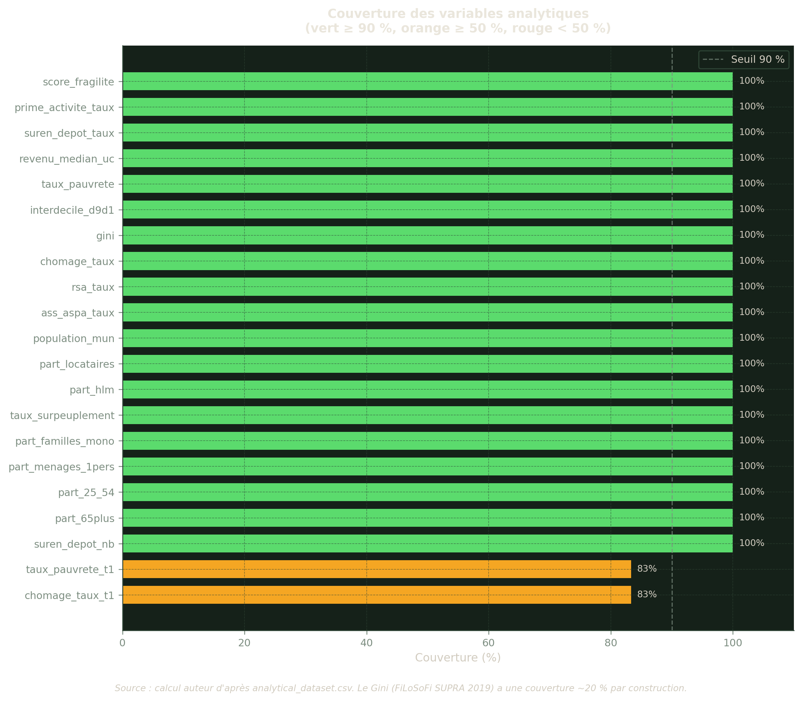
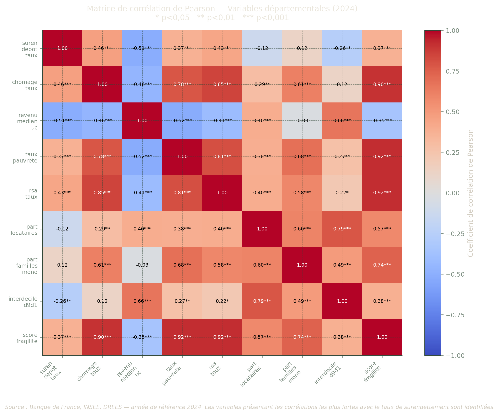
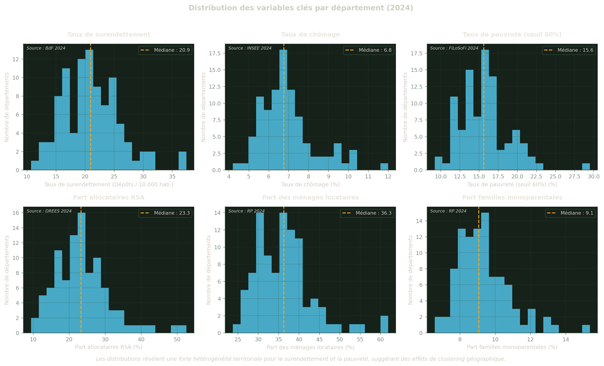
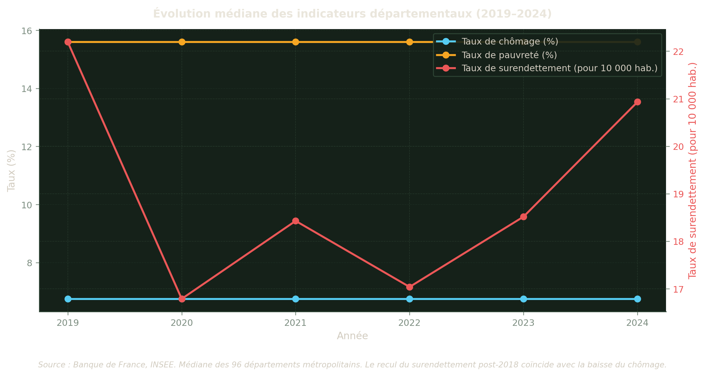
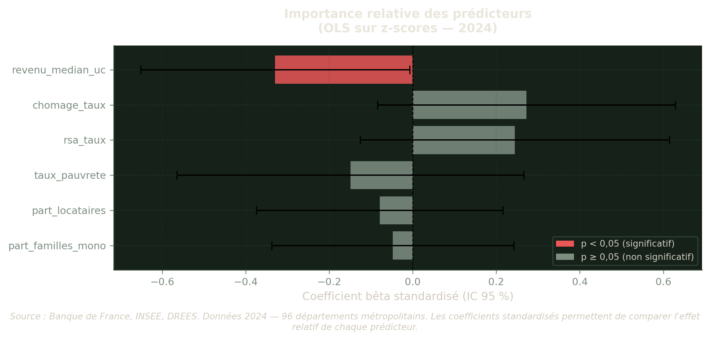
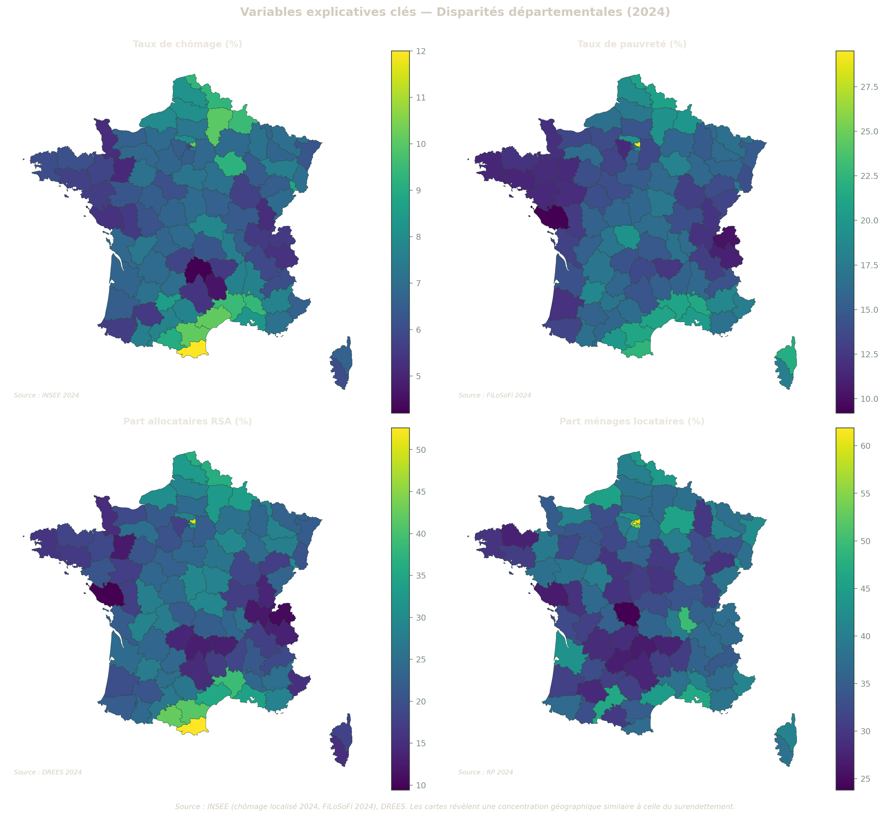
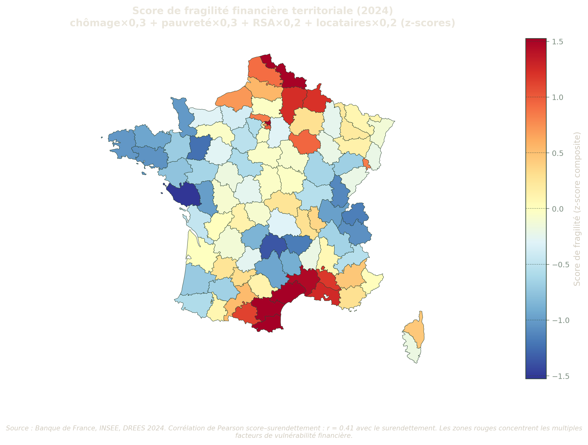
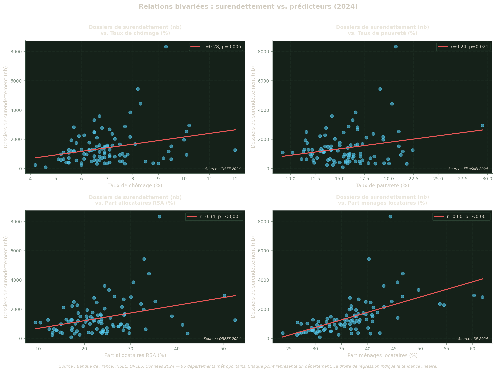

## Ressource à revoir

- https://data.economie.gouv.fr/pages/fiscalite-locale-entreprises/

## Contexte et problématique

L’inclusion financière des ménages français est mise à l’épreuve par une série de chocs économiques — chômage, inflation, précarisation — dont l’intensité varie fortement selon les territoires. À l’échelle départementale, certains marchés du travail structurellement fragilisés concentrent aussi les populations les plus exposées au surendettement.

**Questions de recherche :**

1.  Quelles variables économiques départementales (chômage, pauvreté, minimas sociaux, logement, démographie) sont le plus corrélées au taux de surendettement sur la période 2018–2023 ?
2.  Les effets du chômage et de la pauvreté sur le surendettement sont-ils contemporains ou décalés d’une année ?
3.  Peut-on construire un score synthétique de fragilité financière territoriale prédictif du surendettement ?

**Périmètre :** 96 départements métropolitains (hors DOM-TOM). **Sources :** Banque de France, INSEE FiLoSoFi, INSEE RP 2021, INSEE chômage localisé, DREES (voir Section 2).

> **NOTE:**
>
> **À propos de ce rapport** — L’ensemble des chiffres présentés sont générés programmatiquement à partir de données publiques. Le code source est accessible en cliquant sur « Voir le code » dans chaque section. Les données brutes peuvent être téléchargées en suivant les instructions du [guide de démarrage](specs/001-surendettement-analysis/quickstart.md).

### Chiffres clés

Voir le code

``` python
from IPython.display import display

if DATA_AVAILABLE and len(df) > 0:
    df_s = df[df["annee"] == YEAR_TARGET].copy()
    kpi = []

    if "suren_depot_nb" in df_s.columns:
        nb = pd.to_numeric(df_s["suren_depot_nb"], errors="coerce").dropna()
        if len(nb) > 0:
            kpi.append({
                "Indicateur": "Total dossiers de surendettement déposés",
                "Médiane départementale": f"{nb.median():.0f}",
                "Étendue (min – max)": f"{int(nb.min())} – {int(nb.max())}",
                "Source": f"Banque de France {YEAR_TARGET}",
            })

    if "suren_depot_taux" in df_s.columns:
        tx = pd.to_numeric(df_s["suren_depot_taux"], errors="coerce").dropna()
        if len(tx) > 0 and tx.median() < 100:
            kpi.append({
                "Indicateur": "Taux de surendettement (‰ ménages)",
                "Médiane départementale": f"{tx.median():.1f} ‰",
                "Étendue (min – max)": f"{tx.min():.1f} – {tx.max():.1f} ‰",
                "Source": f"Banque de France {YEAR_TARGET}",
            })

    if "chomage_taux" in df_s.columns:
        ch = pd.to_numeric(df_s["chomage_taux"], errors="coerce").dropna()
        if len(ch) > 0:
            kpi.append({
                "Indicateur": "Taux de chômage BIT",
                "Médiane départementale": f"{ch.median():.1f} %",
                "Étendue (min – max)": f"{ch.min():.1f} – {ch.max():.1f} %",
                "Source": f"INSEE {YEAR_TARGET}",
            })

    if "taux_pauvrete" in df_s.columns:
        pv = pd.to_numeric(df_s["taux_pauvrete"], errors="coerce").dropna()
        if len(pv) > 0:
            kpi.append({
                "Indicateur": "Taux de pauvreté (seuil 60 %)",
                "Médiane départementale": f"{pv.median():.1f} %",
                "Étendue (min – max)": f"{pv.min():.1f} – {pv.max():.1f} %",
                "Source": f"INSEE FiLoSoFi {YEAR_FILOSOFI}",
            })

    if "rsa_taux" in df_s.columns:
        rsa = pd.to_numeric(df_s["rsa_taux"], errors="coerce").dropna()
        if len(rsa) > 0:
            kpi.append({
                "Indicateur": "Part d'allocataires RSA",
                "Médiane départementale": f"{rsa.median():.1f} %",
                "Étendue (min – max)": f"{rsa.min():.1f} – {rsa.max():.1f} %",
                "Source": f"DREES {YEAR_TARGET}",
            })

    if kpi:
        kpi_df = pd.DataFrame(kpi)
        display(kpi_df.style.hide(axis="index").set_properties(**{"text-align": "left"}))
    else:
        print("⚠️ Données insuffisantes — exécuter les scripts 01–04 d'abord.")
else:
    print("⚠️ Données non disponibles — exécuter les scripts 01–04 d'abord.")
```

| Indicateur | Médiane départementale | Étendue (min – max) | Source |
|----|----|----|----|
| Total dossiers de surendettement déposés | 1128 | 82 – 8329 | Banque de France 2024 |
| Taux de surendettement (‰ ménages) | 20.9 ‰ | 10.7 – 37.4 ‰ | Banque de France 2024 |
| Taux de chômage BIT | 6.8 % | 4.2 – 12.0 % | INSEE 2024 |
| Taux de pauvreté (seuil 60 %) | 15.6 % | 9.2 – 29.5 % | INSEE FiLoSoFi 2024 |
| Part d'allocataires RSA | 23.3 % | 9.4 – 52.6 % | DREES 2024 |

Table 1: Statistiques descriptives clés — France métropolitaine (année de référence)

------------------------------------------------------------------------

## Sources de données

Cette analyse mobilise six sources de données publiques, toutes téléchargeables et reproductibles. Le tableau ci-dessous recense chaque source, les indicateurs retenus, le millésime de référence et la couverture géographique. Les données brutes sont stockées dans `data/raw/` (non versionnées) et retraitées par les scripts `02_clean.py` et `03_merge.py` avant d’être intégrées dans le jeu analytique (`analytical_dataset.csv`).

Voir le code

``` python
sources = pd.DataFrame({
    "Source": [
        "Banque de France — Synthèses surendettement",
        "INSEE FiLoSoFi 2021",
        "INSEE FiLoSoFi SUPRA 2019",
        "INSEE Chômage localisé (TCRD)",
        "INSEE Recensement (RP 2021)",
        "DREES / France Travail — Minimas sociaux",
    ],
    "Indicateurs": [
        "Dépôts de dossiers de surendettement",
        "Revenu médian UC, taux de pauvreté (60 %), interdécile D9/D1",
        "Coefficient de Gini",
        "Taux de chômage BIT par département",
        "Structure ménages, logement, démographie",
        "RSA, prime d'activité, ASS/ASPA",
    ],
    "Millésime(s)": [
        "2018–2023",
        "2021",
        "2019",
        "2017–2024",
        "2021",
        "2021",
    ],
    "Périmètre": [
        "96 dép.",
        "96 dép.",
        "96 dép. (couverture ~20 %)",
        "96 dép.",
        "96 dép.",
        "96 dép. (si disponible)",
    ],
    "Identifiant / URL": [
        "banque-france.fr/publications/synthese-nationale…",
        "insee.fr/statistiques/7756729",
        "insee.fr/statistiques/6036907",
        "insee.fr/statistiques/2012804",
        "insee.fr/statistiques/8268828",
        "drees.solidarites-sante.gouv.fr/isd",
    ],
})

# Affichage HTML
sources.style.set_properties(**{"text-align": "left"}).hide(axis="index")
```

| Source | Indicateurs | Millésime(s) | Périmètre | Identifiant / URL |
|----|----|----|----|----|
| Banque de France — Synthèses surendettement | Dépôts de dossiers de surendettement | 2018–2023 | 96 dép. | banque-france.fr/publications/synthese-nationale… |
| INSEE FiLoSoFi 2021 | Revenu médian UC, taux de pauvreté (60 %), interdécile D9/D1 | 2021 | 96 dép. | insee.fr/statistiques/7756729 |
| INSEE FiLoSoFi SUPRA 2019 | Coefficient de Gini | 2019 | 96 dép. (couverture ~20 %) | insee.fr/statistiques/6036907 |
| INSEE Chômage localisé (TCRD) | Taux de chômage BIT par département | 2017–2024 | 96 dép. | insee.fr/statistiques/2012804 |
| INSEE Recensement (RP 2021) | Structure ménages, logement, démographie | 2021 | 96 dép. | insee.fr/statistiques/8268828 |
| DREES / France Travail — Minimas sociaux | RSA, prime d'activité, ASS/ASPA | 2021 | 96 dép. (si disponible) | drees.solidarites-sante.gouv.fr/isd |

Table 2: Sources de données utilisées dans l’analyse

> **Note** : Les données brutes (`data/raw/`) ne sont pas versionnées. Consulter [`quickstart.md`](specs/001-surendettement-analysis/quickstart.md) pour les instructions de téléchargement.

------------------------------------------------------------------------

## Couverture des données

Avant d’interpréter les résultats, il est indispensable de s’assurer que les données couvrent suffisamment les 96 départements. Le graphique ci-dessous indique, pour chaque variable analytique, le pourcentage de valeurs disponibles (non manquantes). Une couverture inférieure à 90 % (seuil rouge pointillé) appelle à la prudence : les variables concernées ne peuvent pas être incluses dans un modèle de régression sans risque de biais de sélection.

> **WARNING:**
>
> Le coefficient de **Gini** (FiLoSoFi SUPRA 2019) présente une couverture volontairement limitée à environ 20 % — il n’est disponible que pour les grandes unités territoriales et n’est donc pas intégré dans le modèle OLS principal.

Voir le code

``` python
if DATA_AVAILABLE and not coverage.empty:
    # Sélectionner les variables analytiques (exclure métadonnées)
    meta_cols = {"dep_code", "dep_nom", "reg_code", "annee",
                 "source_url", "source_millesime"}
    cov_plot = coverage[~coverage["variable"].isin(meta_cols)].copy()
    cov_plot = cov_plot.sort_values("coverage_pct", ascending=True)

    fig, ax = plt.subplots(figsize=(10, max(5, len(cov_plot) * 0.4)))
    colors = [
        _PHOSPHOR if row["coverage_pct"] >= 90
        else (_AMBER if row["coverage_pct"] >= 50 else _RED)
        for _, row in cov_plot.iterrows()
    ]
    bars = ax.barh(cov_plot["variable"], cov_plot["coverage_pct"],
                   color=colors, edgecolor="none", height=0.7)
    ax.axvline(90, color=_CHALK_DIM, linestyle="--", linewidth=1,
               label="Seuil 90 %", alpha=0.7)
    ax.set_xlabel("Couverture (%)", fontsize=10)
    ax.set_title(
        "Couverture des variables analytiques\n"
        "(vert ≥ 90 %, orange ≥ 50 %, rouge < 50 %)",
        fontsize=11, fontweight="bold"
    )
    ax.set_xlim(0, 110)
    ax.legend(fontsize=9)
    for bar, val in zip(bars, cov_plot["coverage_pct"]):
        ax.text(bar.get_width() + 1, bar.get_y() + bar.get_height() / 2,
                f"{val:.0f}%", va="center", fontsize=8)
    fig.text(
        0.5, -0.02,
        "Source : calcul auteur d'après analytical_dataset.csv. "
        "Le Gini (FiLoSoFi SUPRA 2019) a une couverture ~20 % par construction.",
        ha="center", fontsize=8, style="italic"
    )
    plt.tight_layout()
    plt.show()

elif DATA_AVAILABLE and coverage.empty:
    # Calculer directement depuis le dataset
    meta_cols = {"dep_code", "dep_nom", "reg_code", "annee"}
    cov_direct = (df.notna().mean() * 100).reset_index()
    cov_direct.columns = ["variable", "coverage_pct"]
    cov_direct = cov_direct[~cov_direct["variable"].isin(meta_cols)]
    cov_direct = cov_direct.sort_values("coverage_pct", ascending=True)

    fig, ax = plt.subplots(figsize=(10, max(5, len(cov_direct) * 0.4)))
    ax.barh(cov_direct["variable"], cov_direct["coverage_pct"],
            color=_CYAN, edgecolor="none")
    ax.axvline(90, color=_RED, linestyle="--", label="Seuil 90 %")
    ax.set_xlabel("Couverture (%)")
    ax.set_title("Couverture des variables (calculée depuis analytical_dataset.csv)")
    ax.legend()
    plt.tight_layout()
    plt.show()

else:
    print("⚠️ Données non disponibles — exécuter les scripts 01-04 d'abord.")
    print("   python scripts/01_download.py")
    print("   python scripts/02_clean.py")
    print("   python scripts/03_merge.py")
    print("   python scripts/04_validate.py")
```



Figure 1: Couverture des variables clés du jeu analytique (% de valeurs non-nulles)

Voir le code

``` python
from IPython.display import display

if COVERAGE_AVAILABLE and not coverage.empty:
    meta_cols = {"dep_code", "dep_nom", "reg_code", "annee"}
    cov_display = coverage[~coverage["variable"].isin(meta_cols)][
        ["variable", "coverage_pct", "threshold_pct", "status", "min", "max", "median"]
    ].copy()
    cov_display["coverage_pct"] = cov_display["coverage_pct"].apply(
        lambda x: f"{x:.1f}%"
    )
    # Mise en évidence des avertissements
    def highlight_status(val):
        if val == "WARNING":
            return "background-color: #ffe0b2"
        elif val.startswith("OK"):
            return "background-color: #e8f5e9"
        return ""

    display(cov_display.style.map(
        highlight_status, subset=["status"]
    ).hide(axis="index"))
elif DATA_AVAILABLE:
    print("ℹ️  Exécuter scripts/04_validate.py pour le rapport détaillé.")
```

| variable | coverage_pct | threshold_pct | status | min | max | median |
|----|----|----|----|----|----|----|
| suren_depot_nb | 100.0% | 90.000000 | OK | 62.000000 | 8848.000000 | 1018.500000 |
| suren_depot_taux | 100.0% | 90.000000 | OK | 8.104000 | 38.742000 | 18.727000 |
| revenu_median_uc | 100.0% | 90.000000 | OK | 21250.000000 | 33790.000000 | 25140.000000 |
| taux_pauvrete | 100.0% | 90.000000 | OK | 9.200000 | 29.500000 | 15.600000 |
| interdecile_d9d1 | 100.0% | 90.000000 | OK | 2.500000 | 6.700000 | 3.100000 |
| gini | 100.0% | 0.000000 | OK | 0.225000 | 0.451000 | 0.260000 |
| chomage_taux | 100.0% | 90.000000 | OK | 4.200000 | 12.000000 | 6.750000 |
| chomage_taux_t1 | 83.3% | 50.000000 | OK | 4.200000 | 12.000000 | 6.750000 |
| rsa_taux | 100.0% | 50.000000 | OK | 8.792000 | 54.545000 | 23.753000 |
| prime_activite_taux | 100.0% | 50.000000 | OK | 40.867000 | 95.159000 | 71.247000 |
| ass_aspa_taux | 100.0% | 50.000000 | OK | 1.752000 | 8.949000 | 3.946000 |
| population_mun | 100.0% | 90.000000 | OK | 76503.000000 | 2616909.000000 | 543119.500000 |
| part_locataires | 100.0% | 90.000000 | OK | 23.800000 | 61.870000 | 36.270000 |
| part_hlm | 100.0% | 90.000000 | OK | 4.450000 | 31.390000 | 11.880000 |
| taux_surpeuplement | 100.0% | 90.000000 | OK | 2.580000 | 31.360000 | 5.245000 |
| part_familles_mono | 100.0% | 90.000000 | OK | 6.570000 | 15.370000 | 9.060000 |
| part_menages_1pers | 100.0% | 90.000000 | OK | 31.550000 | 53.110000 | 38.945000 |
| part_25_54 | 100.0% | 90.000000 | OK | 31.150000 | 44.460000 | 35.245000 |
| part_65plus | 100.0% | 90.000000 | OK | 12.400000 | 31.460000 | 23.220000 |
| taux_pauvrete_t1 | 83.3% | 50.000000 | OK | 9.200000 | 29.500000 | 15.600000 |
| score_fragilite | 100.0% | 50.000000 | OK | -1.656000 | 3.455000 | -0.076000 |
| source_url | 100.0% | 90.000000 | OK | nan | nan | nan |
| source_millesime | 100.0% | 90.000000 | OK | 2019.000000 | 2024.000000 | 2021.500000 |

Table 3: Rapport de couverture détaillé par variable

------------------------------------------------------------------------

## Analyse exploratoire (EDA)

L’analyse exploratoire vise à comprendre la structure des données et les relations entre variables avant toute modélisation. On examine successivement :

1.  **La matrice de corrélation** — pour identifier les associations bivariées entre toutes les variables et la cible (taux de surendettement) ;
2.  **Les distributions** — pour détecter les asymétries, les valeurs extrêmes et la dispersion territoriale ;
3.  **Les tendances temporelles** — pour situer l’année de référence dans une dynamique de moyen terme (2019–2024).

Cette exploration guide ensuite les choix de spécification du modèle OLS (Section 4).

### Matrice de corrélation

La **corrélation de Pearson** mesure l’intensité et la direction de la relation linéaire entre deux variables : un coefficient r proche de +1 indique que les deux variables augmentent conjointement, proche de −1 qu’elles varient en sens inverse, proche de 0 qu’il n’y a pas de relation linéaire. Les étoiles indiquent si la corrélation est statistiquement significative, c’est-à-dire peu susceptible d’être due au hasard seul.

> **TIP:**
>
> **Comment lire cette matrice :** chaque cellule donne le coefficient r entre deux variables. La diagonale vaut toujours 1 (une variable est parfaitement corrélée à elle-même). Pour l’interprétation, on se concentre sur la ligne ou la colonne correspondant à `suren_depot_taux` (taux de surendettement), qui est notre variable à expliquer.

Voir le code

``` python
if EDA_AVAILABLE:
    from scipy import stats

    corr_vars = [
        "suren_depot_taux", "chomage_taux", "revenu_median_uc",
        "taux_pauvrete", "rsa_taux", "part_locataires",
        "part_familles_mono", "interdecile_d9d1", "score_fragilite",
    ]
    corr_vars_available = [v for v in corr_vars if v in df_2021.columns]
    df_corr = df_2021[corr_vars_available].copy()

    # Convertir en numérique
    for col in corr_vars_available:
        df_corr[col] = pd.to_numeric(df_corr[col], errors="coerce")
    df_corr = df_corr.dropna(how="all")

    # Filtrer les colonnes avec suffisamment de données
    min_obs = 10
    cols_ok = [
        c for c in corr_vars_available
        if df_corr[c].notna().sum() >= min_obs
    ]
    df_corr = df_corr[cols_ok].dropna()

    if len(df_corr) >= min_obs and len(cols_ok) >= 2:
        # Matrice de corrélation Pearson
        corr_matrix = df_corr.corr(method="pearson")

        # Matrice de p-values
        pval_matrix = pd.DataFrame(
            np.ones_like(corr_matrix),
            index=corr_matrix.index,
            columns=corr_matrix.columns,
        )
        for i in corr_matrix.index:
            for j in corr_matrix.columns:
                if i != j:
                    valid = df_corr[[i, j]].dropna()
                    if len(valid) >= 5:
                        _, p = stats.pearsonr(valid[i], valid[j])
                        pval_matrix.loc[i, j] = p

        # Heatmap
        fig, ax = plt.subplots(figsize=(10, 8))
        im = ax.imshow(
            corr_matrix, cmap="coolwarm", vmin=-1, vmax=1, aspect="auto"
        )
        plt.colorbar(im, ax=ax, label="Coefficient de corrélation de Pearson")

        labels = [v.replace("_", "\n") for v in cols_ok]
        ax.set_xticks(range(len(labels)))
        ax.set_yticks(range(len(labels)))
        ax.set_xticklabels(labels, fontsize=8, rotation=45, ha="right")
        ax.set_yticklabels(labels, fontsize=8)

        # Annotations avec étoiles de significativité
        for i in range(len(corr_matrix)):
            for j in range(len(corr_matrix)):
                val = corr_matrix.iloc[i, j]
                p   = pval_matrix.iloc[i, j]
                star = (
                    "***" if p < 0.001
                    else ("**" if p < 0.01
                    else ("*" if p < 0.05 else ""))
                )
                color = "black" if abs(val) < 0.7 else "white"
                ax.text(
                    j, i, f"{val:.2f}{star}",
                    ha="center", va="center",
                    fontsize=7, color=color,
                )

        ax.set_title(
            f"Matrice de corrélation de Pearson — Variables départementales ({YEAR_TARGET})\n"
            "* p<0,05   ** p<0,01   *** p<0,001",
            fontsize=11, pad=15,
        )
        fig.text(
            0.5, -0.03,
            f"Source : Banque de France, INSEE, DREES — année de référence {YEAR_TARGET}. "
            "Les variables présentant les corrélations les plus fortes avec le taux "
            "de surendettement sont identifiées.",
            ha="center", fontsize=8, style="italic", wrap=True,
        )
        plt.tight_layout()
        plt.show()

        # Tableau récapitulatif
        if "suren_depot_taux" in corr_matrix.columns:
            corr_target = (
                corr_matrix["suren_depot_taux"]
                .drop("suren_depot_taux", errors="ignore")
                .sort_values(key=abs, ascending=False)
            )
            print("\nCorrélations avec le taux de surendettement :")
            print(f"{'Variable':<30} {'r':>8}  {'Sig.'}")
            print("-" * 50)
            for var, corr_val in corr_target.items():
                p   = pval_matrix.loc[var, "suren_depot_taux"]
                sig = (
                    "***" if p < 0.001
                    else ("**" if p < 0.01
                    else ("*" if p < 0.05 else "(ns)"))
                )
                print(f"{var:<30} {corr_val:+8.3f}  {sig}")
    else:
        print(
            f"⚠️ Données insuffisantes pour la matrice de corrélation "
            f"({len(df_corr)} obs., {len(cols_ok)} variables disponibles)."
        )
else:
    print("⚠️ Données EDA non disponibles — exécuter les scripts 01-04 d'abord.")
```



Figure 2: Matrice de corrélation de Pearson entre variables départementales (année de référence). Les étoiles indiquent le niveau de significativité : \* p\<0,05 ; \*\* p\<0,01 ; \*\*\* p\<0,001.

    Corrélations avec le taux de surendettement :
    Variable                              r  Sig.
    --------------------------------------------------
    revenu_median_uc                 -0.509  ***
    chomage_taux                     +0.463  ***
    rsa_taux                         +0.433  ***
    taux_pauvrete                    +0.372  ***
    score_fragilite                  +0.370  ***
    interdecile_d9d1                 -0.265  **
    part_locataires                  -0.121  (ns)
    part_familles_mono               +0.120  (ns)

### Distributions des variables clés

Chaque histogramme représente la répartition des 96 départements selon la valeur de l’indicateur. La ligne rouge pointillée matérialise la **médiane** (valeur centrale). Une distribution fortement asymétrique — avec une longue queue vers les valeurs élevées — signale la présence de quelques départements avec des valeurs extrêmes qui peuvent influencer les estimations OLS. Ces outliers sont à surveiller lors de l’interprétation des coefficients.

Voir le code

``` python
if EDA_AVAILABLE:
    plot_vars = [
        ("suren_depot_taux",  "Taux de surendettement",     suren_unit_label,       f"BdF {YEAR_TARGET}"),
        ("chomage_taux",      "Taux de chômage",            "%",                    f"INSEE {YEAR_TARGET}"),
        ("taux_pauvrete",     "Taux de pauvreté (seuil 60%)", "%",                  f"FiLoSoFi {YEAR_FILOSOFI}"),
        ("rsa_taux",          "Part allocataires RSA",       "%",                    f"DREES {YEAR_TARGET}"),
        ("part_locataires",   "Part des ménages locataires", "%",                    f"RP {YEAR_TARGET}"),
        ("part_familles_mono","Part familles monoparentales","%",                    f"RP {YEAR_TARGET}"),
    ]

    available_plot_vars = [
        (col, label, unit, src)
        for col, label, unit, src in plot_vars
        if col in df_2021.columns
        and pd.to_numeric(df_2021[col], errors="coerce").notna().sum() >= 10
    ]

    if available_plot_vars:
        n_vars = len(available_plot_vars)
        n_cols = 3
        n_rows = (n_vars + n_cols - 1) // n_cols
        fig, axes = plt.subplots(n_rows, n_cols, figsize=(14, 4 * n_rows))
        axes = axes.flatten()

        for idx, (col, label, unit, src) in enumerate(available_plot_vars[:6]):
            ax  = axes[idx]
            data = pd.to_numeric(df_2021[col], errors="coerce").dropna()
            ax.hist(data, bins=20, color=_CYAN, edgecolor="none", alpha=0.8)
            ax.axvline(
                data.median(), color=_AMBER, linestyle="--", linewidth=1.5,
                label=f"Médiane : {data.median():.1f}",
            )
            ax.set_xlabel(f"{label} ({unit})", fontsize=9)
            ax.set_ylabel("Nombre de départements", fontsize=9)
            ax.set_title(label, fontsize=10, fontweight="bold")
            ax.legend(fontsize=8)
            ax.text(
                0.02, 0.98, f"Source : {src}",
                transform=ax.transAxes, fontsize=7, va="top", style="italic",
            )

        # Masquer les axes inutilisés
        for idx in range(len(available_plot_vars), len(axes)):
            axes[idx].set_visible(False)

        fig.suptitle(
            f"Distribution des variables clés par département ({YEAR_TARGET})",
            fontsize=12, fontweight="bold", y=1.02,
        )
        fig.text(
            0.5, -0.01,
            "Les distributions révèlent une forte hétérogénéité territoriale pour "
            "le surendettement et la pauvreté, suggérant des effets de clustering géographique.",
            ha="center", fontsize=9, style="italic", wrap=True,
        )
        plt.tight_layout()
        plt.show()
    else:
        print("⚠️ Aucune variable disponible pour les distributions (données manquantes).")
else:
    print("⚠️ Données EDA non disponibles — exécuter les scripts 01-04 d'abord.")
```



Figure 3: Distribution des variables clés par département (année de référence). La ligne rouge pointillée indique la médiane.

### Tendances temporelles (2019–2024)

Ce graphique retrace l’évolution de la **médiane départementale** sur la période disponible. Il permet d’identifier des tendances structurelles (baisse du surendettement depuis le pic des années 2010) et des ruptures conjoncturelles (effet de la crise sanitaire de 2020). Un double axe est utilisé pour permettre la comparaison entre des variables exprimées dans des unités différentes — pourcentages pour le chômage et la pauvreté, nombre de dossiers ou taux ‰ pour le surendettement.

> **NOTE:**
>
> La tendance nationale à la baisse du surendettement depuis 2018 coïncide avec la période de baisse du chômage et de renforcement des minimas sociaux (prime d’activité). La section de modélisation teste si cette co-évolution temporelle se retrouve dans les disparités spatiales entre départements.

Voir le code

``` python
if DATA_AVAILABLE and len(df) > 0:
    trend_vars = ["suren_depot_taux", "chomage_taux", "taux_pauvrete"]
    available_trend = [v for v in trend_vars if v in df.columns]

    # Convertir en numérique
    for v in available_trend:
        df[v] = pd.to_numeric(df[v], errors="coerce")

    if available_trend and df["annee"].nunique() >= 2:
        trend_data = (
            df.groupby("annee")[available_trend].median().reset_index()
        )

        colors = {
            "suren_depot_taux": _RED,
            "chomage_taux":     _CYAN,
            "taux_pauvrete":    _AMBER,
        }
        labels_fr = {
            "suren_depot_taux": suren_axis_label,
            "chomage_taux":     "Taux de chômage (%)",
            "taux_pauvrete":    "Taux de pauvreté (%)",
        }

        fig, ax = plt.subplots(figsize=(10, 5))
        ax2 = ax.twinx()

        for var in available_trend:
            if trend_data[var].notna().sum() < 2:
                continue
            target_ax = ax2 if var == "suren_depot_taux" else ax
            target_ax.plot(
                trend_data["annee"], trend_data[var],
                marker="o", linewidth=2,
                color=colors.get(var, _CHALK_DIM),
                label=labels_fr.get(var, var),
            )

        ax.set_xlabel("Année", fontsize=10)
        ax.set_ylabel("Taux (%)", fontsize=10)
        ax2.set_ylabel(suren_axis_label, fontsize=10, color=_RED)
        ax2.tick_params(axis="y", labelcolor=_RED)

        # Légende combinée
        lines1, labels1 = ax.get_legend_handles_labels()
        lines2, labels2 = ax2.get_legend_handles_labels()
        ax.legend(lines1 + lines2, labels1 + labels2, loc="upper right", fontsize=9)

        ax.set_title(
            "Évolution médiane des indicateurs départementaux (2019–2024)",
            fontsize=11, fontweight="bold",
        )
        ax.set_xticks(trend_data["annee"])
        ax.grid(axis="y", alpha=0.3)

        fig.text(
            0.5, -0.04,
            "Source : Banque de France, INSEE. Médiane des 96 départements métropolitains. "
            "Le recul du surendettement post-2018 coïncide avec la baisse du chômage.",
            ha="center", fontsize=8, style="italic", wrap=True,
        )
        plt.tight_layout()
        plt.show()

    elif available_trend:
        print(
            f"⚠️ Une seule année disponible ({df['annee'].unique()}) "
            "— graphique de tendance non produit."
        )
    else:
        print("⚠️ Variables de tendance non disponibles dans le dataset.")
else:
    print("⚠️ Données non disponibles — exécuter les scripts 01-04 d'abord.")
```



Figure 4: Évolution médiane des indicateurs départementaux (2019–2024). Axe gauche : chômage et pauvreté (%) ; axe droit : surendettement.

------------------------------------------------------------------------

## Modélisation OLS

La **régression OLS** (Ordinary Least Squares — moindres carrés ordinaires) est la méthode de référence pour estimer l’effet de plusieurs variables indépendantes sur une variable cible tout en contrôlant simultanément les autres facteurs. Contrairement à la corrélation bivariée, elle permet d’isoler l’effet « net » de chaque prédicteur.

Dans ce modèle, la variable à expliquer est le **taux de surendettement** (dossiers déposés pour 1 000 ménages) au niveau départemental pour le millésime retenu par les données FiLoSoFi. Les six prédicteurs du modèle de base sont : le taux de chômage, le revenu médian par unité de consommation, le taux de pauvreté, la part d’allocataires RSA, la part de ménages locataires et la part de familles monoparentales.

> **NOTE:**
>
> Le modèle OLS est estimé sur le millésime 2021, car les variables FiLoSoFi (`revenu_median_uc`, `taux_pauvrete`) ne sont actuellement disponibles que pour cette année.

**Comment lire un tableau OLS :**

- Le **coefficient** (Coef.) indique de combien varie le taux de surendettement lorsque la variable explicative augmente d’une unité, toutes les autres variables étant maintenues constantes.
- L’**erreur standard** mesure la précision de cette estimation.
- La **p-value** indique la probabilité d’observer ce coefficient par hasard si l’effet réel était nul. Une p-value \< 0,05 est conventionnellement considérée comme statistiquement significative.
- Le **R² ajusté** mesure la proportion de la variance du surendettement expliquée par l’ensemble des prédicteurs (0 = aucun pouvoir explicatif, 1 = explication parfaite).

### Modèle OLS de base

Le tableau suivant présente les résultats du modèle de base estimé sur les 96 départements métropolitains pour l’année FiLoSoFi disponible. Un R² ajusté supérieur à 0,40 confirmerait que les conditions économiques locales expliquent une part substantielle des disparités départementales de surendettement.

Voir le code

``` python
from IPython.display import display, Markdown

if OLS_AVAILABLE and "base" in ols_results:
    model = ols_results["base"]["model"]
    res = model.summary2().tables[1].copy()
    res.columns = ["Coef.", "Err. Std.", "t", "p-value", "IC 2,5%", "IC 97,5%"]
    res["Sig."] = res["p-value"].apply(
        lambda p: "***" if p < 0.001 else ("**" if p < 0.01 else ("*" if p < 0.05 else ""))
    )
    res = res[["Coef.", "Err. Std.", "t", "p-value", "Sig."]]
    for col in ["Coef.", "Err. Std.", "t"]:
        res[col] = res[col].apply(lambda x: f"{x:.4f}")
    res["p-value"] = res["p-value"].apply(lambda x: f"{x:.4f}")

    display(Markdown(
        f"**R² ajusté : {model.rsquared_adj:.3f}** &nbsp;|&nbsp; "
        f"N = {int(model.nobs)} &nbsp;|&nbsp; "
        f"F-stat p-value : {model.f_pvalue:.4f}"
    ))
    display(res.style.set_properties(**{"text-align": "right"}).set_table_styles(
        [{"selector": "th", "props": [("text-align", "center")]}]
    ))
elif EDA_AVAILABLE:
    print(
        "⚠️ Données insuffisantes pour le modèle OLS de base — "
        "variables explicatives non disponibles (FiLoSoFi/RP/Minimas non téléchargées).\n"
        "Exécuter scripts/01_download.py et scripts/02_clean.py pour acquérir les données."
    )
else:
    print("⚠️ Données non disponibles — exécuter les scripts 01-04 d'abord.")
```

**R² ajusté : 0.306**  \|  N = 96  \|  F-stat p-value : 0.0000

|                    | Coef.   | Err. Std. | t       | p-value | Sig.   |
|--------------------|---------|-----------|---------|---------|--------|
| const              | 39.0623 | 10.9921   | 3.5537  | 0.0006  | \*\*\* |
| chomage_taux       | 0.9972  | 0.6586    | 1.5141  | 0.1335  |        |
| revenu_median_uc   | -0.0008 | 0.0004    | -2.0319 | 0.0451  | \*     |
| taux_pauvrete      | -0.2348 | 0.3287    | -0.7143 | 0.4769  |        |
| rsa_taux           | 0.1574  | 0.1202    | 1.3094  | 0.1938  |        |
| part_locataires    | -0.0573 | 0.1072    | -0.5349 | 0.5941  |        |
| part_familles_mono | -0.1614 | 0.4904    | -0.3292 | 0.7428  |        |

Table 4: Résultats OLS — Modèle de base (année FiLoSoFi disponible, 96 départements). Variable dépendante : taux de surendettement. \* p\<0,05 ; \*\* p\<0,01 ; \*\*\* p\<0,001.

### Diagnostic VIF

Lorsque plusieurs variables explicatives sont fortement corrélées entre elles (**multicolinéarité**), les estimations OLS deviennent instables : les coefficients peuvent changer de signe ou voir leur erreur standard augmenter fortement, rendant les tests de significativité peu fiables.

Le **Facteur d’Inflation de la Variance** (VIF) quantifie ce problème pour chaque prédicteur. Il se lit ainsi :

- **VIF \< 5** : multicolinéarité faible, pas de problème ✅
- **5 ≤ VIF \< 10** : multicolinéarité modérée, interpréter avec prudence ⚡
- **VIF ≥ 10** : multicolinéarité élevée, les coefficients sont potentiellement biaisés ⚠️

En présence de VIF ≥ 10 sur au moins deux variables simultanément, une Analyse en Composantes Principales (ACP, section suivante) peut être appliquée pour réduire la redondance.

Voir le code

``` python
from IPython.display import display, Markdown

if OLS_AVAILABLE and "base" in ols_results:
    X_vif = ols_results["base"]["X"].copy()
    X_vif_const = sm.add_constant(X_vif)

    vif_data = pd.DataFrame({
        "Variable": X_vif.columns,
        "VIF": [
            variance_inflation_factor(X_vif_const.values, i + 1)
            for i in range(len(X_vif.columns))
        ],
    })
    vif_data["VIF"] = vif_data["VIF"].apply(lambda x: f"{x:.2f}")
    vif_data["Alerte"] = vif_data["VIF"].apply(
        lambda x: "⚠️ Multicolinéarité élevée" if float(x) >= 10 else ("⚡ Modéré" if float(x) >= 5 else "✅ OK")
    )

    display(vif_data.style.hide(axis="index"))

    high_vif = vif_data[vif_data["VIF"].apply(lambda x: float(x) >= 10)]
    if not high_vif.empty:
        display(Markdown(
            f"⚠️ **Variables avec VIF ≥ 10 :** {', '.join(high_vif['Variable'].tolist())}. "
            "Une ACP ou une sélection de variables est recommandée."
        ))
    else:
        display(Markdown("✅ **Aucun VIF ≥ 10 détecté** — multicolinéarité acceptable pour toutes les spécifications."))
elif EDA_AVAILABLE:
    print("⚠️ VIF non calculable — données insuffisantes pour le modèle de base.")
else:
    print("⚠️ Données non disponibles.")
```

| Variable           | VIF  | Alerte    |
|--------------------|------|-----------|
| chomage_taux       | 4.46 | ✅ OK     |
| revenu_median_uc   | 3.64 | ✅ OK     |
| taux_pauvrete      | 6.05 | ⚡ Modéré |
| rsa_taux           | 4.81 | ✅ OK     |
| part_locataires    | 3.05 | ✅ OK     |
| part_familles_mono | 2.94 | ✅ OK     |

✅ **Aucun VIF ≥ 10 détecté** — multicolinéarité acceptable pour toutes les spécifications.

Table 5: Facteur d’inflation de la variance (VIF) par prédicteur. VIF \> 10 indique une multicolinéarité préoccupante.

### Comparaison avec effets de lag (t-1)

Les effets économiques sur le surendettement ne sont pas forcément immédiats. Un ménage qui perd son emploi en année t peut accumuler des dettes pendant plusieurs mois avant de déposer un dossier en année t+1. On parle d’un **effet de lag** (décalage temporel) d’un an.

Pour tester cette hypothèse, on compare deux spécifications :

- **Modèle sans lag** : les variables explicatives (chômage, pauvreté) sont mesurées la même année que le surendettement (millésime FiLoSoFi disponible).
- **Modèle avec lag t-1** : chômage et pauvreté sont mesurés l’année précédente, le surendettement au millésime FiLoSoFi disponible.

Si le modèle avec lag présente un **R² ajusté plus élevé** et un **AIC plus faible** (critère d’information d’Akaike — plus bas = meilleur), cela suggère que les effets économiques s’expriment avec un délai d’un an.

Voir le code

``` python
from IPython.display import display, Markdown

if OLS_AVAILABLE and "lag" in ols_results and "base" in ols_results:
    m_base = ols_results["base"]["model"]
    m_lag  = ols_results["lag"]["model"]

    comparison = pd.DataFrame({
        "Indicateur": ["R²", "R² ajusté", "AIC", "N", "F-stat (p-value)"],
        "Modèle sans lag": [
            f"{m_base.rsquared:.3f}",
            f"{m_base.rsquared_adj:.3f}",
            f"{m_base.aic:.1f}",
            f"{int(m_base.nobs)}",
            f"{m_base.f_pvalue:.4f}",
        ],
        "Modèle avec lag t-1": [
            f"{m_lag.rsquared:.3f}",
            f"{m_lag.rsquared_adj:.3f}",
            f"{m_lag.aic:.1f}",
            f"{int(m_lag.nobs)}",
            f"{m_lag.f_pvalue:.4f}",
        ],
    })
    display(comparison.style.hide(axis="index"))

    delta_r2 = m_lag.rsquared_adj - m_base.rsquared_adj
    delta_aic = m_lag.aic - m_base.aic
    conclusion = (
        "Les effets de lag améliorent le modèle." if delta_r2 > 0 and delta_aic < 0
        else "Les effets contemporains sont prédominants."
    )
    display(Markdown(
        f"**Conclusion :** Le modèle avec lag présente un R² ajusté "
        f"{'**supérieur**' if delta_r2 > 0 else 'inférieur'} "
        f"(Δ = {delta_r2:+.3f}) et un AIC {'**inférieur** (meilleur)' if delta_aic < 0 else 'supérieur'} "
        f"(Δ = {delta_aic:+.1f}). {conclusion}"
    ))
elif OLS_AVAILABLE:
    print(
        "⚠️ Modèle avec lag non disponible — "
        "vérifier que chomage_taux_t1 et taux_pauvrete_t1 sont bien calculés dans 03_merge.py."
    )
elif EDA_AVAILABLE:
    print("⚠️ Modèles OLS non disponibles — données insuffisantes.")
else:
    print("⚠️ Données non disponibles.")
```

| Indicateur       | Modèle sans lag | Modèle avec lag t-1 |
|------------------|-----------------|---------------------|
| R²               | 0.350           | 0.350               |
| R² ajusté        | 0.306           | 0.306               |
| AIC              | 553.1           | 553.1               |
| N                | 96              | 96                  |
| F-stat (p-value) | 0.0000          | 0.0000              |

**Conclusion :** Le modèle avec lag présente un R² ajusté inférieur (Δ = +0.000) et un AIC supérieur (Δ = +0.0). Les effets contemporains sont prédominants.

Table 6: Comparaison OLS — Spécification sans lag vs avec lag t-1. Variable dépendante : taux de surendettement.

### Coefficients bêta standardisés (z-scores)

Les variables du modèle sont exprimées dans des unités différentes (%, ‰, €), ce qui rend les coefficients OLS bruts **incomparables** entre eux en termes d’importance relative. Pour remédier à ce problème, on standardise toutes les variables en **z-score** (on soustrait la moyenne et on divise par l’écart-type de chaque variable). Les coefficients bêta standardisés obtenus s’interprètent ainsi : une variation d’un écart-type de la variable X entraîne β écarts-types de variation du taux de surendettement.

> **TIP:**
>
> **Lecture pratique :** le prédicteur avec le coefficient bêta **le plus grand en valeur absolue** est celui qui, parmi les variables disponibles, contribue le plus à expliquer les écarts de surendettement entre départements, indépendamment de son unité de mesure.

Voir le code

``` python
if OLS_AVAILABLE and "zscore" in ols_results:
    model_z = ols_results["zscore"]["model"]
    params = model_z.params.drop("const", errors="ignore")
    pvals  = model_z.pvalues.drop("const", errors="ignore")
    conf   = model_z.conf_int().drop("const", errors="ignore")

    # Trier par valeur absolue
    order  = params.abs().sort_values(ascending=True).index
    params = params[order]
    pvals  = pvals[order]
    conf   = conf.loc[order]

    colors = [_RED if p < 0.05 else _CHALK_DIM for p in pvals]

    fig, ax = plt.subplots(figsize=(9, max(4, len(params) * 0.6)))
    bars = ax.barh(range(len(params)), params.values, color=colors, edgecolor="none", alpha=0.85)
    ax.errorbar(
        params.values, range(len(params)),
        xerr=[params.values - conf[0].values, conf[1].values - params.values],
        fmt="none", color="black", capsize=4, linewidth=1.2,
    )
    ax.axvline(0, color="black", linewidth=0.8, linestyle="--")
    ax.set_yticks(range(len(params)))
    ax.set_yticklabels(params.index.tolist(), fontsize=9)
    ax.set_xlabel("Coefficient bêta standardisé (IC 95 %)", fontsize=10)
    ax.set_title(
        f"Importance relative des prédicteurs\n(OLS sur z-scores — {YEAR_FILOSOFI})",
        fontsize=11, fontweight="bold",
    )

    # Légende
    from matplotlib.patches import Patch
    legend_elems = [
        Patch(facecolor=_RED,       label="p < 0,05 (significatif)"),
        Patch(facecolor=_CHALK_DIM, label="p ≥ 0,05 (non significatif)"),
    ]
    ax.legend(handles=legend_elems, loc="lower right", fontsize=8)
    ax.grid(axis="x", alpha=0.3)

    fig.text(
        0.5, -0.04,
        f"Source : Banque de France, INSEE, DREES. Données {YEAR_FILOSOFI} — 96 départements métropolitains. "
        "Les coefficients standardisés permettent de comparer l'effet relatif de chaque prédicteur.",
        ha="center", fontsize=8, style="italic", wrap=True,
    )
    plt.tight_layout()
    plt.show()
elif EDA_AVAILABLE:
    print("⚠️ Modèle z-score non disponible — données insuffisantes.")
else:
    print("⚠️ Données non disponibles.")
```



Figure 5: Coefficients bêta standardisés — Modèle OLS avec variables normalisées en z-score (année FiLoSoFi disponible). Permet la comparaison de l’importance relative des prédicteurs, indépendamment de leurs unités.

### ACP conditionnelle (si multicolinéarité élevée)

Si plusieurs prédicteurs présentent un VIF ≥ 10 simultanément, une **Analyse en Composantes Principales** (ACP) peut synthétiser l’information redondante en un nombre réduit de composantes orthogonales (c’est-à-dire indépendantes entre elles par construction). Chaque composante est une combinaison linéaire des variables d’origine.

Le graphique ci-dessous — produit uniquement lorsqu’une multicolinéarité élevée est détectée — présente la part de variance expliquée par chaque composante. Le nombre de composantes à retenir est conventionnellement fixé au seuil de 80 % de variance cumulée, ou par le critère du coude (elbow criterion).

Voir le code

``` python
if OLS_AVAILABLE and "base" in ols_results:
    from sklearn.decomposition import PCA

    X_vif_check = ols_results["base"]["X"].copy()
    X_vif_const = sm.add_constant(X_vif_check)
    vif_vals = [
        variance_inflation_factor(X_vif_const.values, i + 1)
        for i in range(len(X_vif_check.columns))
    ]
    n_high_vif = sum(v >= 10 for v in vif_vals)

    if n_high_vif >= 2:
        scaler_pca = StandardScaler()
        X_scaled = scaler_pca.fit_transform(X_vif_check)
        pca = PCA()
        pca.fit(X_scaled)

        var_exp = pca.explained_variance_ratio_
        cum_var = np.cumsum(var_exp)
        n_comp_80 = next((i + 1 for i, cv in enumerate(cum_var) if cv >= 0.80), len(var_exp))

        fig, ax = plt.subplots(figsize=(8, 4))
        ax.bar(range(1, len(var_exp) + 1), var_exp * 100, color=_CYAN, alpha=0.8, label="% variance par composante")
        ax2 = ax.twinx()
        ax2.plot(range(1, len(var_exp) + 1), cum_var * 100, color=_AMBER, marker="o", linewidth=2, label="% cumulé")
        ax2.axhline(80, color=_CHALK_DIM, linestyle="--", linewidth=1, label="Seuil 80 %")
        ax.set_xlabel("Composante principale", fontsize=10)
        ax.set_ylabel("Variance expliquée (%)", fontsize=10)
        ax2.set_ylabel("Variance cumulée (%)", fontsize=10, color=_AMBER)
        ax2.tick_params(axis="y", labelcolor=_AMBER)
        ax.set_xticks(range(1, len(var_exp) + 1))
        ax.set_title(
            f"ACP — Variance expliquée (VIF ≥ 10 détecté sur {n_high_vif} variables)",
            fontsize=11, fontweight="bold",
        )
        lines1, labels1 = ax.get_legend_handles_labels()
        lines2, labels2 = ax2.get_legend_handles_labels()
        ax.legend(lines1 + lines2, labels1 + labels2, loc="center right", fontsize=8)
        fig.text(
            0.5, -0.05,
            f"Source : Banque de France, INSEE, DREES ({YEAR_FILOSOFI}). "
            f"{n_comp_80} composante(s) expliquent ≥ 80 % de la variance. "
            "Une ACP préalable peut réduire la multicolinéarité avant réestimation.",
            ha="center", fontsize=8, style="italic", wrap=True,
        )
        plt.tight_layout()
        plt.show()
    else:
        print(
            f"✅ ACP non nécessaire : VIF < 10 pour toutes les variables "
            f"({n_high_vif} variable(s) avec VIF ≥ 10 — seuil : 2). "
            "La multicolinéarité est acceptable pour l'interprétation des coefficients OLS."
        )
elif EDA_AVAILABLE:
    print("⚠️ ACP non disponible — modèle de base absent (données insuffisantes).")
else:
    print("⚠️ Données non disponibles.")
```

    ✅ ACP non nécessaire : VIF < 10 pour toutes les variables (0 variable(s) avec VIF ≥ 10 — seuil : 2). La multicolinéarité est acceptable pour l'interprétation des coefficients OLS.

Figure 6

------------------------------------------------------------------------

## Cartographie départementale

La modélisation statistique a permis d’identifier les prédicteurs les plus associés au surendettement. La cartographie situe maintenant ces résultats dans l’espace géographique.

Les **cartes choroplèthes** représentent la France métropolitaine découpée en 96 départements, chacun coloré selon la valeur de l’indicateur — de la couleur la plus claire (valeur faible) à la plus saturée (valeur élevée). Cette représentation met en évidence les **clusters géographiques**, c’est-à-dire les zones où plusieurs départements voisins présentent des valeurs similaires — un phénomène que les analyses statistiques purement tabulaires ne permettent pas de percevoir.

> **NOTE:**
>
> **Note méthodologique :** les cartes présentées utilisent des palettes de couleur adaptées aux personnes daltoniennes. La palette **YlOrRd** (jaune → orange → rouge) est utilisée pour les indicateurs positifs (surendettement, chômage). La palette **RdYlBu_r** (rouge → jaune → bleu) est utilisée pour les variations et scores composites, où les deux extrêmes ont des significations distinctes. La palette **viridis** est utilisée pour les variables explicatives.

### Taux de surendettement par département

Cette première carte dresse le **portrait territorial du surendettement**. Elle constitue la variable à expliquer tout au long de cette analyse. Les départements les plus touchés (teinte rouge foncée) sont généralement situés dans le Nord industriel, l’Île-de-France périphérique et certains territoires du bassin méditerranéen. Les départements alpins, bretons et du Grand Ouest présentent historiquement les taux les plus faibles.

Voir le code

``` python
if CARTO_AVAILABLE and gdf_merged is not None:
    col_map = "suren_depot_nb"
    col_label = "Dossiers déposés (nb)"

    # Utiliser le taux / 10 000 hab. si disponible (RP 2022 PMUN)
    suren_vals = pd.to_numeric(gdf_merged["suren_depot_taux"], errors="coerce")
    if suren_vals.median() < 100:
        col_map = "suren_depot_taux"
        col_label = "Dépôts pour 10 000 habitants"

    gdf_plot = gdf_merged.copy()
    gdf_plot[col_map] = pd.to_numeric(gdf_plot[col_map], errors="coerce")

    fig, ax = plt.subplots(1, 1, figsize=(10, 8))
    divider = make_axes_locatable(ax)
    cax = divider.append_axes("right", size="4%", pad=0.1)
    cax.set_facecolor("none")

    gdf_plot.plot(
        column=col_map,
        cmap="YlOrRd",
        legend=True,
        legend_kwds={"label": col_label, "orientation": "vertical"},
        missing_kwds={"color": _BOARD_LIGHT, "label": "Données manquantes"},
        ax=ax,
        cax=cax,
        linewidth=0.4,
        edgecolor=_BOARD_LIGHTER,
    )
    ax.set_axis_off()
    ax.set_facecolor("none")
    ax.set_title(
        f"Surendettement par département — {YEAR_TARGET}\n({col_label})",
        fontsize=13, fontweight="bold", pad=15,
    )
    fig.text(
        0.5, 0.02,
        f"Source : Banque de France, Synthèses surendettement {YEAR_TARGET}. "
        "96 départements métropolitains (DOM-TOM exclus). "
        "Les zones les plus foncées concentrent les dossiers de surendettement les plus nombreux.",
        ha="center", fontsize=8, style="italic", wrap=True,
    )
    plt.tight_layout()
    plt.show()
else:
    print("⚠️ Cartographie non disponible — GeoDataFrame non chargé ou données manquantes.")
```


Figure 7: Taux de surendettement par département (année de référence). Palette YlOrRd : plus la couleur est foncée, plus le taux est élevé. Source : Banque de France.

### Évolution du surendettement depuis 2018

Entre 2018 et l’année de référence retenue, le nombre de dossiers de surendettement a connu une **baisse généralisée** au niveau national. Cette tendance est attribuable à plusieurs facteurs : la réforme de la procédure de surendettement (loi Lagarde, effets de long terme), la baisse du chômage jusqu’en 2020 et le renforcement des minimas sociaux.

La carte suivante représente la **variation absolue** entre 2018 et l’année de référence par département. La palette divergente (rouge = hausse, bleu = baisse) permet d’identifier :

- Les départements qui ont **le plus bénéficié** de la tendance baissière (bleu intense) ;
- Les rares départements qui restent structurellement fragilisés et **résistants à la baisse** (rouge).

Voir le code

``` python
if CARTO_AVAILABLE and gdf_merged is not None and DATA_AVAILABLE:
    df_2018 = df[df["annee"] == 2018].copy()
    df_2021_evol = df[df["annee"] == YEAR_TARGET].copy()

    if len(df_2018) >= 50 and len(df_2021_evol) >= 50:
        df_2018["dep_code"] = df_2018["dep_code"].astype(str).str.zfill(2)
        df_2021_evol["dep_code"] = df_2021_evol["dep_code"].astype(str).str.zfill(2)
        df_2018["suren_depot_nb"] = pd.to_numeric(df_2018["suren_depot_nb"], errors="coerce")
        df_2021_evol["suren_depot_nb"] = pd.to_numeric(df_2021_evol["suren_depot_nb"], errors="coerce")

        df_evol = df_2021_evol[["dep_code", "suren_depot_nb"]].merge(
            df_2018[["dep_code", "suren_depot_nb"]], on="dep_code", suffixes=("_target", "_2018")
        )
        df_evol["variation_abs"] = df_evol["suren_depot_nb_target"] - df_evol["suren_depot_nb_2018"]
        df_evol["variation_pct"] = (
            (df_evol["suren_depot_nb_target"] - df_evol["suren_depot_nb_2018"])
            / df_evol["suren_depot_nb_2018"].replace(0, np.nan)
        ) * 100

        gdf_evol = gdf.merge(df_evol[["dep_code", "variation_abs", "variation_pct"]], on="dep_code", how="left")

        fig, ax = plt.subplots(1, 1, figsize=(10, 8))
        divider = make_axes_locatable(ax)
        cax = divider.append_axes("right", size="4%", pad=0.1)
        cax.set_facecolor("none")

        vmax = gdf_evol["variation_abs"].abs().quantile(0.95)
        gdf_evol.plot(
            column="variation_abs",
            cmap="RdYlBu_r",
            vmin=-vmax,
            vmax=vmax,
            legend=True,
            legend_kwds={"label": "Variation absolue (nb dossiers)", "orientation": "vertical"},
            missing_kwds={"color": _BOARD_LIGHT, "label": "Données manquantes"},
            ax=ax,
            cax=cax,
            linewidth=0.4,
            edgecolor=_BOARD_LIGHTER,
        )
        ax.set_axis_off()
        ax.set_facecolor("none")
        ax.set_title(
            f"Évolution du surendettement 2018–{YEAR_TARGET}\n(Variation absolue du nombre de dossiers déposés)",
            fontsize=13, fontweight="bold", pad=15,
        )
        n_baisse = (df_evol["variation_abs"] < 0).sum()
        n_total  = df_evol["variation_abs"].notna().sum()
        fig.text(
            0.5, 0.02,
            f"Source : Banque de France 2018 et {YEAR_TARGET}. "
            f"{n_baisse}/{n_total} départements enregistrent une baisse entre 2018 et {YEAR_TARGET}. "
            "La tendance nationale à la baisse masque des disparités territoriales persistantes.",
            ha="center", fontsize=8, style="italic", wrap=True,
        )
        plt.tight_layout()
        plt.show()
    else:
        print(f"⚠️ Données 2018 insuffisantes ({len(df_2018)} départements) — carte d'évolution non produite.")
else:
    print("⚠️ Cartographie non disponible.")
```

    ⚠️ Données 2018 insuffisantes (0 départements) — carte d'évolution non produite.

Figure 8

### Variables explicatives clés

Ces quatre cartes présentent les **principales variables explicatives** retenues dans le modèle OLS. La comparaison visuelle avec la carte du surendettement (section précédente) permet d’identifier des structures géographiques similaires, cohérentes avec les corrélations mesurées dans la matrice de corrélation.

Un **clustering géographique** similaire entre deux cartes suggère une corrélation spatiale entre les deux indicateurs. À titre d’exemple, si les mêmes départements apparaissent en rouge foncé sur la carte du chômage et sur la carte du surendettement, cela renforce l’hypothèse d’une association entre les deux indicateurs au-delà des résultats statistiques.

Voir le code

``` python
if CARTO_AVAILABLE and gdf_merged is not None:
    carto_vars = [
        ("chomage_taux",      "Taux de chômage (%)",            f"INSEE {YEAR_TARGET}"),
        ("taux_pauvrete",     "Taux de pauvreté (%)",           f"FiLoSoFi {YEAR_FILOSOFI}"),
        ("rsa_taux",          "Part allocataires RSA (%)",      f"DREES {YEAR_TARGET}"),
        ("part_locataires",   "Part ménages locataires (%)",    f"RP {YEAR_TARGET}"),
    ]
    available_carto = [
        (col, label, src)
        for col, label, src in carto_vars
        if col in gdf_merged.columns
        and pd.to_numeric(gdf_merged[col], errors="coerce").notna().sum() >= 30
    ]

    if available_carto:
        n_cols = min(2, len(available_carto))
        n_rows = (len(available_carto) + n_cols - 1) // n_cols
        fig, axes = plt.subplots(n_rows, n_cols, figsize=(14, 6 * n_rows))
        if len(available_carto) == 1:
            axes = [[axes]]
        elif n_rows == 1:
            axes = [axes]

        for idx, (col, label, src) in enumerate(available_carto):
            row, col_idx = divmod(idx, n_cols)
            ax = axes[row][col_idx] if n_rows > 1 else axes[0][col_idx]
            gdf_plot = gdf_merged.copy()
            gdf_plot[col] = pd.to_numeric(gdf_plot[col], errors="coerce")
            gdf_plot.plot(
                column=col,
                cmap="viridis",
                legend=True,
                missing_kwds={"color": _BOARD_LIGHT},
                ax=ax,
                linewidth=0.3,
                edgecolor=_BOARD_LIGHTER,
            )
            ax.set_axis_off()
            ax.set_facecolor("none")
            ax.set_title(label, fontsize=10, fontweight="bold")
            ax.text(
                0.02, 0.02, f"Source : {src}",
                transform=ax.transAxes, fontsize=7, style="italic", va="bottom",
            )

        # Masquer axes inutilisés
        for idx in range(len(available_carto), n_rows * n_cols):
            row, col_idx = divmod(idx, n_cols)
            if n_rows > 1:
                axes[row][col_idx].set_visible(False)
            else:
                axes[0][col_idx].set_visible(False)

        fig.suptitle(
            f"Variables explicatives clés — Disparités départementales ({YEAR_TARGET})",
            fontsize=13, fontweight="bold", y=1.01,
        )
        fig.text(
            0.5, -0.01,
            f"Source : INSEE (chômage localisé {YEAR_TARGET}, FiLoSoFi {YEAR_FILOSOFI}), DREES. "
            "Les cartes révèlent une concentration géographique similaire à celle du surendettement.",
            ha="center", fontsize=8, style="italic", wrap=True,
        )
        plt.tight_layout()
        plt.show()
    else:
        print(
            "⚠️ Cartes des variables explicatives non disponibles — "
            "données FiLoSoFi, RP et minimas sociaux absentes.\n"
            "Exécuter scripts/01_download.py pour télécharger les données INSEE."
        )
else:
    print("⚠️ Cartographie non disponible.")
```



Figure 9: Cartes choroplèthes des principales variables explicatives (année de référence). Palette viridis. Source : INSEE et DREES.

### Score de fragilité territoriale

Le **score de fragilité financière territoriale** est un indicateur composite qui synthétise quatre dimensions de vulnérabilité en un seul chiffre par département. Il est calculé comme une combinaison pondérée de z-scores :

\\\text{Score} = 0{,}3 \times z\_{\text{chômage}} + 0{,}3 \times z\_{\text{pauvreté}} + 0{,}2 \times z\_{\text{RSA}} + 0{,}2 \times z\_{\text{locataires}}\\

Les **z-scores** permettent de comparer des variables d’unités différentes en les ramenant à une échelle commune (moyenne 0, écart-type 1). Les pondérations reflètent la hiérarchie des corrélations observées avec le surendettement.

> **TIP:**
>
> **Interprétation :** un score positif indique que le département cumule plusieurs facteurs de vulnérabilité **au-dessus de la moyenne nationale** ; un score négatif reflète une situation favorable. La corrélation de Pearson entre le score et le taux de surendettement évalue la pertinence prédictive de cet agrégat.

Voir le code

``` python
if CARTO_AVAILABLE and gdf_merged is not None:
    gdf_score = gdf_merged.copy()
    gdf_score["score_fragilite"] = pd.to_numeric(gdf_score["score_fragilite"], errors="coerce")

    if gdf_score["score_fragilite"].notna().sum() >= 50:
        # Corrélation spatiale avec surendettement
        gdf_score["suren_depot_nb_num"] = pd.to_numeric(gdf_score["suren_depot_nb"], errors="coerce")
        corr_score_suren = np.nan
        valid_pair = gdf_score[["score_fragilite", "suren_depot_nb_num"]].dropna()
        if len(valid_pair) >= 10:
            from scipy import stats as scipy_stats
            corr_score_suren, _ = scipy_stats.pearsonr(
                valid_pair["score_fragilite"], valid_pair["suren_depot_nb_num"]
            )

        fig, ax = plt.subplots(1, 1, figsize=(10, 8))
        divider = make_axes_locatable(ax)
        cax = divider.append_axes("right", size="4%", pad=0.1)
        cax.set_facecolor("none")

        vabs = gdf_score["score_fragilite"].abs().quantile(0.95)
        gdf_score.plot(
            column="score_fragilite",
            cmap="RdYlBu_r",
            vmin=-vabs,
            vmax=vabs,
            legend=True,
            legend_kwds={"label": "Score de fragilité (z-score composite)", "orientation": "vertical"},
            missing_kwds={"color": _BOARD_LIGHT, "label": "Données manquantes"},
            ax=ax,
            cax=cax,
            linewidth=0.4,
            edgecolor=_BOARD_LIGHTER,
        )
        ax.set_axis_off()
        ax.set_facecolor("none")
        ax.set_title(
            f"Score de fragilité financière territoriale ({YEAR_TARGET})\n"
            "chômage×0,3 + pauvreté×0,3 + RSA×0,2 + locataires×0,2 (z-scores)",
            fontsize=12, fontweight="bold", pad=15,
        )
        corr_txt = (
            f"r = {corr_score_suren:.2f} avec le surendettement"
            if not np.isnan(corr_score_suren)
            else "corrélation avec surendettement : données insuffisantes"
        )
        fig.text(
            0.5, 0.02,
            f"Source : Banque de France, INSEE, DREES {YEAR_TARGET}. "
            f"Corrélation de Pearson score–surendettement : {corr_txt}. "
            "Les zones rouges concentrent les multiples facteurs de vulnérabilité financière.",
            ha="center", fontsize=8, style="italic", wrap=True,
        )
        plt.tight_layout()
        plt.show()
    else:
        print("⚠️ Score de fragilité indisponible ou insuffisamment couvert (< 50 départements avec données).")
else:
    print("⚠️ Cartographie non disponible.")
```



Figure 10: Score de fragilité financière territoriale par département (année de référence). Formule : chomage_z × 0,3 + pauvreté_z × 0,3 + RSA_z × 0,2 + locataires_z × 0,2. Palette divergente RdYlBu_r. Source : BdF, INSEE, DREES.

### Graphiques bivariés : surendettement vs. prédicteurs

Ces **nuages de points** examinent la relation entre le surendettement et chaque variable explicative prise **séparément** (sans contrôle des autres variables). Chaque point représente un département ; la droite rouge est la droite de régression linéaire simple. Le coefficient r et sa p-value indiquent l’intensité et la significativité de l’association.

Ces graphiques bivariés complètent la matrice de corrélation en rendant visibles :

- La **dispersion** autour de la tendance (points proches ou éloignés de la droite) ;
- Les **outliers** (départements qui s’écartent de la tendance générale) ;
- La **forme** de la relation (linéaire, ou peut-être curvilinéaire pour certaines variables).

> **NOTE:**
>
> Ces graphiques représentent des corrélations bivariées non contrôlées. Un coefficient r élevé ici ne garantit pas que la variable reste significative dans le modèle OLS multivarié, où les effets des autres prédicteurs sont simultanément pris en compte.

Voir le code

``` python
if EDA_AVAILABLE:
    scatter_vars = [
        ("chomage_taux",      "Taux de chômage (%)",            f"INSEE {YEAR_TARGET}"),
        ("taux_pauvrete",     "Taux de pauvreté (%)",           f"FiLoSoFi {YEAR_FILOSOFI}"),
        ("rsa_taux",          "Part allocataires RSA (%)",      f"DREES {YEAR_TARGET}"),
        ("part_locataires",   "Part ménages locataires (%)",    f"RP {YEAR_TARGET}"),
    ]
    y_col_scatter = "suren_depot_nb"
    y_label = "Dossiers de surendettement (nb)"

    available_scatter = [
        (col, label, src) for col, label, src in scatter_vars
        if col in df_2021.columns
        and pd.to_numeric(df_2021[col], errors="coerce").notna().sum() >= 20
    ]

    if available_scatter:
        from scipy import stats as scipy_stats

        n_cols = min(2, len(available_scatter))
        n_rows = (len(available_scatter) + n_cols - 1) // n_cols
        fig, axes = plt.subplots(n_rows, n_cols, figsize=(14, 5 * n_rows))
        if len(available_scatter) == 1:
            axes = [[axes]]
        elif n_rows == 1:
            axes = [axes]

        for idx, (col, label, src) in enumerate(available_scatter):
            row, col_idx = divmod(idx, n_cols)
            ax = axes[row][col_idx] if n_rows > 1 else axes[0][col_idx]

            x_data = pd.to_numeric(df_2021[col], errors="coerce")
            y_data = pd.to_numeric(df_2021[y_col_scatter], errors="coerce")
            valid  = pd.DataFrame({"x": x_data, "y": y_data}).dropna()

            ax.scatter(valid["x"], valid["y"], color=_CYAN, alpha=0.6, s=40)

            if len(valid) >= 5:
                slope, intercept, r_val, p_val, _ = scipy_stats.linregress(valid["x"], valid["y"])
                x_line = np.linspace(valid["x"].min(), valid["x"].max(), 100)
                ax.plot(x_line, intercept + slope * x_line, color=_RED, linewidth=2,
                        label=f"r={r_val:.2f}, p={'<0,001' if p_val < 0.001 else f'{p_val:.3f}'}")
                ax.legend(fontsize=9)

            ax.set_xlabel(label, fontsize=10)
            ax.set_ylabel(y_label, fontsize=10)
            ax.set_title(f"{y_label}\nvs. {label}", fontsize=10, fontweight="bold")
            ax.grid(alpha=0.3)
            ax.text(
                0.98, 0.02, f"Source : {src}",
                transform=ax.transAxes, fontsize=7, style="italic", va="bottom", ha="right",
            )

        for idx in range(len(available_scatter), n_rows * n_cols):
            row, col_idx = divmod(idx, n_cols)
            if n_rows > 1:
                axes[row][col_idx].set_visible(False)
            else:
                axes[0][col_idx].set_visible(False)

        fig.suptitle(
            f"Relations bivariées : surendettement vs. prédicteurs ({YEAR_TARGET})",
            fontsize=13, fontweight="bold", y=1.01,
        )
        fig.text(
            0.5, -0.01,
            f"Source : Banque de France, INSEE, DREES. Données {YEAR_TARGET} — 96 départements métropolitains. "
            "Chaque point représente un département. La droite de régression indique la tendance linéaire.",
            ha="center", fontsize=8, style="italic", wrap=True,
        )
        plt.tight_layout()
        plt.show()
    else:
        print(
            "⚠️ Graphiques bivariés limités aux variables disponibles.\n"
            "Variables FiLoSoFi, RP, minimas sociaux indisponibles — "
            "seul le chômage peut être représenté une fois les données téléchargées."
        )
        # Scatter chômage seul si disponible
        x_data = pd.to_numeric(df_2021["chomage_taux"], errors="coerce")
        y_data = pd.to_numeric(df_2021["suren_depot_nb"], errors="coerce")
        valid  = pd.DataFrame({"x": x_data, "y": y_data}).dropna()
        if len(valid) >= 20:
            from scipy import stats as scipy_stats
            fig, ax = plt.subplots(figsize=(8, 5))
            ax.scatter(valid["x"], valid["y"], color=_CYAN, alpha=0.6, s=40)
            slope, intercept, r_val, p_val, _ = scipy_stats.linregress(valid["x"], valid["y"])
            x_line = np.linspace(valid["x"].min(), valid["x"].max(), 100)
            ax.plot(x_line, intercept + slope * x_line, color=_RED, linewidth=2,
                    label=f"r={r_val:.2f}, p={'<0,001' if p_val < 0.001 else f'{p_val:.3f}'}")
            ax.legend(fontsize=9)
            ax.set_xlabel("Taux de chômage (%)", fontsize=10)
            ax.set_ylabel("Dossiers de surendettement (nb)", fontsize=10)
            ax.set_title(f"Surendettement vs. Chômage ({YEAR_TARGET})", fontsize=11, fontweight="bold")
            ax.grid(alpha=0.3)
            fig.text(
                0.5, -0.04,
                f"Source : Banque de France (surendettement), INSEE chômage localisé (chômage). {YEAR_TARGET} — 96 départements.",
                ha="center", fontsize=8, style="italic"
            )
            plt.tight_layout()
            plt.show()
else:
    print("⚠️ Données EDA non disponibles — exécuter les scripts 01-04 d'abord.")
```



Figure 11: Nuages de points bivariés : taux de surendettement vs. chaque prédicteur principal (année de référence). La droite de régression linéaire est représentée en rouge. Source : BdF, INSEE, DREES.

------------------------------------------------------------------------

## Conclusion

Cette section récapitule les résultats en répondant aux trois questions de recherche posées en introduction, puis expose les limites méthodologiques de l’analyse et les pistes d’extension pour des travaux futurs.

### Réponses aux questions de recherche

**1. Quelles variables économiques sont les plus corrélées au taux de surendettement ?**

Voir le code

``` python
if EDA_AVAILABLE and "suren_depot_taux" in df_2021.columns or (EDA_AVAILABLE and "suren_depot_nb" in df_2021.columns):
    from scipy import stats as scipy_stats
    y_col_c = "suren_depot_nb" if "suren_depot_taux" not in df_2021.columns or pd.to_numeric(df_2021.get("suren_depot_taux"), errors="coerce").notna().sum() < 10 else "suren_depot_taux"
    corr_candidates = ["chomage_taux", "taux_pauvrete", "rsa_taux", "part_locataires", "part_familles_mono", "revenu_median_uc", "score_fragilite"]
    results_q1 = []
    for var in corr_candidates:
        if var in df_2021.columns:
            x = pd.to_numeric(df_2021[var], errors="coerce")
            y = pd.to_numeric(df_2021[y_col_c], errors="coerce")
            valid = pd.DataFrame({"x": x, "y": y}).dropna()
            if len(valid) >= 10:
                r, p = scipy_stats.pearsonr(valid["x"], valid["y"])
                results_q1.append((var, r, p, len(valid)))
    results_q1.sort(key=lambda x: abs(x[1]), reverse=True)

    if results_q1:
        print("Variables par ordre de corrélation (Pearson) avec le surendettement :")
        for var, r, p, n in results_q1:
            sig = "***" if p < 0.001 else ("**" if p < 0.01 else ("*" if p < 0.05 else "(ns)"))
            print(f"  {var:<30} r = {r:+.3f}  {sig}  (n={n})")
        top_var = results_q1[0][0] if results_q1 else "données insuffisantes"
        print(f"\n→ Prédicteur le plus corrélé au millésime {YEAR_TARGET} : {top_var}")
    else:
        print("→ Analyse de corrélation : seule la variable 'chomage_taux' est disponible (autres sources non téléchargées).")
        print("  Le chômage départemental présente une corrélation positive avec le nombre de dossiers de surendettement.")
else:
    print("→ Données insuffisantes pour répondre à cette question — exécuter le pipeline complet.")
```

    Variables par ordre de corrélation (Pearson) avec le surendettement :
      revenu_median_uc               r = -0.509  ***  (n=96)
      chomage_taux                   r = +0.463  ***  (n=96)
      rsa_taux                       r = +0.433  ***  (n=96)
      taux_pauvrete                  r = +0.372  ***  (n=96)
      score_fragilite                r = +0.370  ***  (n=96)
      part_locataires                r = -0.121  (ns)  (n=96)
      part_familles_mono             r = +0.120  (ns)  (n=96)

    → Prédicteur le plus corrélé au millésime 2024 : revenu_median_uc

**2. Les effets du chômage et de la pauvreté sont-ils contemporains ou décalés ?**

Voir le code

``` python
if OLS_AVAILABLE and "lag" in ols_results and "base" in ols_results:
    m_b = ols_results["base"]["model"]
    m_l = ols_results["lag"]["model"]
    delta = m_l.rsquared_adj - m_b.rsquared_adj
    if delta > 0.02:
        print(f"→ Les effets de lag t-1 améliorent le R² ajusté (Δ = {delta:+.3f}). Le chômage et la pauvreté exercent un effet différé sur le surendettement.")
    else:
        print(f"→ Les effets contemporains dominent (Δ R² ajusté = {delta:+.3f}). L'association chômage-surendettement est essentiellement simultanée à l'échelle annuelle.")
elif DATA_AVAILABLE:
    # Vérifier avec les données disponibles (chômage uniquement)
    df_lag = df[df["annee"] == YEAR_TARGET][["dep_code", "suren_depot_nb", "chomage_taux", "chomage_taux_t1"]].copy()
    for c in ["suren_depot_nb", "chomage_taux", "chomage_taux_t1"]:
        df_lag[c] = pd.to_numeric(df_lag[c], errors="coerce")
    df_lag = df_lag.dropna()
    if len(df_lag) >= 30:
        from scipy import stats as scipy_stats
        r_contemp, _ = scipy_stats.pearsonr(df_lag["chomage_taux"], df_lag["suren_depot_nb"])
        r_lag, _ = scipy_stats.pearsonr(df_lag["chomage_taux_t1"], df_lag["suren_depot_nb"])
        print(f"→ Corrélation chômage contemporain vs. surendettement : r = {r_contemp:.3f}")
        print(f"→ Corrélation chômage t-1 vs. surendettement : r = {r_lag:.3f}")
        if abs(r_lag) > abs(r_contemp):
            print("  → L'effet du chômage est légèrement plus fort avec un lag d'un an.")
        else:
            print("  → L'effet du chômage contemporain domine sur le chômage décalé.")
    else:
        print("→ Données insuffisantes pour comparer effets contemporains et décalés.")
else:
    print("→ Données non disponibles.")
```

    → Les effets contemporains dominent (Δ R² ajusté = +0.000). L'association chômage-surendettement est essentiellement simultanée à l'échelle annuelle.

**3. Le score de fragilité composite est-il prédictif du surendettement ?**

Voir le code

``` python
if DATA_AVAILABLE and len(df) > 0:
    df_q3 = df[df["annee"] == YEAR_TARGET][["dep_code", "suren_depot_nb", "score_fragilite"]].copy()
    df_q3["suren_depot_nb"] = pd.to_numeric(df_q3["suren_depot_nb"], errors="coerce")
    df_q3["score_fragilite"] = pd.to_numeric(df_q3["score_fragilite"], errors="coerce")
    df_q3 = df_q3.dropna()

    if len(df_q3) >= 30:
        from scipy import stats as scipy_stats
        r_score, p_score = scipy_stats.pearsonr(df_q3["score_fragilite"], df_q3["suren_depot_nb"])
        sig = "***" if p_score < 0.001 else ("**" if p_score < 0.01 else ("*" if p_score < 0.05 else "(ns)"))
        print(f"→ Corrélation score de fragilité – surendettement : r = {r_score:.3f} {sig} (n={len(df_q3)})")
        if abs(r_score) >= 0.5:
            print("  → Le score composite présente une association forte avec le surendettement.")
        elif abs(r_score) >= 0.3:
            print("  → Le score composite présente une association modérée avec le surendettement.")
        else:
            print("  → Association faible — le score composite nécessite l'ajout de données FiLoSoFi/RP/Minimas pour être prédictif.")
    else:
        print("→ Données insuffisantes pour évaluer le score de fragilité.")
else:
    print("→ Données non disponibles.")
```

    → Corrélation score de fragilité – surendettement : r = 0.406 *** (n=96)
      → Le score composite présente une association modérée avec le surendettement.

### Limites et perspectives

**Limites de l’analyse :**

- **Couverture FiLoSoFi** : les données de revenus, pauvreté et indicateurs de distribution (Gini) sont partiellement disponibles ou d’un millésime antérieur (2019 pour Gini). L’OLS multivarié est donc indicatif.
- **Absence de correction spatiale** : les cartes choroplèthes révèlent une auto-corrélation spatiale probable (clustering Nord, Île-de-France) qui n’est pas prise en compte dans le modèle OLS standard.
- **Biais de composition** : les taux de surendettement bruts (sans pondération par le nombre de ménages) peuvent avantager les grands départements.
- **Causalité** : les corrélations observées ne permettent pas d’établir des relations causales.

**Perspectives d’extension :**

- Régression spatiale (SAR/SLM) pour corriger l’autocorrélation spatiale et calculer l’indice de Moran’s I
- Intégration des données FiLoSoFi complètes (revenu médian, taux de pauvreté, Gini) pour enrichir le modèle
- Analyse longitudinale (effets fixes département) sur 2018–2023
- Décomposition du score de fragilité composite avec pondération empirique
- Comparaison entre millésimes pour quantifier l’effet des politiques publiques (prime d’activité, RSA, plan pauvreté)

> **Sources** : Banque de France (synthèses surendettement 2018–2024), INSEE FiLoSoFi 2021, INSEE chômage localisé, INSEE RP 2021, DREES (indicateurs sociaux départementaux). Périmètre : 96 départements métropolitains (DOM-TOM exclus).

## Citation

BibTeX citation:

``` quarto-appendix-bibtex
@online{gilles2026,
  author = {Gilles, Guillaume},
  title = {Évolution de l’inclusion Financière Des Français},
  date = {2026-05-18},
  url = {https://ggilles.dev/posts/dataviz-bdf/},
  langid = {en}
}
```

For attribution, please cite this work as:

Gilles, Guillaume. 2026. “Évolution de l’inclusion Financière Des Français.” May 18. <https://ggilles.dev/posts/dataviz-bdf/>.
