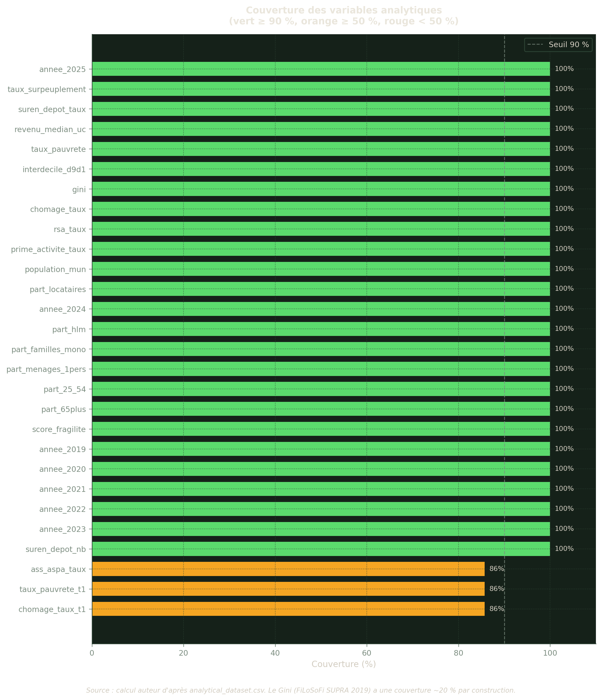
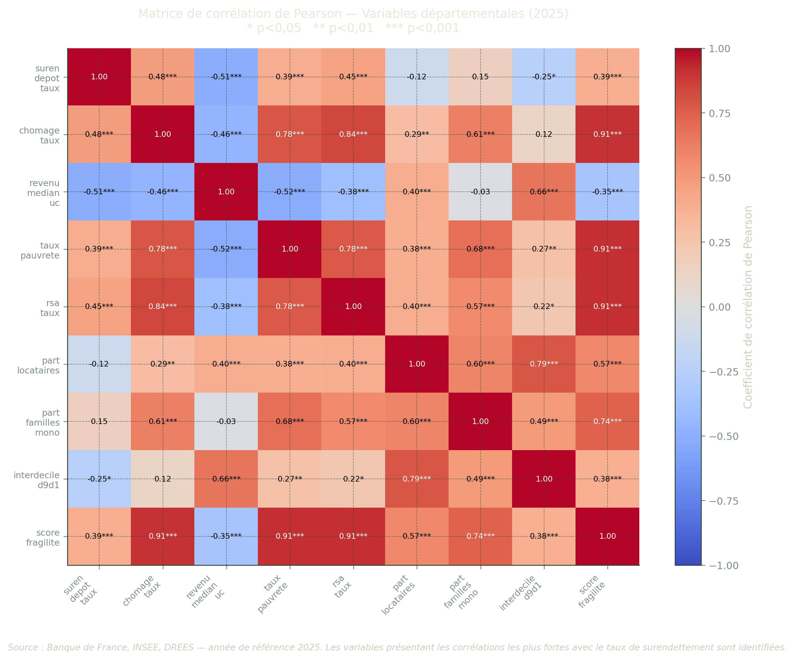
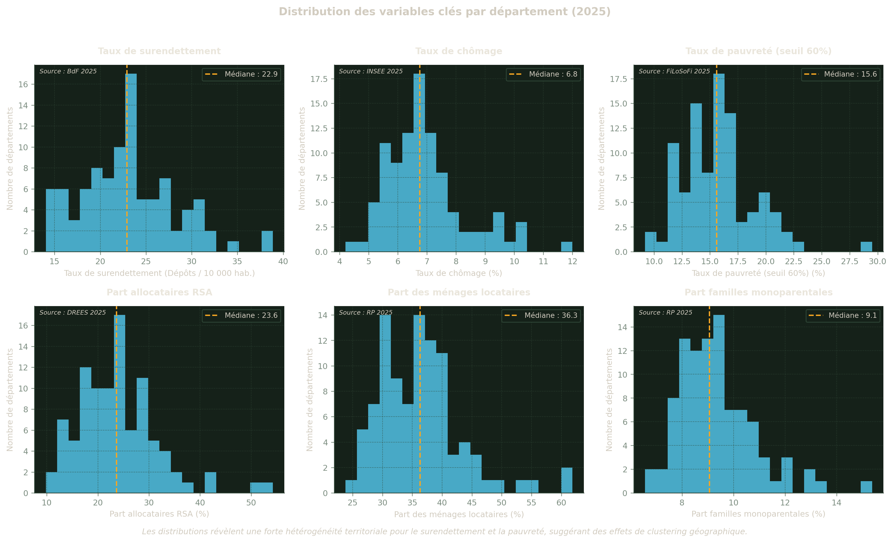
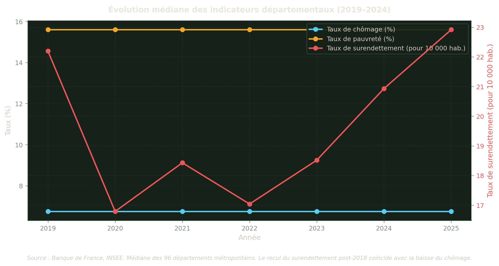
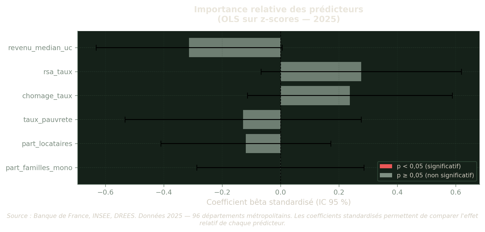
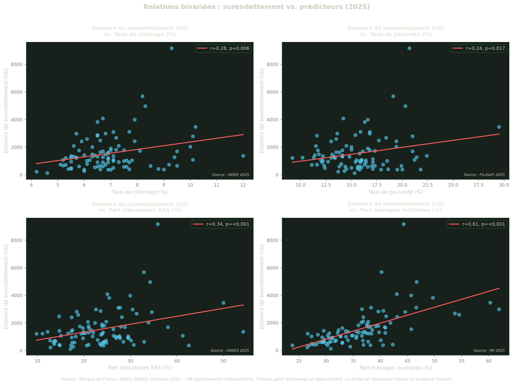

## Ressource à revoir

- https://data.economie.gouv.fr/pages/fiscalite-locale-entreprises/

## Contexte et problématique

L’inclusion financière des ménages français est mise à l’épreuve par une série de chocs économiques — chômage, inflation, précarisation — dont l’intensité varie fortement selon les territoires. À l’échelle départementale, certains marchés du travail structurellement fragilisés concentrent aussi les populations les plus exposées au surendettement.

**Questions de recherche :**

1.  Quelles variables économiques départementales (chômage, pauvreté, minimas sociaux, logement, démographie) sont le plus corrélées au taux de surendettement sur la période 2018–2023 ?
2.  Les effets du chômage et de la pauvreté sur le surendettement sont-ils contemporains ou décalés d’une année ?
3.  Peut-on construire un score synthétique de fragilité financière territoriale prédictif du surendettement ?

**Périmètre :** 96 départements métropolitains (hors DOM-TOM). **Sources :** Banque de France, INSEE FiLoSoFi, INSEE RP 2021, INSEE chômage localisé, DREES (voir Section 2).

> **NOTE:**
>
> **À propos de ce rapport** — L’ensemble des chiffres présentés sont générés programmatiquement à partir de données publiques. Le code source est accessible en cliquant sur « Voir le code » dans chaque section. Les données brutes peuvent être téléchargées en suivant les instructions du [guide de démarrage](specs/001-surendettement-analysis/quickstart.md).

### Chiffres clés

| Indicateur | Médiane départementale | Étendue (min – max) | Source |
|----|----|----|----|
| Total dossiers de surendettement déposés | 1222 | 108 – 9155 | Banque de France 2025 |
| Taux de surendettement (‰ ménages) | 22.9 ‰ | 14.1 – 38.9 ‰ | Banque de France 2025 |
| Taux de chômage BIT | 6.8 % | 4.2 – 12.0 % | INSEE 2025 |
| Taux de pauvreté (seuil 60 %) | 15.6 % | 9.2 – 29.5 % | INSEE FiLoSoFi 2025 |
| Part d'allocataires RSA | 23.6 % | 9.8 – 54.3 % | DREES 2025 |

Table 1: Statistiques descriptives clés — France métropolitaine (année de référence)

------------------------------------------------------------------------

## Sources de données

Cette analyse mobilise six sources de données publiques, toutes téléchargeables et reproductibles. Le tableau ci-dessous recense chaque source, les indicateurs retenus, le millésime de référence et la couverture géographique. Les données brutes sont stockées dans `data/raw/` (non versionnées) et retraitées par les scripts `02_clean.py` et `03_merge.py` avant d’être intégrées dans le jeu analytique (`analytical_dataset.csv`).

| Source | Indicateurs | Millésime(s) | Périmètre | Identifiant / URL |
|----|----|----|----|----|
| Banque de France — Synthèses surendettement | Dépôts de dossiers de surendettement | 2018–2023 | 96 dép. | banque-france.fr/publications/synthese-nationale… |
| INSEE FiLoSoFi 2021 | Revenu médian UC, taux de pauvreté (60 %), interdécile D9/D1 | 2021 | 96 dép. | insee.fr/statistiques/7756729 |
| INSEE FiLoSoFi SUPRA 2019 | Coefficient de Gini | 2019 | 96 dép. (couverture ~20 %) | insee.fr/statistiques/6036907 |
| INSEE Chômage localisé (TCRD) | Taux de chômage BIT par département | 2017–2024 | 96 dép. | insee.fr/statistiques/2012804 |
| INSEE Recensement (RP 2021) | Structure ménages, logement, démographie | 2021 | 96 dép. | insee.fr/statistiques/8268828 |
| DREES / France Travail — Minimas sociaux | RSA, prime d'activité, ASS/ASPA | 2021 | 96 dép. (si disponible) | drees.solidarites-sante.gouv.fr/isd |

Table 2: Sources de données utilisées dans l’analyse

> **Note** : Les données brutes (`data/raw/`) ne sont pas versionnées. Consulter [`quickstart.md`](specs/001-surendettement-analysis/quickstart.md) pour les instructions de téléchargement.

------------------------------------------------------------------------

## Couverture des données

Avant d’interpréter les résultats, il est indispensable de s’assurer que les données couvrent suffisamment les 96 départements. Le graphique ci-dessous indique, pour chaque variable analytique, le pourcentage de valeurs disponibles (non manquantes). Une couverture inférieure à 90 % (seuil rouge pointillé) appelle à la prudence : les variables concernées ne peuvent pas être incluses dans un modèle de régression sans risque de biais de sélection.

> **WARNING:**
>
> Le coefficient de **Gini** (FiLoSoFi SUPRA 2019) présente une couverture volontairement limitée à environ 20 % — il n’est disponible que pour les grandes unités territoriales et n’est donc pas intégré dans le modèle OLS principal.



Figure 1: Couverture des variables clés du jeu analytique (% de valeurs non-nulles)

| variable | coverage_pct | threshold_pct | status | min | max | median |
|----|----|----|----|----|----|----|
| suren_depot_nb | 100.0% | 90.000000 | OK | 62.000000 | 9155.000000 | 1048.500000 |
| suren_depot_taux | 100.0% | 90.000000 | OK | 8.104000 | 38.879000 | 19.163000 |
| revenu_median_uc | 100.0% | 90.000000 | OK | 21250.000000 | 33790.000000 | 25140.000000 |
| taux_pauvrete | 100.0% | 90.000000 | OK | 9.200000 | 29.500000 | 15.600000 |
| interdecile_d9d1 | 100.0% | 90.000000 | OK | 2.500000 | 6.700000 | 3.100000 |
| gini | 100.0% | 0.000000 | OK | 0.225000 | 0.451000 | 0.260000 |
| chomage_taux | 100.0% | 90.000000 | OK | 4.200000 | 12.000000 | 6.750000 |
| chomage_taux_t1 | 85.7% | 50.000000 | OK | 4.200000 | 12.000000 | 6.750000 |
| rsa_taux | 100.0% | 50.000000 | OK | 8.792000 | 54.545000 | 23.718000 |
| prime_activite_taux | 100.0% | 50.000000 | OK | 40.867000 | 95.159000 | 71.322000 |
| ass_aspa_taux | 85.7% | 50.000000 | OK | 1.752000 | 8.949000 | 3.946000 |
| population_mun | 100.0% | 90.000000 | OK | 76503.000000 | 2616909.000000 | 543119.500000 |
| part_locataires | 100.0% | 90.000000 | OK | 23.800000 | 61.870000 | 36.270000 |
| part_hlm | 100.0% | 90.000000 | OK | 4.450000 | 31.390000 | 11.880000 |
| taux_surpeuplement | 100.0% | 90.000000 | OK | 2.580000 | 31.360000 | 5.245000 |
| part_familles_mono | 100.0% | 90.000000 | OK | 6.570000 | 15.370000 | 9.060000 |
| part_menages_1pers | 100.0% | 90.000000 | OK | 31.550000 | 53.110000 | 38.945000 |
| part_25_54 | 100.0% | 90.000000 | OK | 31.150000 | 44.460000 | 35.245000 |
| part_65plus | 100.0% | 90.000000 | OK | 12.400000 | 31.460000 | 23.220000 |
| taux_pauvrete_t1 | 85.7% | 50.000000 | OK | 9.200000 | 29.500000 | 15.600000 |
| score_fragilite | 100.0% | 50.000000 | OK | -1.654000 | 3.459000 | -0.076000 |
| source_url | 100.0% | 90.000000 | OK | nan | nan | nan |
| source_millesime | 100.0% | 90.000000 | OK | 2019.000000 | 2025.000000 | 2022.000000 |
| annee_2019 | 100.0% | 100.000000 | OK | nan | nan | nan |
| annee_2020 | 100.0% | 100.000000 | OK | nan | nan | nan |
| annee_2021 | 100.0% | 100.000000 | OK | nan | nan | nan |
| annee_2022 | 100.0% | 100.000000 | OK | nan | nan | nan |
| annee_2023 | 100.0% | 100.000000 | OK | nan | nan | nan |
| annee_2024 | 100.0% | 100.000000 | OK | nan | nan | nan |
| annee_2025 | 100.0% | 100.000000 | OK | nan | nan | nan |

Table 3: Rapport de couverture détaillé par variable

------------------------------------------------------------------------

## Analyse exploratoire (EDA)

L’analyse exploratoire vise à comprendre la structure des données et les relations entre variables avant toute modélisation. On examine successivement :

1.  **La matrice de corrélation** — pour identifier les associations bivariées entre toutes les variables et la cible (taux de surendettement) ;
2.  **Les distributions** — pour détecter les asymétries, les valeurs extrêmes et la dispersion territoriale ;
3.  **Les tendances temporelles** — pour situer l’année de référence dans une dynamique de moyen terme (2019–2024).

Cette exploration guide ensuite les choix de spécification du modèle OLS (Section 4).

### Matrice de corrélation

La **corrélation de Pearson** mesure l’intensité et la direction de la relation linéaire entre deux variables : un coefficient r proche de +1 indique que les deux variables augmentent conjointement, proche de −1 qu’elles varient en sens inverse, proche de 0 qu’il n’y a pas de relation linéaire. Les étoiles indiquent si la corrélation est statistiquement significative, c’est-à-dire peu susceptible d’être due au hasard seul.

> **TIP:**
>
> **Comment lire cette matrice :** chaque cellule donne le coefficient r entre deux variables. La diagonale vaut toujours 1 (une variable est parfaitement corrélée à elle-même). Pour l’interprétation, on se concentre sur la ligne ou la colonne correspondant à `suren_depot_taux` (taux de surendettement), qui est notre variable à expliquer.



Figure 2: Matrice de corrélation de Pearson entre variables départementales (année de référence). Les étoiles indiquent le niveau de significativité : \* p\<0,05 ; \*\* p\<0,01 ; \*\*\* p\<0,001.

    Corrélations avec le taux de surendettement :
    Variable                              r  Sig.
    --------------------------------------------------
    revenu_median_uc                 -0.511  ***
    chomage_taux                     +0.478  ***
    rsa_taux                         +0.450  ***
    taux_pauvrete                    +0.392  ***
    score_fragilite                  +0.389  ***
    interdecile_d9d1                 -0.251  *
    part_familles_mono               +0.151  (ns)
    part_locataires                  -0.116  (ns)

### Distributions des variables clés

Chaque histogramme représente la répartition des 96 départements selon la valeur de l’indicateur. La ligne rouge pointillée matérialise la **médiane** (valeur centrale). Une distribution fortement asymétrique — avec une longue queue vers les valeurs élevées — signale la présence de quelques départements avec des valeurs extrêmes qui peuvent influencer les estimations OLS. Ces outliers sont à surveiller lors de l’interprétation des coefficients.



Figure 3: Distribution des variables clés par département (année de référence). La ligne rouge pointillée indique la médiane.

### Tendances temporelles (2019–2024)

Ce graphique retrace l’évolution de la **médiane départementale** sur la période disponible. Il permet d’identifier des tendances structurelles (baisse du surendettement depuis le pic des années 2010) et des ruptures conjoncturelles (effet de la crise sanitaire de 2020). Un double axe est utilisé pour permettre la comparaison entre des variables exprimées dans des unités différentes — pourcentages pour le chômage et la pauvreté, nombre de dossiers ou taux ‰ pour le surendettement.

> **NOTE:**
>
> La tendance nationale à la baisse du surendettement depuis 2018 coïncide avec la période de baisse du chômage et de renforcement des minimas sociaux (prime d’activité). La section de modélisation teste si cette co-évolution temporelle se retrouve dans les disparités spatiales entre départements.



Figure 4: Évolution médiane des indicateurs départementaux (2019–2024). Axe gauche : chômage et pauvreté (%) ; axe droit : surendettement.

------------------------------------------------------------------------

## Modélisation OLS

La **régression OLS** (Ordinary Least Squares — moindres carrés ordinaires) est la méthode de référence pour estimer l’effet de plusieurs variables indépendantes sur une variable cible tout en contrôlant simultanément les autres facteurs. Contrairement à la corrélation bivariée, elle permet d’isoler l’effet « net » de chaque prédicteur.

Dans ce modèle, la variable à expliquer est le **taux de surendettement** (dossiers déposés pour 1 000 ménages) au niveau départemental pour le millésime retenu par les données FiLoSoFi. Les six prédicteurs du modèle de base sont : le taux de chômage, le revenu médian par unité de consommation, le taux de pauvreté, la part d’allocataires RSA, la part de ménages locataires et la part de familles monoparentales.

> **NOTE:**
>
> Le modèle OLS est estimé sur le millésime 2021, car les variables FiLoSoFi (`revenu_median_uc`, `taux_pauvrete`) ne sont actuellement disponibles que pour cette année.

**Comment lire un tableau OLS :**

- Le **coefficient** (Coef.) indique de combien varie le taux de surendettement lorsque la variable explicative augmente d’une unité, toutes les autres variables étant maintenues constantes.
- L’**erreur standard** mesure la précision de cette estimation.
- La **p-value** indique la probabilité d’observer ce coefficient par hasard si l’effet réel était nul. Une p-value \< 0,05 est conventionnellement considérée comme statistiquement significative.
- Le **R² ajusté** mesure la proportion de la variance du surendettement expliquée par l’ensemble des prédicteurs (0 = aucun pouvoir explicatif, 1 = explication parfaite).

### Modèle OLS de base

Le tableau suivant présente les résultats du modèle de base estimé sur les 96 départements métropolitains pour l’année FiLoSoFi disponible. Un R² ajusté supérieur à 0,40 confirmerait que les conditions économiques locales expliquent une part substantielle des disparités départementales de surendettement.

**R² ajusté : 0.320**  \|  N = 96  \|  F-stat p-value : 0.0000

|                    | Coef.   | Err. Std. | t       | p-value | Sig.   |
|--------------------|---------|-----------|---------|---------|--------|
| const              | 40.4002 | 11.4705   | 3.5221  | 0.0007  | \*\*\* |
| chomage_taux       | 0.9159  | 0.6827    | 1.3416  | 0.1831  |        |
| revenu_median_uc   | -0.0008 | 0.0004    | -1.9547 | 0.0538  |        |
| taux_pauvrete      | -0.2132 | 0.3374    | -0.6320 | 0.5290  |        |
| rsa_taux           | 0.1861  | 0.1163    | 1.5999  | 0.1132  |        |
| part_locataires    | -0.0907 | 0.1116    | -0.8133 | 0.4182  |        |
| part_familles_mono | -0.0035 | 0.5105    | -0.0068 | 0.9946  |        |

Table 4: Résultats OLS — Modèle de base (année FiLoSoFi disponible, 96 départements). Variable dépendante : taux de surendettement. \* p\<0,05 ; \*\* p\<0,01 ; \*\*\* p\<0,001.

### Diagnostic VIF

Lorsque plusieurs variables explicatives sont fortement corrélées entre elles (**multicolinéarité**), les estimations OLS deviennent instables : les coefficients peuvent changer de signe ou voir leur erreur standard augmenter fortement, rendant les tests de significativité peu fiables.

Le **Facteur d’Inflation de la Variance** (VIF) quantifie ce problème pour chaque prédicteur. Il se lit ainsi :

- **VIF \< 5** : multicolinéarité faible, pas de problème ✅
- **5 ≤ VIF \< 10** : multicolinéarité modérée, interpréter avec prudence ⚡
- **VIF ≥ 10** : multicolinéarité élevée, les coefficients sont potentiellement biaisés ⚠️

En présence de VIF ≥ 10 sur au moins deux variables simultanément, une Analyse en Composantes Principales (ACP, section suivante) peut être appliquée pour réduire la redondance.

| Variable           | VIF  | Alerte    |
|--------------------|------|-----------|
| chomage_taux       | 4.41 | ✅ OK     |
| revenu_median_uc   | 3.64 | ✅ OK     |
| taux_pauvrete      | 5.85 | ⚡ Modéré |
| rsa_taux           | 4.21 | ✅ OK     |
| part_locataires    | 3.03 | ✅ OK     |
| part_familles_mono | 2.93 | ✅ OK     |

✅ **Aucun VIF ≥ 10 détecté** — multicolinéarité acceptable pour toutes les spécifications.

Table 5: Facteur d’inflation de la variance (VIF) par prédicteur. VIF \> 10 indique une multicolinéarité préoccupante.

### Comparaison avec effets de lag (t-1)

Les effets économiques sur le surendettement ne sont pas forcément immédiats. Un ménage qui perd son emploi en année t peut accumuler des dettes pendant plusieurs mois avant de déposer un dossier en année t+1. On parle d’un **effet de lag** (décalage temporel) d’un an.

Pour tester cette hypothèse, on compare deux spécifications :

- **Modèle sans lag** : les variables explicatives (chômage, pauvreté) sont mesurées la même année que le surendettement (millésime FiLoSoFi disponible).
- **Modèle avec lag t-1** : chômage et pauvreté sont mesurés l’année précédente, le surendettement au millésime FiLoSoFi disponible.

Si le modèle avec lag présente un **R² ajusté plus élevé** et un **AIC plus faible** (critère d’information d’Akaike — plus bas = meilleur), cela suggère que les effets économiques s’expriment avec un délai d’un an.

| Indicateur       | Modèle sans lag | Modèle avec lag t-1 |
|------------------|-----------------|---------------------|
| R²               | 0.363           | 0.363               |
| R² ajusté        | 0.320           | 0.320               |
| AIC              | 561.2           | 561.2               |
| N                | 96              | 96                  |
| F-stat (p-value) | 0.0000          | 0.0000              |

**Conclusion :** Le modèle avec lag présente un R² ajusté inférieur (Δ = +0.000) et un AIC supérieur (Δ = +0.0). Les effets contemporains sont prédominants.

Table 6: Comparaison OLS — Spécification sans lag vs avec lag t-1. Variable dépendante : taux de surendettement.

### Coefficients bêta standardisés (z-scores)

Les variables du modèle sont exprimées dans des unités différentes (%, ‰, €), ce qui rend les coefficients OLS bruts **incomparables** entre eux en termes d’importance relative. Pour remédier à ce problème, on standardise toutes les variables en **z-score** (on soustrait la moyenne et on divise par l’écart-type de chaque variable). Les coefficients bêta standardisés obtenus s’interprètent ainsi : une variation d’un écart-type de la variable X entraîne β écarts-types de variation du taux de surendettement.

> **TIP:**
>
> **Lecture pratique :** le prédicteur avec le coefficient bêta **le plus grand en valeur absolue** est celui qui, parmi les variables disponibles, contribue le plus à expliquer les écarts de surendettement entre départements, indépendamment de son unité de mesure.



Figure 5: Coefficients bêta standardisés — Modèle OLS avec variables normalisées en z-score (année FiLoSoFi disponible). Permet la comparaison de l’importance relative des prédicteurs, indépendamment de leurs unités.

### ACP conditionnelle (si multicolinéarité élevée)

Si plusieurs prédicteurs présentent un VIF ≥ 10 simultanément, une **Analyse en Composantes Principales** (ACP) peut synthétiser l’information redondante en un nombre réduit de composantes orthogonales (c’est-à-dire indépendantes entre elles par construction). Chaque composante est une combinaison linéaire des variables d’origine.

Le graphique ci-dessous — produit uniquement lorsqu’une multicolinéarité élevée est détectée — présente la part de variance expliquée par chaque composante. Le nombre de composantes à retenir est conventionnellement fixé au seuil de 80 % de variance cumulée, ou par le critère du coude (elbow criterion).

    ✅ ACP non nécessaire : VIF < 10 pour toutes les variables (0 variable(s) avec VIF ≥ 10 — seuil : 2). La multicolinéarité est acceptable pour l'interprétation des coefficients OLS.

Figure 6

------------------------------------------------------------------------

## Cartographie départementale

La modélisation statistique a permis d’identifier les prédicteurs les plus associés au surendettement. La cartographie situe maintenant ces résultats dans l’espace géographique.

Les **cartes choroplèthes** représentent la France métropolitaine découpée en 96 départements, chacun coloré selon la valeur de l’indicateur — de la couleur la plus claire (valeur faible) à la plus saturée (valeur élevée). Cette représentation met en évidence les **clusters géographiques**, c’est-à-dire les zones où plusieurs départements voisins présentent des valeurs similaires — un phénomène que les analyses statistiques purement tabulaires ne permettent pas de percevoir.

> **NOTE:**
>
> **Note méthodologique :** les cartes présentées utilisent des palettes de couleur adaptées aux personnes daltoniennes. La palette **YlOrRd** (jaune → orange → rouge) est utilisée pour les indicateurs positifs (surendettement, chômage). La palette **RdYlBu_r** (rouge → jaune → bleu) est utilisée pour les variations et scores composites, où les deux extrêmes ont des significations distinctes. La palette **viridis** est utilisée pour les variables explicatives.

### Explorateur cartographique interactif

L’explorateur ci-dessous remplace les quatre cartes statiques précédentes : il suffit de déplacer le curseur d’année (ou de lancer la lecture) pour voir le territoire se recolorer, et de survoler un département pour obtenir son détail. Le sélecteur d’indicateur compare le taux de dépôts au chômage, à la pauvreté, à la part d’allocataires RSA, à la part de locataires et au score de fragilité ; le sélecteur de mode affiche le niveau, la variation depuis la première année, la variation d’une année sur l’autre ou le rang. L’encodage du niveau est fixe et documenté : le **taux** de dépôts pour 10 000 habitants est toujours représenté (jamais le nombre brut de dossiers), classé en six classes quantiles. Cliquez sur un département (ou validez-le au clavier avec Entrée) pour l’épingler : un panneau latéral affiche alors sa trajectoire complète sur toutes les années, pour le taux de dépôts et pour l’indicateur sélectionné, avec les valeurs annuelles ; recliquez pour désépingler.

``` js
{
  if (!od_paths || od_paths.length === 0) {
    return html`<p class="od-note">Explorateur cartographique indisponible :
    données non chargées (exécuter les scripts 01–04).</p>`;
  }

  const W = od_viewBox[0], H = od_viewBox[1];
  const years = od_years.map(String);
  const firstYear = years[0];
  const latestYear = years[years.length - 1];
  const byCode = Object.fromEntries(od_data.map(d => [d.code, d]));
  const geoByCode = Object.fromEntries(od_paths.map(p => [p.code, p]));
  const indByKey = Object.fromEntries(od_indicators.map(i => [i.key, i]));

  // ── palettes ColorBrewer (sûres pour les daltoniens) ─────────────────
  const YLORRD = ["#ffffb2","#fee391","#fec44f","#fe9929","#ec7014",
                  "#d94801","#cc4c02","#993404","#662506"];
  // RdBu inversé : rouge = hausse, bleu = baisse, centré sur 0 (FR-005, R5)
  const RDBU_R = ["#2166ac","#4393c3","#92c5de","#d1e5f0","#f7f7f7",
                  "#fddbc7","#f4a582","#d6604d","#b2182b"];
  const MISSING = "#d9d9d9";

  // ── utilitaires couleur / quantiles (sans d3 : zéro requête CDN) ──────
  const hex2rgb = h => { h = h.replace("#","");
    return [parseInt(h.slice(0,2),16), parseInt(h.slice(2,4),16), parseInt(h.slice(4,6),16)]; };
  const rgb2hex = (r,g,b) => "#" + [r,g,b]
    .map(v => Math.round(Math.max(0, Math.min(255, v))).toString(16).padStart(2,"0")).join("");
  const lerp = (c1, c2, t) => { const a = hex2rgb(c1), b = hex2rgb(c2);
    return rgb2hex(a[0]+(b[0]-a[0])*t, a[1]+(b[1]-a[1])*t, a[2]+(b[2]-a[2])*t); };
  const paletteAt = (stops, t) => { t = Math.max(0, Math.min(1, t));
    const pos = t * (stops.length - 1), i = Math.floor(pos), f = pos - i;
    return lerp(stops[i], stops[Math.min(i+1, stops.length-1)], f); };
  const quantile = (sorted, q) => { const pos = (sorted.length - 1) * q;
    const lo = Math.floor(pos), hi = Math.ceil(pos);
    return sorted[lo] + (sorted[hi] - sorted[lo]) * (pos - lo); };
  const fmt = n => n.toLocaleString("fr-FR");

  // ── état (FR-010/FR-011/FR-009/FR-022) ────────────────────────────────
  const MODES = [
    { key: "niveau",   label: "Niveau" },
    { key: "var_base", label: `Variation vs ${firstYear} (%)` },
    { key: "var_n1",   label: "Variation vs année précédente (%)" },
    { key: "rang",     label: "Rang" },
  ];
  const state = { year: latestYear, variable: "suren", mode: "niveau",
                  timer: null, pinned: null };
  const ind = () => indByKey[state.variable];
  // FR-022 : indicateur à millésime unique → année effective fixée sur le
  // millésime source ; le curseur d'année reste visible mais inerte.
  const effYear = () => ind().varies_by_year ? state.year
    : (years.includes(String(ind().millesime)) ? String(ind().millesime) : firstYear);
  const modeLabel = () => MODES.find(m => m.key === state.mode).label;

  // ── accès aux valeurs ─────────────────────────────────────────────────
  const val = (code, year, key) => {
    const d = byCode[code]; if (!d) return null;
    const y = d.years[year]; return y ? y[key] : null; };
  const nbOf = (code, year) => {
    const d = byCode[code]; if (!d) return null;
    const y = d.years[year]; return y ? y.nb : null; };

  // ── statistiques de l'état courant ────────────────────────────────────
  function computeStats() {
    const y = effYear(), k = state.variable;
    const rows = od_data.map(d => ({ code: d.code, nom: d.nom,
      v: val(d.code, y, k), nb: nbOf(d.code, y) }));
    const vals = rows.filter(r => r.v != null).map(r => r.v).sort((a,b) => a-b);
    const n = vals.length || 1;
    const mean = vals.reduce((s,x) => s+x, 0) / n;
    const sd = Math.sqrt(vals.reduce((s,x) => s+(x-mean)**2, 0) / n) || 1;
    const thresholds = [1,2,3,4,5].map(i => quantile(vals, i/6));
    const vmap = {}, rank = {}, z = {}, nbs = {}, deltaN1 = {}, deltaBase = {};
    rows.filter(r => r.v != null).sort((a,b) => b.v - a.v)
        .forEach((r,i) => { rank[r.code] = i + 1; });
    const prev = years[years.indexOf(y) - 1];
    rows.forEach(r => {
      nbs[r.code] = r.nb;
      if (r.v == null) return;
      vmap[r.code] = r.v;
      z[r.code] = (r.v - mean) / sd;
      const vp = prev ? val(r.code, prev, k) : null;
      deltaN1[r.code] = (vp != null && vp !== 0) ? (r.v - vp) / vp * 100 : null;
      const vb = val(r.code, firstYear, k);
      deltaBase[r.code] = (vb != null && vb !== 0) ? (r.v - vb) / vb * 100 : null;
    });
    // rang : classes quantiles sur les rangs 1..n (R5) ; étendue symétrique
    // des variations pour l'échelle divergente centrée sur 0 (FR-005)
    const ranks = Object.values(rank).sort((a,b) => a-b);
    const rankThresholds = [1,2,3,4,5].map(i => quantile(ranks, i/6));
    const deltasAll = Object.values(state.mode === "var_n1" ? deltaN1 : deltaBase)
      .filter(d => d != null);
    const extent = deltasAll.length ? Math.max(...deltasAll.map(Math.abs)) : 1;
    return { rows, vals, mean, sd, thresholds, vmap, rank, z, nbs,
             deltaN1, deltaBase, rankThresholds, extent, prevYear: prev, n };
  }

  // valeur affichée selon le mode (FR-011)
  const displayValue = (code, st) => state.mode === "niveau" ? (st.vmap[code] ?? null)
    : state.mode === "rang" ? (st.rank[code] ?? null)
    : state.mode === "var_n1" ? (st.deltaN1[code] ?? null)
    : (st.deltaBase[code] ?? null);
  const unitOf = st => state.mode.startsWith("var_") ? "%"
    : state.mode === "rang" ? "rang" : ind().unit;
  const decimalsOf = () => state.mode.startsWith("var_") ? 1
    : state.mode === "rang" ? 0 : ind().decimals;
  const fmtVal = v => v == null ? "—" : v.toFixed(decimalsOf());

  // couleur selon le mode (FR-003/FR-004/FR-005/FR-006)
  function colorOf(code, st) {
    const v = displayValue(code, st);
    if (v == null) return MISSING;
    if (state.mode === "niveau") {
      const i = st.thresholds.reduce((acc,t) => acc + (v >= t ? 1 : 0), 0);
      return paletteAt(YLORRD, i / 5);
    }
    if (state.mode === "rang") {
      // rang 1 = valeur la plus forte = classe la plus foncée
      const i = st.rankThresholds.reduce((acc,t) => acc + (v < t ? 1 : 0), 0);
      return paletteAt(YLORRD, i / 5);
    }
    const t = (v + st.extent) / (2 * st.extent);
    return paletteAt(RDBU_R, t);
  }

  // ── totaux nationaux par année (légende d'évolution, indicateur suren) ─
  const totals = {};
  years.forEach(y => { totals[y] = od_data.reduce((s,d) => s + (nbOf(d.code, y) || 0), 0); });
  const troughYear = years.reduce((a,b) => totals[a] <= totals[b] ? a : b);
  const rebound = (totals[latestYear] - totals[troughYear]) / totals[troughYear] * 100;

  // ── construction du DOM ───────────────────────────────────────────────
  const titleEl = html`<div class="od-title"></div>`;
  const yearLabelEl = html`<span class="od-year">${state.year}</span>`;
  const slider = html`<input type="range" class="od-slider"
    min=${years[0]} max=${years[years.length-1]} step="1" value=${state.year}
    aria-label="Année d'observation">`;
  const playBtn = html`<button type="button" class="od-play" aria-pressed="false"
    aria-label="Lire l'animation année par année">Lire l'animation</button>`;
  const varSelect = html`<select class="od-select"
    aria-label="Indicateur cartographié">${od_indicators.map(i =>
      html`<option value=${i.key}>${i.label}</option>`)}</select>`;
  const badge = html`<span class="od-badge" hidden></span>`;
  const modeInputs = MODES.map(m =>
    html`<input type="radio" name="od-mode" class="od-mode-radio" value=${m.key}
      aria-label=${m.label}>`);
  const modeToggle = html`<div class="od-modes" role="radiogroup"
    aria-label="Mode d'affichage">${MODES.map((m,i) =>
      html`<label class="od-mode">${modeInputs[i]}<span>${m.label}</span></label>`)}</div>`;
  const controls = html`<div class="od-controls">${slider} ${yearLabelEl}
    ${playBtn} ${varSelect} ${badge} ${modeToggle}</div>`;

  // NB: mapSvg (et non svg) pour ne pas masquer le builtin `svg` (htl),
  // utilisé pour créer les <path>/<rect>/<text>/<g> dans le namespace SVG.
  const mapSvg = html`<svg class="od-svg" viewBox="0 0 ${W} ${H}" role="application"
    aria-label="Carte choroplèthe de France métropolitaine, 96 départements"></svg>`;
  const labelsG = svg`<g class="od-labels"></g>`;
  const pathByCode = {};
  const tip = html`<div class="od-tooltip" role="tooltip" hidden></div>`;
  const stage = html`<div class="od-stage">${mapSvg}${tip}</div>`;
  // Panneau latéral épinglé (FR-013) : sparklines sur toutes les années du
  // taux de dépôt et de l'indicateur sélectionné, avec valeurs annuelles.
  const panel = html`<aside class="od-panel" hidden
    aria-label="Trajectoire du département épinglé"></aside>`;
  const body = html`<div class="od-body">${stage}${panel}</div>`;

  const legendSvg = html`<svg class="od-legend-svg" role="img"
    aria-label="Légende de la carte"></svg>`;
  const captionEl = html`<div class="od-caption"></div>`;
  const sourceEl = html`<div class="od-source"></div>`;
  const tableSummaryYear = html`<span></span>`;
  const tbody = html`<tbody></tbody>`;
  const table = html`<details class="od-table">
    <summary>Tableau des 96 départements — <span class="od-table-var"></span>,
      année ${tableSummaryYear}</summary>
    <table><thead><tr><th>Code</th><th>Département</th>
      <th class="od-table-val">Valeur</th><th>Rang</th></tr></thead>${tbody}</table>
  </details>`;
  const tableVarEl = table.querySelector(".od-table-var");
  const tableValEl = table.querySelector(".od-table-val");

  const root = html`<div class="od-map">${titleEl}${controls}${body}
    ${legendSvg}${captionEl}${sourceEl}${table}</div>`;

  for (const p of od_paths) {
    const el = svg`<path d=${p.d} class="od-dep" tabindex="0" role="button"
      aria-pressed="false"></path>`;
    el.dataset.code = p.code;
    pathByCode[p.code] = el;
    mapSvg.appendChild(el);

    el.addEventListener("mouseenter", ev => showTip(el, p, ev));
    el.addEventListener("mousemove", ev => showTip(el, p, ev));
    el.addEventListener("mouseleave", hideTip);
    el.addEventListener("focus", ev => showTip(el, p, ev, true));
    el.addEventListener("blur", hideTip);
    el.addEventListener("click", () => togglePin(p.code));
    el.addEventListener("keydown", ev => {
      if (ev.key === "Enter" || ev.key === " ") {
        ev.preventDefault();
        togglePin(p.code);
      }
    });
  }
  mapSvg.appendChild(labelsG);

  // ── infobulle (FR-012) ────────────────────────────────────────────────
  function showTip(el, p, ev, fromFocus=false) {
    const st = lastStats;
    const v = displayValue(p.code, st);
    let txt = `<strong>${p.nom}</strong> (${p.code})<br>`;
    if (v == null) {
      txt += "données manquantes";
    } else {
      txt += `${fmtVal(v)} ${unitOf(st)}<br>rang ${st.rank[p.code]}/96<br>`;
      // FR-003 : le nombre brut de dossiers n'apparaît qu'en infobulle
      if (state.variable === "suren" && state.mode === "niveau"
          && st.nbs[p.code] != null) {
        txt += `dossiers déposés : ${fmt(st.nbs[p.code])}<br>`;
      }
      if (state.mode === "niveau" && st.prevYear) {
        const d = st.deltaN1[p.code];
        if (d != null) txt += `vs ${st.prevYear} : ${d >= 0 ? "+" : ""}${d.toFixed(1)} %<br>`;
      }
      if (state.mode.startsWith("var_")) {
        const lv = st.vmap[p.code];
        if (lv != null) txt += `niveau ${effYear()} : ${lv.toFixed(ind().decimals)} ${ind().unit}<br>`;
      }
      txt += `z = ${st.z[p.code].toFixed(2)} (moy. nat. ${st.mean.toFixed(ind().decimals)})`;
    }
    tip.innerHTML = txt;
    tip.hidden = false;
    const rect = root.getBoundingClientRect();
    const x = fromFocus ? el.getBoundingClientRect().left - rect.left
                        : ev.clientX - rect.left;
    const y = fromFocus ? el.getBoundingClientRect().top - rect.top
                        : ev.clientY - rect.top;
    tip.style.left = Math.max(0, Math.min(x + 14, rect.width - 240)) + "px";
    tip.style.top = Math.max(0, y + 14) + "px";
  }
  function hideTip() { tip.hidden = true; }

  // ── épinglage d'un département (FR-013) ───────────────────────────────
  // Clic ou Entrée : épingler ; reclic sur le même : désépingler.
  function togglePin(code) {
    state.pinned = (state.pinned === code) ? null : code;
    render();
  }

  // Série complète (toutes les années) d'un indicateur pour un département.
  const sparkSeries = (code, key) =>
    years.map(y => ({ y, v: val(code, y, key), nb: nbOf(code, y) }));

  // Sparkline SVG pure (zéro d3) ; la ligne est interrompue sur les null.
  function sparkSvg(series, decimals) {
    const w = 250, h = 58, pad = 8;
    const el = svg`<svg class="od-spark" viewBox="0 0 ${w} ${h}"
      role="img" aria-label="Courbe annuelle"></svg>`;
    const vs = series.filter(s => s.v != null).map(s => s.v);
    if (!vs.length) {
      el.appendChild(svg`<text x=${w / 2} y=${h / 2} text-anchor="middle"
        class="od-spark-year">données manquantes</text>`);
      return el;
    }
    const lo = Math.min(...vs), hi = Math.max(...vs), span = (hi - lo) || 1;
    const x = i => pad + i * (w - 2 * pad) / (series.length - 1);
    const yOf = v => pad + (1 - (v - lo) / span) * (h - 2 * pad - 8);
    let seg = [];
    const flush = () => {
      if (seg.length > 1) el.insertBefore(svg`<polyline class="od-spark-line"
        points=${seg.map(s => `${x(s.i).toFixed(1)},${yOf(s.v).toFixed(1)}`)
          .join(" ")}></polyline>`, el.firstChild);
      seg = [];
    };
    series.forEach((s, i) => {
      if (s.v == null) { flush(); return; }
      seg.push({ i, v: s.v });
      el.appendChild(svg`<circle
        class="od-spark-dot${s.y === effYear() ? " od-spark-now" : ""}"
        cx=${x(i).toFixed(1)} cy=${yOf(s.v).toFixed(1)} r="2.4">
        <title>${s.y} : ${s.v.toFixed(decimals)}</title></circle>`);
    });
    flush();
    el.appendChild(svg`<text x=${pad} y=${h - 2}
      class="od-spark-year">${series[0].y}</text>`);
    el.appendChild(svg`<text x=${w - pad} y=${h - 2} text-anchor="end"
      class="od-spark-year">${series[series.length - 1].y}</text>`);
    return el;
  }

  // Valeurs annuelles sous-jacentes (FR-013) ; le nombre brut de dossiers
  // n'apparaît que dans l'infobulle et ce panneau (FR-003).
  function sparkVals(series, indMeta, key) {
    return html`<div class="od-spark-vals">${series.map(s =>
      html`<span class="od-spark-yv"><b>${s.y}</b> ${
        s.v == null ? "—" : s.v.toFixed(indMeta.decimals) +
        (key === "suren" && s.nb != null ? ` (${fmt(s.nb)} dossiers)` : "")
      }</span>`)}</div>`;
  }

  // Panneau latéral : reconstruit à chaque render() → les séries restent
  // complètes quand l'année ou l'indicateur change (FR-013, scénario 2),
  // et la surbrillance de la carte suit le département épinglé.
  function renderPanel() {
    if (!state.pinned) { panel.hidden = true; panel.innerHTML = ""; return; }
    const d = byCode[state.pinned], g = geoByCode[state.pinned];
    const nom = g ? g.nom : (d ? d.nom : state.pinned);
    const surenInd = indByKey["suren"], selInd = ind();
    const same = selInd.key === "suren";
    const anneeSel = selInd.varies_by_year ? effYear() : selInd.millesime;
    const closeBtn = html`<button type="button" class="od-panel-close"
      aria-label="Désépingler ${nom}">✕</button>`;
    closeBtn.addEventListener("click", () => togglePin(state.pinned));
    const seriesSuren = sparkSeries(state.pinned, "suren");
    const seriesSel = sparkSeries(state.pinned, selInd.key);
    panel.innerHTML = "";
    panel.appendChild(html`<div class="od-panel-head">
      <span class="od-panel-title">${nom} (${state.pinned})</span>${closeBtn}
    </div>`);
    panel.appendChild(html`<div class="od-panel-block">
      <div class="od-panel-label">${surenInd.label}
        <span class="od-panel-unit">${surenInd.unit} — ${surenInd.source}</span>
      </div>
      ${sparkSvg(seriesSuren, surenInd.decimals)}
      ${sparkVals(seriesSuren, surenInd, "suren")}
    </div>`);
    panel.appendChild(html`<div class="od-panel-block">
      <div class="od-panel-label">${selInd.label}
        <span class="od-panel-unit">${selInd.unit} — ${selInd.source},
          ${anneeSel}</span>
        ${same ? html`<span class="od-panel-note">(même série que ci-dessus)</span>` : ""}
      </div>
      ${sparkSvg(seriesSel, selInd.decimals)}
      ${sparkVals(seriesSel, selInd, selInd.key)}
    </div>`);
    panel.hidden = false;
  }

  // ── rendu (FR-015 : titre, légende+unités, source, année, légende textuelle) ──
  function render() {
    lastStats = computeStats();
    const st = lastStats;
    const yLab = effYear();

    for (const p of od_paths) {
      const el = pathByCode[p.code];
      const v = displayValue(p.code, st);
      const pinned = state.pinned === p.code;
      el.setAttribute("fill", colorOf(p.code, st));
      el.setAttribute("class", "od-dep"
        + (v == null ? " od-missing" : "")
        + (pinned ? " od-pinned" : ""));
      el.setAttribute("aria-pressed", String(pinned));
      el.setAttribute("aria-label",
        `${p.nom} (${p.code}) : ${v == null ? "données manquantes" : `${fmtVal(v)} ${unitOf(st)}`}, ` +
        `rang ${st.rank[p.code] ?? "—"}/96, ${yLab}${pinned ? ", épinglé" : ""}`);
    }

    // légende selon le mode
    legendSvg.setAttribute("viewBox", "0 0 1000 46");
    legendSvg.innerHTML = "";
    const sw = 150, gap = 12;
    const unit = unitOf(st);
    let labels = [];
    for (let i = 0; i < 6; i++) {
      let fill;
      if (state.mode === "niveau") {
        const th = st.thresholds;
        const lo = i === 0 ? null : th[i-1], hi = i === 5 ? null : th[i];
        fill = paletteAt(YLORRD, i / 5);
        labels.push(lo == null ? `< ${hi.toFixed(ind().decimals)}`
          : hi == null ? `≥ ${lo.toFixed(ind().decimals)}`
          : `${lo.toFixed(ind().decimals)} – ${hi.toFixed(ind().decimals)}`);
      } else if (state.mode === "rang") {
        const th = st.rankThresholds;
        const lo = i === 0 ? 1 : Math.floor(th[i-1]) + 1;
        const hi = i === 5 ? st.n : Math.round(th[i]);
        fill = paletteAt(YLORRD, i / 5);
        labels.push(`${lo} – ${hi}`);
      } else {
        const ext = st.extent, step = 2 * ext / 6;
        const lo = -ext + i * step, hi = lo + step;
        fill = paletteAt(RDBU_R, ((lo + hi) / 2 + ext) / (2 * ext));
        labels.push(i === 0 ? `< ${hi.toFixed(0)} %`
          : i === 5 ? `≥ ${lo.toFixed(0)} %`
          : `${lo.toFixed(0)} – ${hi.toFixed(0)} %`);
      }
      const x = i * (sw + gap);
      const rect = svg`<rect x=${x} y="0" width=${sw} height="14"
        fill=${fill} class="od-swatch"></rect>`;
      const text = svg`<text x=${x} y="30" class="od-range">${labels[i]}</text>`;
      const unitT = svg`<text x=${x} y="43" class="od-unit">${i === 5 ? unit : ""}</text>`;
      legendSvg.appendChild(rect); legendSvg.appendChild(text); legendSvg.appendChild(unitT);
    }

    // étiquettes top-5 hausses / baisses en mode variation (FR-014)
    labelsG.innerHTML = "";
    if (state.mode.startsWith("var_")) {
      const deltas = Object.entries(state.mode === "var_n1" ? st.deltaN1 : st.deltaBase)
        .filter(([,d]) => d != null);
      const risers = deltas.slice().sort((a,b) => b[1] - a[1]).slice(0, 5);
      const fallers = deltas.slice().sort((a,b) => a[1] - b[1]).slice(0, 5);
      for (const [code, d] of risers) {
        const g = geoByCode[code]; if (!g) continue;
        labelsG.appendChild(svg`<text x=${g.cx} y=${g.cy} text-anchor="middle"
          class="od-toplabel od-rise">${g.nom} +${d.toFixed(0)} %</text>`);
      }
      for (const [code, d] of fallers) {
        const g = geoByCode[code]; if (!g) continue;
        labelsG.appendChild(svg`<text x=${g.cx} y=${g.cy} text-anchor="middle"
          class="od-toplabel od-fall">${g.nom} ${d.toFixed(0)} %</text>`);
      }
    }

    // titre / source / année / badge millésime (FR-022)
    titleEl.textContent = `${ind().label} — ${modeLabel()} — ${yLab}`;
    yearLabelEl.textContent = yLab;
    sourceEl.textContent = `Source : ${ind().source} — ${yLab}. ` +
      "96 départements métropolitains — DOM-TOM exclus.";
    const varies = ind().varies_by_year;
    slider.disabled = !varies;
    playBtn.disabled = !varies;
    badge.hidden = varies;
    if (!varies) badge.textContent = `${ind().source} ${ind().millesime}`;
    varSelect.value = state.variable;
    modeInputs.forEach((r, i) => { r.checked = MODES[i].key === state.mode; });

    // légende textuelle calculée (FR-015)
    if (state.mode === "niveau") {
      const med = quantile(st.vals, 0.5), max = st.vals[st.vals.length - 1];
      const top = st.rows.filter(r => r.v === max)[0];
      captionEl.textContent =
        `En ${yLab}, la médiane est de ${med.toFixed(ind().decimals)} ` +
        `${ind().unit} et le maximum de ${max.toFixed(ind().decimals)} ` +
        `(${top ? top.nom : "—"})${state.variable === "suren" ? `. Au niveau national, ` +
        `les dépôts sont passés de ${fmt(totals[troughYear])} dossiers en ` +
        `${troughYear} (creux) à ${fmt(totals[latestYear])} en ${latestYear}, ` +
        `soit ${rebound >= 0 ? "+" : ""}${rebound.toFixed(0)} %.` : "."}`;
    } else if (state.mode === "rang") {
      const top = st.rows.filter(r => r.rank === 1)[0];
      const med = st.rows.filter(r => r.rank === Math.round(st.n / 2))[0];
      captionEl.textContent =
        `En ${yLab}, le rang 1 est ${top ? top.nom : "—"} ` +
        `(${top ? fmtVal(top.v) : "—"} ${ind().unit}) ; le rang médian ` +
        `(${Math.round(st.n / 2)}) est ${med ? med.nom : "—"}.`;
    } else {
      const ref = state.mode === "var_base" ? firstYear : (st.prevYear ?? firstYear);
      const deltas = Object.entries(state.mode === "var_n1" ? st.deltaN1 : st.deltaBase)
        .filter(([,d]) => d != null);
      const up = deltas.filter(([,d]) => d > 0).length;
      const down = deltas.filter(([,d]) => d < 0).length;
      const riser = deltas.slice().sort((a,b) => b[1] - a[1])[0];
      const faller = deltas.slice().sort((a,b) => a[1] - b[1])[0];
      captionEl.textContent =
        `Variation ${yLab} vs ${ref} : ${up} départements en hausse, ` +
        `${down} en baisse ; plus forte hausse : ${riser ? geoByCode[riser[0]].nom : "—"} ` +
        `(${riser ? "+" + riser[1].toFixed(0) : "—"} %), plus forte baisse : ` +
        `${faller ? geoByCode[faller[0]].nom : "—"} (${faller ? faller[1].toFixed(0) : "—"} %).`;
    }

    // tableau des 96 départements (FR-023)
    tableVarEl.textContent = ind().label;
    tableSummaryYear.textContent = yLab;
    tableValEl.textContent = state.mode === "rang" ? "Rang"
      : state.mode.startsWith("var_") ? "Variation (%)"
      : `${ind().label} (${ind().unit})`;
    const rows = st.rows.slice()
      .sort((a,b) => (b.v ?? -Infinity) - (a.v ?? -Infinity));
    tbody.innerHTML = rows.map(r =>
      `<tr><td>${r.code}</td><td>${r.nom}</td>` +
      `<td>${fmtVal(displayValue(r.code, st))}</td>` +
      `<td>${st.rank[r.code] ?? "—"}</td></tr>`).join("");

    // panneau épinglé (FR-013) : mis à jour à chaque changement d'état
    renderPanel();
  }

  // ── lecture / curseur (FR-009 : le manuel interrompt l'animation) ──────
  let lastStats = computeStats();
  function stopPlay() {
    if (state.timer) { clearInterval(state.timer); state.timer = null; }
    playBtn.setAttribute("aria-pressed", "false");
    playBtn.textContent = "Lire l'animation";
  }
  playBtn.addEventListener("click", () => {
    if (!ind().varies_by_year) return; // FR-022 : lecture inerte
    if (state.timer) { stopPlay(); return; }
    playBtn.setAttribute("aria-pressed", "true");
    playBtn.textContent = "Pause";
    state.timer = setInterval(() => {
      const i = years.indexOf(state.year);
      if (i >= years.length - 1) { stopPlay(); return; }
      state.year = years[i + 1];
      slider.value = state.year;
      render();
    }, 800);
  });
  slider.addEventListener("input", () => {
    stopPlay();
    state.year = slider.value;
    render();
  });
  varSelect.addEventListener("change", () => {
    stopPlay();
    state.variable = varSelect.value;
    render();
  });
  modeInputs.forEach((r, i) => r.addEventListener("change", () => {
    stopPlay();
    state.mode = MODES[i].key;
    render();
  }));

  render();
  return root;
}
```

### Carte statique de repli (sans JavaScript)

La carte ci-dessous est le **repli statique** de la section : elle reste visible même lorsque JavaScript est désactivé dans le navigateur. Avec JavaScript activé, utilisez plutôt l’**explorateur interactif ci-dessus** pour faire varier l’année, l’indicateur et le mode d’affichage. L’encodage est identique à celui de l’explorateur : taux de dépôts pour 10 000 habitants (jamais le nombre brut de dossiers), six classes quantiles, palette YlOrRd, style neutre « données manquantes », thème clair de la page (FR-003–FR-006, FR-016, FR-019).


Figure 7: Carte statique de repli (sans JavaScript) — taux de dépôts de dossiers de surendettement pour 10 000 habitants, dernière année disponible. Six classes quantiles, palette YlOrRd. Source : Banque de France. 96 départements métropolitains — DOM-TOM exclus.

### Graphiques bivariés : surendettement vs. prédicteurs

Ces **nuages de points** examinent la relation entre le surendettement et chaque variable explicative prise **séparément** (sans contrôle des autres variables). Chaque point représente un département ; la droite rouge est la droite de régression linéaire simple. Le coefficient r et sa p-value indiquent l’intensité et la significativité de l’association.

Ces graphiques bivariés complètent la matrice de corrélation en rendant visibles :

- La **dispersion** autour de la tendance (points proches ou éloignés de la droite) ;
- Les **outliers** (départements qui s’écartent de la tendance générale) ;
- La **forme** de la relation (linéaire, ou peut-être curvilinéaire pour certaines variables).

> **NOTE:**
>
> Ces graphiques représentent des corrélations bivariées non contrôlées. Un coefficient r élevé ici ne garantit pas que la variable reste significative dans le modèle OLS multivarié, où les effets des autres prédicteurs sont simultanément pris en compte.



Figure 8: Nuages de points bivariés : taux de surendettement vs. chaque prédicteur principal (année de référence). La droite de régression linéaire est représentée en rouge. Source : BdF, INSEE, DREES.

------------------------------------------------------------------------

## Conclusion

Cette section récapitule les résultats en répondant aux trois questions de recherche posées en introduction, puis expose les limites méthodologiques de l’analyse et les pistes d’extension pour des travaux futurs.

### Réponses aux questions de recherche

**1. Quelles variables économiques sont les plus corrélées au taux de surendettement ?**

    Variables par ordre de corrélation (Pearson) avec le surendettement :
      revenu_median_uc               r = -0.511  ***  (n=96)
      chomage_taux                   r = +0.478  ***  (n=96)
      rsa_taux                       r = +0.450  ***  (n=96)
      taux_pauvrete                  r = +0.392  ***  (n=96)
      score_fragilite                r = +0.389  ***  (n=96)
      part_familles_mono             r = +0.151  (ns)  (n=96)
      part_locataires                r = -0.116  (ns)  (n=96)

    → Prédicteur le plus corrélé au millésime 2025 : revenu_median_uc

**2. Les effets du chômage et de la pauvreté sont-ils contemporains ou décalés ?**

    → Les effets contemporains dominent (Δ R² ajusté = +0.000). L'association chômage-surendettement est essentiellement simultanée à l'échelle annuelle.

**3. Le score de fragilité composite est-il prédictif du surendettement ?**

    → Corrélation score de fragilité – surendettement : r = 0.412 *** (n=96)
      → Le score composite présente une association modérée avec le surendettement.

### Limites et perspectives

**Limites de l’analyse :**

- **Couverture FiLoSoFi** : les données de revenus, pauvreté et indicateurs de distribution (Gini) sont partiellement disponibles ou d’un millésime antérieur (2019 pour Gini). L’OLS multivarié est donc indicatif.
- **Absence de correction spatiale** : les cartes choroplèthes révèlent une auto-corrélation spatiale probable (clustering Nord, Île-de-France) qui n’est pas prise en compte dans le modèle OLS standard.
- **Biais de composition** : les taux de surendettement bruts (sans pondération par le nombre de ménages) peuvent avantager les grands départements.
- **Causalité** : les corrélations observées ne permettent pas d’établir des relations causales.

**Perspectives d’extension :**

- Régression spatiale (SAR/SLM) pour corriger l’autocorrélation spatiale et calculer l’indice de Moran’s I
- Intégration des données FiLoSoFi complètes (revenu médian, taux de pauvreté, Gini) pour enrichir le modèle
- Analyse longitudinale (effets fixes département) sur 2018–2023
- Décomposition du score de fragilité composite avec pondération empirique
- Comparaison entre millésimes pour quantifier l’effet des politiques publiques (prime d’activité, RSA, plan pauvreté)

> **Sources** : Banque de France (synthèses surendettement 2018–2024), INSEE FiLoSoFi 2021, INSEE chômage localisé, INSEE RP 2021, DREES (indicateurs sociaux départementaux). Périmètre : 96 départements métropolitains (DOM-TOM exclus).

## Citation

BibTeX citation:

``` quarto-appendix-bibtex
@online{gilles2026,
  author = {Gilles, Guillaume},
  title = {Map of {Overindebtedness} in {France}},
  date = {2026-05-18},
  url = {https://ggilles.dev/posts/overindebtedness/},
  langid = {en}
}
```

For attribution, please cite this work as:

Gilles, Guillaume. 2026. “Map of Overindebtedness in France.” May 18. <https://ggilles.dev/posts/overindebtedness/>.
