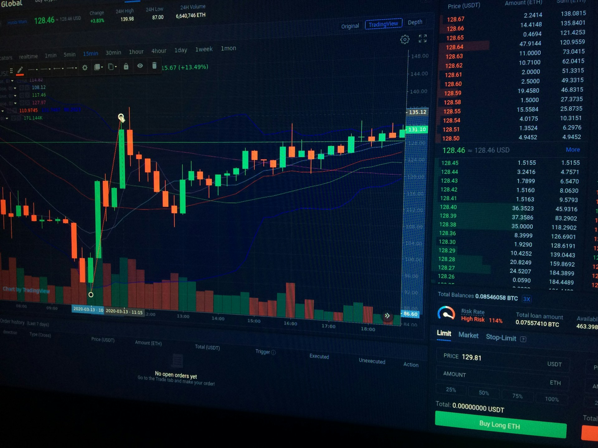
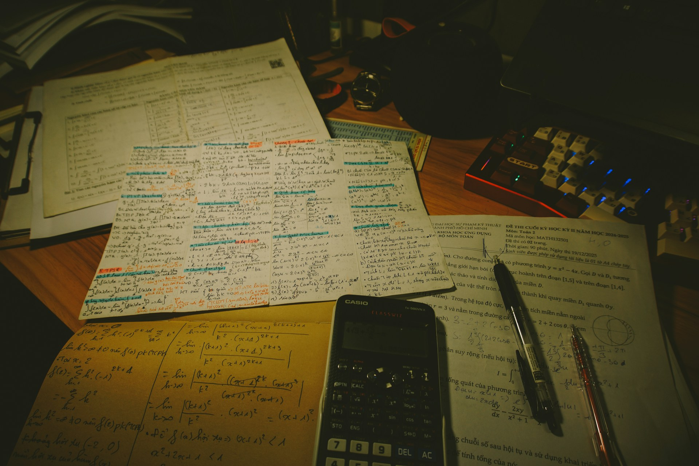
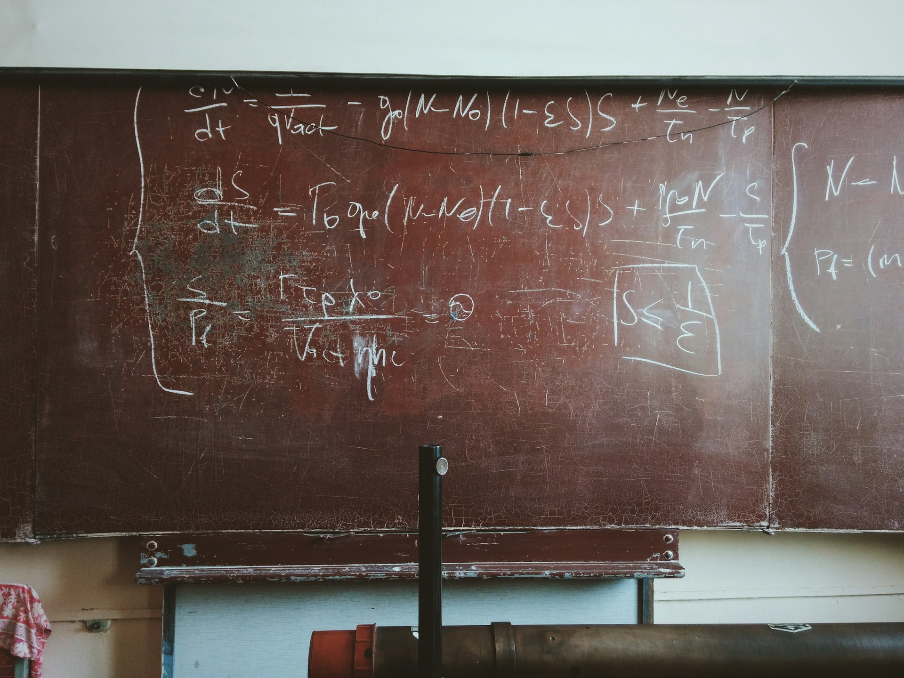

# Teaching

I teach at **ESSCA** (statistics & information systems) and **INSEEC** (financial analysis, graduate level). Course materials live here and are updated each semester.

### Annotating Course Pages

All course pages support **collaborative annotation** via [Hypothesis](https://web.hypothes.is/). You can highlight any passage, leave a comment, or ask a question — directly on the page, without leaving the browser.

To get started:

1.  Create a free account at [hypothes.is](https://web.hypothes.is/)
2.  Open any course page (Statistics, Mathematical Analysis, Financial Analysis, AI guide)
3.  Click the **◀** tab on the right edge of the screen to open the annotation panel
4.  Select any text to highlight it or leave a note

Annotations are **public by default**. Your questions and comments are visible to other students, which turns the course material into a shared living document. If you prefer to annotate privately, switch to *Only me* in the Hypothesis panel before posting.

### English or French Track 

While browsing courses you can switch between French and English tracks using the icon at the top of the page.

## Graduate

##### Financial Mathematics

How do we compare, value, and arbitrate financial flows that occur at different points in time? This course equips Master 1 business-school students with the tools to answer…

Guillaume Gilles

##### Financial and Strategic Analysis of the Company

Guillaume Gilles

##### Information Systems Management

Diagnostic sur les comptes individuels et sur les comptes consolidés. Étude de la profitabilité, de la solvabilité, de la structure financière et de la rentabilité (ROCE…

Guillaume Gilles

## Undergraduate

##### Data Description

**Welcome to MS03-001-G: Data Description.**

This course introduces the basic statistical tools corresponding to the first stage of data analysis: numerical summaries and…

Guillaume Gilles

##### Decision Making Statistics

Undergraduate course providing the fondamental mathematical intuition to understand, describe, and analyse data in finance, economics, and management.

Guillaume Gilles

##### Mathematical Analysis

Guillaume Gilles

##### Mathematical Fundamentals

Provides the essential mathematical tools to analyse and solve quantitative problems in finance, economics, and management.

Guillaume Gilles

##### Probabilités & Statistiques

Ce cours introduit les probabilités et les statistiques comme outils de modélisation de l’incertitude et d’analyse de données. Il couvre les variables aléatoires continues…

Guillaume Gilles

## Honor Code

Please do not look on the internet for the answers to questions. It violates the honor code, and prevents you from learning.

**Above all**: welcome, and enjoy! We are all here to learn.
