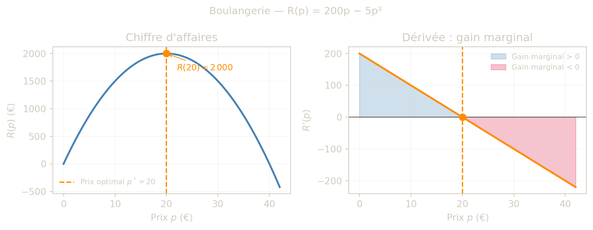
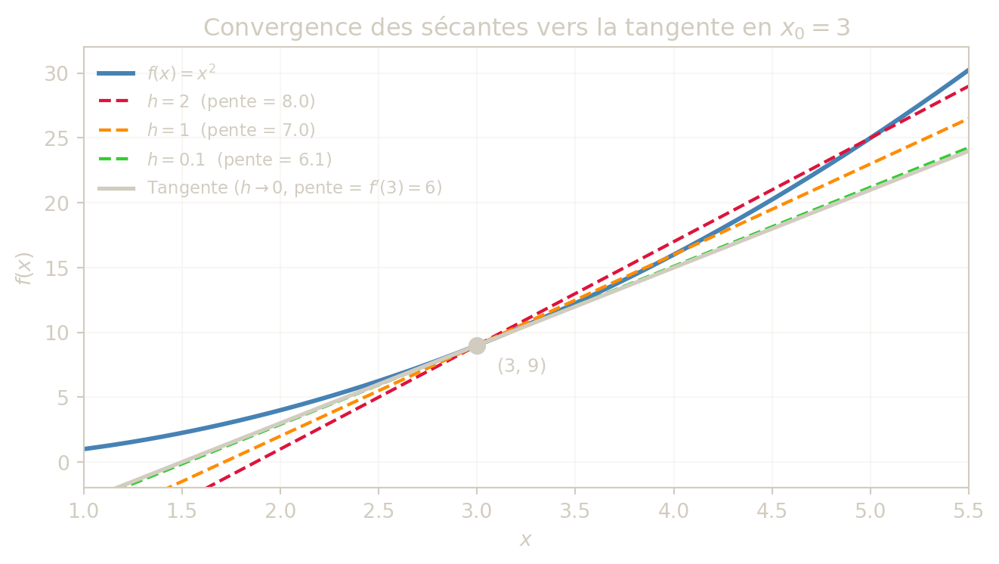
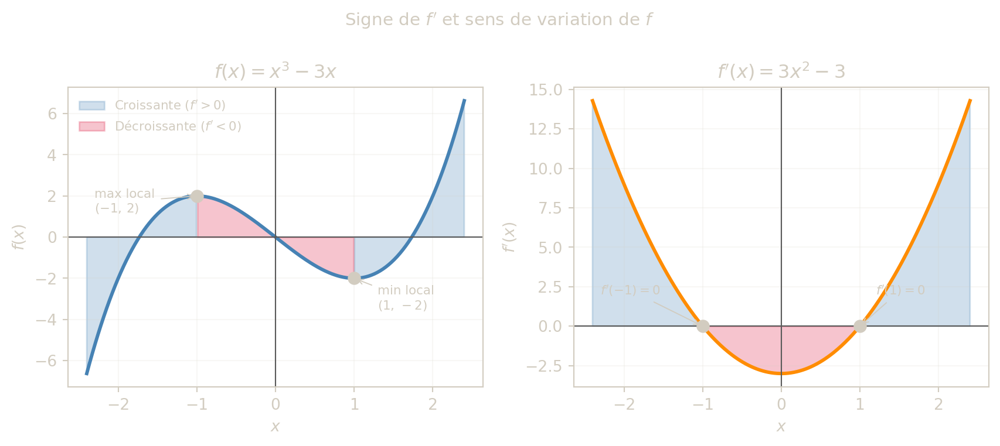

> **IMPORTANT:**
>
> - Comprendre la **dérivée d’une fonction univariée**
> - Savoir **calculer et interpréter** une dérivée
> - Étudier le **sens de variation** d’une fonction
> - Comprendre et calculer l’**élasticité**

## 0.1 Introduction

> **NOTE:**
>
> Imaginez que vous gérez une boulangerie. Votre chiffre d’affaires quotidien est \\R(p) = 200p - 5p^2\\, ou \\p\\ est le prix d’une baguette en euros.
>
> Si vous augmentez \\p\\ de 1 centime, votre chiffre d’affaires augmente-t-il ou diminue-t-il ? De combien exactement ?
>
> C’est précisément ce que mesure la dérivée : **la variation instantanée d’une grandeur par rapport à une autre**. Dans cet exemple, \\R'(p)\\ indique le gain (ou la perte) de chiffre d’affaires pour une hausse de prix infinitésimale.

Ce module présente les notions fondamentales de dérivation des fonctions univariées et leur interprétation économique.

### 0.1.1 Exemple économique

Le graphique ci-dessous illustre le cas de la boulangerie : à gauche le chiffre d’affaires \\R(p)\\, à droite sa dérivée \\R'(p)\\ qui mesure le gain marginal.



Figure 1: Chiffre d’affaires R(p) = 200p − 5p² : la dérivée indique le gain marginal par euro de hausse de prix.

## 0.2 Définition de la dérivée

Une fonction \\f\\ est dite dérivable en \\x\\ si le taux d’accroissement \\\frac{f(x+h)-f(x)}{h}\\ admet une limite quand \\h \to 0\\.

On définit alors :

\\ f'(x) = \lim\_{h \to 0} \frac{f(x+h)-f(x)}{h} \\

## 0.3 Intuition : du taux moyen au taux instantané

Le quotient

\\ \frac{f(x+h)-f(x)}{h} \\

mesure une **variation moyenne** de \\f\\ entre \\x\\ et \\x+h\\. Quand \\h\\ devient très petit, on “zoome” autour de \\x\\ : cette variation moyenne tend vers une variation **instantanée**.

C’est exactement ce que représente la dérivée \\f'(x)\\ :

- en géométrie : la pente de la tangente ;
- en économie : un effet marginal (coût marginal, recette marginale, etc.).

### 0.3.1 Mini-lecture numérique

Pour \\f(x)=x^2\\ au point \\x=3\\ :

\\ \frac{f(3+h)-f(3)}{h}=\frac{(3+h)^2-9}{h}=6+h \\

Si \\h=1\\, on obtient \\7\\ ; si \\h=0.1\\, on obtient \\6.1\\ ; si \\h=0.01\\, on obtient \\6.01\\. La valeur se rapproche de \\6\\, donc \\f'(3)=6\\.



Figure 2: Droites sécantes pour h = 2, 1 et 0.1 : quand h tend vers 0, la sécante converge vers la tangente (pente = 6).

### 0.3.2 À retenir

1.  On calcule d’abord un taux moyen.
2.  On fait tendre \\h\\ vers 0.
3.  La limite obtenue est la dérivée (taux instantané).

### 0.3.3 Exercice interactif — Convergence de h → 0

Utilisez le curseur pour faire varier \\h\\ et observez comment la pente de la sécante se rapproche de \\f'(3) = 6\\.

\<\<\<\<\<\<\< HEAD

``` shinylive-python
#| standalone: true
#| components: [viewer]
#| viewerHeight: 510
=======
```{ojs}
//| echo: false
md`##### 🎯 De la sécante à la tangente
>>>>>>> main

Faites varier h pour voir comment la pente de la sécante se rapproche de f'(3) = 6 quand h → 0.`
```

``` js
viewof sec_h = Inputs.range([0.05, 3.0], {value: 2.0, step: 0.05, label: "Valeur de h :"})
```

``` js
sec_slope = ((3 + sec_h) ** 2 - 9) / sec_h
sec_error = Math.abs(sec_slope - 6)
```

``` js
{
  const close = sec_error < 0.15;
  const tick = close ? "  ✅ Tres proche !" : "";
  const color = close ? "steelblue" : "#e07a5f";
  return html`<div style="border-left:3px solid steelblue; border-radius:6px; padding:10px 14px; margin:8px 0; font-family:monospace; font-size:0.9em; background:rgba(128,128,128,0.10);">
    Pente = (f(3 + ${sec_h.toFixed(2)}) − f(3)) / ${sec_h.toFixed(2)}
    = <strong style="color:darkorange">${sec_slope.toFixed(4)}</strong><br>
    Ecart avec 6 : <strong style="color:${color}">${sec_error.toFixed(4)}</strong>${tick}
  </div>`;
}
```

``` js
{
  const x0 = 3, y0 = 9;
  const xs = d3.range(0.5, 6.5001, 0.02);
  const lblF = "f(x) = x²";
  const lblS = `Sécante  h=${sec_h.toFixed(2)}  (pente=${sec_slope.toFixed(3)})`;
  const lblT = "Tangente h→0  (pente = 6)";
  return Plot.plot({
    width: 700,
    height: 380,
    style: {background: "transparent", color: "currentColor", fontSize: "12px"},
    x: {domain: [0.5, 6.5], label: "x"},
    y: {domain: [-5, 45], label: "f(x)", grid: true},
    color: {
      legend: true,
      domain: [lblF, lblS, lblT],
      range: ["steelblue", "darkorange", "currentColor"]
    },
    marks: [
      Plot.line(xs, {x: xs => xs, y: x => x * x, stroke: () => lblF, strokeWidth: 2.2, clip: true}),
      Plot.line(xs, {x: xs => xs, y: x => y0 + sec_slope * (x - x0), stroke: () => lblS, strokeWidth: 1.8, strokeDasharray: "6,4", clip: true}),
      Plot.line(xs, {x: xs => xs, y: x => y0 + 6 * (x - x0), stroke: () => lblT, strokeWidth: 2, clip: true}),
      Plot.dot([[x0, y0], [x0 + sec_h, (x0 + sec_h) ** 2]], {fill: "crimson", r: 5})
    ]
  });
}
```

### 0.3.4 Exemple détaillé : \\f(x)=x^2\\

\\ \begin{aligned} \frac{f(x+h)-f(x)}{h} &= \frac{(x+h)^2-x^2}{h} \\ &= \frac{x^2+2xh+h^2-x^2}{h} \\ &= 2x+h \end{aligned} \\

Donc :

\\ f'(x) = \lim\_{h \to 0}(2x+h)=2x \\

### 0.3.5 Exemples rapides

- \\f(x)=\frac{1}{x} \Rightarrow f'(x)=-\frac{1}{x^2}\\
- \\f(x)=\sqrt{x} \Rightarrow f'(x)=\frac{1}{2\sqrt{x}}, \\ x\>0\\

## 0.4 Dérivées des fonctions usuelles

| Fonction \\f(x)\\ | Dérivée \\f'(x)\\       | Condition              |
|-------------------|-------------------------|------------------------|
| \\k\\             | \\0\\                   | \\k\\ constante réelle |
| \\kx\\            | \\k\\                   | \\k\\ constante réelle |
| \\x^n\\           | \\nx^{n-1}\\            | \\n \in \mathbb{N}\\   |
| \\\frac{1}{x^n}\\ | \\\frac{-n}{x^{n+1}}\\  | \\x \neq 0\\           |
| \\\sqrt{x}\\      | \\\frac{1}{2\sqrt{x}}\\ | \\x \> 0\\             |
| \\e^x\\           | \\e^x\\                 |                        |
| \\\ln(x)\\        | \\\frac{1}{x}\\         | \\x\>0\\               |

> **TIP:**
>
> - La constante ne varie jamais : \\f(x)=5 \Rightarrow f'(x)=0\\.
> - La dérivée de \\kx\\ est la pente \\k\\ : une augmentation de 1 de \\x\\ fait varier \\f\\ de \\k\\ unités.
> - La dérivée de \\x^n\\ “abaisse l’exposant d’un cran” : \\x^4 \to 4x^3\\.
> - \\e^x\\ est sa propre dérivée : son taux de croissance instantané est égal à sa valeur — propriété remarquable exploitée en finance (actualisation).

> **IMPORTANT:**
>
> La dérivée n’est définie que là où la fonction est définie. Par exemple, \\\ln(x)\\ impose \\x \> 0\\, donc \\(\ln(x))' = \frac{1}{x}\\ est également valable uniquement pour \\x \> 0\\.
>
> **Toujours préciser le domaine de définition** avant de dériver.

# 1 Partie 2 - Fonctions composées

## 1.1 Règles de dérivation

| Règle | Formule |
|----|----|
| Somme | \\(u+v)' = u' + v'\\ |
| Produit | \\(uv)' = u'v + uv'\\ |
| Quotient | \\\left(\dfrac{u}{v}\right)' = \dfrac{u'v - uv'}{v^2}\\ |
| Exponentielle composée | \\(e^{u(x)})' = u'(x)\\e^{u(x)}\\ |
| Logarithme compose | \\(\ln(u(x)))' = \dfrac{u'(x)}{u(x)}\\ |
| Puissance composée | \\(u(x)^n)' = n\\u'(x)\\u(x)^{n-1}\\ |

> **TIP:**
>
> La règle \\(uv)' = u'v + uv'\\ est souvent source d’erreurs. Pensez-y ainsi : quand le produit de deux quantités varie, **chaque terme contribue tour à tour** pendant que l’autre reste fixe. On additionne les deux contributions.

## 1.2 Exemples pas a pas

### 1.2.1 Règle de la somme : \\f(x) = 4x - e^x\\

On pose \\u(x)=4x\\ et \\v(x)=e^x\\.

\\ u'(x)=4, \qquad v'(x)=e^x \\

\\ f'(x) = 4 - e^x \\

------------------------------------------------------------------------

### 1.2.2 Règle du produit : \\f(x) = (2x+3)\\e^x\\

On pose \\u(x)=2x+3\\ et \\v(x)=e^x\\.

\\ u'(x)=2, \qquad v'(x)=e^x \\

\\ f'(x) = u'v + uv' = 2\\e^x + (2x+3)\\e^x = e^x(2x+5) \\

------------------------------------------------------------------------

### 1.2.3 Règle du quotient : \\f(x) = \dfrac{\ln(x)}{2x^2}\\

On pose \\u(x)=\ln(x)\\ et \\v(x)=2x^2\\.

\\ u'(x)=\frac{1}{x}, \qquad v'(x)=4x \\

\\ f'(x) = \frac{\frac{1}{x}\cdot 2x^2 - \ln(x)\cdot 4x}{(2x^2)^2} = \frac{2x - 4x\ln(x)}{4x^4} = \frac{1 - 2\ln(x)}{2x^3} \\

------------------------------------------------------------------------

### 1.2.4 Exponentielle composée : \\f(x) = e^{2x^2+3x}\\

On pose \\u(x)=2x^2+3x\\.

\\ u'(x)=4x+3 \\

\\ f'(x) = u'(x)\\e^{u(x)} = (4x+3)\\e^{2x^2+3x} \\

------------------------------------------------------------------------

### 1.2.5 Logarithme compose : \\f(x) = \ln(4x^2+2)\\

On pose \\u(x)=4x^2+2\\.

\\ u'(x)=8x \\

\\ f'(x) = \frac{u'(x)}{u(x)} = \frac{8x}{4x^2+2} = \frac{4x}{2x^2+1} \\

> **WARNING:**
>
> Ne pas confondre \\(\ln(x))' = \frac{1}{x}\\ et \\(\ln(u(x)))' = \frac{u'(x)}{u(x)}\\.
>
> Toujours verifier si l’argument du \\\ln\\ est une expression composée, et si oui, multiplier par sa dérivée.

# 2 Partie 3 - Interprétation de la dérivée

## 2.1 Interprétation géométrique

La dérivée \\f'(a)\\ représente la pente de la tangente à la courbe de \\f\\ au point d’abscisse \\a\\.

## 2.2 Approximation locale utile

Pres d’un point \\a\\, on peut approximer :

\\ f(a+h) \approx f(a) + f'(a)h \\

Cette formule donne une lecture pratique : \\f'(a)\\ indique la variation attendue de \\f\\ pour une petite variation de la variable.

## 2.3 Sens de variation

- Si \\f'(x)\>0\\, la fonction est croissante.
- Si \\f'(x)\<0\\, la fonction est décroissante.
- Si \\f'(x)=0\\, \\x\\ est un point critique.



Figure 3: f(x) = x³ − 3x et sa dérivée f’(x) = 3x² − 3. Les zones bleues indiquent où f est croissante (f’ \> 0) ; les zones rouges où f est décroissante (f’ \< 0).

### 2.3.1 Exercice interactif — Explorer le sens de variation

Choisissez une fonction et observez comment le signe de \\f'\\ détermine la croissance ou la décroissance de \\f\\.

\<\<\<\<\<\<\< HEAD

    #| standalone: true
    #| components: [viewer]
    #| viewerHeight: 490
    =======
    ```{ojs}
    //| echo: false
    md`##### 📈 Signe de f' et sens de variation
    >>>>>>> main

    Sélectionnez une fonction et observez le lien entre le signe de f' et la croissance / décroissance de f.`

``` js
sgn_functions = new Map([
  ["f(x) = x² − 4x  (profit)", {
    f: x => x ** 2 - 4 * x, fp: x => 2 * x - 4,
    xlim: [-1.0, 6.0], title_f: "f(x) = x² − 4x", title_fp: "f'(x) = 2x − 4", zeros: [2]
  }],
  ["f(x) = x³ − 3x  (cubique)", {
    f: x => x ** 3 - 3 * x, fp: x => 3 * x ** 2 - 3,
    xlim: [-2.4, 2.4], title_f: "f(x) = x³ − 3x", title_fp: "f'(x) = 3x² − 3", zeros: [-1, 1]
  }],
  ["f(x) = −x² + 6x  (recette max)", {
    f: x => -(x ** 2) + 6 * x, fp: x => -2 * x + 6,
    xlim: [-1.0, 8.0], title_f: "f(x) = −x² + 6x", title_fp: "f'(x) = −2x + 6", zeros: [3]
  }]
])
```

``` js
viewof sgn_cfg = Inputs.select(sgn_functions, {label: "Fonction :"})
```

``` js
{
  const cfg = sgn_cfg;
  const xs = d3.range(cfg.xlim[0], cfg.xlim[1] + 1e-9, (cfg.xlim[1] - cfg.xlim[0]) / 400);
  const pts = xs.map(x => ({x, f: cfg.f(x), fp: cfg.fp(x)}));
  const up = "Croissante (f' > 0)", down = "Décroissante (f' < 0)";
  const common = {
    width: 440, height: 340,
    style: {background: "transparent", color: "currentColor", fontSize: "12px"},
    x: {label: "x", grid: true}
  };
  const axes = [Plot.ruleY([0], {stroke: "#888"}), Plot.ruleX([0], {stroke: "#888"})];

  const p1 = Plot.plot({
    ...common,
    y: {label: "f(x)", grid: true},
    color: {legend: true, domain: [up, down], range: ["steelblue", "crimson"]},
    marks: [
      ...axes,
      Plot.areaY(pts, {x: "x", y1: 0, y2: d => d.fp > 0 ? d.f : 0, fill: up, fillOpacity: 0.28}),
      Plot.areaY(pts, {x: "x", y1: 0, y2: d => d.fp < 0 ? d.f : 0, fill: down, fillOpacity: 0.28}),
      Plot.line(pts, {x: "x", y: "f", stroke: "steelblue", strokeWidth: 2.2})
    ]
  });
  const p2 = Plot.plot({
    ...common,
    y: {label: "f'(x)", grid: true},
    marks: [
      ...axes,
      Plot.areaY(pts, {x: "x", y1: 0, y2: d => d.fp > 0 ? d.fp : 0, fill: "steelblue", fillOpacity: 0.28}),
      Plot.areaY(pts, {x: "x", y1: 0, y2: d => d.fp < 0 ? d.fp : 0, fill: "crimson", fillOpacity: 0.28}),
      Plot.line(pts, {x: "x", y: "fp", stroke: "darkorange", strokeWidth: 2.2}),
      Plot.dot(cfg.zeros, {x: d => d, y: 0, fill: "currentColor", r: 4})
    ]
  });
  return html`<div style="text-align:center; font-size:0.9em; margin-bottom:4px;">Signe de f' ⇔ sens de variation de f</div>
  <div style="display:flex; flex-wrap:wrap; gap:12px; justify-content:center;">
    <div><div style="text-align:center;"><code>${cfg.title_f}</code></div>${p1}</div>
    <div><div style="text-align:center;"><code>${cfg.title_fp}</code></div>${p2}</div>
  </div>`;
}
```

## 2.4 Exercices

1.  Calculer les dérivées de \\3x^2\\, \\5x^3-2x\\, et \\\frac{1}{x}\\.
2.  Étudier le sens de variation de \\f(x)=x^3-3x\\.
3.  Calculer \\f'(2)\\ pour \\f(x)=4x^4-3x^2+7\\.

## 2.5 Exercices supplémentaires (issus du support)

1.  Dériver et donner le domaine de définition :
    - \\f(x)=5\\
    - \\g(x)=5x\\
    - \\h(x)=-7x+2\\
    - \\k(x)=5x^2+8x-3\\
2.  Dériver les fonctions composées :
    - \\f(x)=(x-2)(2x+5)\\
    - \\g(x)=x(3x-2)\\
    - \\h(x)=\dfrac{\ln(x)}{2x^2}\\
3.  Étudier les variations de :
    - \\u(x)=x^2-2x-3\\
    - \\v(x)=\dfrac{1}{x}\\
    - \\w(x)=e^{2x^2+3x}\\

## 2.6 Exercice interactif — Quiz de dérivation

Testez vos reflexes : une fonction s’affiche, choisissez la bonne dérivée et recevez un retour immédiat.

\<\<\<\<\<\<\< HEAD

``` shinylive-python
#| standalone: true
#| components: [viewer]
#| viewerHeight: 430

from shiny import App, render, ui, reactive
import random

BG = '#1C2E22'
FG = '#D2CCC0'

QUESTIONS = [
    {
        "func":    "f(x) = 5",
        "correct": "f'(x) = 0",
        "choices": ["f'(x) = 0", "f'(x) = 5", "f'(x) = 1", "f'(x) = 5x"],
        "hint":    "La dérivée d'une constante est toujours zéro.",
        "rule":    "Constante",
    },
    {
        "func":    "f(x) = 3x",
        "correct": "f'(x) = 3",
        "choices": ["f'(x) = 3x²", "f'(x) = 3", "f'(x) = x", "f'(x) = 1/3"],
        "hint":    "La dérivée de kx est k : c'est la pente de la droite.",
        "rule":    "Linéaire",
    },
    {
        "func":    "f(x) = x⁴",
        "correct": "f'(x) = 4x³",
        "choices": ["f'(x) = 4x⁵", "f'(x) = x³", "f'(x) = 4x³", "f'(x) = 4"],
        "hint":    "Règle puissance : (xⁿ)' = n·xⁿ⁻¹. Ici n=4.",
        "rule":    "Puissance",
    },
    {
        "func":    "f(x) = eˣ",
        "correct": "f'(x) = eˣ",
        "choices": ["f'(x) = eˣ⁻¹", "f'(x) = x·eˣ", "f'(x) = eˣ", "f'(x) = 1"],
        "hint":    "L'exponentielle est sa propre dérivée : (eˣ)' = eˣ.",
        "rule":    "Exponentielle",
    },
    {
        "func":    "f(x) = ln(x)",
        "correct": "f'(x) = 1/x",
        "choices": ["f'(x) = 1/x", "f'(x) = x", "f'(x) = ln(x)/x", "f'(x) = eˣ"],
        "hint":    "(ln x)' = 1/x, valable pour x > 0.",
        "rule":    "Logarithme",
    },
    {
        "func":    "f(x) = e^(3x)",
        "correct": "f'(x) = 3e^(3x)",
        "choices": ["f'(x) = e^(3x)", "f'(x) = 3e^(3x)", "f'(x) = 3xe^(3x)", "f'(x) = e^(3)"],
        "hint":    "Exponentielle composée : (e^u)' = u'·e^u. Ici u=3x donc u'=3.",
        "rule":    "Exp. composée",
    },
    {
        "func":    "f(x) = ln(2x² + 1)",
        "correct": "f'(x) = 4x / (2x² + 1)",
        "choices": [
            "f'(x) = 1 / (2x² + 1)",
            "f'(x) = 4x / (2x² + 1)",
            "f'(x) = 4x · ln(2x² + 1)",
            "f'(x) = 2x / (2x² + 1)",
        ],
        "hint":    "Log. compose : (ln u)' = u'/u. Ici u=2x²+1 donc u'=4x.",
        "rule":    "Log. compose",
    },
    {
        "func":    "f(x) = (2x + 3)·eˣ",
        "correct": "f'(x) = (2x + 5)·eˣ",
        "choices": [
            "f'(x) = 2·eˣ",
            "f'(x) = (2x + 3)·eˣ",
            "f'(x) = (2x + 5)·eˣ",
            "f'(x) = 2(x + 3)·eˣ",
        ],
        "hint":    "Règle du produit : (uv)' = u'v + uv'. Ici u=2x+3, v=eˣ.",
        "rule":    "Produit",
    },
=======
```{ojs}
//| echo: false
quiz_questions = [
  {func: "f(x) = 5", correct: "f'(x) = 0",
   choices: ["f'(x) = 0", "f'(x) = 5", "f'(x) = 1", "f'(x) = 5x"],
   hint: "La dérivée d'une constante est toujours zéro.", rule: "Constante"},
  {func: "f(x) = 3x", correct: "f'(x) = 3",
   choices: ["f'(x) = 3x²", "f'(x) = 3", "f'(x) = x", "f'(x) = 1/3"],
   hint: "La dérivée de kx est k : c'est la pente de la droite.", rule: "Linéaire"},
  {func: "f(x) = x⁴", correct: "f'(x) = 4x³",
   choices: ["f'(x) = 4x⁵", "f'(x) = x³", "f'(x) = 4x³", "f'(x) = 4"],
   hint: "Règle puissance : (xⁿ)' = n·xⁿ⁻¹. Ici n=4.", rule: "Puissance"},
  {func: "f(x) = eˣ", correct: "f'(x) = eˣ",
   choices: ["f'(x) = eˣ⁻¹", "f'(x) = x·eˣ", "f'(x) = eˣ", "f'(x) = 1"],
   hint: "L'exponentielle est sa propre dérivée : (eˣ)' = eˣ.", rule: "Exponentielle"},
  {func: "f(x) = ln(x)", correct: "f'(x) = 1/x",
   choices: ["f'(x) = 1/x", "f'(x) = x", "f'(x) = ln(x)/x", "f'(x) = eˣ"],
   hint: "(ln x)' = 1/x, valable pour x > 0.", rule: "Logarithme"},
  {func: "f(x) = e^(3x)", correct: "f'(x) = 3e^(3x)",
   choices: ["f'(x) = e^(3x)", "f'(x) = 3e^(3x)", "f'(x) = 3xe^(3x)", "f'(x) = e^(3)"],
   hint: "Exponentielle composée : (e^u)' = u'·e^u. Ici u=3x donc u'=3.", rule: "Exp. composée"},
  {func: "f(x) = ln(2x² + 1)", correct: "f'(x) = 4x / (2x² + 1)",
   choices: ["f'(x) = 1 / (2x² + 1)", "f'(x) = 4x / (2x² + 1)", "f'(x) = 4x · ln(2x² + 1)", "f'(x) = 2x / (2x² + 1)"],
   hint: "Log. compose : (ln u)' = u'/u. Ici u=2x²+1 donc u'=4x.", rule: "Log. compose"},
  {func: "f(x) = (2x + 3)·eˣ", correct: "f'(x) = (2x + 5)·eˣ",
   choices: ["f'(x) = 2·eˣ", "f'(x) = (2x + 3)·eˣ", "f'(x) = (2x + 5)·eˣ", "f'(x) = 2(x + 3)·eˣ"],
   hint: "Règle du produit : (uv)' = u'v + uv'. Ici u=2x+3, v=eˣ.", rule: "Produit"}
>>>>>>> main
]
```

``` js
quiz_widget = {
  const order = d3.shuffle(d3.range(quiz_questions.length));
  let idx = 0, answered = false, chosen = null, score = 0, done = 0;

  const root = html`<div style="padding:4px 0;"></div>`;
  const title = html`<h5>🧠 Quiz — Quelle est la dérivée ?</h5>`;
  const scoreEl = html`<p style="font-size:0.85em; opacity:0.7; margin-bottom:6px;"></p>`;
  const qEl = html`<div></div>`;
  const fbEl = html`<div></div>`;
  const next = html`<button style="margin-top:10px; background:transparent; color:inherit; border:1px solid currentColor; border-radius:6px; padding:7px 18px; cursor:pointer;">Question suivante →</button>`;
  root.append(title, scoreEl, qEl, fbEl, next);

  const btnStyle = "display:block; width:100%; margin:5px 0; background:transparent; color:inherit; border:1px solid rgba(128,128,128,0.6); border-radius:6px; padding:8px 14px; cursor:pointer; font-size:0.9em; text-align:left;";

  function render() {
    const q = quiz_questions[order[idx % order.length]];
    scoreEl.textContent = done === 0
      ? "Répondez aux questions pour voir votre score."
      : `Score : ${score} / ${done} (${Math.round(100 * score / done)}%)`;

    qEl.replaceChildren(
      html`<p style="font-size:0.75em; opacity:0.6; margin-bottom:8px;">Règle : ${q.rule}</p>`,
      html`<p><strong>Donnez la dérivée de</strong> &nbsp; <code>${q.func}</code></p>`,
      ...q.choices.map(c => {
        const b = html`<button style="${btnStyle}">${c}</button>`;
        if (answered) {
          b.disabled = true;
          if (c === q.correct) b.style.borderColor = "#4caf50";
          else if (c === chosen) b.style.borderColor = "#e53935";
        }
        b.onclick = () => {
          if (answered) return;
          answered = true; chosen = c; done += 1;
          if (c === q.correct) score += 1;
          render();
        };
        return b;
      })
    );

    if (!answered) fbEl.replaceChildren();
    else if (chosen === q.correct) {
      fbEl.replaceChildren(html`<div style="border-radius:6px; padding:10px 14px; margin-top:10px; font-size:0.9em; background:rgba(76,175,80,0.15); border-left:4px solid #4caf50;">✅ <strong>Correct !</strong><br>${q.hint}</div>`);
    } else {
      fbEl.replaceChildren(html`<div style="border-radius:6px; padding:10px 14px; margin-top:10px; font-size:0.9em; background:rgba(229,57,53,0.15); border-left:4px solid #e53935;">❌ <strong>Incorrect.</strong> Bonne réponse : <em>${q.correct}</em><br>${q.hint}</div>`);
    }
  }

  next.onclick = () => { idx += 1; answered = false; chosen = null; render(); };
  render();
  return root;
}
```

# 3 Conclusion

La dérivée mesure une variation marginale. Elle constitue un outil central pour l’analyse économique, la modélisation et la décision.

## Citation

BibTeX citation:

``` quarto-appendix-bibtex
@online{gilles,
  author = {Gilles, Guillaume},
  title = {Dérivée d’une Fonction Univariée},
  url = {https://ggilles.dev/teaching/mathematical-analysis/derivatives.html},
  langid = {en}
}
```

For attribution, please cite this work as:

Gilles, Guillaume. n.d. “Dérivée d’une Fonction Univariée.” <https://ggilles.dev/teaching/mathematical-analysis/derivatives.html>.
