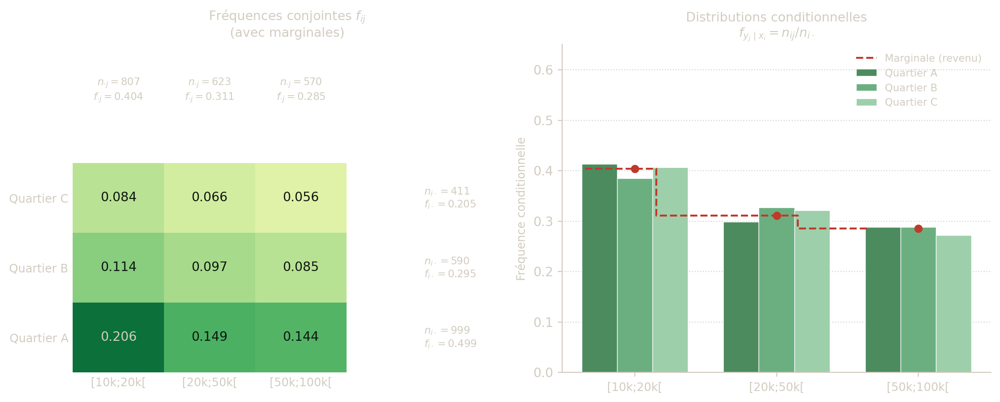
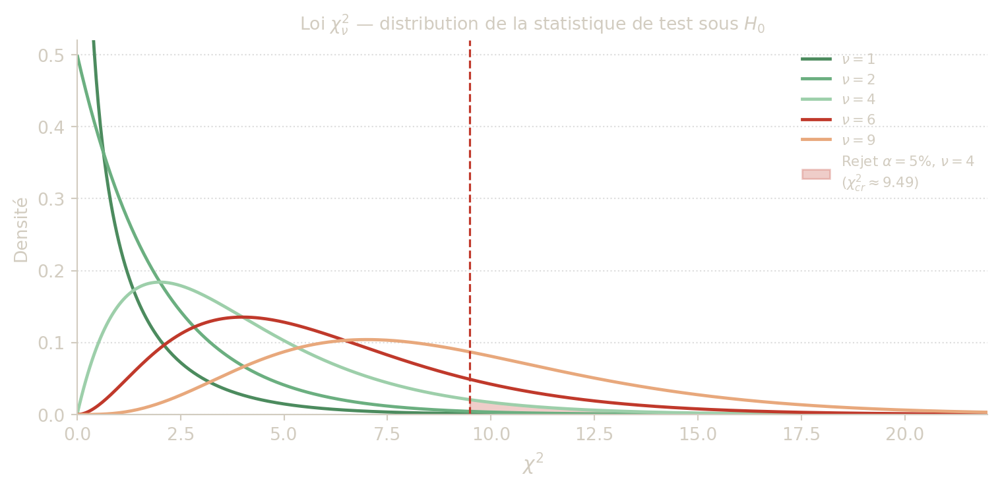

## 1 Distribution conjointe

Lorsqu’on observe **deux variables simultanément** sur chaque individu d’une population, on ne peut pas les étudier séparément sans perdre l’information sur leur relation. La distribution conjointe capture précisément cette information : elle recense le nombre (ou la fréquence) d’individus pour chaque combinaison de modalités des deux variables. Son outil de représentation naturel est le **tableau de contingence**.

Soit \\P\\ une population et \\(x,y)\\ un couple de variables, c’est-à-dire une application \\ (x,y):P\to E_x\times E_y, \qquad u\mapsto (x(u),y(u)). \\

Les variables peuvent être qualitatives ou quantitatives (discrètes ou regroupées en classes). On parle de **couple statistique** : chaque individu est décrit par **deux** caractères simultanément, ce qui permet d’étudier la relation entre eux.

> **NOTE:**
>
> Si \\x_1,\dots,x_p\\ sont les modalités de \\x\\ et \\y_1,\dots,y_q\\ celles de \\y\\ :
>
> - \\n\_{ij}\\ est l’**effectif conjoint** du couple \\(x_i,y_j)\\ : le nombre d’individus ayant simultanément \\x=x_i\\ et \\y=y_j\\,
> - \\f\_{ij}=n\_{ij}/n\\ est la **fréquence conjointe**,
> - l’ensemble des triplets \\(x_i,y_j,n\_{ij})\\ forme la **distribution conjointe**.
>
> On a toujours : \\ \sum\_{i=1}^p\sum\_{j=1}^q n\_{ij}=n, \qquad \sum\_{i=1}^p\sum\_{j=1}^q f\_{ij}=1. \\

La représentation standard est le **tableau de contingence** : un tableau à double entrée de dimensions \\p\times q\\ dont la cellule \\(i,j)\\ contient \\n\_{ij}\\ (ou \\f\_{ij}\\), complété par les totaux marginaux en marge.

> **CAUTION:**
>
> Une enquête porte sur 2000 habitants. On observe :
>
> | Quartier / Revenu annuel | \\\[10000,20000\[\\ | \\\[20000,50000\[\\ | \\\[50000,100000\[\\ | Total |
> |----|---:|---:|---:|---:|
> | A | 413 | 298 | 288 | ? |
> | B | 227 | 193 | 170 | ? |
> | C | 167 | 132 | 112 | ? |
> | Total | ? | ? | ? | 2000 |
>
> 1.  Compléter le tableau.
> 2.  Calculer la fréquence d’habitants ayant un revenu d’au moins 20 000.

> **TIP:**
>
> - Totaux lignes :
>   - A : 999,
>   - B : 590,
>   - C : 411.
> - Totaux colonnes :
>   - \\\[10000,20000\[\\ : 807,
>   - \\\[20000,50000\[\\ : 623,
>   - \\\[50000,100000\[\\ : 570.
> - Fréquence revenu \\\ge 20000\\ : \\ \frac{623+570}{2000}=\frac{1193}{2000}=0{,}5965. \\

## 2 Distributions marginales

Une fois le tableau de contingence construit, on peut retrouver la distribution de chaque variable **individuellement** en faisant la somme sur l’autre variable. Ces distributions dites **marginales** correspondent aux totaux de lignes et de colonnes du tableau — elles figurent littéralement dans les **marges** du tableau. Elles permettent de calculer les indicateurs habituels — moyenne, médiane, écart-type — pour chaque variable, indépendamment de l’autre.

À partir de la distribution conjointe, on obtient les distributions de chaque variable prise séparément.

> **NOTE:**
>
> - Effectif marginal de \\x_i\\ : \\n\_{i\cdot}=\sum\_{j=1}^q n\_{ij}, \qquad f\_{i\cdot}=\frac{n\_{i\cdot}}{n}.\\
> - Effectif marginal de \\y_j\\ : \\n\_{\cdot j}=\sum\_{i=1}^p n\_{ij}, \qquad f\_{\cdot j}=\frac{n\_{\cdot j}}{n}.\\
>
> Les couples \\(x_i,n\_{i\cdot})\\ et \\(y_j,n\_{\cdot j})\\ définissent les **distributions marginales** de \\x\\ et \\y\\.

> **IMPORTANT:**
>
> Les distributions marginales vérifient : \\ \sum\_{i=1}^p n\_{i\cdot} = \sum\_{j=1}^q n\_{\cdot j} = n, \qquad \sum\_{i=1}^p f\_{i\cdot} = \sum\_{j=1}^q f\_{\cdot j} = 1. \\
>
> On retrouve bien des distributions complètes sur chacune des deux variables.

Ces marginales permettent de calculer les indicateurs usuels de chaque variable (moyenne, médiane, écart-type, etc.) si le type de variable le permet. Pour une variable quantitative regroupée en classes, on utilise les **centres de classes** \\c_j\\ comme valeurs représentatives : \\ \bar x = \sum\_{i=1}^p c_i\\ f\_{i\cdot}. \\

> **CAUTION:**
>
> Reprendre l’exemple 1.
>
> 1.  Déterminer les distributions marginales de “Quartier” et de “Revenu annuel”.
> 2.  Pour « Revenu annuel » (en classes), estimer la moyenne à l’aide des centres de classes.

> **TIP:**
>
> - Marginale de “Quartier” : totaux de lignes / 2000.
> - Marginale de “Revenu annuel” : totaux de colonnes / 2000.
> - Moyenne approximative du revenu : \\ \bar y\approx\sum_j c_j f\_{\cdot j}, \\ où \\c_j\\ est le centre de la classe \\j\\.

## 3 Distributions conditionnelles

Les distributions marginales décrivent chaque variable dans l’ensemble de la population. Mais que se passe-t-il **au sein d’un sous-groupe** ? La distribution conditionnelle répond à cette question : elle décrit la répartition d’une variable lorsqu’on **fixe la modalité de l’autre**. Comparer les distributions conditionnelles de \\y\\ pour différentes valeurs de \\x\\ est le premier outil pour détecter visuellement une association entre les deux variables.

Une ligne (resp. colonne) du tableau de contingence décrit la répartition conditionnelle de \\y\\ sachant \\x=x_i\\ (resp. de \\x\\ sachant \\y=y_j\\).

> **NOTE:**
>
> - Fréquence conditionnelle de \\y_j\\ sachant \\x_i\\ : \\f\_{y_j\mid x_i}=\frac{n\_{ij}}{n\_{i\cdot}}.\\
> - Fréquence conditionnelle de \\x_i\\ sachant \\y_j\\ : \\f\_{x_i\mid y_j}=\frac{n\_{ij}}{n\_{\cdot j}}.\\

> **IMPORTANT:**
>
> Pour chaque \\i\\ fixé, les fréquences conditionnelles de \\y\\ sachant \\x_i\\ forment une distribution complète : \\ \sum\_{j=1}^q f\_{y_j\mid x_i} = \frac{1}{n\_{i\cdot}}\sum\_{j=1}^q n\_{ij} = \frac{n\_{i\cdot}}{n\_{i\cdot}} = 1. \\
>
> On peut donc calculer la **moyenne conditionnelle** de \\y\\ sachant \\x=x_i\\ : \\ \bar y\_{\|x_i} = \sum\_{j=1}^q c_j\\ f\_{y_j\mid x_i}, \\ où \\c_j\\ est la valeur (ou le centre de classe) de \\y_j\\.

Les distributions conditionnelles servent à comparer les profils entre sous-populations. Si ces profils sont très différents d’une modalité de \\x\\ à l’autre, cela suggère une association entre \\x\\ et \\y\\. Si au contraire ils sont tous semblables à la distribution marginale de \\y\\, les deux variables semblent indépendantes.

Figure 1: Distribution conjointe, marginales et conditionnelles illustrées sur les données de l’exemple 1 (2000 habitants). **Gauche** : fréquences conjointes \\f\_{ij}\\ (intensité de la couleur). **Droite** : distributions conditionnelles du revenu pour chaque quartier — si les barres étaient identiques d’un quartier à l’autre, les variables seraient indépendantes.

> **CAUTION:**
>
> Dans l’exemple 1, déterminer la distribution conditionnelle du revenu sachant que l’on est dans le quartier A. Puis identifier la classe de revenu majoritaire dans ce quartier.

> **TIP:**
>
> Comme \\n\_{A\cdot}=999\\ : \\ \left(\frac{413}{999},\frac{298}{999},\frac{288}{999}\right) \approx (0{,}413,0{,}298,0{,}288). \\ La classe majoritaire est \\\[10000,20000\[\\.

## 4 Indépendance de deux variables

Deux variables sont **indépendantes** si connaître la modalité de l’une n’apporte aucune information sur la distribution de l’autre — autrement dit, si toutes les distributions conditionnelles sont identiques à la distribution marginale. En pratique, cette condition se traduit par une relation de **factorisation** des fréquences conjointes, ce qui permet de la vérifier cellule par cellule dans le tableau de contingence.

> **NOTE:**
>
> Les variables \\x\\ et \\y\\ sont **indépendantes** si, pour toute modalité \\x_i\\, la distribution conditionnelle de \\y\\ sachant \\x_i\\ est égale à la distribution marginale de \\y\\ : \\ f\_{y_j\mid x_i} = f\_{\cdot j} \quad \text{pour tout } i,j. \\ Autrement dit, la valeur prise par \\x\\ ne modifie pas la répartition de \\y\\.

> **IMPORTANT:**
>
> Les propriétés suivantes sont équivalentes :
>
> 1.  \\x\\ et \\y\\ sont indépendantes.
> 2.  Pour tout \\i,j\\, \\f\_{ij}=f\_{i\cdot}f\_{\cdot j}.\\
> 3.  Pour tout \\i,j\\, \\n\_{ij}=\frac{n\_{i\cdot}n\_{\cdot j}}{n}.\\
>
> **Pourquoi ?** Si \\f\_{y_j\mid x_i}=f\_{\cdot j}\\, alors : \\ f\_{ij}=\frac{n\_{ij}}{n}=\frac{n\_{ij}}{n\_{i\cdot}}\cdot\frac{n\_{i\cdot}}{n}=f\_{y_j\mid x_i}\cdot f\_{i\cdot}=f\_{\cdot j}\cdot f\_{i\cdot}. \\ La fréquence conjointe se **factorise** en le produit des deux fréquences marginales. C’est cette propriété que le test du \\\chi^2\\ va exploiter quantitativement.

En pratique, l’indépendance se traduit par des profils de lignes (ou colonnes) identiques les uns aux autres.

> **CAUTION:**
>
> Dans un tableau \\2\times 2\\ avec \\ \begin{pmatrix} 30 & 20\\ 15 & 35 \end{pmatrix}, \quad n=100, \\ vérifier si l’indépendance est satisfaite exactement.

> **TIP:**
>
> Totaux : lignes \\(50,50)\\, colonnes \\(45,55)\\. Sous indépendance, la case (1,1) devrait valoir \\50\times45/100=22{,}5\\ (et non 30). Donc les variables ne sont pas indépendantes.

------------------------------------------------------------------------

## 5 Test du khi-deux d’indépendance

### 5.1 Motivation

L’inspection visuelle des distributions conditionnelles ne suffit pas : les écarts observés peuvent être dus au **hasard de l’échantillonnage**. Même si les variables sont parfaitement indépendantes dans la population, un échantillon produira toujours des fréquences conjointes légèrement différentes du produit des marginales. La question est donc : les écarts observés sont-ils **trop grands** pour être attribués au seul hasard ?

Le test du \\\chi^2\\ d’indépendance de Pearson fournit une réponse rigoureuse à cette question. L’idée est de :

1.  calculer ce que l’on observerait **si l’indépendance était exacte** (effectifs théoriques),
2.  mesurer l’**écart global** entre ces valeurs théoriques et les valeurs réellement observées,
3.  décider si cet écart est significatif en le comparant à une valeur critique issue de la loi \\\chi^2\\.

On teste :

- \\H_0\\ : indépendance entre \\x\\ et \\y\\,
- \\H_1\\ : dépendance (association).

### 5.2 Effectifs théoriques

Sous \\H_0\\, si les variables étaient indépendantes, la fréquence conjointe \\f\_{ij}\\ devrait valoir \\f\_{i\cdot}f\_{\cdot j}\\ (factorisation). On en déduit l’effectif que l’on devrait observer dans la case \\(i,j)\\ :

\\ E\_{ij}=n\\f\_{i\cdot}f\_{\cdot j}=n\cdot\frac{n\_{i\cdot}}{n}\cdot\frac{n\_{\cdot j}}{n}=\frac{n\_{i\cdot}\\n\_{\cdot j}}{n}. \\

**Interprétation :** \\E\_{ij}\\ est la part du total \\n\\ que l’on attribuerait à la case \\(i,j)\\ si les lignes et les colonnes étaient « proportionnelles » les unes aux autres. Les totaux marginaux \\n\_{i\cdot}\\ et \\n\_{\cdot j}\\ sont fixés (ils ne dépendent pas de \\H_0\\) ; seule la répartition interne change.

> **IMPORTANT:**
>
> Les effectifs théoriques conservent les mêmes totaux que les effectifs observés : \\ \sum\_{j=1}^q E\_{ij}=n\_{i\cdot} \quad\text{et}\quad \sum\_{i=1}^p E\_{ij}=n\_{\cdot j}. \\ Les marges du tableau ne sont pas modifiées par l’hypothèse \\H_0\\ : seule la distribution *interne* des cellules est affectée.

> **TIP:**
>
> L’approximation par la loi \\\chi^2\\ n’est valide que si les effectifs théoriques sont suffisamment grands :
>
> - au moins **80 %** des \\E\_{ij}\\ sont \\\ge 5\\,
> - **aucun** \\E\_{ij}\\ n’est nul ou très proche de zéro.
>
> Si cette condition n’est pas satisfaite, il faut **regrouper** des modalités (fusionner des lignes ou colonnes) jusqu’à ce qu’elle le soit. Un tableau \\2\times 2\\ avec tous les \\E\_{ij}\<5\\ nécessite le test exact de Fisher.

### 5.3 Statistique de test

On mesure l’écart global entre les effectifs observés \\O\_{ij}=n\_{ij}\\ et les effectifs théoriques \\E\_{ij}\\ par la **statistique de Pearson** :

\\ \chi^2\_{obs}=\sum\_{i=1}^p\sum\_{j=1}^q\frac{(O\_{ij}-E\_{ij})^2}{E\_{ij}}. \\

**Décomposition de la formule :**

- \\(O\_{ij}-E\_{ij})^2\\ mesure l’**écart au carré** entre observé et attendu. On élève au carré pour éviter que les écarts positifs et négatifs ne se compensent, et pour pénaliser davantage les grands écarts.
- On divise par \\E\_{ij}\\ pour **normaliser** : un écart de 10 est beaucoup plus remarquable dans une cellule attendue à 15 que dans une cellule attendue à 500. La division rend les contributions comparables.
- Plus \\\chi^2\_{obs}\\ est **grand**, plus les données s’éloignent de l’hypothèse d’indépendance.
- Si l’indépendance était parfaite (\\O\_{ij}=E\_{ij}\\ pour tout \\i,j\\), on obtiendrait \\\chi^2\_{obs}=0\\.

### 5.4 Loi de la statistique sous \\H_0\\

> **NOTE:**
>
> Sous \\H_0\\ et lorsque les effectifs sont suffisamment grands (condition de Cochran), la statistique \\\chi^2\_{obs}\\ suit **approximativement** une loi du khi-deux à \\\nu\\ degrés de liberté : \\ \chi^2\_{obs} \underset{H_0}{\sim} \chi^2\_\nu, \qquad \nu=(p-1)(q-1). \\

**Pourquoi \\(p-1)(q-1)\\ degrés de liberté ?**

Le tableau \\p\times q\\ contient \\pq\\ cellules, mais les effectifs ne sont pas libres : les totaux marginaux (lignes et colonnes) sont fixés, ce qui impose \\p+q-1\\ contraintes (les \\p\\ totaux de lignes et les \\q\\ totaux de colonnes, moins 1 car la somme des deux est la même, \\n\\). Le nombre de cellules « libres » est donc : \\ pq - (p+q-1) = (p-1)(q-1). \\ On peut remplir librement les \\(p-1)(q-1)\\ premières cellules ; toutes les autres sont alors déterminées par les contraintes sur les marges.

**La loi \\\chi^2\_\nu\\ :** c’est une loi continue sur \\\mathbb{R}\_+\\, asymétrique à droite, dont la densité est nulle en zéro et décroît vers zéro pour les grandes valeurs. Plus \\\nu\\ est grand, plus la distribution est étalée vers la droite. La valeur critique \\\chi^2\_{1-\alpha,\nu}\\ est le quantile d’ordre \\1-\alpha\\ de cette loi, tabule en annexe.

Figure 2: Densité de la loi \\\chi^2\_\nu\\ pour différents degrés de liberté. La zone grisée représente la région de rejet au seuil \\\alpha=5\\\\ pour \\\nu=4\\ : on rejette \\H_0\\ lorsque \\\chi^2\_{obs}\\ tombe dans cette zone.

### 5.5 Règle de décision

Au seuil \\\alpha\\ (risque de première espèce : probabilité de rejeter \\H_0\\ à tort) :

- on lit la valeur critique \\\chi^2\_{1-\alpha,\nu}\\ dans la table (ou on la calcule),
- si \\\chi^2\_{obs}\>\chi^2\_{1-\alpha,\nu}\\, on **rejette \\H_0\\** : les données sont incompatibles avec l’hypothèse d’indépendance,
- si \\\chi^2\_{obs}\le\chi^2\_{1-\alpha,\nu}\\, on **ne rejette pas \\H_0\\** : les données sont compatibles avec l’indépendance.

> **WARNING:**
>
> - **Rejeter \\H_0\\** ne signifie pas prouver \\H_1\\ avec certitude : cela signifie que les données observées seraient très improbables si \\H_0\\ était vraie.
> - **Ne pas rejeter \\H_0\\** ne signifie pas prouver l’indépendance : cela signifie simplement que les données ne fournissent pas assez de preuves contre \\H_0\\. L’absence de preuve n’est pas la preuve de l’absence.
> - Le test du \\\chi^2\\ détecte l’existence d’une association mais **n’en mesure pas l’intensité**. Un test très significatif sur un grand échantillon peut correspondre à une dépendance très faible en pratique.

### 5.6 Valeurs critiques usuelles

| \\\nu\\ | \\\alpha=10\\\\ | \\\alpha=5\\\\ | \\\alpha=1\\\\ |
|--------:|----------------:|---------------:|---------------:|
|       1 |           2,706 |          3,841 |          6,635 |
|       2 |           4,605 |          5,991 |          9,210 |
|       3 |           6,251 |          7,815 |         11,345 |
|       4 |           7,779 |          9,488 |         13,277 |
|       6 |          10,645 |         12,592 |         16,812 |
|       9 |          14,684 |         16,919 |         21,666 |

### 5.7 Méthodologie complète

Pour conduire un test du \\\chi^2\\ d’indépendance, suivre systématiquement les étapes suivantes :

1.  **Poser les hypothèses** : \\H_0\\ (indépendance) et \\H_1\\ (dépendance).
2.  **Construire le tableau** avec les effectifs observés \\O\_{ij}\\ et calculer les totaux marginaux.
3.  **Calculer les effectifs théoriques** \\E\_{ij}=n\_{i\cdot}n\_{\cdot j}/n\\.
4.  **Vérifier Cochran** : au moins 80 % des \\E\_{ij}\ge 5\\ et aucun nul. Sinon, regrouper.
5.  **Calculer la statistique** \\\chi^2\_{obs}=\sum (O\_{ij}-E\_{ij})^2/E\_{ij}\\.
6.  **Déterminer les degrés de liberté** \\\nu=(p-1)(q-1)\\.
7.  **Lire la valeur critique** \\\chi^2\_{1-\alpha,\nu}\\ dans la table.
8.  **Conclure** en comparant \\\chi^2\_{obs}\\ à \\\chi^2\_{1-\alpha,\nu}\\, et reformuler dans le contexte du problème.

> **CAUTION:**
>
> Reprendre le tableau de l’exemple 1 et tester l’indépendance entre « Quartier » et « Revenu annuel » au seuil \\\alpha=5\\\\.

> **TIP:**
>
> **Données (tableau observé)**
>
> | Quartier / Revenu | \\\[10k;20k\[\\ | \\\[20k;50k\[\\ | \\\[50k;100k\[\\ |    Total |
> |-------------------|----------------:|----------------:|-----------------:|---------:|
> | A                 |             413 |             298 |              288 |      999 |
> | B                 |             227 |             193 |              170 |      590 |
> | C                 |             167 |             132 |              112 |      411 |
> | **Total**         |         **807** |         **623** |          **570** | **2000** |
>
> **Étape 1 — Hypothèses**
>
> \\H_0\\ : indépendance entre le quartier et la tranche de revenu. \\H_1\\ : dépendance.
>
> **Étape 2 — Effectifs théoriques** \\E\_{ij}=n\_{i\cdot}n\_{\cdot j}/2000\\
>
> |  | \\\[10k;20k\[\\ | \\\[20k;50k\[\\ | \\\[50k;100k\[\\ |
> |----|---:|---:|---:|
> | A | \\999\times807/2000=403{,}05\\ | \\999\times623/2000=311{,}45\\ | \\999\times570/2000=284{,}72\\ |
> | B | \\590\times807/2000=238{,}07\\ | \\590\times623/2000=183{,}79\\ | \\590\times570/2000=168{,}15\\ |
> | C | \\411\times807/2000=165{,}84\\ | \\411\times623/2000=128{,}03\\ | \\411\times570/2000=117{,}14\\ |
>
> Tous les \\E\_{ij}\>5\\ (min : 117,14) — condition de Cochran largement satisfaite.
>
> **Étape 3 — Statistique**
>
> \\ \chi^2\_{obs} =\frac{(413-403{,}05)^2}{403{,}05} +\frac{(298-311{,}45)^2}{311{,}45} +\frac{(288-284{,}72)^2}{284{,}72} +\frac{(227-238{,}07)^2}{238{,}07} +\frac{(193-183{,}79)^2}{183{,}79} +\frac{(170-168{,}15)^2}{168{,}15} +\frac{(167-165{,}84)^2}{165{,}84} +\frac{(132-128{,}03)^2}{128{,}03} +\frac{(112-117{,}14)^2}{117{,}14} \\ \\ = 0{,}246+0{,}585+0{,}038+0{,}514+0{,}460+0{,}020+0{,}008+0{,}123+0{,}226 = 2{,}22. \\
>
> **Étape 4 — Degrés de liberté et valeur critique**
>
> \\\nu=(3-1)(3-1)=4\\. Au seuil 5 % : \\\chi^2\_{0{,}95;\\4}=9{,}488\\.
>
> **Étape 5 — Décision et conclusion**
>
> \\\chi^2\_{obs}=2{,}22 \< 9{,}488\\ : on **ne rejette pas \\H_0\\** au seuil 5 %.
>
> Les données sont compatibles avec l’hypothèse d’indépendance entre le quartier de résidence et la tranche de revenu. Les écarts observés entre les effectifs observés et théoriques peuvent s’expliquer par les fluctuations d’échantillonnage.

> **CAUTION:**
>
> Cent fruits sont triés selon : - leur poids (en grammes), - leur qualité (accepté/refusé).
>
> | Poids (g)       | Accepté | Refusé |
> |-----------------|--------:|-------:|
> | \\\[200;240\[\\ |       8 |     23 |
> | \\\[240;280\[\\ |       7 |     45 |
> | \\\[280;360\[\\ |       4 |     13 |
>
> 1.  Identifier les caractères étudiés et leur type.
> 2.  Déterminer la distribution marginale de la variable « poids » et le poids médian.
> 3.  Déterminer la proportion de fruits dans la classe \\\[240;280\[\\ pour chaque qualite. Les variables « poids » et « qualité » semblent-elles indépendantes ?
> 4.  Tester l’indépendance de « qualité » et “poids” au risque \\\alpha=5\\\\ (test du khi-deux).

> **TIP:**
>
> **1. Caractères et types**
>
> - *Poids* : variable quantitative continue, regroupée en classes.
> - *Qualité* : variable qualitative nominale binaire (accepté / refusé).
>
> **2. Distribution marginale du poids et médiane**
>
> Totaux lignes et colonnes :
>
> | Poids (g)       | Accepté | Refusé |   Total | \\f\_{i\cdot}\\ | \\F\_{i\cdot}\\ |
> |-----------------|--------:|-------:|--------:|----------------:|----------------:|
> | \\\[200;240\[\\ |       8 |     23 |      31 |            0,31 |            0,31 |
> | \\\[240;280\[\\ |       7 |     45 |      52 |            0,52 |            0,83 |
> | \\\[280;360\[\\ |       4 |     13 |      17 |            0,17 |            1,00 |
> | **Total**       |  **19** | **81** | **100** |                 |                 |
>
> La fréquence cumulée dépasse 0,5 dans la classe \\\[240;280\[\\. La médiane vaut : \\ M_e = 240 + \frac{0{,}50 - 0{,}31}{0{,}52}\times 40 = 240 + \frac{0{,}19}{0{,}52}\times 40 \approx 254{,}6\text{ g}. \\
>
> **3. Distributions conditionnelles et indépendance visuelle**
>
> La proportion de fruits dans \\\[240;280\[\\ pour chaque qualité :
>
> - Acceptés : \\\dfrac{7}{19} \approx 0{,}368\\.
> - Refusés : \\\dfrac{45}{81} \approx 0{,}556\\.
>
> Sous indépendance, on attendrait la même proportion que dans la marginale (\\52/100 = 0{,}52\\) pour les deux qualités. Les valeurs \\0{,}368\\ et \\0{,}556\\ s’en écartent sensiblement, ce qui suggère une dépendance entre poids et qualité.
>
> **4. Test du khi-deux**
>
> *Hypothèses :* \\H_0\\ : indépendance entre poids et qualité ; \\H_1\\ : dépendance.
>
> *Effectifs théoriques* \\E\_{ij} = n\_{i\cdot}n\_{\cdot j}/100\\ :
>
> | Poids           |                     Accepté |                       Refusé |
> |-----------------|----------------------------:|-----------------------------:|
> | \\\[200;240\[\\ | \\31\times19/100 = 5{,}89\\ | \\31\times81/100 = 25{,}11\\ |
> | \\\[240;280\[\\ | \\52\times19/100 = 9{,}88\\ | \\52\times81/100 = 42{,}12\\ |
> | \\\[280;360\[\\ | \\17\times19/100 = 3{,}23\\ | \\17\times81/100 = 13{,}77\\ |
>
> *Condition de Cochran :* \\E\_{31}=3{,}23\<5\\ (une cellule sur six). Le test est à utiliser avec prudence ; on peut regrouper \\\[200;240\[\\ et \\\[280;360\[\\ si l’on veut strictement satisfaire la règle. On procède ici avec les données telles quelles.
>
> *Statistique :* \\ \chi^2\_{obs} = \frac{(8-5{,}89)^2}{5{,}89} + \frac{(23-25{,}11)^2}{25{,}11} + \frac{(7-9{,}88)^2}{9{,}88} + \frac{(45-42{,}12)^2}{42{,}12} + \frac{(4-3{,}23)^2}{3{,}23} + \frac{(13-13{,}77)^2}{13{,}77} \approx 0{,}756+0{,}177+0{,}839+0{,}197+0{,}184+0{,}043 = 2{,}20. \\
>
> *Degrés de liberté :* \\\nu=(3-1)(2-1)=2\\.
>
> *Valeur critique :* \\\chi^2\_{0{,}95;\\2}\approx 5{,}991\\.
>
> *Décision :* \\2{,}20 \< 5{,}991\\, on **ne rejette pas** \\H_0\\ au seuil 5 %.
>
> *Conclusion :* Les données ne fournissent pas de preuve significative d’une dépendance entre le poids et la qualité des fruits.

> **CAUTION:**
>
> Le tableau suivant donne la distribution conjointe (fréquences) du temps de trajet domicile-travail et du mode de transport :
>
> | Temps (h)  | \\\[0;0{,}5\[\\ | \\\[0{,}5;1\[\\ | \\\[1;2\[\\ |
> |------------|----------------:|----------------:|------------:|
> | Collectif  |            0,05 |            0,09 |        0,14 |
> | Individuel |            0,25 |            0,24 |        0,23 |
>
> 1.  Déterminer le temps moyen pour chacun des deux modes de transport.
> 2.  En supposant un échantillon de 1000 personnes, tester l’indépendance entre mode de transport et classe de temps au risque \\\alpha=5\\\\.

> **TIP:**
>
> **1. Temps moyen par mode de transport**
>
> Centres de classes : \\c_1=0{,}25\\ h, \\c_2=0{,}75\\ h, \\c_3=1{,}5\\ h.
>
> Marginales (somme sur les colonnes de chaque ligne) :
>
> - Collectif : \\f\_{\text{col}\cdot} = 0{,}05+0{,}09+0{,}14 = 0{,}28\\.
> - Individuel : \\f\_{\text{ind}\cdot} = 0{,}25+0{,}24+0{,}23 = 0{,}72\\.
>
> Fréquences conditionnelles pour le transport *collectif* (on divise chaque cellule par 0,28) :
>
> \\ f\_{\[0;0{,}5\[\mid\text{col}}} = \frac{0{,}05}{0{,}28}\approx 0{,}179,\quad f\_{\[0{,}5;1\[\mid\text{col}}} = \frac{0{,}09}{0{,}28}\approx 0{,}321,\quad f\_{\[1;2\[\mid\text{col}}} = \frac{0{,}14}{0{,}28} = 0{,}500. \\
>
> \\ \bar t\_{\text{col}} = 0{,}25\times 0{,}179 + 0{,}75\times 0{,}321 + 1{,}5\times 0{,}500 = \frac{0{,}25\times 0{,}05 + 0{,}75\times 0{,}09 + 1{,}5\times 0{,}14}{0{,}28} = \frac{0{,}0625+0{,}0675+0{,}21}{0{,}28} = \frac{0{,}29}{0{,}28} \approx 1{,}036\text{ h}. \\
>
> Fréquences conditionnelles pour le transport *individuel* (on divise par 0,72) :
>
> \\ \bar t\_{\text{ind}} = \frac{0{,}25\times 0{,}25 + 0{,}75\times 0{,}24 + 1{,}5\times 0{,}23}{0{,}72} = \frac{0{,}0625+0{,}18+0{,}345}{0{,}72} = \frac{0{,}5875}{0{,}72} \approx 0{,}816\text{ h}. \\
>
> Les usagers des transports collectifs ont en moyenne un trajet **26 % plus long** que ceux en transport individuel.
>
> **2. Test du khi-deux (n = 1000)**
>
> *Hypothèses :* \\H_0\\ : indépendance entre mode et classe de temps ; \\H_1\\ : dépendance.
>
> *Tableau d’effectifs observés* (fréquences \\\times\\ 1000) :
>
> |            | \\\[0;0{,}5\[\\ | \\\[0{,}5;1\[\\ | \\\[1;2\[\\ |    Total |
> |------------|----------------:|----------------:|------------:|---------:|
> | Collectif  |              50 |              90 |         140 |      280 |
> | Individuel |             250 |             240 |         230 |      720 |
> | **Total**  |         **300** |         **330** |     **370** | **1000** |
>
> *Effectifs théoriques* \\E\_{ij}=n\_{i\cdot}n\_{\cdot j}/1000\\ :
>
> |            | \\\[0;0{,}5\[\\ | \\\[0{,}5;1\[\\ | \\\[1;2\[\\ |
> |------------|----------------:|----------------:|------------:|
> | Collectif  |              84 |            92,4 |       103,6 |
> | Individuel |             216 |           237,6 |       266,4 |
>
> Tous les \\E\_{ij}\ge 5\\ : condition de Cochran satisfaite.
>
> *Statistique :* \\ \chi^2\_{obs} =\frac{(50-84)^2}{84}+\frac{(90-92{,}4)^2}{92{,}4}+\frac{(140-103{,}6)^2}{103{,}6} +\frac{(250-216)^2}{216}+\frac{(240-237{,}6)^2}{237{,}6}+\frac{(230-266{,}4)^2}{266{,}4} \\ \\ \approx 13{,}76+0{,}06+12{,}79+5{,}35+0{,}02+4{,}97 = 36{,}95. \\
>
> *Degrés de liberté :* \\\nu=(2-1)(3-1)=2\\.
>
> *Valeur critique :* \\\chi^2\_{0{,}95;\\2}\approx 5{,}991\\.
>
> *Décision :* \\36{,}95 \gg 5{,}991\\, on **rejette** \\H_0\\ au seuil 5 %.
>
> *Conclusion :* Il existe une dépendance significative entre le mode de transport et la classe de temps de trajet. Les usagers du collectif tendent à avoir des trajets plus longs que ceux en transport individuel.

> **CAUTION:**
>
> Voici les résultats d’une enquête sur les intentions de vote selon la classe d’âge :
>
> | Liste / Âge        | \\\[18;35\[\\ | \\\[35;50\[\\ | \\\[50;80\[\\ |
> |--------------------|--------------:|--------------:|--------------:|
> | Vers l’avenir      |           110 |           113 |           145 |
> | Pour la démocratie |           127 |           120 |           220 |
> | En avant           |            57 |            41 |            67 |
>
> 1.  Déterminer la proportion de personnes entre 18 et 35 ans pour chacune des listes. Commenter.
> 2.  Les variables « intentions de vote » et « âge » sont-elles indépendantes ?
> 3.  Réaliser un test du khi-deux d’indépendance au risque \\\alpha=5\\\\.

> **TIP:**
>
> **Totaux du tableau**
>
> | Liste / Âge        | \\\[18;35\[\\ | \\\[35;50\[\\ | \\\[50;80\[\\ |    Total |
> |--------------------|--------------:|--------------:|--------------:|---------:|
> | Vers l’avenir      |           110 |           113 |           145 |  **368** |
> | Pour la démocratie |           127 |           120 |           220 |  **467** |
> | En avant           |            57 |            41 |            67 |  **165** |
> | **Total**          |       **294** |       **274** |       **432** | **1000** |
>
> **1. Proportion de 18–35 ans par liste**
>
> \\ f\_{\[18;35\[\mid\text{Avenir}}} = \frac{110}{368}\approx 0{,}299,\quad f\_{\[18;35\[\mid\text{Démocratie}}} = \frac{127}{467}\approx 0{,}272,\quad f\_{\[18;35\[\mid\text{En avant}}} = \frac{57}{165}\approx 0{,}345. \\
>
> La proportion marginale des 18–35 ans est \\294/1000=0{,}294\\. Les trois proportions conditionnelles s’en approchent mais présentent des écarts notables (de 0,272 à 0,345), ce qui laisse présager une légère dépendance entre l’intention de vote et la classe d’âge.
>
> **2. Indépendance visuelle**
>
> Sous indépendance, on attendrait la même distribution d’âge dans chaque liste (proportions \\0{,}294\\, \\0{,}274\\, \\0{,}432\\). Les profils conditionnels des trois listes s’en écartent modérément, sans rupture flagrante. L’indépendance est plausible mais doit être confirmée par le test.
>
> **3. Test du khi-deux**
>
> *Hypothèses :* \\H_0\\ : indépendance entre intention de vote et âge ; \\H_1\\ : dépendance.
>
> *Effectifs théoriques* \\E\_{ij}=n\_{i\cdot}n\_{\cdot j}/1000\\ :
>
> |  | \\\[18;35\[\\ | \\\[35;50\[\\ | \\\[50;80\[\\ |
> |----|---:|---:|---:|
> | Vers l’avenir | \\368\times294/1000=108{,}19\\ | \\368\times274/1000=100{,}83\\ | \\368\times432/1000=158{,}98\\ |
> | Pour la démocratie | \\467\times294/1000=137{,}30\\ | \\467\times274/1000=127{,}96\\ | \\467\times432/1000=201{,}74\\ |
> | En avant | \\165\times294/1000=48{,}51\\ | \\165\times274/1000=45{,}21\\ | \\165\times432/1000=71{,}28\\ |
>
> Tous les \\E\_{ij}\ge 5\\ : condition de Cochran satisfaite.
>
> *Statistique :* \\ \chi^2\_{obs} =\frac{(110-108{,}19)^2}{108{,}19} +\frac{(113-100{,}83)^2}{100{,}83} +\frac{(145-158{,}98)^2}{158{,}98} +\frac{(127-137{,}30)^2}{137{,}30} +\frac{(120-127{,}96)^2}{127{,}96} +\frac{(220-201{,}74)^2}{201{,}74} +\frac{(57-48{,}51)^2}{48{,}51} +\frac{(41-45{,}21)^2}{45{,}21} +\frac{(67-71{,}28)^2}{71{,}28} \\ \\ \approx 0{,}030+1{,}468+1{,}229+0{,}772+0{,}495+1{,}652+1{,}486+0{,}392+0{,}257 = 7{,}78. \\
>
> *Degrés de liberté :* \\\nu=(3-1)(3-1)=4\\.
>
> *Valeur critique :* \\\chi^2\_{0{,}95;\\4}\approx 9{,}488\\.
>
> *Décision :* \\7{,}78 \< 9{,}488\\, on **ne rejette pas** \\H_0\\ au seuil 5 %.
>
> *Conclusion :* Au seuil de 5 %, les données ne permettent pas de conclure à une dépendance significative entre l’intention de vote et la classe d’âge. Les différences observées dans les profils sont compatibles avec les fluctuations d’échantillonnage sous l’hypothèse d’indépendance.

------------------------------------------------------------------------

## 6 Lecture et interprétation des résultats

Obtenir une valeur de \\\chi^2\_{obs}\\ et une décision (rejet ou non de \\H_0\\) n’est que le début de l’analyse. Une **bonne interprétation statistique** requiert de contextualiser la décision : un test significatif indique une dépendance, mais pas son intensité ni sa nature. Il faut ensuite examiner quelles cellules contribuent le plus à l’écart global et formuler une conclusion dans le langage du problème étudié.

> **IMPORTANT:**
>
> 1.  Toujours commenter **l’ampleur** des écarts, pas seulement la décision binaire du test.
> 2.  Examiner les distributions conditionnelles pour identifier les associations les plus marquantes.
> 3.  Vérifier la qualité du tableau (effectifs suffisants, classes pertinentes).
> 4.  Distinguer « absence de preuve de dépendance » et « preuve d’indépendance ».
> 5.  Rappeler que le test du \\\chi^2\\ est **sensible à la taille de l’échantillon** : avec un \\n\\ très grand, de très petits écarts pratiquement négligeables peuvent devenir statistiquement significatifs.

### 6.1 Résidus standardisés

Pour identifier quelles cellules contribuent le plus à la valeur de \\\chi^2\_{obs}\\, on calcule les **résidus standardisés** : \\ R\_{ij}=\frac{O\_{ij}-E\_{ij}}{\sqrt{E\_{ij}}}, \\ qui vérifient \\\chi^2\_{obs}=\sum\_{i,j}R\_{ij}^2\\. Les cellules avec \\\|R\_{ij}\|\>2\\ contribuent le plus à l’écart et méritent une attention particulière dans l’interprétation. Un résidu positif signifie que cette combinaison de modalités est **sur-représentée** par rapport à l’indépendance ; un résidu négatif signifie qu’elle est **sous-représentée**.

### 6.2 Limites du test

- Le test du \\\chi^2\\ **ne quantifie pas l’intensité** de l’association. Pour cela, on peut utiliser le coefficient de contingence \\C=\sqrt{\chi^2/(n+\chi^2)}\\ ou le \\V\\ de Cramér \\V=\sqrt{\chi^2/(n\cdot\min(p-1,q-1))}\\, qui sont normalisés entre 0 et 1.
- Il ne s’applique qu’à des **données de comptage** dans un tableau de contingence (et non à des moyennes ou des proportions issues de mesures répétées sur les mêmes individus).
- Il est **non directionnel** : il détecte l’existence d’une association mais n’en précise pas la direction ni la forme.
