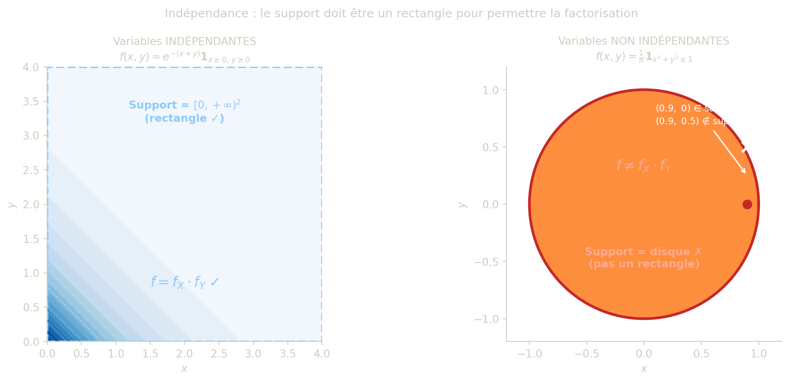
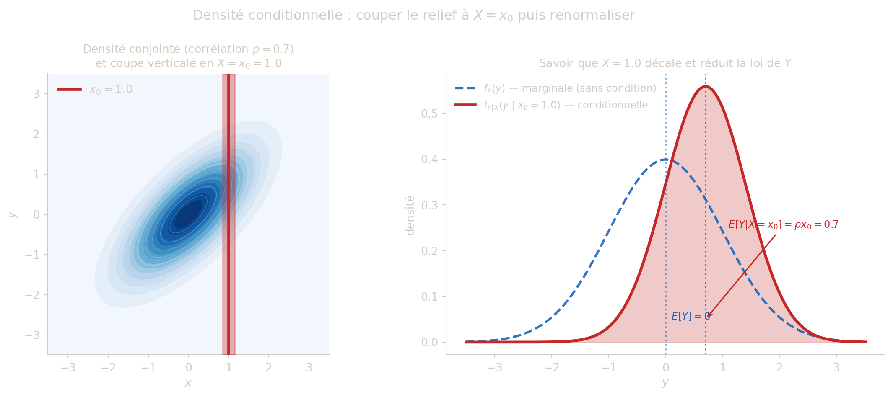
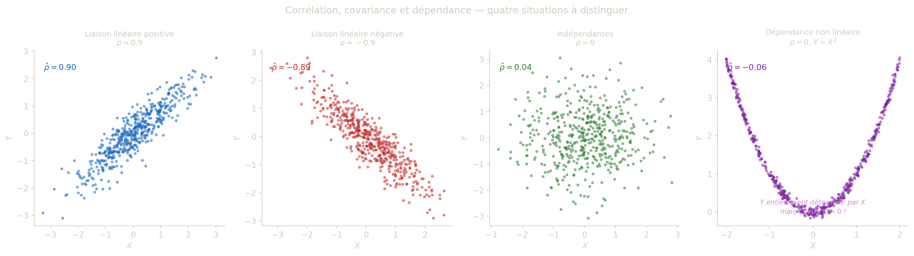
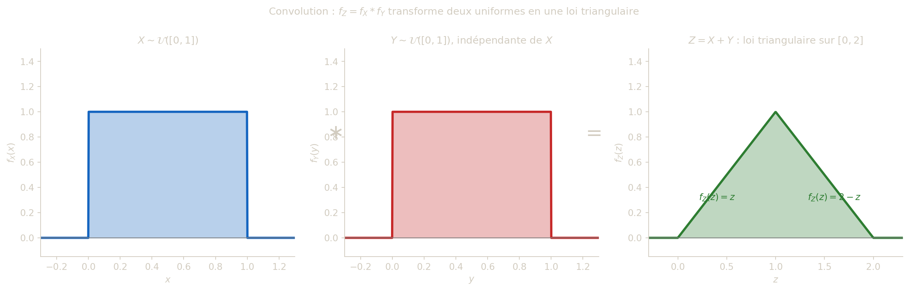

Jusqu’ici, on a étudié les variables aléatoires une à une. Dans de nombreuses situations concrètes, on s’intéresse simultanément à plusieurs grandeurs liées : la taille et le poids d’un individu, la température et la pression atmosphérique, la durée de vie de deux composants d’un même système. Pour modéliser ces **dépendances**, il faut étudier la loi **conjointe** du couple \\(X, Y)\\, qui décrit non seulement le comportement individuel de chaque variable, mais aussi les liens statistiques entre elles. C’est ce que permet le cadre des couples de variables aléatoires à densité.

## 1 Dépendance entre deux variables aléatoires

Deux variables aléatoires \\X\\ et \\Y\\ sont **dépendantes** si la connaissance de la valeur prise par l’une modifie la distribution de l’autre. Dit autrement, savoir que \\X = x\\ change ce qu’on peut dire sur \\Y\\ — et ce changement est capturé par la **densité conditionnelle** \\f\_{Y\mid X}(\cdot\mid x)\\.

> **TIP:**
>
> Il est utile de distinguer trois situations de plus en plus fortes :
>
> | Situation | Signification | Exemple |
> |----|----|----|
> | **Dépendance** | \\f\_{Y\mid X}(y\mid x) \ne f_Y(y)\\ pour certains \\(x,y)\\ | Taille et poids d’un individu |
> | **Non-corrélation** | \\\operatorname{Cov}(X,Y) = 0\\ mais pas nécessairement indépendantes | \\X \sim \mathcal{U}(\[-1,1\])\\, \\Y = X^2\\ |
> | **Indépendance** | \\f(x,y) = f_X(x)\\f_Y(y)\\ pour tout \\(x,y)\\ | Résultats de deux dés distincts |
>
> L’indépendance implique la non-corrélation, mais la réciproque est fausse en général.

### 1.1 Pourquoi la loi conjointe ne se déduit pas des lois marginales

Les lois marginales \\f_X\\ et \\f_Y\\ décrivent le comportement individuel de chaque variable, mais elles **ne contiennent aucune information sur la relation** entre \\X\\ et \\Y\\. Deux couples \\(X_1, Y_1)\\ et \\(X_2, Y_2)\\ peuvent partager exactement les mêmes marginales tout en ayant des structures de dépendance radicalement différentes.

**Exemple clé.** Considérons deux lois normales bivariées avec marginales \\\mathcal{N}(0,1)\\ pour \\X\\ et pour \\Y\\, mais de corrélations différentes. Quelle que soit la corrélation \\\rho \in (-1, 1)\\, la densité conjointe

\\ f\_\rho(x,y) = \frac{1}{2\pi\sqrt{1-\rho^2}}\exp\\\left(-\frac{x^2 - 2\rho xy + y^2}{2(1-\rho^2)}\right) \\

produit les mêmes marginales \\f_X = f_Y = \mathcal{N}(0,1)\\. Pourtant, pour \\\rho = 0\\ les variables sont indépendantes, pour \\\rho = 0.9\\ elles sont fortement positivement liées (grand \\X\\ prédit grand \\Y\\), et pour \\\rho = -0.9\\ elles varient en sens opposé. Les marginales ne font pas la différence : **c’est la loi conjointe — et elle seule — qui encode la dépendance**.

### 1.2 Mesurer la dépendance : covariance et limites

La **covariance** \\\operatorname{Cov}(X,Y) = E(XY) - E(X)E(Y)\\ est une mesure scalaire de la dépendance *linéaire* :

- \\\operatorname{Cov}(X,Y) \> 0\\ : \\X\\ et \\Y\\ tendent à varier dans le même sens.
- \\\operatorname{Cov}(X,Y) \< 0\\ : \\X\\ et \\Y\\ tendent à varier en sens opposé.
- \\\operatorname{Cov}(X,Y) = 0\\ : absence de liaison linéaire — mais pas nécessairement indépendance.

La covariance ne capture que les liaisons **linéaires**. Si \\Y = X^2\\ avec \\X\\ symétrique autour de \\0\\, la covariance est nulle malgré une dépendance fonctionnelle totale. Le **coefficient de corrélation** \\\rho(X,Y) = \operatorname{Cov}(X,Y)/(\sigma_X\sigma_Y)\\ est la version normalisée, bornée dans \\\[-1, 1\]\\, et \\\|\rho\| = 1\\ si et seulement si la liaison est exactement affine.

## 2 Indépendance de deux variables continues

L’indépendance est la notion fondamentale qui formalise l’idée que « connaître la valeur de \\X\\ n’apporte aucune information sur \\Y\\, et réciproquement ». Dans le cas discret, deux variables sont indépendantes si les probabilités conjointes sont les produits des probabilités marginales. La même idée s’étend au cas continu : l’indépendance se lit directement sur la **factorisation** de la densité conjointe en un produit de densités marginales.

> **NOTE:**
>
> Les variables continues \\X\\ et \\Y\\ sont indépendantes si, pour tous intervalles \\I,J\\, \\ P(X\in I,\\ Y\in J)=P(X\in I)P(Y\in J). \\

> **IMPORTANT:**
>
> Soit \\(X,Y)\\ de densité conjointe \\f\\, de répartition conjointe \\F\\, et de marginales \\(f_X,f_Y)\\, \\(F_X,F_Y)\\. Les propriétés suivantes sont équivalentes :
>
> 1.  \\X\\ et \\Y\\ sont indépendantes.
> 2.  \\F(x,y)=F_X(x)F_Y(y)\\ pour tout \\(x,y)\\.
> 3.  \\f(x,y)=f_X(x)f_Y(y)\\ pour tout \\(x,y)\\.

### 2.1 Indépendance : ce que ça signifie vraiment

La définition formelle dit que les événements \\\\X\in I\\\\ et \\\\Y\in J\\\\ sont indépendants pour tous intervalles \\I, J\\. En pratique, la caractérisation la plus utile est la **factorisation de la densité** : \\f(x,y) = f_X(x)\\f_Y(y)\\.

Voici comment lire cette condition dans les deux directions :

- **Si \\X\\ et \\Y\\ sont indépendantes**, la densité conditionnelle est identique à la densité marginale : \\f\_{Y\mid X}(y\mid x) = \frac{f(x,y)}{f_X(x)} = \frac{f_X(x)\\f_Y(y)}{f_X(x)} = f_Y(y).\\ Savoir que \\X = x\\ ne change rien à la loi de \\Y\\ — quelle que soit la valeur observée de \\X\\, la distribution de \\Y\\ reste la même. **La connaissance de \\X\\ est inutile pour prédire \\Y\\.**

- **Si \\X\\ et \\Y\\ sont dépendantes**, il existe au moins un \\x\\ tel que \\f\_{Y\mid X}(\cdot\mid x) \ne f_Y\\. Connaître la valeur de \\X\\ **modifie** la distribution de \\Y\\, parfois radicalement.

> **TIP:**
>
> Prenons deux exemples avec des marginales exponentielles \\f_X(x) = e^{-x}\\, \\f_Y(y) = e^{-y}\\ sur \\\mathbb{R}\_+\\.
>
> **Cas 1 — Indépendantes.** La densité conjointe est \\f(x,y) = e^{-x}e^{-y} = e^{-(x+y)}\\ sur \\\[0,+\infty)^2\\.
>
> - Support : le quart de plan \\\[0,+\infty)^2\\ — un rectangle ✓.
> - Factorisation : \\f(x,y) = f_X(x) \cdot f_Y(y)\\ ✓.
> - Conditionnelle : \\f\_{Y\mid X}(y\mid x) = e^{-y}\\ — la loi de \\Y\\ ne dépend pas de \\x\\ ✓.
> - Interprétation : la durée de vie de deux composants fabriqués indépendamment.
>
> **Cas 2 — Dépendantes.** La densité conjointe est \\f(x,y) = \lambda^2 e^{-\lambda x}\\\mathbf{1}\_{0 \< y \< x}\\ (Exercice 1).
>
> - Support : le triangle \\\\0 \< y \< x\\\\ — pas un rectangle ✗.
> - Factorisation : impossible (\\f \ne f_X \cdot f_Y\\) ✗.
> - Conditionnelle : \\f\_{Y\mid X}(y\mid x) = \frac{1}{x}\\\mathbf{1}\_{0 \< y \< x}\\ — la loi de \\Y\\ est uniforme sur \\\[0,x\]\\, donc dépend de \\x\\ ✗.
> - Interprétation : \\Y\\ est une fraction de \\X\\ — connaître \\X\\ restreint fortement les valeurs possibles de \\Y\\.
>
> La différence essentielle : dans le cas indépendant, **fixer \\x\\ ne change rien** à ce qu’on sait sur \\Y\\. Dans le cas dépendant, **fixer \\x\\ restreint** l’espace des valeurs possibles de \\Y\\.

### 2.2 Conséquences pratiques de l’indépendance

Lorsque \\X\\ et \\Y\\ sont indépendantes, plusieurs calculs se simplifient considérablement :

\\E(XY) = E(X)\\E(Y), \qquad \operatorname{Cov}(X,Y) = 0, \qquad \operatorname{Var}(X+Y) = \operatorname{Var}(X) + \operatorname{Var}(Y).\\

Plus généralement, pour toutes fonctions mesurables \\g\\ et \\h\\ : \\E\bigl\[g(X)\\h(Y)\bigr\] = E\bigl\[g(X)\bigr\]\cdot E\bigl\[h(Y)\bigr\].\\

Ces propriétés **ne se généralisent pas** au cas dépendant sans information supplémentaire sur la structure de dépendance.

### 2.3 Méthode pratique pour tester l’indépendance

Face à une densité conjointe \\f(x,y)\\, voici le protocole en trois étapes :

1.  **Vérifier le support.** Si le support n’est pas un rectangle (éventuellement infini), les variables sont **nécessairement dépendantes** — inutile d’aller plus loin.

2.  **Calculer les marginales** \\f_X(x) = \int f(x,y)\\dy\\ et \\f_Y(y) = \int f(x,y)\\dx\\.

3.  **Comparer \\f(x,y)\\ à \\f_X(x)\\f_Y(y)\\.** Si les deux expressions sont égales pour tout \\(x,y)\\ dans le support, les variables sont **indépendantes**. S’il existe un seul point où elles diffèrent, elles sont **dépendantes**.

> **WARNING:**
>
> Un support rectangulaire est une **condition nécessaire** mais pas suffisante pour l’indépendance. Par exemple, la densité \\f(x,y) = \frac{x+y}{8}\\\mathbf{1}\_{\[0,2\]^2}(x,y)\\ a un support \\\[0,2\]^2\\ qui est bien un rectangle, mais les marginales valent \\f_X(x) = \frac{x+1}{4}\\ et \\f_Y(y) = \frac{y+1}{4}\\, et on vérifie que \\f_X(x)\\f_Y(y) = \frac{(x+1)(y+1)}{16} \ne \frac{x+y}{8}\\ en général (par exemple en \\(0,0)\\ : \\\frac{1}{16} \ne 0\\). **Les variables sont dépendantes malgré le support rectangulaire.**
>
> La factorisation de la densité est la seule vérification fiable.

La condition de factorisation \\f(x,y) = f_X(x)\\f_Y(y)\\ a une interprétation géométrique claire : le relief de \\f\\ doit être un **produit tensoriel**, c’est-à-dire une surface dont chaque tranche verticale et chaque tranche horizontale ont la même forme (à un facteur de normalisation près). En particulier, le **support** de \\f\\ (la région où \\f \> 0\\) doit nécessairement être un **rectangle**, éventuellement infini. Tout support non rectangulaire rend la factorisation impossible : si \\(x,y)\\ est dans le support mais qu’il existe des valeurs \\x'\\ ou \\y'\\ telles que \\(x', y)\\ ou \\(x, y')\\ n’y sont pas, on ne peut pas écrire \\f = f_X \cdot f_Y\\ sur \\\mathbb{R}^2\\ tout entier. C’est pourquoi la loi uniforme sur le disque unité ne peut jamais correspondre à deux variables indépendantes — le support circulaire n’est pas un rectangle.

### 2.4 Le rôle du rectangle : explication détaillée

#### Qu’est-ce qu’un « rectangle » dans ce contexte ?

Un rectangle (au sens probabiliste) n’est pas nécessairement un carré ou une figure bornée : c’est un **produit cartésien** \\A \times B\\ où \\A \subseteq \mathbb{R}\\ et \\B \subseteq \mathbb{R}\\ sont deux ensembles quelconques. Autrement dit, l’ensemble des \\x\\ possibles et l’ensemble des \\y\\ possibles sont **indépendants l’un de l’autre** — les valeurs autorisées pour \\y\\ ne dépendent pas de la valeur prise par \\x\\.

Exemples de supports rectangulaires :

| Support | Forme | Rectangle ? |
|----|----|----|
| \\\[0,1\] \times \[0,1\]\\ | carré unité | ✓ oui |
| \\\[0,+\infty) \times \[0,+\infty)\\ | quart de plan | ✓ oui |
| \\\mathbb{R} \times \[0,+\infty)\\ | demi-plan | ✓ oui |
| \\\[a,b\] \times \[c,d\]\\ | rectangle quelconque | ✓ oui |
| \\\\(x,y) : 0 \< y \< x\\\\ | triangle | ✗ non |
| \\\\(x,y) : x^2+y^2 \le 1\\\\ | disque | ✗ non |
| \\\\(x,y) : 0 \le y \le x \le 1\\\\ | triangle dans le carré | ✗ non |
| \\\\(x,y) : \lvert y \rvert \le x,\\ x \ge 0\\\\ | cône | ✗ non |

La règle est simple : **le support est rectangulaire si et seulement si on peut l’écrire \\\\(x,y) : x \in A,\\ y \in B\\\\ pour deux ensembles \\A\\ et \\B\\ qui ne dépendent pas l’un de l’autre.**

#### Pourquoi un support non rectangulaire force la dépendance

L’argument est algébrique et s’applique en un seul contre-exemple. Supposons que le support de \\f\\ ne soit pas un rectangle : il existe alors un point \\(x_0, y_1)\\ **hors du support** alors que :

- \\(x_0, y_0) \in \text{support}\\ pour un certain \\y_0\\ (donc \\f_X(x_0) \> 0\\),
- \\(x_1, y_1) \in \text{support}\\ pour un certain \\x_1\\ (donc \\f_Y(y_1) \> 0\\).

On a donc : \\f(x_0, y_1) = 0, \quad \text{mais} \quad f_X(x_0)\\f_Y(y_1) \> 0.\\

La factorisation \\f(x_0, y_1) = f_X(x_0)\\f_Y(y_1)\\ est **impossible** : les deux membres ne peuvent pas être égaux. **Les variables sont nécessairement dépendantes.**

L’intuition est immédiate : si \\(x_0, y_1)\\ est impossible mais que \\x_0\\ et \\y_1\\ sont chacun séparément possibles, alors la valeur de \\X\\ **contraint** les valeurs accessibles à \\Y\\. Savoir que \\X = x_0\\ élimine \\y_1\\ du champ des possibles pour \\Y\\ — c’est exactement ce que signifie la dépendance.

> **TIP:**
>
> Prenons le support triangulaire \\\\0 \< y \< x\\\\. Pour tout \\x_0 \> 0\\ fixé, \\Y\\ ne peut prendre que des valeurs dans \\\]0, x_0\[\\. Si \\x_0 = 1\\, \\Y \in \]0, 1\[\\. Si \\x_0 = 3\\, \\Y \in \]0, 3\[\\. La fourchette des valeurs possibles de \\Y\\ **change avec \\x_0\\** : c’est la signature de la dépendance.
>
> À l’inverse, sur le support rectangulaire \\\[0,+\infty)^2\\, quelle que soit la valeur de \\X\\, \\Y\\ peut toujours prendre n’importe quelle valeur dans \\\[0,+\infty)\\ — le domaine de \\Y\\ ne change pas. Aucune information sur \\X\\ ne restreint \\Y\\.

#### Pourquoi la factorisation impose un support rectangulaire

La réciproque se montre aussi directement. Si \\f(x,y) = f_X(x)\\f_Y(y)\\, alors : \\f(x,y) \> 0 \iff f_X(x) \> 0 \text{ et } f_Y(y) \> 0.\\

Le support de \\f\\ est donc exactement \\\\x : f_X(x) \> 0\\ \times \\y : f_Y(y) \> 0\\\\, qui est par construction un **produit cartésien**, donc un rectangle. La factorisation *force* le support à être rectangulaire.



Figure 1: **Gauche :** variables indépendantes — le support est un rectangle (ici \\\[0,+\infty)^2\\) et la densité se factorise \\f(x,y)=f_X(x)\cdot f_Y(y)\\. **Droite :** variables non indépendantes — le support est un disque, qui n’est pas un rectangle : la factorisation est impossible.

### 2.5 Explorateur interactif — Indépendance et support

Sélectionnez l’une des trois densités pour observer le lien entre **forme du support**, **lois marginales** et **indépendance**. La densité ③ illustre le piège classique : un support rectangulaire ne garantit pas l’indépendance — seule la factorisation \\f = f_X \cdot f_Y\\ est décisive.

\<\<\<\<\<\<\< HEAD

``` shinyl
#| standalone: true
#| components: [viewer]
#| viewerHeight: 430

from shiny import App, render, ui
import matplotlib
matplotlib.use('Agg')
import matplotlib.pyplot as plt
import numpy as np

BG = '#1C2E22'
FG = '#D2CCC0'

CHOICES = {
    "indep":    "① e^{−(x+y)} sur [0,∞)²  (indépendantes)",
    "triangle": "② e^{−y}·1_{0<x<y}        (dépendantes, triangle)",
    "rect_dep": "③ (x+y)/8 sur [0,2]²      (dépendantes, rectangle!)",
=======
```{ojs}
//| echo: false
ind_cells = function(f, x0, x1, y0, y1, n = 60) {
  const out = [], dx = (x1 - x0) / n, dy = (y1 - y0) / n;
  for (let i = 0; i < n; i++) for (let j = 0; j < n; j++) {
    const a = x0 + i * dx, b = y0 + j * dy;
    const v = f(a + dx / 2, b + dy / 2);
    if (Number.isFinite(v)) out.push({x1: a, x2: a + dx, y1: b, y2: b + dy, v});
  }
  return out;
>>>>>>> main
}

ind_info = ({
  indep: ["#66BB6A", "✅ Support rectangulaire<br>✅ Factorisation → <strong>INDÉPENDANTES</strong>"],
  triangle: ["#EF5350", "❌ Support triangulaire → <strong>DÉPENDANTES</strong><br><em>Pas besoin de vérifier la factorisation.</em>"],
  rect_dep: ["#FFA726", "✅ Support rectangulaire<br>❌ Factorisation échoue → <strong>DÉPENDANTES</strong><br><em>Piège classique !</em>"]
})

viewof ind_density = Inputs.radio(
  new Map([
    ["① e^−(x+y) sur [0,∞)²  (indépendantes)", "indep"],
    ["② e^−y · 1_{0<x<y}  (dépendantes, triangle)", "triangle"],
    ["③ (x+y)/8 sur [0,2]²  (dépendantes, rectangle !)", "rect_dep"]
  ]),
  {label: "Choisir la densité :", value: "indep"}
)
```

``` js
{
  const d = document.createElement("div");
  d.setAttribute("style", `border-left:3px solid ${ind_info[ind_density][0]}; padding:7px 12px; margin:6px 0; font-size:0.9em; background:rgba(128,128,128,0.12); border-radius:5px;`);
  d.innerHTML = ind_info[ind_density][1];
  return d;
}
```

``` js
{
  const d = ind_density;
  let L, f, fX, fY, color, title;
  if (d === "indep") {
    L = 4; f = (x, y) => Math.exp(-(x + y));
    fX = x => Math.exp(-x); fY = y => Math.exp(-y);
    color = "#66BB6A"; title = "f(x,y) = e^−(x+y) — variables INDÉPENDANTES";
  } else if (d === "triangle") {
    L = 4; f = (x, y) => (x < y ? Math.exp(-y) : NaN);
    fX = x => Math.exp(-x); fY = y => y * Math.exp(-y);
    color = "#EF5350"; title = "f(x,y) = e^−y · 1_{0<x<y} — variables DÉPENDANTES";
  } else {
    L = 2; f = (x, y) => (x + y) / 8;
    fX = x => (x + 1) / 4; fY = y => (y + 1) / 4;
    color = "#FFA726"; title = "f(x,y) = (x+y)/8 — DÉPENDANTES malgré le rectangle";
  }
  const t = d3.range(0, L + 1e-9, L / 200);
  const dataX = t.map(x => ({t: x, v: fX(x)}));
  const dataY = t.map(y => ({t: y, v: fY(y)}));
  const base = {width: 330, height: 280, style: {background: "transparent", color: "currentColor", fontSize: "11px"}};
  const joint = Plot.plot({
    ...base, title: "Densité conjointe", aspectRatio: 1,
    x: {label: "x", domain: [0, L]}, y: {label: "y", domain: [0, L]},
    color: {scheme: "blues", domain: [0, d3.max(ind_cells(f, 0, L, 0, L, 20), c => c.v)]},
    marks: [Plot.rect(ind_cells(f, 0, L, 0, L), {x1: "x1", x2: "x2", y1: "y1", y2: "y2", fill: "v", inset: -0.3})]
  });
  const margX = Plot.plot({
    ...base, title: "Marginale de X",
    x: {label: "x"}, y: {label: "f_X(x)", domain: [0, d3.max(dataX, e => e.v) * 1.05]},
    marks: [Plot.areaY(dataX, {x: "t", y: "v", fill: "#4FC3F7", fillOpacity: 0.25}),
            Plot.line(dataX, {x: "t", y: "v", stroke: "#4FC3F7", strokeWidth: 2}),
            Plot.ruleY([0])]
  });
  const margY = Plot.plot({
    ...base, title: "Marginale de Y",
    x: {label: "y"}, y: {label: "f_Y(y)", domain: [0, d3.max(dataY, e => e.v) * 1.05]},
    marks: [Plot.areaY(dataY, {x: "t", y: "v", fill: color, fillOpacity: 0.25}),
            Plot.line(dataY, {x: "t", y: "v", stroke: color, strokeWidth: 2}),
            Plot.ruleY([0])]
  });
  return html`<div style="font-weight:bold; font-size:0.9em; margin-bottom:4px;">${title}</div>
    <div style="display:flex; flex-wrap:wrap; gap:6px;">${joint}${margX}${margY}</div>`;
}
```

> **CAUTION:**
>
> On reprend la densité de l’exemple 2 : \\ f(x,y)=e^{-(x+y)}\mathbf{1}\_{x\ge 0, y\ge 0}. \\
>
> 1.  Calculer \\f_X\\ et \\f_Y\\.
> 2.  Conclure sur l’indépendance de \\X\\ et \\Y\\.

> **TIP:**
>
> - \\f_X(x)=e^{-x}\mathbf{1}\_{x\ge 0}\\,
> - \\f_Y(y)=e^{-y}\mathbf{1}\_{y\ge 0}\\,
> - donc \\f(x,y)=f_X(x)f_Y(y)\\.
>
> Les variables \\X\\ et \\Y\\ sont indépendantes.

> **CAUTION:**
>
> Soit \\\lambda\>0\\ et \\f(x,y)=\lambda^2e^{-\lambda x}\mathbf{1}\_{\\0\<y\<x\\}.\\
>
> 1.  Vérifier que \\f\\ est une densité sur \\\mathbb{R}^2\\.
> 2.  Déterminer les lois marginales de \\X\\ et de \\Y\\.
> 3.  Les variables \\X\\ et \\Y\\ sont-elles indépendantes ?
> 4.  Calculer \\P(X\<Y)\\, \\P(Y\<X)\\ et \\P\\\left(Y\<\frac{X}{2}\right)\\.

> **TIP:**
>
> **1.** \\f\ge 0\\. On intègre d’abord en \\y\\ de \\0\\ à \\x\\ (borne du support) : \\ \iint\_{\mathbb{R}^2} f\\dx\\dy =\lambda^2\int_0^{+\infty}\\\int_0^x e^{-\lambda x}\\dy\\dx =\lambda^2\int_0^{+\infty} x\\e^{-\lambda x}\\dx =\lambda^2\cdot\frac{1}{\lambda^2}=1. \\ (On a utilisé \\\displaystyle\int_0^{+\infty} x e^{-\lambda x}\\dx=\frac{1}{\lambda^2}\\.) Donc \\f\\ est une densité.
>
> **2.** Pour \\x\>0\\, on intègre \\f\\ en \\y\\ sur \\\[0,x\]\\ : \\ f_X(x)=\int_0^x \lambda^2 e^{-\lambda x}\\dy=\lambda^2 x\\e^{-\lambda x},\quad x\>0. \\ C’est la densité d’une loi \\\Gamma(2,\lambda)\\.
>
> Pour \\y\>0\\, on intègre \\f\\ en \\x\\ sur \\\[y,+\infty)\\ : \\ f_Y(y)=\int_y^{+\infty}\lambda^2 e^{-\lambda x}\\dx =\lambda^2\cdot\frac{e^{-\lambda y}}{\lambda}=\lambda e^{-\lambda y},\quad y\>0. \\ Ainsi \\Y\sim\mathcal{E}(\lambda)\\.
>
> **3.** Si \\X\\ et \\Y\\ étaient indépendantes, on aurait \\f(x,y)=f_X(x)\\f_Y(y)=\lambda^3 x\\e^{-\lambda(x+y)}\\ sur \\\mathbb{R}\_+^2\\. Or \\f(x,y)=\lambda^2 e^{-\lambda x}\\ sur le triangle \\\\0\<y\<x\\\\, dont le support n’est pas un rectangle. Les deux expressions ne coïncident pas, donc \\X\\ et \\Y\\ ne sont **pas indépendantes**.
>
> **4.** Sur le support \\\\0\<y\<x\\\\, on a toujours \\y\<x\\, donc \\P(X\<Y)=0\\ et \\P(Y\<X)=1\\.
>
> Pour \\P\\\left(Y\<\frac{X}{2}\right)\\, on intègre sur \\\left\\0\<y\<\frac{x}{2}\right\\\cap\\0\<y\<x\\=\left\\0\<y\<\frac{x}{2},\\x\>0\right\\\\ : \\ P\\\left(Y\<\frac{X}{2}\right) =\lambda^2\int_0^{+\infty}\\\int_0^{x/2} e^{-\lambda x}\\dy\\dx =\lambda^2\int_0^{+\infty}\frac{x}{2}e^{-\lambda x}\\dx =\frac{\lambda^2}{2}\cdot\frac{1}{\lambda^2}=\frac{1}{2}. \\

> **CAUTION:**
>
> Soient \\\lambda,\mu\>0\\ et \\X_1, X_2\\ indépendantes, avec \\X_1\sim\mathcal{E}(\lambda),\qquad X_2\sim\mathcal{E}(\mu).\\
>
> 1.  Calculer \\P(X_1=X_2)\\ et \\P(X_1\<X_2)\\.
> 2.  Déterminer la loi de \\Y=\min(X_1,X_2),\qquad Z=\max(X_1,X_2).\\

> **TIP:**
>
> **1.** Le couple \\(X_1,X_2)\\ admet la densité conjointe \\f(x_1,x_2)=\lambda e^{-\lambda x_1}\cdot\mu e^{-\mu x_2}\\ sur \\\mathbb{R}\_+^2\\ (par indépendance). Comme les variables sont continues, \\P(X_1=X_2)=0\\.
>
> \\ P(X_1\<X_2)=\int_0^{+\infty}\\\int\_{x_1}^{+\infty}\lambda e^{-\lambda x_1}\mu e^{-\mu x_2}\\dx_2\\dx_1 =\int_0^{+\infty}\lambda e^{-\lambda x_1}\\e^{-\mu x_1}\\dx_1 =\lambda\int_0^{+\infty}e^{-(\lambda+\mu)x_1}\\dx_1 =\frac{\lambda}{\lambda+\mu}. \\
>
> **2. Loi de \\Y=\min(X_1,X_2)\\.** Pour tout \\t\ge 0\\ : \\ P(Y\>t)=P(X_1\>t,\\X_2\>t)=e^{-\lambda t}\\e^{-\mu t}=e^{-(\lambda+\mu)t}. \\ Donc \\Y=\min(X_1,X_2)\sim\mathcal{E}(\lambda+\mu)\\.
>
> **Loi de \\Z=\max(X_1,X_2)\\.** Pour tout \\t\ge 0\\ : \\ P(Z\le t)=P(X_1\le t,\\X_2\le t)=(1-e^{-\lambda t})(1-e^{-\mu t}). \\ En dérivant, la densité de \\Z\\ est : \\ f_Z(t)=\lambda e^{-\lambda t}(1-e^{-\mu t})+\mu e^{-\mu t}(1-e^{-\lambda t}) =\lambda e^{-\lambda t}+\mu e^{-\mu t}-(\lambda+\mu)e^{-(\lambda+\mu)t},\quad t\>0. \\

> **CAUTION:**
>
> Soit \\k\in\mathbb{R}\\ et \\f\\ la fonction définie sur \\\mathbb{R}^2\\ par \\ f(x,y)=k\\e^{-y}\\\mathbf{1}\_{\\0\<x\<y\\}(x,y). \\
>
> 1.  Pour quelle valeur de \\k\\ la fonction \\f\\ est-elle une densité ?
> 2.  Soit \\(X,Y)\\ un couple de v.a.r. à densité \\f\\.
>     1.  Déterminer les lois marginales de \\X\\ et de \\Y\\.
>     2.  \\X\\ et \\Y\\ sont-elles indépendantes ?

> **TIP:**
>
> **1.** La fonction est positive si \\k\ge 0\\. On calcule : \\ \iint\_{\mathbb{R}^2} f(x,y)\\dx\\dy =k\int_0^{+\infty}\\\int_x^{+\infty} e^{-y}\\dy\\dx =k\int_0^{+\infty} e^{-x}\\dx=k. \\ Donc \\f\\ est une densité si et seulement si \\\boxed{k=1}\\.
>
> **2a. Loi marginale de \\X\\** (\\x\>0\\): \\ f_X(x)=\int_x^{+\infty} e^{-y}\\dy=e^{-x}. \\ Ainsi \\f_X(x)=e^{-x}\mathbf{1}\_{x\>0}\\, soit \\X\sim\mathcal{E}(1)\\.
>
> **Loi marginale de \\Y\\** (\\y\>0\\): \\ f_Y(y)=\int_0^{y} e^{-y}\\dx=y\\e^{-y}. \\ Ainsi \\f_Y(y)=y\\e^{-y}\mathbf{1}\_{y\>0}\\, soit \\Y\sim\Gamma(2,1)\\.
>
> **2b.** On compare \\f(x,y)=e^{-y}\mathbf{1}\_{0\<x\<y}\\ et \\f_X(x)f_Y(y)=e^{-x}\cdot y\\e^{-y}\\. Ces deux expressions ne coïncident pas (par exemple en \\x=1, y=2\\ : \\e^{-2}\ne e^{-1}\cdot 2e^{-2}\\). Donc \\X\\ et \\Y\\ ne sont **pas indépendantes**.

> **CAUTION:**
>
> Roméo et Juliette se donnent rendez-vous devant une salle de théâtre entre 20h et 21h. Le temps écoulé depuis 20h avant les arrivées de Roméo et de Juliette sont deux variables aléatoires \\R\\ et \\J\\ indépendantes de loi uniforme sur \\\[0;1\]\\ (en heures).
>
> 1.  Déterminer la loi du couple \\(R;J)\\.
> 2.  Donner \\E(RJ)\\ sans la calculer directement.
> 3.  Montrer que \\P(\|J-R\|\<\tfrac{1}{4})=1-2P(J-R\>\tfrac{1}{4})\\.
> 4.  Chacun décide d’attendre au plus 15 minutes que l’autre arrive avant d’entrer dans la salle. Quelle est la probabilité qu’ils entrent ensemble ?

> **TIP:**
>
> **1.** \\R\\ et \\J\\ sont indépendantes et uniformes sur \\\[0,1\]\\, donc le couple \\(R,J)\\ est uniforme sur le carré \\\[0,1\]^2\\, de densité \\f(r,j)=1\\ sur \\\[0,1\]^2\\.
>
> **2.** Par indépendance : \\E(RJ)=E(R)\\E(J)=\dfrac{1}{2}\cdot\dfrac{1}{2}=\dfrac{1}{4}\\.
>
> **3.** Par symétrie du carré \\\[0,1\]^2\\, l’événement \\\\J-R\>\tfrac{1}{4}\\\\ a la même probabilité que \\\\R-J\>\tfrac{1}{4}\\\\. Ces deux événements sont disjoints et leur réunion est le complémentaire de \\\\\|J-R\|\le\tfrac{1}{4}\\\\. Donc: \\ P(\|J-R\|\le\tfrac{1}{4})=1-P(J-R\>\tfrac{1}{4})-P(R-J\>\tfrac{1}{4})=1-2P(J-R\>\tfrac{1}{4}). \\
>
> **4.** Les deux entrent ensemble si et seulement si \\\|J-R\|\le\tfrac{1}{4}\\. La zone \\\\J-R\>\tfrac{1}{4}\\\\ dans \\\[0,1\]^2\\ est un triangle rectangle de côté \\\tfrac{3}{4}\\, d’aire \\\tfrac{1}{2}\left(\tfrac{3}{4}\right)^2=\tfrac{9}{32}\\. Donc : \\ P(\|J-R\|\le\tfrac{1}{4})=1-2\cdot\frac{9}{32}=1-\frac{9}{16}=\frac{7}{16}. \\

## 3 Densité conditionnelle

Connaître la loi de \\Y\\ sachant que \\X\\ a pris une valeur précise \\x\\ est l’objet de la **densité conditionnelle**. Dans le cas discret, la probabilité conditionnelle est le rapport \\P(X=x,\\Y=y)/P(X=x)\\. Dans le cas continu, \\P(X=x) = 0\\ pour tout \\x\\, donc ce rapport est de la forme \\0/0\\ et n’a pas de sens direct. On contourne cette difficulté en travaillant avec les densités : la densité conditionnelle est définie par la même formule de rapport, mais appliquée aux densités plutôt qu’aux probabilités ponctuelles. Elle peut se justifier rigoureusement comme la limite \\f\_{Y\mid X}(y\mid x) = \lim\_{\varepsilon \to 0} f\_{Y \mid X \in \[x, x+\varepsilon\]}(y)\\, c’est-à-dire la loi de \\Y\\ lorsqu’on “sait que \\X\\ est très proche de \\x\\”.

### 3.1 Définition

> **NOTE:**
>
> Soit \\(X,Y)\\ un couple de v.a.r. de densité conjointe \\f\\, et soit \\f_X\\ la densité marginale de \\X\\. Pour tout \\x\\ tel que \\f_X(x) \> 0\\, on définit la **densité conditionnelle** de \\Y\\ sachant \\X = x\\ par: \\ f\_{Y\|X}(y \mid x) = \frac{f(x,y)}{f_X(x)}. \\
>
> De même, pour tout \\y\\ tel que \\f_Y(y) \> 0\\ : \\ f\_{X\|Y}(x \mid y) = \frac{f(x,y)}{f_Y(y)}. \\

> **NOTE:**
>
> L’**espérance conditionnelle** de \\Y\\ sachant \\X = x\\ est: \\ E(Y \mid X = x) = \int\_{\mathbb{R}} y \\ f\_{Y\|X}(y \mid x) \\ dy. \\

> **CAUTION:**
>
> Reprenons l’exercice avec \\f(x,y)=e^{-y}\\\mathbf{1}\_{\\0\<x\<y\\}\\. On a vu que \\f_X(x)=e^{-x}\mathbf{1}\_{x\>0}\\ et \\f_Y(y)=y\\e^{-y}\mathbf{1}\_{y\>0}\\.
>
> La densité conditionnelle de \\Y\\ sachant \\X = x\\ (\\x \> 0\\) est: \\ f\_{Y\|X}(y \mid x) = \frac{e^{-y}\mathbf{1}\_{0\<x\<y}}{e^{-x}} = e^{-(y-x)}\mathbf{1}\_{y \> x}. \\
>
> On reconnaît une loi exponentielle \\\mathcal{E}(1)\\ **translatée** de \\x\\, soit \\Y \mid X=x \sim x + \mathcal{E}(1)\\.

### 3.2 Explorateur interactif — Densité conditionnelle

Déplacez \\x_0\\ pour observer comment la densité conditionnelle \\f\_{Y\|X}(y \mid x_0)\\ change. Pour les variables **indépendantes** (gauche), la courbe est identique quel que soit \\x_0\\. Pour les variables **dépendantes** (droite), elle se translate avec \\x_0\\ — c’est la marque de la dépendance.

\<\<\<\<\<\<\< HEAD

``` shinyl
#| standalone: true
#| components: [viewer]
#| viewerHeight: 420

from shiny import App, render, ui
import matplotlib
matplotlib.use('Agg')
import matplotlib.pyplot as plt
import numpy as np

BG = '#1C2E22'
FG = '#D2CCC0'

app_ui = ui.page_fluid(
    ui.tags.style(f"""
        body {{ background-color: {BG}; color: {FG}; padding: 10px;
                font-family: sans-serif; margin: 0; }}
        label {{ color: {FG} !important; }}
        .formula {{ background:#152119; border-radius:5px; padding:7px 12px; margin-top:6px;
                    border-left:3px solid #FFA726; font-size:0.85em; font-family:monospace; }}
    """),
    ui.h5("📐 Densité conditionnelle — déplacer x₀"),
    ui.row(
        ui.column(4,
            ui.input_radio_buttons("density", "Densité conjointe :",
                choices={
                    "indep": "f = e^{−(x+y)}  (indépendantes)",
                    "dep":   "f = e^{−y}·1_{0<x<y}  (dépendantes)",
                },
                selected="indep"),
            ui.input_slider("x0", "Valeur de x₀ :", min=0.2, max=3.0, value=1.0, step=0.1),
            ui.output_ui("formula"),
        ),
        ui.column(8,
            ui.output_plot("plot", height="340px"),
        ),
    ),
=======
```{ojs}
//| echo: false
viewof cond_density = Inputs.radio(
  new Map([
    ["f = e^−(x+y)  (indépendantes)", "indep"],
    ["f = e^−y · 1_{0<x<y}  (dépendantes)", "dep"]
  ]),
  {label: "Densité conjointe :", value: "indep"}
>>>>>>> main
)

viewof cond_x0 = Inputs.range([0.2, 3.0], {label: "Valeur de x₀ :", value: 1.0, step: 0.1})
```

``` js
{
  const x0 = cond_x0.toFixed(1);
  const d = document.createElement("div");
  d.setAttribute("style", "border-left:3px solid #FFA726; padding:7px 12px; margin:6px 0; font-size:0.9em; font-family:monospace; background:rgba(128,128,128,0.12); border-radius:5px;");
  d.innerHTML = cond_density === "indep"
    ? `f<sub>Y|X</sub>(y | x=${x0}) = e<sup>−y</sup> · 1<sub>y≥0</sub><br><em style="color:#66BB6A">Invariante en x₀ → indépendance !</em>`
    : `f<sub>Y|X</sub>(y | x=${x0}) = e<sup>−(y−${x0})</sup> · 1<sub>y&gt;${x0}</sub><br><em style="color:#EF5350">Se décale avec x₀ → dépendance !</em>`;
  return d;
}
```

``` js
{
  const dep = cond_density === "dep", x0 = cond_x0;
  const f = dep ? (x, y) => (x < y ? Math.exp(-y) : NaN) : (x, y) => Math.exp(-(x + y));
  const cells = [], n = 60, L = 4, h = L / n;
  for (let i = 0; i < n; i++) for (let j = 0; j < n; j++) {
    const v = f((i + 0.5) * h, (j + 0.5) * h);
    if (Number.isFinite(v)) cells.push({x1: i * h, x2: (i + 1) * h, y1: j * h, y2: (j + 1) * h, v});
  }
  const color = dep ? "#EF5350" : "#66BB6A";
  const start = dep ? x0 : 0, mean = start + 1;
  const xmax = dep ? x0 + 6 : 6;
  const curve = d3.range(0, 401).map(i => {
    const y = start + 6 * i / 400;
    return {y, v: Math.exp(-(y - start))};
  });
  const base = {width: 400, height: 300, style: {background: "transparent", color: "currentColor", fontSize: "11px"}};
  const joint = Plot.plot({
    ...base, title: "Densité conjointe f(x,y)", aspectRatio: 1,
    x: {label: "x", domain: [0, L]}, y: {label: "y", domain: [0, L]},
    color: {scheme: "blues", domain: [0, 1]},
    marks: [
      Plot.rect(cells, {x1: "x1", x2: "x2", y1: "y1", y2: "y2", fill: "v", inset: -0.3}),
      Plot.ruleX([x0], {stroke: "#FFA726", strokeWidth: 2, strokeDasharray: "6,4"})
    ]
  });
  const cond = Plot.plot({
    ...base, title: "Densité conditionnelle f_Y|X(y|x₀)",
    x: {label: "y", domain: [0, xmax]}, y: {label: "densité conditionnelle", domain: [0, 1.05]},
    marks: [
      Plot.areaY(curve, {x: "y", y: "v", fill: color, fillOpacity: 0.25}),
      Plot.line(curve, {x: "y", y: "v", stroke: color, strokeWidth: 2.5}),
      dep ? Plot.line([[0, 0], [x0, 0]], {stroke: color, strokeWidth: 2.5}) : null,
      dep ? Plot.ruleX([x0], {stroke: "#FFA726", strokeDasharray: "2,3", opacity: 0.8}) : null,
      Plot.ruleX([mean], {stroke: "currentColor", strokeDasharray: "2,3", opacity: 0.7}),
      Plot.ruleY([0])
    ].filter(Boolean)
  });
  return html`<div style="font-weight:bold; font-size:0.9em; margin-bottom:4px;">Tranche verticale de f(x,y) en x = x₀, normalisée</div>
    <div style="display:flex; flex-wrap:wrap; gap:6px;">${joint}${cond}</div>
    <div style="font-size:0.85em;">
      <span style="color:#FFA726">┅ x₀ = ${x0.toFixed(1)}</span> &nbsp;
      <span style="color:${color}">━ f_Y|X(y|x₀)</span> &nbsp;
      <span>┅ E[Y|X=x₀] = ${mean.toFixed(1)}</span></div>`;
}
```

### 3.3 Lien avec l’indépendance

La densité conditionnelle \\f\_{Y\mid X}(\cdot \mid x)\\ est bien une densité de probabilité pour chaque \\x\\ fixé : elle est positive et d’intégrale \\1\\ (ce qui découle directement de la définition de \\f_X(x) = \int f(x,y)\\dy\\). Elle décrit la loi de \\Y\\ “restreinte” à la connaissance que \\X = x\\.

Lorsque \\X\\ et \\Y\\ sont indépendantes, on a \\f(x,y) = f_X(x)f_Y(y)\\, donc \\f\_{Y\mid X}(y \mid x) = f_Y(y)\\ : la connaissance de \\X\\ ne modifie pas la loi de \\Y\\. C’est la formalisation exacte de l’indépendance — l’information apportée par \\X\\ est nulle vis-à-vis de \\Y\\.



Figure 2: **Gauche :** densité conjointe avec corrélation \\\rho = 0.7\\. La ligne rouge marque la condition \\X = x_0 = 1\\. **Droite :** la densité conditionnelle \\f\_{Y\|X}(y\mid x_0)\\ (rouge) est obtenue en coupant le relief à \\X=x_0\\ et en renormalisant — elle diffère de la marginale \\f_Y\\ (pointillés bleus) car \\X\\ et \\Y\\ sont corrélées.

> **CAUTION:**
>
> Soit \\(X,Y)\\ un couple de v.a.r. de densité conjointe \\ f(x,y)=\frac{3}{2}(x^2+y^2)\\\mathbf{1}\_{\[0,1\]^2}(x,y). \\
>
> 1.  Vérifier que \\f\\ est une densité.
> 2.  Déterminer les lois marginales \\f_X\\ et \\f_Y\\. \\X\\ et \\Y\\ sont-elles indépendantes ?
> 3.  Déterminer la densité conditionnelle \\f\_{Y\mid X}(y\mid x)\\ pour \\x\in(0,1)\\.
> 4.  Calculer l’espérance conditionnelle \\E(Y\mid X=x)\\.

> **TIP:**
>
> **1.** \\f\\ est positive. On intègre : \\ \iint\_{\[0,1\]^2}\frac{3}{2}(x^2+y^2)\\dx\\dy =\frac{3}{2}\\\left(\int_0^1 x^2\\dx+\int_0^1 y^2\\dy\right) =\frac{3}{2}\\\left(\frac{1}{3}+\frac{1}{3}\right)=1. \\ Donc \\f\\ est une densité.
>
> **2.** Pour \\x\in\[0,1\]\\, on intègre en \\y\\ : \\ f_X(x)=\int_0^1\frac{3}{2}(x^2+y^2)\\dy=\frac{3}{2}\\\left(x^2+\frac{1}{3}\right)=\frac{3x^2+1}{2}. \\ Par symétrie en \\x\leftrightarrow y\\ : \\\displaystyle f_Y(y)=\frac{3y^2+1}{2}\\ pour \\y\in\[0,1\]\\.
>
> Si \\X\\ et \\Y\\ étaient indépendantes, on aurait \\f(x,y)=f_X(x)f_Y(y)=\dfrac{(3x^2+1)(3y^2+1)}{4}\\. Or en \\(0,0)\\ : \\f_X(0)f_Y(0)=\tfrac{1}{4}\\ mais \\f(0,0)=0\\. Donc \\X\\ et \\Y\\ ne sont **pas indépendantes**.
>
> **3.** Pour \\x\in(0,1)\\ fixé (on a \\f_X(x)\>0\\) et \\y\in\[0,1\]\\ : \\ f\_{Y\mid X}(y\mid x)=\frac{f(x,y)}{f_X(x)} =\frac{\frac{3}{2}(x^2+y^2)}{\frac{3x^2+1}{2}} =\frac{3(x^2+y^2)}{3x^2+1}. \\
>
> **4.** \\ E(Y\mid X=x)=\int_0^1 y\cdot\frac{3(x^2+y^2)}{3x^2+1}\\dy =\frac{3}{3x^2+1}\int_0^1(x^2 y+y^3)\\dy =\frac{3}{3x^2+1}\\\left(\frac{x^2}{2}+\frac{1}{4}\right) =\frac{3(2x^2+1)}{4(3x^2+1)}. \\

## 4 Espérance, covariance, corrélation

### 4.1 Espérance et covariance

> **NOTE:**
>
> L’**espérance d’un couple** de v.a.r. continues et intégrables est le couple des espérances : \\ E(X, Y) = \bigl(E(X),\\ E(Y)\bigr), \\ avec \\ E(X)=\int\_{\mathbb{R}} x f_X(x)\\dx, \qquad E(Y)=\int\_{\mathbb{R}} y f_Y(y)\\dy. \\
>
> Si \\X\\ et \\Y\\ sont de carré intégrable, la covariance est \\ \operatorname{Cov}(X,Y)=E\\\left\[(X-E(X))(Y-E(Y))\right\] =E(XY)-E(X)E(Y), \\ avec \\ E(XY)=\iint\_{\mathbb{R}^2} xy f(x,y)\\dx\\dy. \\

> **TIP:**
>
> - On peut aussi écrire :
>   - \\\displaystyle E(X)=\iint\_{\mathbb{R}^2} x f(x,y)\\dx\\dy\\,
>   - \\\displaystyle E(Y)=\iint\_{\mathbb{R}^2} y f(x,y)\\dx\\dy\\.
> - \\\operatorname{Cov}(X,X)=\operatorname{Var}(X)\\.

> **IMPORTANT:**
>
> Si \\X\\ et \\Y\\ sont indépendantes, alors \\ \operatorname{Cov}(X,Y)=0. \\ La réciproque est fausse en général.

La covariance mesure la tendance de \\X\\ et \\Y\\ à varier **dans le même sens** (\\\operatorname{Cov} \> 0\\), en **sens opposé** (\\\operatorname{Cov} \< 0\\), ou de manière **non coordonnée** (\\\operatorname{Cov} = 0\\). Lorsque \\X\\ et \\Y\\ sont indépendantes, on a \\E(XY) = E(X)E(Y)\\, donc \\\operatorname{Cov}(X,Y) = 0\\.

La **réciproque est fausse** : une covariance nulle signifie seulement l’absence de liaison **linéaire**, mais des dépendances non linéaires peuvent exister. Un contre-exemple classique : si \\X \sim \mathcal{U}(\[-1,1\])\\ et \\Y = X^2\\, alors \\E(XY) = E(X^3) = 0\\ par symétrie, \\E(X) = 0\\, donc \\\operatorname{Cov}(X,Y) = 0\\ — pourtant \\Y\\ est entièrement déterminé par \\X\\. En résumé : **indépendance \\\Rightarrow\\ covariance nulle, mais pas réciproquement**.



Figure 3: Quatre nuages de points illustrant les différentes situations. **De gauche à droite :** liaison linéaire positive (\\\rho\approx0.9\\), liaison linéaire négative (\\\rho\approx-0.9\\), variables indépendantes (\\\rho=0\\), et dépendance non linéaire (\\Y=X^2\\) avec covariance nulle malgré une dépendance totale. Ce dernier cas montre que \\\rho=0\\ n’implique pas l’indépendance.

### 4.2 Coefficient de corrélation

> **NOTE:**
>
> Si \\\sigma(X)\>0\\ et \\\sigma(Y)\>0\\, \\ \rho(X,Y)=\frac{\operatorname{Cov}(X,Y)}{\sigma(X)\sigma(Y)}. \\ Ce coefficient mesure la force (linéaire) de la liaison entre \\X\\ et \\Y\\.

> **IMPORTANT:**
>
> Pour tout couple \\(X, Y)\\ de v.a.r. de carré intégrable avec \\\sigma(X) \> 0\\ et \\\sigma(Y) \> 0\\ :
>
> 1.  \\\rho(X,Y) \in \[-1,\\ 1\]\\.
> 2.  \\\|\rho(X,Y)\| = 1\\ si et seulement s’il existe \\a \ne 0\\ et \\b \in \mathbb{R}\\ tels que \\Y = aX + b\\ p.s.
>
> *Esquisse de preuve.*
>
> **1.** Par l’inégalité de Cauchy-Schwarz appliquée aux v.a. centrées : \\ \|\operatorname{Cov}(X,Y)\| = \bigl\|E\\\left\[(X-E(X))(Y-E(Y))\right\]\bigr\| \le \sqrt{E\\\left\[(X-E(X))^2\right\]\\E\\\left\[(Y-E(Y))^2\right\]} = \sigma(X)\\\sigma(Y), \\ d’où \\\|\rho(X,Y)\| \le 1\\.
>
> **2.** L’égalité dans Cauchy-Schwarz a lieu si et seulement si \\Y - E(Y) = a(X - E(X))\\ p.s. pour un certain \\a \ne 0\\, soit \\Y = aX + b\\ avec \\b = E(Y) - aE(X)\\.

> **TIP:**
>
> - \\\rho(X,Y) = 0\\ : absence de liaison linéaire (variables **non corrélées**).
> - \\\rho(X,Y) \> 0\\ : liaison linéaire positive (\\X\\ et \\Y\\ varient dans le même sens).
> - \\\rho(X,Y) \< 0\\ : liaison linéaire négative (\\X\\ et \\Y\\ varient en sens opposé).
> - \\\|\rho(X,Y)\| = 1\\ : liaison linéaire parfaite (relation affine exacte).

> **CAUTION:**
>
> Soit la fonction \\f(x,y)=2\\\mathbf{1}\_{\\0\le y\le x\le 1\\}.\\
>
> 1.  Montrer que \\f\\ est une densité sur \\\mathbb{R}^2\\.
> 2.  Soit \\(X,Y)\\ un couple de variables aléatoires de densité \\f\\. Calculer \\P(X\<Y)\\ et \\P(Y\<X)\\.
> 3.  Calculer \\E(XY)\\ puis \\\operatorname{Cov}(X,Y)\\.

> **TIP:**
>
> **1.** Le support de \\f\\ est le triangle \\T=\\0\le y\le x\le 1\\\\. \\f\\ est positive. On calcule : \\ \iint\_{\mathbb{R}^2} f\\dx\\dy=2\int_0^1\\\int_0^x dy\\dx=2\int_0^1 x\\dx=2\cdot\frac{1}{2}=1. \\ Donc \\f\\ est une densité.
>
> **2.** Sur le support \\\\0\le y\le x\le 1\\\\, on a toujours \\y\le x\\, donc l’événement \\\\X\<Y\\\\ a probabilité nulle : \\ P(X\<Y)=0. \\ Puisque \\P(X=Y)=0\\ (variables continues), on a \\P(Y\<X)=1\\.
>
> **3.** Les lois marginales : pour \\x\in\[0,1\]\\, \\ f_X(x)=\int_0^x 2\\dy=2x, \\ et pour \\y\in\[0,1\]\\, \\ f_Y(y)=\int_y^1 2\\dx=2(1-y). \\
>
> On calcule : \\ E(X)=\int_0^1 x\cdot 2x\\dx=2\int_0^1 x^2\\dx=\frac{2}{3}, \qquad E(Y)=\int_0^1 y\cdot 2(1-y)\\dy=2\\\left(\frac{1}{2}-\frac{1}{3}\right)=\frac{1}{3}. \\
>
> \\ E(XY)=\iint\_{\mathbb{R}^2}xy\cdot 2\\dx\\dy=2\int_0^1\\\int_0^x xy\\dy\\dx =2\int_0^1 x\cdot\frac{x^2}{2}\\dx=\int_0^1 x^3\\dx=\frac{1}{4}. \\
>
> \\ \operatorname{Cov}(X,Y)=E(XY)-E(X)E(Y)=\frac{1}{4}-\frac{2}{3}\cdot\frac{1}{3}=\frac{1}{4}-\frac{2}{9}=\frac{9-8}{36}=\frac{1}{36}. \\

## 5 Loi de la somme de deux variables indépendantes

Lorsque \\Z = X + Y\\ est la **somme de deux variables indépendantes**, on cherche à exprimer la densité de \\Z\\ en fonction de celles de \\X\\ et \\Y\\. L’idée clé est la suivante : pour que \\Z\\ vaille \\z\\, il faut que \\X\\ vaille \\x\\ **et** que \\Y\\ vaille \\z - x\\, pour un certain \\x\\. On intègre alors sur toutes les valeurs possibles de \\x\\, et on obtient la **formule de convolution**. L’indépendance est ici essentielle : elle permet d’écrire la densité conjointe de \\(X,Y)\\ comme le produit \\f_X(x)\\f_Y(z-x)\\.

Soient \\X\\ et \\Y\\ indépendantes, de densités \\f_X\\ et \\f_Y\\, et posons \\Z=X+Y\\.

### 5.1 Formule de convolution

> **IMPORTANT:**
>
> La variable \\Z\\ admet la densité \\ f_Z(z)=\int\_{\mathbb{R}} f_X(x)f_Y(z-x)\\dx. \\
>
> On dit que \\f_Z\\ est le **produit de convolution** de \\f_X\\ et \\f_Y\\.

La formule \\f_Z(z) = \int f_X(x)\\f_Y(z-x)\\dx\\ se lit ainsi : pour chaque valeur \\x\\ que peut prendre \\X\\, la contribution à \\f_Z(z)\\ est le produit \\f_X(x) \cdot f_Y(z-x)\\ — le poids en \\x\\ pour \\X\\, multiplié par le poids en \\z-x\\ pour \\Y\\ (seul choix qui force leur somme à valoir \\z\\). On somme ensuite sur toutes les valeurs de \\x\\.

On retrouve par cette formule la **stabilité** des grandes familles de lois : la somme de deux lois normales indépendantes est normale (Exercice 5), la somme de deux lois gamma de même paramètre est encore une loi gamma, etc. Ces résultats de stabilité sont l’un des intérêts majeurs de la convolution en probabilités.



Figure 4: **Gauche et centre :** \\X\\ et \\Y\\ suivent chacune une loi uniforme sur \\\[0,1\]\\. **Droite :** la densité de \\Z=X+Y\\, obtenue par convolution, est la **loi triangulaire** sur \\\[0,2\]\\. La forme triangulaire émerge naturellement du chevauchement glissant des deux densités uniformes.

### 5.2 Applications

> **CAUTION:**
>
> Soient \\X\\ et \\Y\\ indépendantes, de loi uniforme sur \\\[0,1\]\\.
>
> 1.  Déterminer la densité de \\Z=X+Y\\.
> 2.  Vérifier qu’il s’agit d’une densité (positive et intégrée à 1).

> **TIP:**
>
> Ici \\f_X=f_Y=\mathbf{1}\_{\[0,1\]}\\. Donc \\ f_Z(z)=\int\_{\mathbb{R}} \mathbf{1}\_{\[0,1\]}(x)\mathbf{1}\_{\[0,1\]}(z-x)\\dx, \\ ce qui donne la densité triangulaire : \\ f_Z(z)= \begin{cases} z & \text{si } 0\le z\le 1,\\ 2-z & \text{si } 1\<z\le 2,\\ 0 & \text{sinon.} \end{cases} \\ Elle est positive et son aire totale vaut 1.

> **CAUTION:**
>
> Soient \\X\\ et \\Y\\ indépendantes, de même loi. On pose \\Z=X+Y\\.
>
> Déterminer la densité de \\Z\\ dans les deux cas suivants :
>
> 1.  \\X,Y\sim\mathcal{U}(\[0,1\])\\.
> 2.  \\X,Y\sim\mathcal{N}(0,1)\\.

> **TIP:**
>
> **1. \\X,Y\sim\mathcal{U}(\[0,1\])\\, \\Z=X+Y\\.**
>
> Par la formule de convolution, avec \\f_X=f_Y=\mathbf{1}\_{\[0,1\]}\\ : \\ f_Z(z)=\int\_{\mathbb{R}}\mathbf{1}\_{\[0,1\]}(x)\\\mathbf{1}\_{\[0,1\]}(z-x)\\dx. \\ La condition \\z-x\in\[0,1\]\\ équivaut à \\x\in\[z-1,z\]\\. On croise avec \\x\in\[0,1\]\\ :
>
> - Si \\0\le z\le 1\\ : \\x\in\[0,z\]\\, longueur \\z\\, donc \\f_Z(z)=z\\.
> - Si \\1\<z\le 2\\ : \\x\in\[z-1,1\]\\, longueur \\2-z\\, donc \\f_Z(z)=2-z\\.
> - Sinon : \\f_Z(z)=0\\.
>
> On obtient la **loi triangulaire** sur \\\[0,2\]\\.
>
> **2. \\X,Y\sim\mathcal{N}(0,1)\\, \\Z=X+Y\\.**
>
> Par la stabilité de la loi normale (démontrée dans l’exercice 5 avec \\\sigma_1=\sigma_2=1\\, \\m_1=m_2=0\\) : \\ Z\sim\mathcal{N}(0,\\2), \\ de densité \\\displaystyle f_Z(z)=\frac{1}{2\sqrt{\pi}}\\e^{-z^2/4}\\.
>
> On peut aussi le vérifier directement par convolution : \\ f_Z(z)=\frac{1}{2\pi}\int\_{\mathbb{R}}\exp\\\left(-\frac{x^2+(z-x)^2}{2}\right)dx. \\ L’exposant est \\x^2+(z-x)^2=2\bigl(x-\tfrac{z}{2}\bigr)^2+\tfrac{z^2}{2}\\, donc : \\ f_Z(z)=\frac{e^{-z^2/4}}{2\pi}\int\_{\mathbb{R}}e^{-(x-z/2)^2}\\dx =\frac{e^{-z^2/4}}{2\pi}\cdot\sqrt{\pi} =\frac{1}{2\sqrt{\pi}}\\e^{-z^2/4}. \\

> **CAUTION:**
>
> Soient \\\sigma_1\>0\\, \\\sigma_2\>0\\ et deux variables indépendantes \\X\sim\mathcal{N}(0,\sigma_1^2),\qquad Y\sim\mathcal{N}(0,\sigma_2^2).\\ On pose \\Z=X+Y\\.
>
> 1.  Montrer que, pour tous \\(x,t)\in\mathbb{R}^2\\, \\\frac{x^2}{\sigma_1^2}+\frac{(t-x)^2}{\sigma_2^2} =\frac{\sigma^2}{\sigma_1^2\sigma_2^2}\left(x-\frac{\sigma_1^2}{\sigma^2}t\right)^2 +\frac{t^2}{\sigma^2},\\ où \\\sigma^2=\sigma_1^2+\sigma_2^2\\.
> 2.  En déduire la loi de \\Z\\.
> 3.  Généraliser au cas \\X\sim\mathcal{N}(m_1,\sigma_1^2),\qquad Y\sim\mathcal{N}(m_2,\sigma_2^2).\\

> **TIP:**
>
> **1.** On développe le membre de droite. Posons \\\sigma^2 = \sigma_1^2 + \sigma_2^2\\. Alors : \\ \frac{\sigma^2}{\sigma_1^2\sigma_2^2}\left(x - \frac{\sigma_1^2}{\sigma^2}t\right)^2 + \frac{t^2}{\sigma^2} = \frac{\sigma^2}{\sigma_1^2\sigma_2^2}\left(x^2 - \frac{2\sigma_1^2}{\sigma^2}xt + \frac{\sigma_1^4}{\sigma^4}t^2\right) + \frac{t^2}{\sigma^2}. \\
>
> En développant : \\ = \frac{x^2}{\sigma_1^2} \cdot \frac{\sigma^2}{\sigma_2^2} \cdot \frac{1}{\frac{\sigma^2}{\sigma_1^2}} - \frac{2xt}{\sigma_2^2} + \frac{\sigma_1^2 t^2}{\sigma_2^2 \sigma^2} + \frac{t^2}{\sigma^2}. \\
>
> Après simplification, on retrouve \\\dfrac{x^2}{\sigma_1^2} + \dfrac{(t-x)^2}{\sigma_2^2}\\, ce qui se vérifie aussi directement en développant \\\dfrac{(t-x)^2}{\sigma_2^2} = \dfrac{t^2 - 2tx + x^2}{\sigma_2^2}\\ et en regroupant les termes en \\x^2\\, \\xt\\ et \\t^2\\.
>
> **2.** Par la formule de convolution, la densité de \\Z = X + Y\\ est : \\ f_Z(t) = \int\_{\mathbb{R}} f_X(x)\\f_Y(t-x)\\dx = \int\_{\mathbb{R}} \frac{1}{\sqrt{2\pi}\sigma_1}\\e^{-\frac{x^2}{2\sigma_1^2}} \cdot \frac{1}{\sqrt{2\pi}\sigma_2}\\e^{-\frac{(t-x)^2}{2\sigma_2^2}}\\dx. \\
>
> Soit : \\ f_Z(t) = \frac{1}{2\pi\sigma_1\sigma_2}\int\_{\mathbb{R}} \exp\\\left(-\frac{1}{2}\left\[\frac{x^2}{\sigma_1^2}+\frac{(t-x)^2}{\sigma_2^2}\right\]\right)dx. \\
>
> En utilisant l’identité de la question 1 : \\ f_Z(t) = \frac{1}{2\pi\sigma_1\sigma_2}\\e^{-\frac{t^2}{2\sigma^2}} \int\_{\mathbb{R}} \exp\\\left(-\frac{\sigma^2}{2\sigma_1^2\sigma_2^2}\left(x-\frac{\sigma_1^2}{\sigma^2}t\right)^2\right)dx. \\
>
> L’intégrale est celle d’une gaussienne en \\x\\. Par le changement de variable \\u = \dfrac{\sigma}{\sigma_1\sigma_2}\\\left(x - \dfrac{\sigma_1^2}{\sigma^2}t\right)\\, on reconnaît \\\displaystyle\int\_{\mathbb{R}} e^{-u^2/2}\\du = \sqrt{2\pi}\\, d’où : \\ \int\_{\mathbb{R}} \exp\\\left(-\frac{\sigma^2}{2\sigma_1^2\sigma_2^2}\left(x-\frac{\sigma_1^2}{\sigma^2}t\right)^2\right)dx = \frac{\sigma_1\sigma_2}{\sigma}\sqrt{2\pi}. \\
>
> Finalement : \\ f_Z(t) = \frac{1}{2\pi\sigma_1\sigma_2}\cdot\frac{\sigma_1\sigma_2}{\sigma}\sqrt{2\pi}\cdot e^{-\frac{t^2}{2\sigma^2}} = \frac{1}{\sqrt{2\pi}\\\sigma}\\e^{-\frac{t^2}{2\sigma^2}}. \\
>
> On reconnaît la densité de \\\mathcal{N}(0, \sigma^2)\\ avec \\\sigma^2 = \sigma_1^2 + \sigma_2^2\\, donc : \\ \boxed{Z \sim \mathcal{N}(0,\\ \sigma_1^2 + \sigma_2^2).} \\
>
> **3.** Si \\X \sim \mathcal{N}(m_1, \sigma_1^2)\\ et \\Y \sim \mathcal{N}(m_2, \sigma_2^2)\\ indépendantes, on écrit \\X = m_1 + X'\\ et \\Y = m_2 + Y'\\ avec \\X' \sim \mathcal{N}(0,\sigma_1^2)\\ et \\Y' \sim \mathcal{N}(0,\sigma_2^2)\\ indépendantes. Alors : \\ Z = X + Y = (m_1 + m_2) + (X' + Y'), \\ et par la question 2, \\X' + Y' \sim \mathcal{N}(0, \sigma_1^2 + \sigma_2^2)\\. Par translation: \\ \boxed{Z \sim \mathcal{N}(m_1 + m_2,\\ \sigma_1^2 + \sigma_2^2).} \\
>
> C’est la **stabilité de la loi normale** : la somme de deux normales indépendantes est normale.

## 6 Changement de variables bidimensionnel

Tout comme dans le cas unidimensionnel on effectuait un changement de variable pour se ramener à une intégrale connue, on peut transformer un couple \\(X,Y)\\ en un nouveau couple \\(U,V) = G(X,Y)\\ dont la loi est plus simple à exploiter. L’outil clé est le **jacobien** de la transformation inverse : c’est le facteur correctif qui compense la déformation locale des surfaces lors du changement de coordonnées.

L’intuition est la suivante : si on “zoome” autour d’un point \\(u,v)\\ dans l’espace de \\(U,V)\\, un petit carré élémentaire \\du\\dv\\ correspond dans l’espace de \\(X,Y)\\ à un petit parallélogramme d’aire \\\|J_H(u,v)\|\\du\\dv\\. Pour que les probabilités soient conservées lors du changement de variables — c’est-à-dire que \\P((U,V) \in \mathcal{D}') = P((X,Y) \in H(\mathcal{D}'))\\ pour tout domaine \\\mathcal{D}'\\ — la densité doit être ajustée par ce facteur de déformation.

### 6.1 Théorème

> **IMPORTANT:**
>
> Soit \\(X,Y)\\ un couple de v.a.r. continues de densité conjointe \\f\_{(X,Y)}\\, à valeurs dans un ouvert \\\mathcal{O} \subset \mathbb{R}^2\\.
>
> Soit \\G : \mathcal{O} \to \mathcal{O}'\\ un \\\mathcal{C}^1\\-difféomorphisme (bijection de classe \\\mathcal{C}^1\\ dont l’inverse \\H = G^{-1}\\ est également de classe \\\mathcal{C}^1\\), et posons \\(U, V) = G(X, Y)\\.
>
> Alors le couple \\(U, V)\\ admet la densité : \\ f\_{(U,V)}(u,v) = f\_{(X,Y)}\\\bigl(H(u,v)\bigr) \cdot \bigl\|J_H(u,v)\bigr\| \cdot \mathbf{1}\_{\mathcal{O}'}(u,v), \\ où \\J_H(u,v)\\ est le **jacobien** (déterminant de la matrice jacobienne) de \\H\\ : \\ J_H(u,v) = \det\begin{pmatrix} \dfrac{\partial h_1}{\partial u} & \dfrac{\partial h_1}{\partial v} \\\[6pt\] \dfrac{\partial h_2}{\partial u} & \dfrac{\partial h_2}{\partial v} \end{pmatrix}, \qquad \text{avec } H(u,v) = \bigl(h_1(u,v),\\ h_2(u,v)\bigr). \\

Le jacobien \\\|J_H(u,v)\|\\ mesure le **facteur d’expansion ou de contraction locale** de la transformation inverse \\H\\ en chaque point. Si \\H\\ dilate localement les surfaces d’un facteur \\k\\, la densité se trouve “comprimée” d’un facteur \\k\\ en ce point. C’est l’exact analogue de la formule unidimensionnelle \\f_Y(y) = f_X\bigl(h(y)\bigr)\\\|h'(y)\|\\ : le terme \\\|h'(y)\|\\ est précisément le jacobien scalaire du changement de variable.

En **coordonnées polaires**, le jacobien vaut \\r\\ : à grand rayon, un même angle infinitésimal \\d\theta\\ correspond à un arc de longueur \\r\\d\theta\\ de plus en plus grand, donc à une surface annulaire \\r\\dr\\d\theta\\ qui grandit avec \\r\\. La densité doit être divisée par \\r\\ (ou multipliée par le jacobien \\r\\ de l’inverse) pour tenir compte de cet étirement.

> **TIP:**
>
> La formule de convolution (section VI) est un cas particulier de ce théorème, obtenu en posant \\U = X + Y\\ et \\V = Y\\ (changement de variables de jacobien \\\|J_H\| = 1\\).

### 6.2 Applications

> **CAUTION:**
>
> Soit \\(X, Y)\\ un couple de loi uniforme sur le disque unité : \\f\_{(X,Y)}(x,y) = \dfrac{1}{\pi}\\\mathbf{1}\_{x^2+y^2 \le 1}\\.
>
> On effectue le changement de variables \\(R, \Theta) = G^{-1}(X, Y)\\ avec \\X = R\cos\Theta\\, \\Y = R\sin\Theta\\.
>
> Le jacobien est \\J = r\\ et la densité de \\(R, \Theta)\\ est : \\ f\_{(R,\Theta)}(r, \theta) = \frac{r}{\pi}\\\mathbf{1}\_{\[0,1\]}(r)\\\mathbf{1}\_{\[0,2\pi\]}(\theta). \\

> **CAUTION:**
>
> Soit \\(X,Y)\\ un couple de v.a.r. indépendantes, chacune de loi \\\mathcal{E}(1)\\. On pose \\ U=X+Y,\qquad V=\frac{X}{X+Y}. \\
>
> 1.  Montrer que la transformation inverse de \\(x,y)\mapsto(u,v)\\ est \\H(u,v)=(uv,\\u(1-v))\\, et calculer le jacobien \\\|J_H(u,v)\|\\.
> 2.  Déterminer la densité conjointe \\f\_{(U,V)}(u,v)\\ sur son domaine de définition.
> 3.  En déduire que \\U\\ et \\V\\ sont indépendants et identifier leurs lois.

> **TIP:**
>
> **1.** De \\U=X+Y\\ et \\V=X/(X+Y)\\, on tire \\X=UV\\ et \\Y=U-UV=U(1-V)\\, d’où \\H(u,v)=(uv,\\u(1-v))\\.
>
> La matrice jacobienne de \\H\\ est : \\ \frac{\partial(x,y)}{\partial(u,v)}= \begin{pmatrix} \dfrac{\partial(uv)}{\partial u} & \dfrac{\partial(uv)}{\partial v}\\\[8pt\] \dfrac{\partial(u(1-v))}{\partial u} & \dfrac{\partial(u(1-v))}{\partial v} \end{pmatrix} =\begin{pmatrix} v & u \\ 1-v & -u \end{pmatrix}, \\ de déterminant \\-uv-u(1-v)=-u\\. Donc \\\|J_H(u,v)\|=u\\.
>
> Le domaine \\\\x\>0,y\>0\\\\ se transforme en \\\\u\>0,\\0\<v\<1\\\\ (car \\v=x/(x+y)\in(0,1)\\ dès que \\x,y\>0\\).
>
> **2.** La densité conjointe de \\(X,Y)\\ est \\f\_{(X,Y)}(x,y)=e^{-x}e^{-y}=e^{-(x+y)}\\ sur \\\mathbb{R}\_+^2\\. Par le théorème de changement de variables : \\ f\_{(U,V)}(u,v)=f\_{(X,Y)}\\\bigl(uv,\\u(1-v)\bigr)\cdot\|J_H(u,v)\| =e^{-(uv+u(1-v))}\cdot u =u\\e^{-u}, \\ pour \\u\>0\\ et \\v\in(0,1)\\.
>
> **3.** On factorise : \\ f\_{(U,V)}(u,v)=\underbrace{u\\e^{-u}}\_{f_U(u)}\cdot\underbrace{1}\_{f_V(v)}, \qquad u\>0,\\ v\in(0,1). \\ La densité conjointe est le produit des marginales sur un domaine produit, donc \\U\\ et \\V\\ sont **indépendants**, avec : \\ U\sim\Gamma(2,1)\quad\text{(densité }ue^{-u}\mathbf{1}\_{u\>0}\text{)}, \qquad V\sim\mathcal{U}(\[0,1\])\quad\text{(densité }1 \text{ sur }(0,1)\text{)}. \\
>
> Ce résultat est remarquable : la somme \\X+Y\\ et le rapport \\X/(X+Y)\\ sont indépendants, bien que tous deux soient des fonctions de \\(X,Y)\\.

## 7 Exercice de synthèse

> **CAUTION:**
>
> Soit le triangle \\ T=\\(x,y)\in\mathbb{R}^2 : 0\le x\le 1,\\ 0\le y\le 1,\\ x+y\le 1\\ \\ et la fonction \\ f(x,y)=2\mathbf{1}\_T(x,y). \\
>
> 1.  Vérifier que \\f\\ est une densité conjointe.
> 2.  Déterminer \\f_X\\ et \\f_Y\\.
> 3.  Calculer \\E(X)\\, \\E(Y)\\, puis \\E(XY)\\.
> 4.  En déduire \\\operatorname{Cov}(X,Y)\\.
> 5.  Les variables \\X\\ et \\Y\\ sont-elles indépendantes ?

> **TIP:**
>
> 1.  Aire de \\T=\frac{1}{2}\\, donc \\ \iint\_{\mathbb{R}^2} f(x,y)\\dx\\dy=2\times\frac{1}{2}=1. \\
>
> 2.  Pour \\0\le x\le 1\\, \\ f_X(x)=\int_0^{1-x}2\\dy=2(1-x), \\ et sinon \\0\\. De même, \\ f_Y(y)=2(1-y)\\ \text{pour }0\le y\le 1, \\ et sinon \\0\\.
>
> 3.  \\ E(X)=\int_0^1 x\\2(1-x)\\dx=\frac{1}{3}, \quad E(Y)=\frac{1}{3}. \\ Puis \\ E(XY)=\int_0^1\int_0^{1-x}2xy\\dy\\dx=\frac{1}{12}. \\
>
> 4.  \\ \operatorname{Cov}(X,Y)=E(XY)-E(X)E(Y)=\frac{1}{12}-\frac{1}{9}=-\frac{1}{36}. \\
>
> 5.  Non : les variables ne sont pas indépendantes (le support triangulaire interdit déjà la factorisation sur un rectangle, et la covariance est négative).

> **CAUTION:**
>
> On lance une aiguille de longueur \\a\\ sur un parquet constitué de lames parallèles de même largeur \\l\\, et on veut déterminer la probabilité que l’aiguille tombe à cheval sur une rainure du parquet.
>
> On note \\O\\ le centre de l’aiguille, \\Y\\ la distance entre \\O\\ et la rainure la plus proche, et \\\theta\\ l’angle entre l’aiguille et la parallele aux rainures passant par \\O\\.
>
> On admet que \\Y\\ et \\\theta\\ sont indépendantes, que \\Y\sim\mathcal{U}\\\left(\[0;\tfrac{l}{2}\]\right)\\ et que \\\theta\sim\mathcal{U}\\\left(\[0;\tfrac{\pi}{2}\]\right)\\.
>
> 1.  Donner la loi du couple \\(Y;\theta)\\.
> 2.  On note \\A\\ l’événement “l’aiguille tombe à cheval sur une rainure”. Exprimer \\A\\ à l’aide de \\Y\\ et \\\theta\\.
> 3.  Calculer \\P(A)\\ dans le cas \\a\le l\\, puis dans le cas \\a\>l\\.

> **TIP:**
>
> **1.** Par indépendance, la densité conjointe est le produit des densités marginales : \\ f(y,\theta)=\frac{2}{l}\cdot\frac{2}{\pi}=\frac{4}{l\pi} \quad\text{sur }\left\[0,\frac{l}{2}\right\]\times\left\[0,\frac{\pi}{2}\right\]. \\
>
> **2.** L’aiguille touche une rainure si et seulement si la demi-longueur projetée \\\frac{a}{2}\sin\theta\\ dépasse la distance \\Y\\ à la rainure : \\ A=\left\\Y\le\frac{a}{2}\sin\theta\right\\. \\
>
> **3. Cas \\a\le l\\.** Pour tout \\\theta\in\[0,\tfrac{\pi}{2}\]\\, on a \\\tfrac{a}{2}\sin\theta\le\tfrac{a}{2}\le\tfrac{l}{2}\\, donc la contrainte \\Y\le\tfrac{a}{2}\sin\theta\\ ne sature pas la borne supérieure de \\Y\\. On intègre : \\ P(A)=\int_0^{\pi/2}\int_0^{(a/2)\sin\theta}\frac{4}{l\pi}\\dy\\d\theta =\frac{4}{l\pi}\int_0^{\pi/2}\frac{a}{2}\sin\theta\\d\theta =\frac{2a}{l\pi}\Bigl\[-\cos\theta\Bigr\]\_0^{\pi/2} =\frac{2a}{l\pi}. \\
>
> **Cas \\a\>l\\.** Pour les angles \\\theta\\ petits, \\\tfrac{a}{2}\sin\theta\\ peut dépasser \\\tfrac{l}{2}\\. On pose \\\theta_0=\arcsin\\\bigl(\tfrac{l}{a}\bigr)\\. On découpe l’intégrale : \\ P(A)=\frac{4}{l\pi}\left\[ \int_0^{\theta_0}\frac{a}{2}\sin\theta\\d\theta +\int\_{\theta_0}^{\pi/2}\frac{l}{2}\\d\theta \right\] =\frac{2a}{l\pi}\left(1-\cos\theta_0\right)+\frac{2}{\pi}\left(\frac{\pi}{2}-\theta_0\right). \\ Avec \\\cos\theta_0=\sqrt{1-\tfrac{l^2}{a^2}}\\, on obtient : \\ P(A)=\frac{2a}{l\pi}\left(1-\sqrt{1-\frac{l^2}{a^2}}\right)+1-\frac{2\theta_0}{\pi}. \\

## Citation

BibTeX citation:

``` quarto-appendix-bibtex
@online{gilles,
  author = {Gilles, Guillaume},
  title = {Couples de Variables à Densité},
  url = {https://ggilles.dev/teaching/probability/joint-continuous-random-variables.html},
  langid = {en},
  abstract = {Ce chapitre étend la théorie des lois à densité au cas de
    deux variables aléatoires réelles. On introduit d’abord les
    intégrales doubles sur \$\textbackslash mathbb\{R\}\^{}2\$ (cadre de
    Tonelli/Fubini), puis la **loi conjointe** d’un couple \$(X,Y)\$
    absolument continu. On construit ensuite les **lois marginales**, on
    caractérise l“**indépendance** par factorisation de la densité, puis
    on généralise les notions d”**espérance** et de **covariance**. Le
    chapitre se termine par une application centrale : la loi de la
    somme de deux variables indépendantes via la **convolution** des
    densités.}
}
```

For attribution, please cite this work as:

Gilles, Guillaume. n.d. “Couples de Variables à Densité.” <https://ggilles.dev/teaching/probability/joint-continuous-random-variables.html>.
