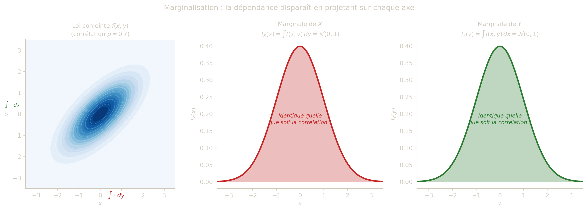

### 0.1 Définition et calcul

> **IMPORTANT:**
>
> Si \\(X,Y)\\ admet une densité conjointe \\f\\, alors \\X\\ et \\Y\\ sont des variables à densité de densités marginales : \\ f_X(x)=\int\_{\mathbb{R}} f(x,y)\\dy, \qquad f_Y(y)=\int\_{\mathbb{R}} f(x,y)\\dx. \\

Ces formules se lisent comme une **projection** de la densité conjointe sur chaque axe : intégrer \\f(x,y)\\ par rapport à \\y\\ revient à accumuler toutes les probabilités associées aux différentes valeurs de \\Y\\, pour chaque \\x\\ fixé. On obtient ainsi la densité “totale” en \\x\\, indépendamment de ce que vaut \\Y\\. Géométriquement, \\f_X(x)\\ est l’**aire de la tranche verticale** du relief \\f\\ à l’abscisse \\x\\ : on “fond” la dimension \\y\\ en la sommant intégralement.

Il est crucial de comprendre que les lois marginales ne déterminent **pas** la loi conjointe. Deux couples \\(X,Y)\\ peuvent partager exactement les mêmes marginales tout en ayant des lois conjointes très différentes. La loi conjointe contient une information supplémentaire — la **structure de dépendance** entre \\X\\ et \\Y\\ — que les marginales seules ne capturent pas. C’est précisément cette structure que l’on formalise dans la section suivante via la notion d’indépendance.

Figure 1: Les lois marginales s’obtiennent en **intégrant la densité conjointe selon l’autre variable** : \\f_X(x) = \int f(x,y)\\dy\\ (projection sur l’axe \\x\\) et \\f_Y(y) = \int f(x,y)\\dx\\ (projection sur l’axe \\y\\). Les marginales ne restituent pas la structure de dépendance présente dans la loi conjointe.

> **CAUTION:**
>
> Soit \\D=\\(x,y)\in\mathbb{R}^2 : x^2+y^2\le 1\\\\ et \\ f(x,y)=\frac{1}{\pi}\mathbf{1}\_D(x,y). \\
>
> 1.  Vérifier que \\f\\ est une densité.
> 2.  Déterminer les densités marginales \\f_X\\ et \\f_Y\\.
> 3.  Vérifier que \\\int\_{\mathbb{R}} f_X(x)\\dx=\int\_{\mathbb{R}} f_Y(y)\\dy=1\\.

> **TIP:**
>
> **1.** La fonction \\f\\ est positive. L’aire du disque \\D\\ de rayon \\1\\ vaut \\\pi\\, donc : \\ \iint\_{\mathbb{R}^2} f(x,y)\\dx\\dy =\frac{1}{\pi}\iint_D dx\\dy =\frac{1}{\pi}\cdot\pi=1. \\ Ainsi \\f\\ est une densité.
>
> **2.** Pour \\\|x\|\le 1\\, \\y\\ varie dans \\\left\[-\sqrt{1-x^2},\sqrt{1-x^2}\right\]\\ : \\ f_X(x)=\int\_{-\sqrt{1-x^2}}^{\sqrt{1-x^2}}\frac{1}{\pi}\\dy =\frac{2\sqrt{1-x^2}}{\pi}, \\ et \\f_X(x)=0\\ pour \\\|x\|\>1\\.
>
> Par symétrie en \\x\leftrightarrow y\\ : \\ f_Y(y)=\frac{2\sqrt{1-y^2}}{\pi}\\ \text{pour }\|y\|\le 1, \qquad f_Y(y)=0\\ \text{sinon.} \\
>
> **3.** On reconnaît l’intégrale d’un demi-cercle unitaire : \\ \int\_{-1}^{1} f_X(x)\\dx =\frac{2}{\pi}\int\_{-1}^{1}\sqrt{1-x^2}\\dx =\frac{2}{\pi}\cdot\frac{\pi}{2}=1. \\ (On a utilisé \\\displaystyle\int\_{-1}^{1}\sqrt{1-x^2}\\dx=\frac{\pi}{2}\\, qui est l’aire d’un demi-disque de rayon \\1\\.) Par symétrie, \\\displaystyle\int\_{\mathbb{R}} f_Y(y)\\dy=1\\ également.

> **CAUTION:**
>
> Marc fait du tir à l’arc sur une cible circulaire de rayon \\4\\. Le point d’impact \\M\\ de la flèche, de coordonnées aléatoires \\(X;Y)\\, suit une loi uniformément distribuée sur la cible. On note \\D=\\(x,y)\in\mathbb{R}^2 : x^2+y^2\le 16\\\\.
>
> 1.  Déterminer la densité du couple \\(X;Y)\\.
> 2.  La zone centrale, permettant de marquer un maximum de points, est un cercle de rayon \\1\\ et de même centre que la cible. Calculer la probabilité que Marc atteigne la zone centrale.
> 3.  Déterminer les lois marginales de \\X\\ et de \\Y\\. Les variables \\X\\ et \\Y\\ sont-elles indépendantes ?

> **TIP:**
>
> **1.** La loi est uniforme sur \\D\\, d’aire \\\pi\cdot 4^2=16\pi\\. La densité est donc : \\ f(x,y)=\frac{1}{16\pi}\\\mathbf{1}\_D(x,y). \\
>
> **2.** La zone centrale \\C=\\x^2+y^2\le 1\\\\ a l’aire \\\pi\cdot 1^2=\pi\\. Par la loi uniforme: \\ P(X^2+Y^2\le 1)=\frac{\pi}{16\pi}=\frac{1}{16}. \\
>
> **3.** Pour \\\|x\|\le 4\\, on intègre \\f\\ par rapport à \\y\\ sur \\\[-\sqrt{16-x^2},\\\sqrt{16-x^2}\]\\: \\ f_X(x)=\int\_{-\sqrt{16-x^2}}^{\sqrt{16-x^2}}\frac{1}{16\pi}\\dy =\frac{2\sqrt{16-x^2}}{16\pi}=\frac{\sqrt{16-x^2}}{8\pi}, \\ et \\f_X(x)=0\\ pour \\\|x\|\>4\\. Par symétrie, \\f_Y(y)=\dfrac{\sqrt{16-y^2}}{8\pi}\\ pour \\\|y\|\le 4\\.
>
> Les variables \\X\\ et \\Y\\ ne sont **pas indépendantes** : le support de \\f\\ est le disque \\D\\, qui n’est pas un rectangle, donc on ne peut pas écrire \\f(x,y)=f_X(x)f_Y(y)\\ sur tout \\\mathbb{R}^2\\.
