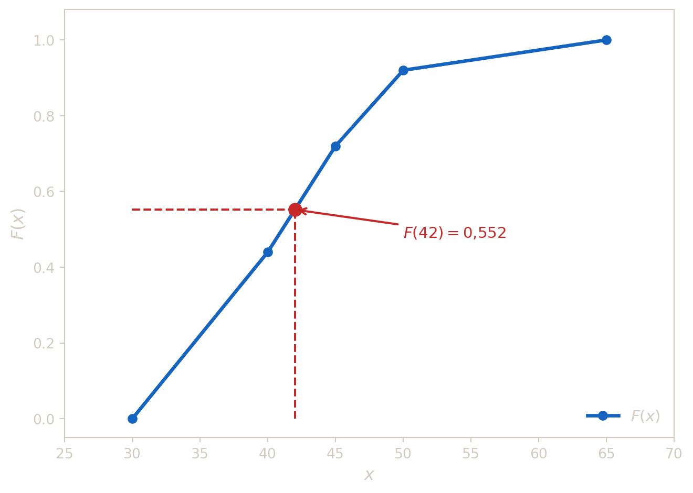
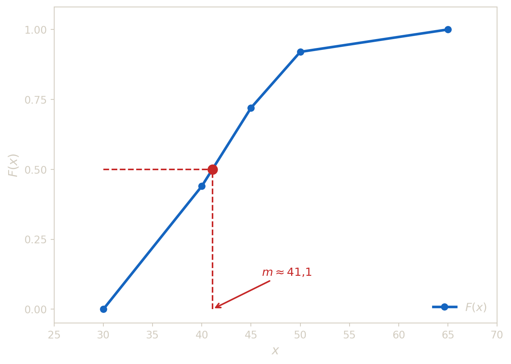

## 1 Fonction de repartition empirique en classes

La fonction de répartition \\F\\ répond à la question, *« quelle proportion d’individus à une valeur strictement inférieure à \\x\\ ? »*. On peut faire une analogie directe entre la fonction de répartition et la [fréquence cumulé croissante](../../teaching/probability/univariate-data-analysis.llms.md) des variables discrètes.

Sous l’hypothese d’équirépartition dans chaque classe, la fonction de répartition \\F\\ est :

- croissante,
- continue,
- affine par morceaux,
- telle que \\F(a_i)\\ vaut la frequence cumulée au bord \\a_i\\.

L’hypothèse d’équirépartition suppose que les observations sont reparties uniformement a l’intérieur de chaque classe. C’est une approximation forte car on ne connaît pas la répartition exacte au sein des classes. Cette hypothese justifie l’interpolation linéaire ci-dessous.

Pour \\x\in\[a_i,a\_{i+1}\[\\, on obtient \\F(x)\\ par interpolation linéaire :

\\ F(x)=F(a_i)+\frac{F(a\_{i+1})-F(a_i)}{a\_{i+1}-a_i}(x-a_i). \\

### 1.1 Exemple - Lecture de répartition

On considère la distribution suivante :

| Classe | \\\[30,40\[\\ | \\\[40,45\[\\ | \\\[45,50\[\\ | \\\[50,65\[\\ | Total |
|----|---:|---:|---:|---:|---:|
| Effectif \\n_i\\ | 11 | 7 | 5 | 2 | 25 |

Calculer \\F(42)\\.

> **TIP:**
>
> - \\42\in\[40,45\[\\.
> - \\F(40)=0{,}44\\ et \\F(45)=0{,}72\\.
> - Donc :
>
> \\ F(42)=0{,}44+\frac{0{,}72-0{,}44}{5}(2)=0{,}552. \\
>
> 
>
> Figure 1: Fonction de répartition empirique (affine par morceaux) de l’exemple 3. L’interpolation linéaire pour \\F(42) = 0{,}552\\ est mise en évidence.

## 2 Lecture graphique

Trois informations sont directement lisibles sur le graphe de \\F\\.

1.  **Lecture directe** — Pour estimer \\F(x_0)\\, on monte verticalement depuis \\x_0\\ jusqu’à la courbe, puis on lit la valeur sur l’axe des ordonnées : c’est la proportion d’individus ayant une valeur strictement inférieure à \\x_0\\.

2.  **Lecture inverse — quantile** — Pour trouver la valeur \\x_p\\ telle que \\F(x_p) = p\\, on part de \\p\\ sur l’axe des ordonnées, on avance horizontalement jusqu’à la courbe, puis on descend sur l’axe des abscisses. On appelle \\x_p\\ le **quantile d’ordre \\p\\**. Le cas \\p = 0{,}5\\ donne la **médiane** \\m\\ :

\\ F(m) = 0{,}5. \\

La médiane partage la population en deux moitiés égales : 50 % des individus ont une valeur inférieure à \\m\\, et 50 % une valeur supérieure.

3.  **Pente et densité** — Sur chaque intervalle \\\[a_i, a\_{i+1}\[\\, la courbe est une droite de pente :

\\ \frac{F(a\_{i+1}) - F(a_i)}{a\_{i+1} - a_i} = \frac{f_i}{A_i} = d_i. \\

Un segment **raide** correspond à une classe **dense** alors qu’un segment **quasi plat** correspond à une classe peu peuplée relativement à son amplitude. La courbe de répartition et l’histogramme portent donc la même information, sous deux formes complémentaires.

Figure 2: Lecture inverse sur la fonction de répartition : la médiane \\m \approx 41{,}1\\ est l’abscisse du point d’ordonnée \\0{,}5\\.

On cherche \\m\\ tel que \\F(m) = 0{,}5\\. Comme \\F(40) = 0{,}44 \< 0{,}5 \< 0{,}72 = F(45)\\, la médiane est dans \\\[40,45\[\\.

Par interpolation linéaire :

\\ m = 40 + \frac{0{,}5 - 0{,}44}{0{,}72 - 0{,}44} \times 5 = 40 + \frac{0{,}06}{0{,}28} \times 5 \approx 41{,}1. \\
