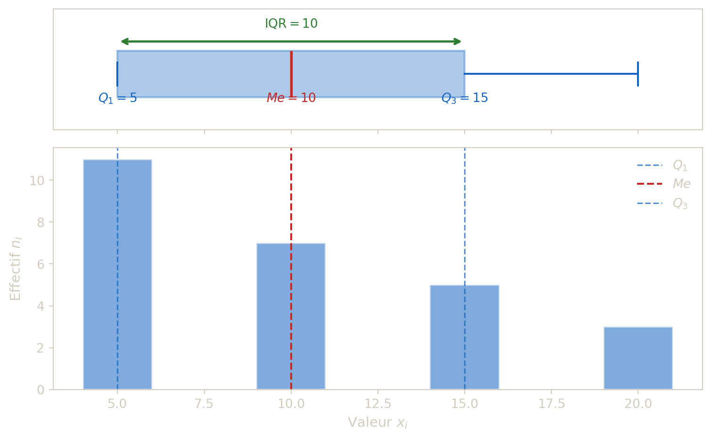

## 1 Mediane, quartiles et dispersion

Les indicateurs de position (moyenne, mediane) et de dispersion (ecart-type, IQR) permettent de resumer une serie par quelques nombres-cles. On commence ici par les indicateurs bases sur le **rang** : mediane et quartiles. Leur interet majeur est d’etre **robustes**, c’est-a-dire peu sensibles aux valeurs extremes.

> **NOTE:**
>
> - La **mediane** est une valeur qui partage la population en deux moities (50 % / 50 %).
> - Les **quartiles** \\Q_1, Q_2, Q_3\\ partagent en quatre parts de 25 %.
> - On a \\Q_2 =\\ mediane.
> - L’**ecart interquartile** vaut \\IQR = Q_3-Q_1,\\ et mesure la dispersion centrale.

Concretement, la mediane est la valeur « du milieu » : la moitie des individus se situe en dessous, l’autre moitie au-dessus. Le premier quartile \\Q_1\\ separe les 25 % les plus faibles du reste, et \\Q_3\\ les 75 % les plus faibles. L’IQR mesure donc l’etendue des 50 % centraux de la distribution, en ignorant les extremes.

> **TIP:**
>
> La mediane est preferable lorsque la distribution est **asymetrique** ou contient des **valeurs aberrantes**. Par exemple, dans une serie de salaires, quelques tres hauts revenus tirent la moyenne vers le haut, mais n’affectent pas la mediane. En revanche, la moyenne utilise toute l’information numerique et se prete mieux aux calculs algebriques (transformations affines, decomposition de variance, etc.).

Pour les series continues en classes, on determine les quantiles par lecture de la fonction de repartition (interpolation lineaire).

> **CAUTION:**
>
> Soit la serie :
>
> | Valeur \\x_i\\   |   5 |  10 |  15 |  20 | Total |
> |------------------|----:|----:|----:|----:|------:|
> | Effectif \\n_i\\ |  11 |   7 |   5 |   3 |    26 |
>
> Determiner la mediane, \\Q_1\\, \\Q_3\\ et l’ecart interquartile.

> **TIP:**
>
> Rangs cumules : - valeur 5 : rangs 1 a 11, - valeur 10 : rangs 12 a 18, - valeur 15 : rangs 19 a 23, - valeur 20 : rangs 24 a 26.
>
> Donc : - mediane (entre rangs 13 et 14) = 10, - \\Q_1\\ (autour du rang 7) = 5, - \\Q_3\\ (autour du rang 20) = 15, - \\IQR = 15-5=10\\.



Figure 1: Boîte à moustaches de la série de l’exemple 5. Les quartiles \\Q_1\\, la médiane \\Me\\ et \\Q_3\\ délimitent la boîte centrale ; l’écart interquartile \\\mathrm{IQR} = Q_3 - Q_1\\ mesure la dispersion des 50 % centraux.

## Citation

BibTeX citation:

``` quarto-appendix-bibtex
@online{gilles,
  author = {Gilles, Guillaume},
  url = {https://ggilles.dev/teaching/probability/univariate-central-tendency.html},
  langid = {en}
}
```

For attribution, please cite this work as:

Gilles, Guillaume. n.d. <https://ggilles.dev/teaching/probability/univariate-central-tendency.html>.
