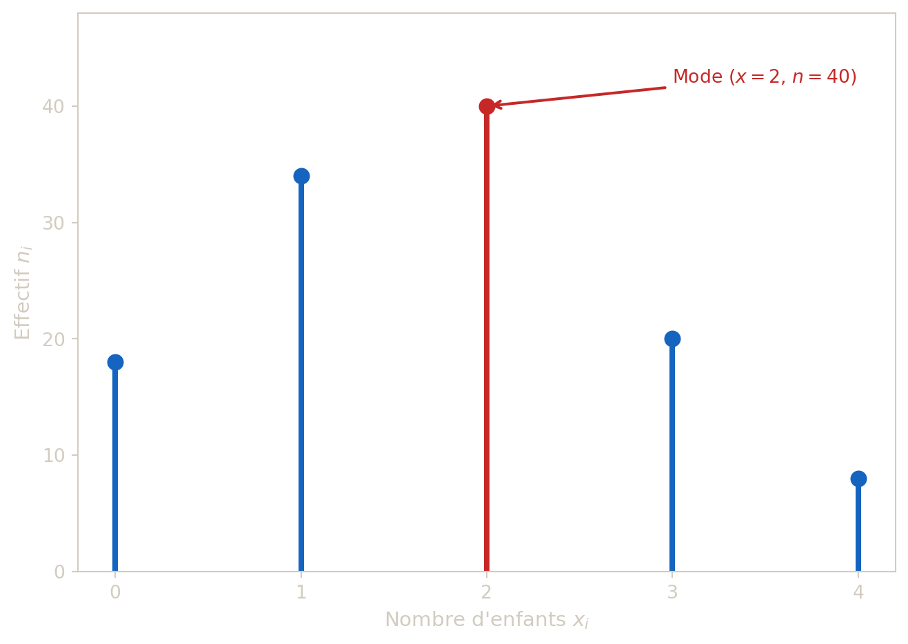
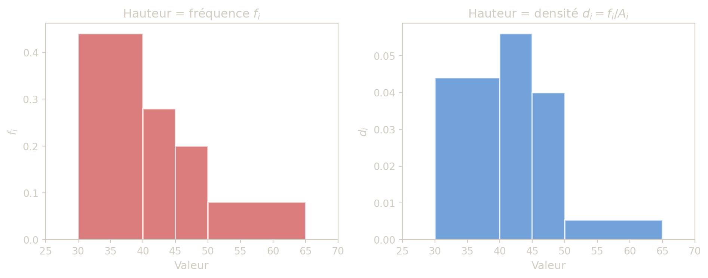

## 1 Distribution discrète finie

Soit une variable quantitative discrete \\x\\ prenant les valeurs distinctes \\ x_1 \< x_2 \< \cdots \< x_r \\

On note \\n\\ l’effectif total, \\n_i\\ l’effectif de \\x_i\\, et sa frequence :

\\ f_i = \frac{n_i}{n} \\

L’effectif \\n_i\\ compte simplement *combien* d’individus prennent la valeur \\x_i\\. La frequence \\f_i\\ exprime cette meme information en *proportion* du total : dire \\f_i = 0{,}3\\ signifie que 30 % des individus presentent la modalite \\x_i\\. Travailler en frequences permet de comparer des series de tailles differentes, car la somme des fréquences vaut toujours \\1\\.

### 1.1 Effectif cumulé croissant - E.C.C.

\\ N_i^+ = \sum\_{k=1}^i n_k \\

L’effectif cumulé croissant permet de répondre à la question, *« combien d’individus prennent une valeur **inferieure ou egale** à \\x_i\\ ? »*

### 1.2 Frequence cumulee croissante F.C.C.

\\ F_i^+ = \sum\_{k=1}^i f_k = \frac{N_i^+}{n} \\

La fréquence cumulée croissante permet de répondre à la question, *« quelle proportion d’individus prennent une valeur **inferieure ou egale** à \\x_i\\ ? »* Par exemple, si \\F_3^+ = 0{,}80\\ celà signifie que 80 % de la population a une valeur inférieure ou égale a \\x_3\\.

### 1.3 Mode

Quant au mode, c’est la valeur la plus fréquemment observée. Il n’est pas forcement unique : une série peut etre **bimodale** (deux modes) voire **multimodale**.

### 1.4 Exemple - Tableau statistique complet

Une etude porte sur le nombre d’enfants par foyer. Les resultats observes sont :

| Valeur \\x_i\\   |   0 |   1 |   2 |   3 |   4 | Total |
|------------------|----:|----:|----:|----:|----:|------:|
| Effectif \\n_i\\ |  18 |  34 |  40 |  20 |   8 |   120 |

1.  Calculer les frequences \\f_i\\.
2.  Calculer les E.C.C. et F.C.C.
3.  Determiner la frequence de foyers ayant au plus 2 enfants.
4.  Donner le (ou les) mode(s).

> **TIP:**
>
> - \\f_i = n_i/120\\.
> - E.C.C. : \\18, 52, 92, 112, 120\\.
> - F.C.C. : \\0{,}15, 0{,}433, 0{,}767, 0{,}933, 1\\.
> - Fréquence de foyers avec au plus 2 enfants : \\F_2^+ = 92/120 \approx 0{,}767\\.
> - Mode : valeur 2 (effectif maximal 40).

### 1.5 Représentation graphique

Le diagramme de réference pour une série discrète est le **diagramme en batons**. Contrairement a un diagramme en barres (qui utilise des rectangles), le diagramme en batons représente chaque valeur par un simple trait vertical dont la hauteur est proportionnelle a l’effectif. On utilise des batons et non des barres car la variable est discrète : chaque valeur est un point isolé sur l’axe des abscisses, il n’y a pas de continuité entre les modalités.



Figure 1: Diagramme en bâtons de la série « nombre d’enfants par foyer ». Le **mode** (valeur d’effectif maximal) est mis en évidence en rouge.

## 2 Distribution continue en classes

Quand les données sont nombreuses et presque toutes distinctes, on regroupe les observations en classes :

\\ \[a_i, a\_{i+1}\[, \quad i=1,\dots,r \\

En effet, si l’on mesurait par exemple la taille de 500 personnes au millimètre près, on obtiendrait presque autant de valeurs distinctes que d’individus, et un diagramme en batons serait illisible. En regroupant les observations par intervalles (par exemple \\\[160, 165\[\\, \\\[165, 170\[\\, etc.), on obtient une vision synthetique de la distribution.

Le choix du nombre de classes et de leurs bornes relève du jugement de l’analyste : trop peu de classes masquent les détails, trop de classes dispersent l’information.

Pour une classe \\\[a_i,a\_{i+1}\[\\ :

### 2.1 Amplitude

\\ A_i = a\_{i+1}-a_i \\

L’amplitude mesure la largeur d’une classe. Elle joue un rôle clé dans l’histogramme : deux classes d’effectifs identiques mais d’amplitudes différentes ne doivent pas avoir la même hauteur de barre. C’est pourquoi on raisonne toujours sur la **surface** (hauteur × largeur) et non sur la hauteur seule.

### 2.2 Centre

\\ c_i = \frac{a_i+a\_{i+1}}{2} \\

Le centre d’une classe sert d’approximation pour représenter toutes les observations de cette classe par une seule valeur : il sera utilisé plus tard dans le calcul de la moyenne et de la variance.

### 2.3 Densité de fréquence

\\ d_i = \frac{f_i}{A_i} \\

La densité de fréquence \\d_i\\ permet de comparer équitablement des classes d’amplitudes différentes : une classe large peut contenir beaucoup d’individus simplement parce qu’elle couvre un grand intervalle, sans pour autant être plus « dense ».

### 2.4 Exemple - Densités et hauteurs corrigées

On considère la distribution suivante :

| Classe | \\\[30,40\[\\ | \\\[40,45\[\\ | \\\[45,50\[\\ | \\\[50,65\[\\ | Total |
|----|---:|---:|---:|---:|---:|
| Effectif \\n_i\\ | 11 | 7 | 5 | 2 | 25 |

1.  Calculer les fréquences \\f_i\\.
2.  Calculer les amplitudes \\A_i\\.
3.  Calculer les densités \\d_i = f_i/A_i\\.

> **TIP:**
>
> - \\f_i = (0{,}44, 0{,}28, 0{,}20, 0{,}08)\\.
> - \\A_i = (10, 5, 5, 15)\\.
> - \\d_i = (0{,}044, 0{,}056, 0{,}040, 0{,}0053)\\.
>
> La deuxieme classe est plus dense que la premiere, bien qu’elle ait un effectif inferieur.

### 2.5 Représentation graphique

Le diagramme de référence pour les variables continues en classes, est l’histogramme. La **surface** de chaque rectangle est proportionnelle à la fréquence de classe. Donc la **hauteur** doit être proportionnelle à la densité \\d_i\\ (et non a \\f_i\\ si les amplitudes sont differentes).

> **IMPORTANT:**
>
> Si toutes les classes ont la même amplitude, \\A_i\\, il n’y a pas de probleme, car les hauteurs proportionnelles à \\f_i\\ et celles proportionnelle à \\d_i\\ reviennent au même.
>
> En revanche, dès que les amplitudes diffèrent, utiliser \\f_i\\ en ordonnée donne une representation **trompeuse** : une classe large paraîtra visuellement dominante alors qu’elle est peut-être moins dense qu’une classe étroite.
>
> Aussi, **si les amplitudes sont différentes**, comparer seulement les hauteurs des barres peut induire en erreur. La grandeur pertinente est donc **la surface** (hauteur \\x\\ largeur).



Figure 2: Comparaison entre un histogramme **incorrect** (hauteur = fréquence) et un histogramme **correct** (hauteur = densité). Avec des amplitudes inégales, seule la densité garantit que l’aire de chaque barre est proportionnelle à la fréquence.

## 3 Exercice de synthèse

Un établissement relève les notes obtenues par 40 élèves à un devoir de mathématiques. Les résultats (sur 20) sont regroupés dans le tableau suivant :

| Classe           | \\\[0,5\[\\ | \\\[5,10\[\\ | \\\[10,14\[\\ | \\\[14,20\]\\ | Total |
|------------------|------------:|-------------:|--------------:|--------------:|------:|
| Effectif \\n_i\\ |           4 |           12 |            16 |             8 |    40 |

1.  Calculer les fréquences \\f_i\\.
2.  Calculer les amplitudes \\A_i\\ et les centres \\c_i\\ de chaque classe.
3.  Calculer les densités de fréquence \\d_i\\.
4.  Établir les E.C.C. et les F.C.C.
5.  Quelle proportion d’élèves a obtenu une note **strictement inférieure à 10** ?
6.  Identifier la **classe modale** et justifier votre réponse.

> **TIP:**
>
> **1. Fréquences**
>
> \\ f_i = \frac{n_i}{40} \\\Rightarrow\\ (0{,}10 ;\\ 0{,}30 ;\\ 0{,}40 ;\\ 0{,}20) \\
>
> **2. Amplitudes et centres**
>
> | Classe            | \\\[0,5\[\\ | \\\[5,10\[\\ | \\\[10,14\[\\ | \\\[14,20\]\\ |
> |-------------------|------------:|-------------:|--------------:|--------------:|
> | Amplitude \\A_i\\ |           5 |            5 |             4 |             6 |
> | Centre \\c_i\\    |         2,5 |          7,5 |            12 |            17 |
>
> **3. Densités de fréquence**
>
> \\ d_i = \frac{f_i}{A_i} \\\Rightarrow\\ (0{,}020 ;\\ 0{,}060 ;\\ 0{,}100 ;\\ 0{,}033) \\
>
> **4. E.C.C. et F.C.C.**
>
> | Classe           | \\\[0,5\[\\ | \\\[5,10\[\\ | \\\[10,14\[\\ | \\\[14,20\]\\ |
> |------------------|------------:|-------------:|--------------:|--------------:|
> | E.C.C. \\N_i^+\\ |           4 |           16 |            32 |            40 |
> | F.C.C. \\F_i^+\\ |        0,10 |         0,40 |          0,80 |             1 |
>
> **5. Proportion d’élèves ayant une note strictement inférieure à 10**
>
> La F.C.C. de la classe \\\[5,10\[\\ donne \\F_2^+ = 16/40 = 0{,}40\\. **40 % des élèves** ont donc obtenu une note strictement inférieure à 10.
>
> **6. Classe modale**
>
> Pour une distribution continue, la classe modale est celle dont la **densité est maximale** (et non l’effectif, pour ne pas avantager les classes larges). Ici \\d_3 = 0{,}100\\ est la valeur maximale : la classe modale est \\\[10,14\[\\.

## Citation

BibTeX citation:

``` quarto-appendix-bibtex
@online{gilles,
  author = {Gilles, Guillaume},
  url = {https://ggilles.dev/teaching/probability/univariate-data-analysis.html},
  langid = {en}
}
```

For attribution, please cite this work as:

Gilles, Guillaume. n.d. <https://ggilles.dev/teaching/probability/univariate-data-analysis.html>.
