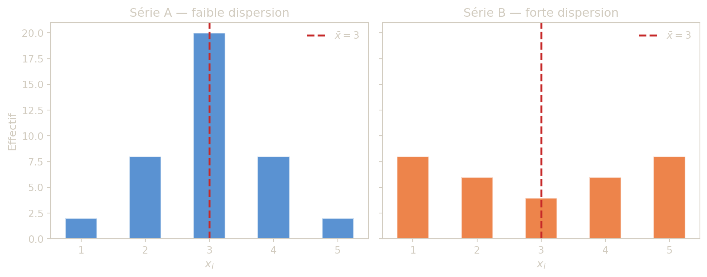
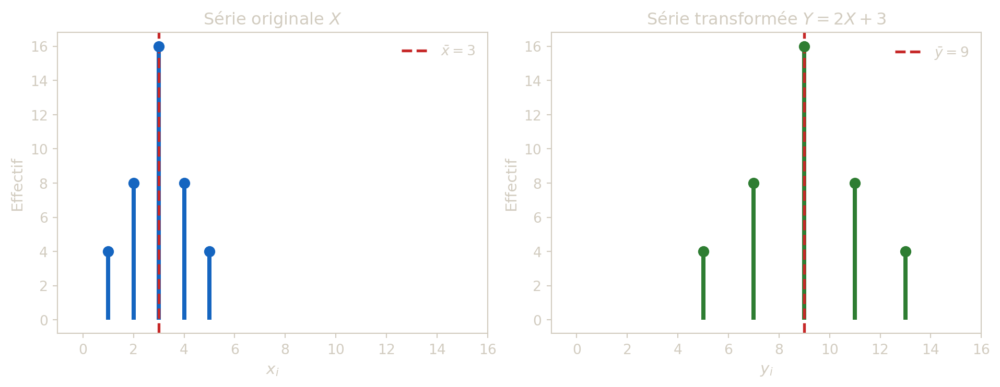

> Dans tout ce chapitre, on étudie une serie statistique à **une variable** observée sur une population finie.

## 1 Vocabulaire de base

### 1.1 Définitions

- La **population** \\P\\ est l’ensemble des individus etudies.
- Les **individus** (ou unites statistiques) sont les elements de \\P\\.
- Le **caractere** (ou variable) est une application \\x : P \to E,\\ ou \\E\\ est l’ensemble des **modalites**.
- Le couple \\(P,x)\\ est une **serie statistique** (ou distribution statistique).

### 1.2 Types de variables

- **Qualitative** : les modalites ne sont pas numeriques.
  - nominale : sans ordre naturel,
  - ordinale : avec ordre naturel.
- **Quantitative** : les modalites sont numeriques.
  - discrete : ensemble de valeurs fini ou denombrable,
  - continue : ensemble de valeurs de type intervalle.

Le schema ci-dessous resume cette classification :

Avant tout calcul, il est essentiel de bien identifier ces elements : la population fixe le perimetre de l’etude (sur *qui* porte-t-elle ?), le caractere precise *ce que l’on mesure*, et la nature du caractere (qualitative, discrete, continue) determine les outils de representation et de calcul que l’on pourra utiliser. Une erreur a ce stade fausse toute l’analyse qui suit.

> **CAUTION:**
>
> Pour chaque situation, preciser la population, le caractere et le type du caractere.
>
> 1.  Metier des adultes d’un groupe de skieurs.
> 2.  Age des participants a un concours.
> 3.  Taille des etudiants d’un amphitheatre.

> **TIP:**
>
> 1.  Metier : variable qualitative nominale.
> 2.  Age : variable quantitative discrete (si age en annees entieres) ou continue (si mesure exacte).
> 3.  Taille : variable quantitative continue.

## 2 —————–

## 3 Moyenne, variance, ecart-type

Apres les indicateurs de rang (mediane, quartiles), on introduit les indicateurs bases sur les **valeurs numeriques** elles-memes. La moyenne, la variance et l’ecart-type forment le trio fondamental de la statistique descriptive : ils seront repris tout au long du cours, aussi bien en probabilites qu’en inference.

Soit une serie quantitative discrete :

| Valeur    | \\x_1\\ | \\x_2\\ |   … | \\x_r\\ |
|-----------|--------:|--------:|----:|--------:|
| Effectif  | \\n_1\\ | \\n_2\\ |   … | \\n_r\\ |
| Frequence | \\f_1\\ | \\f_2\\ |   … | \\f_r\\ |

avec \\\sum n_i=n\\ et \\\sum f_i=1\\.

> **NOTE:**
>
> - Moyenne : \\\bar x = \frac{1}{n}\sum\_{i=1}^r n_i x_i = \sum\_{i=1}^r f_i x_i.\\
> - Variance : \\\mathrm{Var}(x)=\frac{1}{n}\sum\_{i=1}^r n_i(x_i-\bar x)^2.\\
> - Ecart-type : \\\sigma(x)=\sqrt{\mathrm{Var}(x)}.\\

La **moyenne** \\\bar x\\ est le « centre de gravite » de la serie : c’est la valeur autour de laquelle les observations se repartissent. Si l’on imaginait les effectifs comme des masses posees sur une regle, la moyenne serait le point d’equilibre.

La **variance** mesure a quel point les valeurs s’ecartent de cette moyenne. On calcule l’ecart de chaque observation a la moyenne \\(x_i - \bar x)\\, on le met au carre (pour eviter que les ecarts positifs et negatifs ne s’annulent), puis on fait la moyenne ponderee de ces carres. Plus la variance est grande, plus les donnees sont dispersees.

L’**ecart-type** \\\sigma(x)\\ est simplement la racine carree de la variance. Son avantage est d’etre exprime dans la **meme unite** que les donnees : si les observations sont en centimetres, l’ecart-type est aussi en centimetres (alors que la variance serait en \\\text{cm}^2\\).

> **TIP:**
>
> \\ \mathrm{Var}(x)=\overline{x^2}-(\bar x)^2 \quad\text{avec}\quad \overline{x^2}=\frac{1}{n}\sum\_{i=1}^r n_i x_i^2. \\

La formule de Konig-Huygens est un raccourci de calcul tres utile : au lieu de calculer chaque ecart \\(x_i - \bar x)\\ puis de le mettre au carre, on calcule separement la moyenne des carres (\\\overline{x^2}\\) et le carre de la moyenne (\\(\bar x)^2\\), puis on fait la difference. C’est souvent plus rapide, surtout a la main, car on evite de manipuler des nombres decimaux issus de \\\bar x\\.

Pour une serie en classes, on applique les memes formules en remplacant \\x_i\\ par les centres \\c_i\\. C’est une approximation : on suppose que tous les individus d’une classe sont concentres au centre de cette classe. Les resultats seront d’autant plus proches de la realite que les classes sont etroites.

> **IMPORTANT:**
>
> - La moyenne est un indicateur de **position** : elle situe le « centre » de la distribution.
> - La variance et l’ecart-type sont des indicateurs de **dispersion** : ils mesurent l’etalement des observations autour de la moyenne.
> - La moyenne est sensible aux valeurs extremes, contrairement a la mediane. En presence de valeurs aberrantes, ces deux indicateurs peuvent donner des images tres differentes de la serie.

Figure 1: Deux séries de même moyenne (\\\bar{x} = 3\\) mais de dispersions très différentes. La série B est plus étalée : sa variance et son écart-type sont plus grands.

> **CAUTION:**
>
> Soit la serie en classes :
>
> | Classe           | \\\[0,2\[\\ | \\\[2,4\[\\ | \\\[4,6\[\\ |
> |------------------|------------:|------------:|------------:|
> | Effectif \\n_i\\ |           9 |           6 |           5 |
>
> Calculer la moyenne, la variance et l’ecart-type en utilisant les centres de classes.

> **TIP:**
>
> Centres : \\c_1=1\\, \\c_2=3\\, \\c_3=5\\ ; effectif total \\n=20\\.
>
> Moyenne : \\ \bar x=\frac{9\cdot1+6\cdot3+5\cdot5}{20}=\frac{52}{20}=2{,}6. \\
>
> Moyenne des carres : \\ \overline{x^2}=\frac{9\cdot1^2+6\cdot3^2+5\cdot5^2}{20}=\frac{188}{20}=9{,}4. \\
>
> Variance : \\ \mathrm{Var}(x)=9{,}4-2{,}6^2=2{,}64. \\
>
> Ecart-type : \\ \sigma(x)=\sqrt{2{,}64}\approx 1{,}625. \\

> **CAUTION:**
>
> Le nombre de clients reçus chaque jour dans une boutique a été relevé pendant une semaine :
>
> | Jour              | Lundi | Mardi | Mercredi | Jeudi | Vendredi | Samedi |
> |-------------------|------:|------:|---------:|------:|---------:|-------:|
> | Nombre de clients |    23 |    42 |       38 |    41 |       55 |     51 |
>
> Déterminer la moyenne, la variance et l’écart-type de la série.

> **TIP:**
>
> Considérer les 6 valeurs comme une série quantitative discrète simple : \\\bar x=\frac{1}{n}\sum\_{i=1}^n x_i, \qquad V=\frac{1}{n}\sum\_{i=1}^n (x_i-\bar x)^2, \qquad \sigma=\sqrt{V}.\\

> **CAUTION:**
>
> Voici un relevé des tirs réussis sur 6 tirs lors d’une campagne :
>
> | Tirs réussis \\x_i\\      |   0 |   1 |   2 |   3 |   4 |   5 |   6 |
> |---------------------------|----:|----:|----:|----:|----:|----:|----:|
> | Nombre de tireurs \\n_i\\ |   3 |  15 |   9 |  11 |   8 |   4 |   2 |
>
> 1.  Déterminer la population, le caractère et le type du caractère étudiés.
> 2.  Représenter cette série par un diagramme en bâtons.
> 3.  Déterminer les couples : (mode, étendue) ; (médiane, écart interquartile) ; (moyenne, écart-type).

> **TIP:**
>
> - Effectif total : \\N=\sum n_i\\.
> - Médiane et quartiles : travailler avec les effectifs cumulés croissants.
> - Moyenne et variance pondérées : \\\bar x=\frac{1}{N}\sum n_i x_i, \qquad V=\frac{1}{N}\sum n_i(x_i-\bar x)^2.\\

> **CAUTION:**
>
> Dans une région, l’étude des exploitations agricoles a conduit au tableau suivant (surface en hectares) :
>
> | Surface (ha) | \\\[0;2\[\\ | \\\[2;3\[\\ | \\\[3;4\[\\ | \\\[4;5\[\\ | \\\[5;6\[\\ |
> |----|---:|---:|---:|---:|---:|
> | Nombre d’exploitations | 15 | 25 | 30 | 25 | 5 |
>
> 1.  Déterminer la population, le caractère et le type du caractère étudiés.
> 2.  Représenter cette série par un histogramme (hauteurs = densités).
> 3.  Tracer la fonction de répartition empirique associée.
> 4.  Calculer : (médiane, écart interquartile) ; (moyenne, écart-type).

> **TIP:**
>
> - Pour l’histogramme, tenir compte des amplitudes de classes inégales : hauteur \\= d_i = f_i/A_i\\.
> - Pour médiane et quartiles, procéder par interpolation linéaire dans la classe qui contient le quantile.
> - Pour moyenne et variance, utiliser les centres de classes.

------------------------------------------------------------------------

## 4 Transformations affines

Il arrive souvent que l’on veuille changer d’unite ou simplifier les calculs en recentrant et redimensionnant les donnees. Par exemple, convertir des temperatures de Celsius en Fahrenheit (\\F = 1{,}8 \times C + 32\\), ou encore ramener des salaires a des valeurs plus maniables en posant \\Y = (X - 35\\000)/1\\000\\. La question est alors : comment les indicateurs (moyenne, variance, ecart-type) de la nouvelle serie se deduisent-ils de ceux de la serie d’origine ?

> **IMPORTANT:**
>
> Pour \\y=ax+b\\ avec \\a\ne 0\\:
>
> - moyenne : \\\bar y = a\bar x + b,\\
> - variance : \\\mathrm{Var}(y)=a^2\mathrm{Var}(x),\\
> - ecart-type : \\\sigma(y)=\|a\|\sigma(x).\\

La translation (ajout de \\b\\) deplace le centre mais ne change pas la dispersion ; le facteur \\a\\ dilate/contracte l’echelle. Remarquons que la variance depend de \\a^2\\ (et non de \\a\\) : elle est donc toujours positive, que la transformation « inverse » ou non l’ordre des valeurs. De meme, ajouter une constante \\b\\ n’affecte ni la variance ni l’ecart-type, ce qui est logique puisque decaler toutes les valeurs d’un meme montant ne change pas leur dispersion relative.

Figure 2: Effet d’une transformation affine \\Y = 2X + 3\\ sur une série discrète. La translation (\\+3\\) décale la distribution ; le facteur (\\\times 2\\) étire l’échelle et augmente la dispersion.

> **CAUTION:**
>
> Une serie de salaires a pour moyenne 37 000 et ecart-type 700 (euros). On definit \\ Y=\frac{X-35\\000}{1\\000}. \\ Determiner \\E(Y)\\, \\\mathrm{Var}(Y)\\ et \\\sigma(Y)\\.

> **TIP:**
>
> Ici \\a=1/1000\\ et \\b=-35\\.
>
> \\ E(Y)=\frac{37\\000-35\\000}{1\\000}=2, \\ \\ \sigma(Y)=\frac{700}{1\\000}=0{,}7, \qquad \mathrm{Var}(Y)=0{,}49. \\

> **CAUTION:**
>
> Un service de ressources humaines étudie la masse salariale \\S\\ et trouve : - moyenne : \\\bar S=37\\000\\ euros, - écart-type : \\\sigma_S=700\\ euros.
>
> Pour faciliter les calculs, il pose \\Y=\dfrac{S-35\\000}{1\\000}\\.
>
> Déterminer la moyenne, la variance et l’écart-type de la nouvelle série \\Y\\.

> **TIP:**
>
> Pour une transformation affine \\Y=aX+b\\ avec \\a=1/1000\\ et \\b=-35\\ : - \\\bar Y = a\bar X + b\\, - \\\mathrm{Var}(Y)=a^2\mathrm{Var}(X)\\, - \\\sigma_Y=\|a\|\sigma_X\\.

------------------------------------------------------------------------

## 5 Methode de synthese (a retenir)

Face a un jeu de donnees, il est facile de se perdre dans les calculs. La procedure ci-dessous fournit une demarche systematique pour mener une etude univariee complete, de la lecture de l’enonce jusqu’a l’interpretation des resultats.

> **NOTE:**
>
> 1.  **Identifier** la population, la variable et son type.
> 2.  **Construire** le tableau statistique (effectifs, frequences, cumuls).
> 3.  **Choisir** une representation adaptee :
>     - batons pour discret,
>     - histogramme en densites pour classes.
> 4.  **Calculer** les indicateurs de position : mode, mediane, quartiles, moyenne.
> 5.  **Calculer** les indicateurs de dispersion : IQR, variance, ecart-type.
> 6.  **Interpreter** les resultats dans le contexte (asymetrie, valeurs extremes, stabilite).

Cette demarche permet de passer des donnees brutes a une lecture quantitative robuste, utile avant toute phase d’inference statistique. En particulier, l’etape 6 est souvent negligee : les chiffres n’ont de sens que replaces dans leur contexte. Dire « l’ecart-type vaut 3{,}2 » ne signifie rien sans preciser l’unite et sans comparer cette dispersion a ce qui est attendu dans le domaine etudie.
