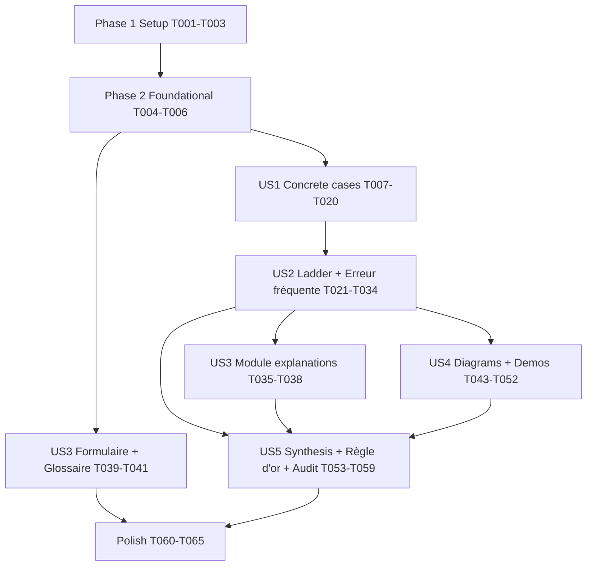

# Tasks: Mathematical Finance Intuition-First Pedagogy

**Input**: Design documents from `/specs/011-math-finance-intuition/`

**Prerequisites**: plan.md, spec.md, research.md, data-model.md,
contracts/pedagogical-contract.md, quickstart.md

**Tests**: No automated test suite was requested. Validation = `quarto render`
(exit 0) + the structural `grep` checks from `quickstart.md` + browser checks of
the demos. These checks are listed as checkpoint tasks, not TDD tasks.

**Organization**: Tasks are grouped by user story. All content edits are in
`fr/teaching/mathematical-finance/` (abbreviated `MF/` below — always expand
to the full path `fr/teaching/mathematical-finance/` when editing).

## Format: `[ID] [P?] [Story] Description`

- **[P]**: Can run in parallel (different files, no dependency on incomplete tasks)
- **[Story]**: US1–US5 from spec.md
- Tasks touching the **same module file are sequential** even across stories.

## Ground Rules (apply to every content task)

- **Content fidelity (T-I / FR-010)**: never delete existing theory, worked
  examples, demonstrations (`.callout-caution collapse="true"`), exercises or
  solutions. Existing "Intuition économique" prose is *moved/reused*, not removed.
- **Locate by heading, not line number** — line numbers shift as you edit.
- Prose wrapped at 80 chars; French only; `$...$` / `$$...$$` math.
- Callout semantics (contract): `.callout-note` = Situation concrète,
  Explication, Exemple résolu, Interprétation économique; `.callout-tip` =
  formula box, "Observez le schéma"; `.callout-warning` = Erreur fréquente;
  `.callout-important` = Définition formelle (new ones), Règle d'or.
- **Concrete case** format (data-model ConcreteCase): `::: {.callout-note}` +
  `## Situation concrète`; "Required, 3-8 sentences"; "Min 2" specific numbers;
  realistic EUR amounts and rates 1-10 %; decision question that "ends with ?";
  must appear before the first formula of the section.
- **Explanation** format (contract "Explication en langage clair"): 4 bold
  labels exactly — `**Ce que calcule cette formule**`, `**Rôle de chaque
  paramètre**` (bullet per symbol, must cover every symbol in the formula),
  `**Ce que signifie le résultat**`, `**Intuition directionnelle**`; each
  "Required, 1 sentence"; "No LaTeX in explanation text" (symbols in backticks).
- **Erreur fréquente** format (contract): `::: {.callout-warning}` +
  `## Erreur fréquente` with 4 bold labels exactly — `**L'intuition piège**`,
  `**Pourquoi c'est faux**`, `**Le bon raisonnement**`, `**Astuce mémo**`
  ("Required, 1 sentence", actionable and memorable).
- Do **not** run a full-project `quarto render` casually: its post-render hook
  (`scripts/update-profile-readme.sh`) pushes to the GitHub profile repo. Use
  single-file renders: `quarto render fr/teaching/mathematical-finance/module-0X.qmd --quiet`.

## Section Classification (resolved — see T004)

The spec says "Séquence 6 = synthesis in every module" and "13 concept
sections", but 5 × 3 − 3 = 12 and Module 2's Séquence 6 (*Sensibilité
obligataire*) is concept content (US2 scenario 2 requires a Duration ladder),
while Module 2's actual case study is **Séquence 7**. Tasks use this mapping,
which yields exactly **13 concept + 3 synthesis** sections:

| Module | Concept sections (7-step ladder + Erreur fréquente) | Synthesis (3-step) |
|--------|------------------------------------------------------|--------------------|
| M1 `module-01.qmd` | S2 Intérêts simples/composés, S3 Actualisation, S4 Taux, S5 Annuités | S6 Cas pratique |
| M2 `module-02.qmd` | S2 Emprunt amortissable, S3 Autres modalités, S4 Coût réel, S5 Obligations, S6 Sensibilité obligataire | S7 Étude de cas |
| M3 `module-03.qmd` | S2 VAN, S3 TRI, S4 Délai de récupération, S5 Analyse du risque | S6 Cas intégrateur |

Séquences 1 and 7 (except M2 S7) are out of scope except for formula
explanations (US3) and the module-start Règle d'or (US5).

---

## Phase 1: Setup

**Purpose**: Establish a clean, renderable baseline before editing.

- [X] T001 Render baseline and confirm exit 0 for `fr/teaching/mathematical-finance/module-01.qmd`, `module-02.qmd`, `module-03.qmd`, `glossaire.qmd`, `formulaire.qmd` (single-file renders, `--quiet`); note any pre-existing warnings in a scratch note so they are not attributed to this feature
- [X] T002 [P] Record baseline counts by running the quickstart §2 greps (Situation concrète/Cas réel, Explication en langage clair, Erreur fréquente, shinylive-python/ojs, Règle d'or, glossary fields, "Cette formule répond à") against `fr/teaching/mathematical-finance/` and paste results into a `## Baseline` section at the bottom of `specs/011-math-finance-intuition/quickstart.md`
- [X] T003 [P] Verify the Shinylive extension is usable: confirm `_extensions/quarto-ext/shinylive/_extension.yml` exists, find how other pages enable it (`grep -rn "shinylive" --include=*.qmd .` for a `filters:` front-matter example) and note the exact front-matter snippet to reuse in T049

---

## Phase 2: Foundational (Blocking Prerequisites)

**Purpose**: Fix section labels and the concept/synthesis mapping so every
story targets the same 16 sections.

**⚠️ CRITICAL**: Complete before any user-story phase.

- [X] T004 Update the section-classification tables so they match the mapping above (M2 S6 = concept, M2 S7 = synthesis; 13 concept + 3 synthesis) in `specs/011-math-finance-intuition/spec.md` ("Definition: Major Concept Section" table), `specs/011-math-finance-intuition/contracts/pedagogical-contract.md` ("Applies to" lines of both contracts) and `specs/011-math-finance-intuition/data-model.md` (Sequence `number` enum → 2-7, type rule)
- [X] T005 Rename the heading `## Intérêts simples et intérêts composés` to `## Séquence 2 — Intérêts simples et intérêts composés` in `fr/teaching/mathematical-finance/module-01.qmd` (first `grep -rn "interets-simples" fr/ docs/fr/teaching/mathematical-finance/*.qmd` for anchor links and update any found)
- [X] T006 [P] Draft the 13 concrete-case narratives and 13 Erreur-fréquente texts (French, per Ground Rules formats) in a working file `specs/011-math-finance-intuition/drafts.md`, using the scenario seeds listed in each US1/US2 task; reuse numbers consistently so the same scenario carries through numerical exploration and worked example of each section

**Checkpoint**: Mapping agreed, M1 S2 labelled, narrative drafts ready.

---

## Phase 3: User Story 1 — Concrete scenario before any formula (Priority: P1) 🎯 MVP

**Goal**: Each of the 13 concept sections opens with a `Situation concrète`
callout before any notation (FR-001, SC-001).

**Independent Test**: `grep -n "Situation concrète" fr/teaching/mathematical-finance/module-0*.qmd`
returns 13 lines, and in each concept section the match precedes the first
`$$` / formula callout of that section.

For each task: insert the callout immediately under the `## Séquence N` heading
(and its intro paragraph, if any), then turn the existing `### Intuition
économique` (if present) into the bridge after it — text preserved.

### Module 1 (`module-01.qmd`, sequential)

- [X] T007 [US1] M1 S2 concrete case in `fr/teaching/mathematical-finance/module-01.qmd`: Léa place 10 000 € pendant 10 ans à 3 % — livret à intérêts simples vs compte à terme à intérêts composés; "Quelle offre choisir et quel écart au bout de 10 ans ?"
- [X] T008 [US1] M1 S3 concrete case in `fr/teaching/mathematical-finance/module-01.qmd`: recevoir 1 000 € aujourd'hui ou 1 100 € dans un an, placement disponible à 5 %; "Quelle offre accepter ?" (place before `### Intuition économique`; keep the existing `### Exemple décisionnel`)
- [X] T009 [US1] M1 S4 concrete case in `fr/teaching/mathematical-finance/module-01.qmd`: deux offres de crédit — 9 % annuel vs 0,75 % par mois sur 10 000 € (rates kept within data-model "realistic 1-10 %"); "Ces deux offres vous coûteront-elles vraiment le même montant ?"
- [X] T010 [US1] M1 S5 concrete case in `fr/teaching/mathematical-finance/module-01.qmd`: Thomas veut 30 000 € d'apport dans 5 ans, verse 5 000 € par an à 3 %; "Ses versements suffiront-ils ?" (place before the existing Règle d'or callout)

### Module 2 (`module-02.qmd`, sequential — can run in parallel with M1 and M3 blocks)

- [X] T011 [P] [US1] M2 S2 concrete case in `fr/teaching/mathematical-finance/module-02.qmd`: une PME emprunte 60 000 € sur 3 ans à 5 % (distinct from the existing 100 000 € worked example, per contract "new numbers"); "Quel montant verser chaque année et combien d'intérêts au total ?"
- [X] T012 [US1] M2 S3 concrete case in `fr/teaching/mathematical-finance/module-02.qmd`: même prêt de 60 000 €, le banquier propose annuités constantes, amortissement constant ou in fine; "Quelle formule convient à une trésorerie tendue la première année ?"
- [X] T013 [US1] M2 S4 concrete case in `fr/teaching/mathematical-finance/module-02.qmd`: offre A 4,0 % + 1 500 € de frais de dossier vs offre B 4,5 % sans frais sur 50 000 € / 4 ans; "Laquelle est réellement la moins chère ?"
- [X] T014 [US1] M2 S5 concrete case in `fr/teaching/mathematical-finance/module-02.qmd`: obligation nominal 1 000 €, coupon 5 %, 3 ans; les taux du marché passent à 6 %; "Combien un investisseur acceptera-t-il de payer aujourd'hui ?"
- [X] T015 [US1] M2 S6 concrete case in `fr/teaching/mathematical-finance/module-02.qmd` (two cases per spec Edge Cases): (a) dilemme du porteur — zéro-coupon 5 ans vs obligation 5 ans coupon 8 %: "Quand récupère-t-on vraiment son argent ?" before `### A. Duration de Macaulay`; (b) "Si les taux montent de 1 point puis de 3 points, la perte est-elle proportionnelle ?" before `### B. Duration modifiée`/convexity content

### Module 3 (`module-03.qmd`, sequential)

- [X] T016 [P] [US1] M3 S2 concrete case in `fr/teaching/mathematical-finance/module-03.qmd`: machine à 50 000 € générant 15 000 € par an pendant 5 ans, coût du capital 8 %; "Faut-il acheter cette machine ?" (before `### Formule et règle de décision`)
- [X] T017 [US1] M3 S3 concrete case in `fr/teaching/mathematical-finance/module-03.qmd`: même machine; "Jusqu'à quel taux de financement le projet reste-t-il intéressant ?" (before `### Définition`)
- [X] T018 [US1] M3 S4 concrete case in `fr/teaching/mathematical-finance/module-03.qmd`: dirigeant de PME à trésorerie contrainte, deux projets de 40 000 € — l'un rembourse vite puis s'éteint, l'autre lentement mais plus longtemps; "Faut-il choisir celui qui rembourse le plus vite ?"
- [X] T019 [US1] M3 S5 concrete case in `fr/teaching/mathematical-finance/module-03.qmd`: reprise de la machine de S2; "Et si les ventes étaient 20 % plus faibles que prévu — le projet tient-il encore ?"

- [X] T020 [US1] Checkpoint: render the three modules (exit 0) and run quickstart §2.1; confirm 13 matches and order (case before first formula in each concept section)

**Checkpoint**: MVP — every concept section is intuition-first at its opening.

---

## Phase 4: User Story 2 — Progressive abstraction ladder (Priority: P1)

**Goal**: Each concept section follows Concrete case → Numerical exploration →
"Observez le schéma" → Formula box → Formal definition → Worked example →
Interprétation économique, plus one Erreur fréquente (FR-002, FR-006).

**Independent Test**: Pick any concept section (e.g. M1 S5 Annuités, M2 S6
Duration) and read top-to-bottom: all 7 rungs present in order; exactly one
`## Erreur fréquente` callout per concept section, none in synthesis sections
(13 total).

**Per-section recipe** (each task below = apply this recipe to one section,
reusing the T007–T019 scenario numbers):
1. *Numerical exploration*: period-by-period table or step calculation with the
   concrete-case numbers, no general formula yet (edge case: formula-heavy
   sections may merge steps 2–3 into one "Construction numérique" table).
2. *Pattern*: `::: {.callout-tip}` `## Observez le schéma` guiding to the formula.
3. *Formula box*: keep the existing `## Formule — …` callout, placed after step 2.
4. *Formal definition*: reuse existing `## Définition — …` callouts where present;
   otherwise add a short `::: {.callout-important}` `## Définition — <Nom>`.
5. *Worked example*: reuse the existing `### Exemple résolu` (new numbers);
   add one only if the section has none.
6. *Interprétation*: `::: {.callout-note}` `## Interprétation économique`
   (reuse existing equivalents, e.g. M3 "Interprétation économique de la VAN",
   M2 "Lecture économique du tableau" — retitle only if needed for consistency).
7. *Erreur fréquente*: insert the 4-part `.callout-warning` from `drafts.md`
   after the worked example.

### Module 1 (`module-01.qmd`, sequential; depends on T007–T010)

- [X] T021 [US2] Ladder M1 S2 in `fr/teaching/mathematical-finance/module-01.qmd`: year-by-year table 10 000 € simple vs composé (years 1–10), pattern "les intérêts produisent des intérêts" → `(1+i)^n`; Erreur fréquente: "3 % pendant 10 ans = +30 %" (memo: "En composé, on multiplie, on n'additionne pas.")
- [X] T022 [US2] Ladder M1 S3 in `fr/teaching/mathematical-finance/module-01.qmd`: compute 1 100/1,05 and 1 000×1,05, pattern "diviser par (1+i)^n = remonter le temps"; Erreur fréquente: additionner/comparer des montants à des dates différentes (memo: "On ne compare que des euros de même date.")
- [X] T023 [US2] Ladder M1 S4 in `fr/teaching/mathematical-finance/module-01.qmd`: capitalise 10 000 € 12 mois à 0,75 % → 10 938 € vs 10 900 € (taux annuel équivalent 9,38 %), pattern → taux équivalent; keep TAEG subsection; Erreur fréquente: "taux mensuel = taux annuel / 12" (memo: "Diviser donne le proportionnel, la racine donne l'équivalent.")
- [X] T024 [US2] Ladder M1 S5 in `fr/teaching/mathematical-finance/module-01.qmd`: table year-by-year accumulation of Thomas's 5 × 5 000 € at 3 %, pattern "somme géométrique" → annuity formula; keep sub-sections B–D (début de période, différées, perpétuités) after the main ladder; Erreur fréquente: confondre terme échu et terme à échoir (memo: "Dessine la ligne du temps : où tombe le premier flux ?")

### Module 2 (`module-02.qmd`, sequential; depends on T011–T015; parallel with M1/M3)

- [X] T025 [P] [US2] Ladder M2 S2 in `fr/teaching/mathematical-finance/module-02.qmd`: the 3 rows of the 60 000 € / 3 ans / 5 % schedule by hand (numbers in drafts.md) (intérêt = CRD × i, amortissement = A − I), pattern → annuity formula; existing `### Exemple résolu — Tableau d'amortissement` as worked example; Erreur fréquente: "annuité constante ⇒ intérêts constants" (memo: "L'annuité est fixe, sa composition bascule des intérêts vers le capital.")
- [X] T026 [US2] Ladder M2 S3 in `fr/teaching/mathematical-finance/module-02.qmd`: side-by-side year-1 cash-out for the 3 modalities of the 60 000 € loan as the "Construction numérique" table; keep A/B/C subsections and `### Comparaison des modalités`; Erreur fréquente: "le in fine coûte plus d'intérêts donc il est toujours plus cher" (memo: "Comparer des coûts actualisés, pas des totaux d'intérêts.")
- [X] T027 [US2] Ladder M2 S4 in `fr/teaching/mathematical-finance/module-02.qmd`: net amount received 48 500 € vs repayments for offer A (taux actuariel ≈ 5,30 % vs 4,50 % for B), pattern "le taux qui égalise ce que je reçois et ce que je rends" → taux actuariel definition; keep Excel callouts and existing worked example; Erreur fréquente: "taux nominal = coût du crédit" (memo: "Coût réel = ce que je reçois vraiment vs ce que je rends vraiment.")
- [X] T028 [US2] Ladder M2 S5 in `fr/teaching/mathematical-finance/module-02.qmd`: discount each flow 50, 50, 1 050 at 6 % → price < 1 000 €, pattern → bond price formula; keep vocabulary, zéro-coupon subsection and existing demo; Erreur fréquente: "les taux montent, mon obligation vaut plus" (memo: "Taux en haut, prix en bas — une balançoire.")
- [X] T029 [US2] Ladder M2 S6 in `fr/teaching/mathematical-finance/module-02.qmd`: table t, flux, VA, poids, t×poids for the 8 % coupon bond → D_M as weighted average; then price change for +1 pt and +3 pts vs duration estimate (convexity gap); keep existing definitions, demonstration and "Limites de la duration"; Erreur fréquente: "duration = maturité" or "la duration suffit pour un gros choc de taux" (memo: "Duration = centre de gravité des flux ; pour les grands chocs, pensez convexité.")

### Module 3 (`module-03.qmd`, sequential; depends on T016–T019; parallel with M1/M2)

- [X] T030 [P] [US2] Ladder M3 S2 in `fr/teaching/mathematical-finance/module-03.qmd`: table of 15 000 € discounted at 8 % years 1–5, sum vs 50 000 €, pattern → VAN formula; keep IP subsection; Erreur fréquente: "5 × 15 000 = 75 000 > 50 000 donc rentable" (memo: "Un euro de demain n'est pas un euro d'aujourd'hui : actualise d'abord.")
- [X] T031 [US2] Ladder M3 S3 in `fr/teaching/mathematical-finance/module-03.qmd`: VAN of the machine at 8 %, 12 %, 16 %, 20 % → sign change, pattern "le taux qui annule la VAN" → TRI definition; keep "Quatre limites" and "Message central"; Erreur fréquente: research.md R5 TRI-vs-VAN example (memo: "VAN pour décider, TRI pour communiquer.")
- [X] T032 [US2] Ladder M3 S4 in `fr/teaching/mathematical-finance/module-03.qmd`: cumulative cash-flow table for both 40 000 € projects (simple then discounted), pattern → DRS/DRA; keep AE subsection; Erreur fréquente: "le projet qui rembourse le plus vite est le meilleur" (memo: "Le délai mesure la liquidité, pas la création de valeur.")
- [X] T033 [US2] Ladder M3 S5 in `fr/teaching/mathematical-finance/module-03.qmd`: recompute VAN with sales −20 %, then find break-even volume, pattern → sensitivity / scenarios / E(VAN), σ(VAN); keep subsections A–D; Erreur fréquente: "VAN espérée positive = projet sûr" (memo: "Regarde la moyenne ET la dispersion.")

- [X] T034 [US2] Checkpoint: render the three modules (exit 0); `grep -c "Erreur fréquente"` = 13 total and none inside M1 S6, M2 S7, M3 S6; `grep -c "Observez le schéma"` ≥ 13; spot-check M1 S5 and M2 S6 against US2 acceptance scenarios

**Checkpoint**: US1 + US2 deliver the full intuition-first structure.

---

## Phase 5: User Story 3 — Clear explanation after every formula (Priority: P2)

**Goal**: Every formula box gets an `Explication en langage clair` callout
directly after it (FR-003, SC-002); formulaire and glossaire carry intuition
(FR-007, FR-008).

**Independent Test**: For every `## Formule…`/formula-bearing definition
callout in the modules, the next callout is `## Explication en langage clair`
with the 4 labels; `grep -c "Cette formule répond à" formulaire.qmd` = 10;
glossary has 3 fields per symbol entry.

### Module explanations (sequential per file; after US2 tasks of that module)

- [X] T035 [US3] Add explanations in `fr/teaching/mathematical-finance/module-01.qmd` after each of the 7 boxes: `Formule — Capitalisation en intérêts simples`, `Formule — Capitalisation en intérêts composés`, `Formule — Actualisation`, `Formule — Taux équivalent`, `Formules — Annuités de fin de période`, `Formules — Annuités de début de période`, `Formules — Perpétuités` (and the new taux-proportionnel definition if it contains a formula)
- [X] T036 [P] [US3] Add explanations in `fr/teaching/mathematical-finance/module-02.qmd` after: `Formule — Annuité d'un emprunt à annuités constantes`, `Formule — Amortissement constant`, `Définition — Taux actuariel (ou TAEG)`, `Formule — Prix d'une obligation` (must include "Prix = Valeur actuelle des coupons + Valeur actuelle du nominal" per US3 scenario 2), `Définition — Duration de Macaulay`, `Formule — Duration modifiée`
- [X] T037 [P] [US3] Add explanations in `fr/teaching/mathematical-finance/module-03.qmd` after: `Formules — Flux de trésorerie d'exploitation` (Séquence 1), `Formule — Valeur actuelle nette` (must open with "Cette formule calcule la valeur nette créée aujourd'hui par le projet" and include "Si le taux k augmente…" per US3 scenario 1; research.md R4 example may be reused), `Définition — Indice de profitabilité (IP)`, `Définition — Taux de rentabilité interne`, `Formule — Annuité équivalente (AE)`, `Formules — VAN espérée et dispersion`
- [X] T038 [US3] Also add explanations for any formula boxes newly created during T021–T033 (e.g. M2 S6 convexity correction) in the respective `fr/teaching/mathematical-finance/module-0X.qmd`; then list every formula box → explanation pair in `specs/011-math-finance-intuition/drafts.md` as an audit table

### Reference pages (independent files — parallel with module work)

- [X] T039 [P] [US3] Add one `**Intuition** : Cette formule répond à : … ?` line immediately after the formula box of each of the 10 numbered sections (1. Capitalisation … 10. Annuité équivalente) in `fr/teaching/mathematical-finance/formulaire.qmd` (pattern: "Cette formule répond à : [question concrète] ?"; e.g. §1 "combien vaudra mon capital dans n périodes si je le place à i % ?")
- [X] T040 [P] [US3] Restructure the `## Symboles mathématiques` table in `fr/teaching/mathematical-finance/glossaire.qmd` into one `### $SYMBOL$ — Nom` block per symbol (33 symbols, keep current order), preserving Définition, Prononciation and Module(s) as a first line, then the 3 fields `**Ce que ça représente** :`, `**Pourquoi ça importe** :`, `**Intuition clé** :` — each "Required, 1 sentence", "No LaTeX in intuition fields (plain text only)" (symbols C_0 … p_s, g; do V_0, i, n, A, Am_t, I_t, CRD_t first, then the M2 and M3 symbols)
- [X] T041 [US3] Add the same 3 fields to each of the 33 rows of `## Termes financiers` in `fr/teaching/mathematical-finance/glossaire.qmd` (same block format, alphabetical order kept) so the total reaches FR-007's "47+" entries; update the page intro sentence to mention the intuition fields and bump `date-modified`
- [X] T042 [US3] Checkpoint: render `glossaire.qmd`, `formulaire.qmd`, and the 3 modules (exit 0); quickstart §2.2 (count = audit-table count), §2.6 (≥ 3 × 66 = 198), §2.7 (= 10)

---

## Phase 6: User Story 4 — Visual / geometric intuition & demos (Priority: P2)

**Goal**: Diagrams for Annuity timeline, Duration, Convexity, VAN profile
(FR-004, T-VII) and the 4 FR-009 demos (2 OJS, 2 Shinylive, T-IV).

**Independent Test**: Each of the 4 concepts shows a diagram/demo in rendered
HTML; quickstart §3 browser checks pass (OJS instant; Shinylive ≤ ~3 s cold).

**Current state** (verified): OJS demos already exist for capitalisation vs
actualisation (M1 S3), bond price–yield (M2 S5) and VAN–TRI (M3 S3). No
Shinylive demo and no sensitivity demo exist yet.

### Diagrams

- [X] T043 [US4] Add a Mermaid annuity timeline (t = 0…5, five 5 000 € deposits, arrows to the capitalised value at t = 5 and present value at t = 0) inside the M1 S5 ladder in `fr/teaching/mathematical-finance/module-01.qmd`, with a one-sentence description (alt text) below it
- [X] T044 [US4] Add a Mermaid `xychart-beta` bar chart of present-value-weighted cash flows of the 8 % coupon bond (from T029) with the Macaulay duration stated as the "centre de gravité" in the title/caption, in M2 S6 of `fr/teaching/mathematical-finance/module-02.qmd`
- [X] T045 [US4] Add a Mermaid `xychart-beta` line chart with two series — exact bond price vs rate and the duration (tangent) approximation — to illustrate convexity, after the second concrete case of M2 S6 in `fr/teaching/mathematical-finance/module-02.qmd`; add a short `.callout-note` "Lire le graphique"

### Demos

- [X] T046 [P] [US4] Verify the existing OJS demo under `### Démonstration interactive — Capitalisation vs Actualisation` in `fr/teaching/mathematical-finance/module-01.qmd` satisfies FR-009 (sliders for rate and periods, instant update); set default slider values to the T008 concrete case (1 000 €, 5 %, 1 an) if feasible and add one-line T-IV justification ("OJS : arithmétique pure, réponse instantanée") in the existing "Lire la démonstration" callout
- [X] T047 [US4] Same verification for the OJS demo under `### Démonstration interactive — Prix obligataire et taux de marché` in `fr/teaching/mathematical-finance/module-02.qmd` (defaults → T014 bond: 1 000 €, coupon 50 €, 3 ans; add T-IV justification line)
- [X] T048 [US4] Write the Shinylive VAN–TRI app code in `specs/011-math-finance-intuition/drafts.md` first: slider k ∈ [0 %, 50 %], same flows as current OJS demo (`I0 = 10000`, `[3000, 3500, 4000, 4000, 3000]`), VAN(k) curve via matplotlib, TRI by bisection (pure Python, no scipy dependency), marker at current k and at TRI with VAN = 0 crossing; test the logic locally with `python3` (VAN at TRI ≈ 0)
- [X] T049 [US4] Enable Shinylive in the front matter of `fr/teaching/mathematical-finance/module-03.qmd` using the snippet found in T003
- [X] T050 [US4] Replace the `{ojs}` block under `### Démonstration interactive — VAN et TRI` in `fr/teaching/mathematical-finance/module-03.qmd` with the `{shinylive-python}` app from T048 (`#| standalone: true`, viewer height ~500); keep and update the following "Lire la démonstration" callout, adding T-IV justification ("Shinylive : recherche de racine itérative pour le TRI")
- [X] T051 [US4] Add a Shinylive sensitivity demo to M3 S5 (after `### A. Analyse de sensibilité`) in `fr/teaching/mathematical-finance/module-03.qmd`: base case = T016 machine (50 000 €, 15 000 €/an, 5 ans, k = 8 %), sliders for variation ±% on prix/volume, coûts, investissement, k; output tornado chart (matplotlib horizontal bars of ΔVAN for ±20 % per driver) + table of scenario VANs + break-even volume; add a "Lire la démonstration" `.callout-note` with T-IV justification ("boucles de scénarios")
- [X] T052 [US4] Checkpoint: render `module-01.qmd`, `module-02.qmd`, `module-03.qmd` (exit 0); `quarto preview` the course and run the quickstart §3.1/§3.2 browser checks (4 demos respond, 4 diagrams render, no console errors) — *done headless (Chromium `--dump-dom` on a local server): 3 diagrams render as SVG, OJS sliders mount in M1/M2, both Shinylive viewers mount in M3, no console errors; a by-hand slider test in a real browser is still advised*

---

## Phase 7: User Story 5 — Consistent structure across modules (Priority: P3)

**Goal**: Same heading/callout rhythm in all modules; synthesis sections use
Situation → Application → Synthèse; Règle d'or reinforced (FR-002 exception,
FR-005).

**Independent Test**: Compare M1 S2, M2 S5 and M3 S2 side by side — identical
callout sequence; each synthesis section has the 3 parts and a closing
`.callout-important` decision framework; Règle d'or present at each module start.

- [X] T053 [P] [US5] Restructure M1 `## Séquence 6 — Cas pratique : constituer un capital` in `fr/teaching/mathematical-finance/module-01.qmd` into 3 steps: wrap existing `### Situation` text in `::: {.callout-note}` `## Contexte`; regroup questions under `### Étape N — …` (Application); add closing `::: {.callout-important}` `## Cadre de décision` with "Si X, alors Y" rules; keep existing verification callout and questions
- [X] T054 [P] [US5] Same 3-step restructure for M2 `## Séquence 7 — Étude de cas : choisir un financement` in `fr/teaching/mathematical-finance/module-02.qmd` (keep `### Travail demandé` and the collapsed "Correction indicative")
- [X] T055 [P] [US5] Same 3-step restructure for M3 `## Séquence 6 — Cas intégrateur : automatisation logistique` in `fr/teaching/mathematical-finance/module-03.qmd`: `### Contexte` → `## Contexte` note callout, keep `### Étape 1–4`, add `::: {.callout-important}` `## Cadre de décision` after the existing "Modèle de note de recommandation"
- [X] T056 [US5] Règle d'or in `fr/teaching/mathematical-finance/module-01.qmd`: add a short `.callout-important` `## Règle d'or — La ligne du temps avant toute formule` right after `## Objectifs de la journée`, and a one-line reminder (pointing back to it) at the start of each concept and synthesis section's first calculation; keep the existing full callout in S5
- [X] T057 [P] [US5] Règle d'or in `fr/teaching/mathematical-finance/module-02.qmd`: module-start callout after `## Objectifs de la journée` + one-line reminder before the first calculation of S2–S7
- [X] T058 [P] [US5] Règle d'or in `fr/teaching/mathematical-finance/module-03.qmd`: module-start callout after `## Objectifs de la journée` + one-line reminder before the first calculation of S2–S6
- [X] T059 [US5] Cross-module consistency audit: for all 13 concept sections, list the callout-title sequence (`grep -n "^## \|^### " fr/teaching/mathematical-finance/module-0*.qmd`) and fix divergent titles so each uses exactly: `Situation concrète`, `Observez le schéma`, `Formule — …`, `Explication en langage clair`, `Définition — …`, `Exemple résolu`, `Interprétation économique`, `Erreur fréquente`; record the result as a compliance table (contract checklist) in `specs/011-math-finance-intuition/drafts.md`

---

## Phase 8: Polish & Cross-Cutting Concerns

- [X] T060 [P] Content-fidelity diff review: `git --no-pager diff --stat` and `git --no-pager diff fr/teaching/mathematical-finance/` — confirm no removed lines contain theory, `Démonstration`, `Exemple résolu`, `Exercices`, or `Solution` content (only moves/retitles)
- [X] T061 [P] Bump `date-modified: 2026-10-11` in front matter of `fr/teaching/mathematical-finance/module-01.qmd`, `module-02.qmd`, `module-03.qmd`, `formulaire.qmd`, `glossaire.qmd`
- [X] T062 [P] Update the summary lines of `fr/teaching/mathematical-finance/module-01.qmd` M1 `## Séquence 7 — Synthèse et erreurs fréquentes` "Erreurs fréquentes à éviter" callout to cross-link (by anchor) the new per-section Erreur fréquente callouts, without removing existing items
- [X] T063 Wrap all new prose at 80 chars and check French typography (espace avant `:` `?` `;`, guillemets « ») in the 5 edited files under `fr/teaching/mathematical-finance/`
- [X] T064 Final validation: single-file renders of the 5 edited files (exit 0) and full quickstart §2 grep table — targets: Situation concrète = 13 (+1 for M2 S6 second case is acceptable), Erreur fréquente = 13, Explication = audit-table count, demos ≥ 4 (`{ojs}` × 2 + `{shinylive-python}` × 2 new/updated), Règle d'or ≥ 4, glossary fields ≥ 198, formulaire = 10; replace the plan's ~30/47 estimates in `specs/011-math-finance-intuition/quickstart.md` Success Criteria with the actual numbers
- [X] T065 Confirm `docs/fr/teaching/mathematical-finance/*.html` are regenerated and, if any `_freeze/fr/teaching/mathematical-finance/` entries were created (Shinylive/OJS normally create none), stage them with the sources per Constitution III (leave the commit to the user) — *done: 5 HTML pages, `search.json`, `sitemap.xml` and the new `_freeze/fr/teaching/mathematical-finance/module-03/` entry (created because the Shinylive filter routes the page through the Jupyter engine) staged with the sources and spec files*

---

## Dependencies & Execution Order



- **US1 → US2**: US2 builds on the concrete-case numbers inserted by US1 in the same sections.
- **US3 (module part)** after US2 so explanations attach to boxes in their final position; **US3 (formulaire/glossaire)** only needs Phase 2 — fully parallel.
- **US4** after US2 (diagrams T043–T045 live inside the ladders); demos T046–T051 touch only demo blocks and could start after Phase 2 if done on separate files.
- **US5 T059 audit** runs last among stories.
- **Same-file rule**: never run two tasks on the same `module-0X.qmd` concurrently.

### Parallel Opportunities

- Per story, the three module files are independent: run the M1, M2 and M3 blocks of US1, US2, US3 as three parallel streams (one agent per module file).
- T039 (formulaire), T040–T041 (glossaire) run in parallel with all module work.
- T053–T055 and T057–T058 touch different files.

### Parallel Example: User Story 1

```text
Stream A (module-01.qmd): T007 → T008 → T009 → T010
Stream B (module-02.qmd): T011 → T012 → T013 → T014 → T015
Stream C (module-03.qmd): T016 → T017 → T018 → T019
Then: T020 checkpoint
```

### Parallel Example: User Story 3

```text
Stream A: T035 (module-01)    Stream B: T036 (module-02)    Stream C: T037 (module-03)
Stream D: T039 (formulaire)   Stream E: T040 → T041 (glossaire)
Then: T038 → T042
```

---

## Implementation Strategy

### MVP (US1 only)

1. Phase 1 + Phase 2 (T001–T006)
2. US1 (T007–T020) → every concept section opens with a concrete case
3. **Stop and validate** (render + grep §2.1); can be published as-is

### Incremental Delivery

1. MVP (US1) → publish
2. US2 → full ladder + Erreur fréquente (core pedagogy complete) → publish
3. US3 → explanations, formulaire, glossaire → publish
4. US4 → diagrams + Shinylive demos → publish
5. US5 + Polish → consistency, synthesis sections, final validation

### Suggested agent split

One agent per module file across US1→US2→US3(module)→US4 diagrams, plus one
agent for formulaire + glossaire; demos (T048–T051) can be a separate agent
coordinated on `module-03.qmd` after its US2 tasks finish.
