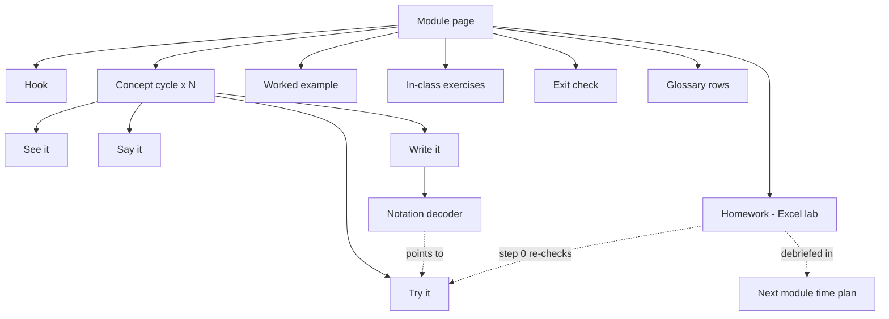
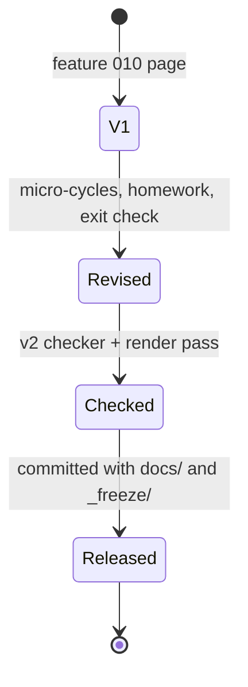

# Data Model: Concrete-to-Abstract Pedagogy — Data Description

**Feature**: `012-data-description-pedagogy` | **Date**: 2026-10-13

This feature has no database. Its "entities" are the content units of a
module page and the relationships between them. Structural rules are
enforced by [contracts/module-page-contract-v2.md](./contracts/module-page-contract-v2.md).

## 1. Entities

### Module page (`teaching/data-description/modules/module-NN.qmd`)

| Field | Description | Rule |
|---|---|---|
| `business_question` | Intro paragraph | Present, before `## Learning objectives` |
| `objectives` | Measurable bullets | ≥ 3; concept/notation verbs (compute by hand, read, write, interpret); Excel verbs move to homework objectives |
| `time_plan` | Table of blocks | Sums to 180; no row starting with `Excel lab`; ≤ 5-min `Excel preview` allowed; `Homework debrief` row (≤ 10) when the previous module had homework |
| `hook` | Concrete business contrast | First subsection of `## Theory` |
| `concepts[]` | Ordered core concepts | Each has one micro-cycle (§1 Concept cycle) |
| `worked_example` | Full Wandering Fork data | Numbers unchanged vs feature 010 |
| `derivation` | Collapsible proof | ≥ 1 (T-VI) |
| `visual_intuition` | Geometric reading | Present (T-VII) |
| `demo` | Shinylive app or TODO | Kept as is (T-IV) |
| `exercises_in_class[]` | By-hand exercises | ≥ 3, incl. ≥ 1 formula → words and ≥ 1 words → formula |
| `common_mistakes` | Warning callout | Kept |
| `exit_check` | 3–5 questions | Concept/notation only; collapsible answers |
| `homework` | Excel lab | See §1 Homework |
| `further_reading` | OpenStax + Khan Academy | Kept |

### Concept cycle

| Field | Description | Rule |
|---|---|---|
| `try_it` | Prompt + table with blanks on a mini-dataset | ≤ 6 values; arithmetic ≤ 5 min by hand; answer in collapsible callout |
| `see_it` | Picture of the same numbers | Figure, number line or table; never skipped |
| `say_it` | One plain-language sentence | Precedes the formal callout |
| `write_it` | Definition/formula callout | Existing callout text kept (T-I); placed after `try_it` |
| `decoder` | Notation decoder | Required for every formula callout; every symbol in the formula appears in its table |

A concept already defined in an earlier module (e.g., IQR) uses a
**recall** cycle: `try_it` + one-line reminder + link to its module; no
decoder required unless the formula is shown again.

### Notation decoder

| Field | Description |
|---|---|
| `symbol` | e.g., $x_i$, $\bar{x}$, $n$, $\sum$, $s^2$ |
| `read_aloud` | e.g., "x sub i", "x-bar", "add up for i from 1 to n" |
| `in_our_example` | Pointer to a number or column of the `try_it` table |
| `sentence` | The whole formula read as one sentence |

### Exit check

3–5 questions; at least one "say in words", one "read/write notation",
one quick calculation on ≤ 5 values. No Excel question.

### Homework (Excel lab)

| Field | Rule |
|---|---|
| `intro` | Estimated time (≤ 60 min), where to do it (any spreadsheet app or campus room), follow-up (debrief at start of next module) |
| `using_excel` | Former `## Using Excel` table, unchanged, as `### Using Excel` |
| `step_0` | Re-enter the in-class mini-dataset and confirm the hand results with Excel |
| `items[]` | Former Excel exercises, `#### Homework k (Excel) — …`, contents unchanged |

### Module template (`specs/012-data-description-pedagogy/module-template.md`, US3)

Documents the section order, micro-cycle, element treatments and time-
plan model, with Module 6 as the reference example.

### Fidelity map (per revised module)

| Old block | New location | Change |
|---|---|---|
| e.g., Exercise 4 (Excel) | Homework 1 (Excel) | Moved, renumbered, content unchanged |

Kept in `specs/012-data-description-pedagogy/fidelity-record.md`
(one table per module) and referenced in the commit message (T-I).

## 2. Relationships

## 3. Module state transitions

A module is checked with the **v1** checker while in `V1`, and with the
**v2** checker from `Revised` on (research R7).

## 4. Module 6 content map (old → new)

| Old block (feature 010) | New location | Change |
|---|---|---|
| Intro "business question" (Harbour mean €628.34) | Intro, kept; extended to point at the two-truck hook | Reworded lead-in |
| Learning objectives (4 bullets) | Kept; reworded around concept/notation; Excel objective moved to homework intro | Reworded |
| Time plan (75 / 50 / 55) | New plan (research R5) | Replaced |
| Theory › Range and IQR (definition callout) | Concept 1 `write_it`, after Trucks A/B range `try_it`; IQR as recall | Re-sequenced |
| Theory › Sample variance and SD (formula callout + plain words) | Concept 2 `write_it` after deviation table, with decoder | Re-sequenced |
| "Why $n-1$" warning | Kept after decoder; preceded by "4 of 5 deviations are free" | Re-sequenced, intuition added |
| Theory › CV (formula callout) | Concept 3 after "is €200 a lot?" `try_it` (Trucks A/B CV) | Re-sequenced |
| Theory › Shortcut formula | Concept 4 after Truck A shortcut `try_it` | Re-sequenced |
| Worked example (Steps 1–4, values table) | Unchanged | — |
| Interpreting $CV$ table | Unchanged (stays in worked example) | — |
| Using Excel table + sample-vs-population note + `tblFork` tip | `## Homework — Excel lab › ### Using Excel` | Moved |
| Proof / derivation (shortcut) | Unchanged | — |
| Visual intuition | Unchanged; cross-references the "See it" figure | Small addition |
| Interactive demo (Shinylive) | Unchanged | — |
| Exercise 1–3 (by hand) | Exercises 1–3 (by hand), unchanged | — |
| *(new)* | Exercises 4–5: formula → words, words → formula ($\sum$) | Added |
| Exercise 4 (Excel) Campus | Homework 1 (Excel) | Moved |
| Exercise 5 (Excel) SUMSQ | Homework 2 (Excel) | Moved |
| Exercise 6 (Excel) Payroll | Homework 3 (Excel) | Moved |
| Common mistakes | Unchanged | — |
| *(new)* | `## Exit check` | Added |
| Further reading | Unchanged | — |

Glossary additions (research R10): $x_i$ and $\sum_{i=1}^{n}$
(introduced in Module 4, where the mean formula already uses them) and
$x_i-\bar{x}$ (introduced in Module 6).

## 5. French stub pages (FR-021)

| Field | Rule |
|---|---|
| Path | `fr/teaching/data-description/modules/<same file name>.qmd`, one per English page in `teaching/data-description/modules/` |
| Front matter | French `title`, `date-modified`; `lang: fr` comes from `fr/teaching/_metadata.yml` |
| Body | `.callout-note` `## Contenu en préparation` + one sentence + a link to the English page (relative path `../../../../teaching/data-description/modules/<file>.qmd`) |
| Navigation | Listed in a `fr-data-description` sidebar block in `_quarto.yml`, after `fr/teaching/data-description/index.qmd` |
