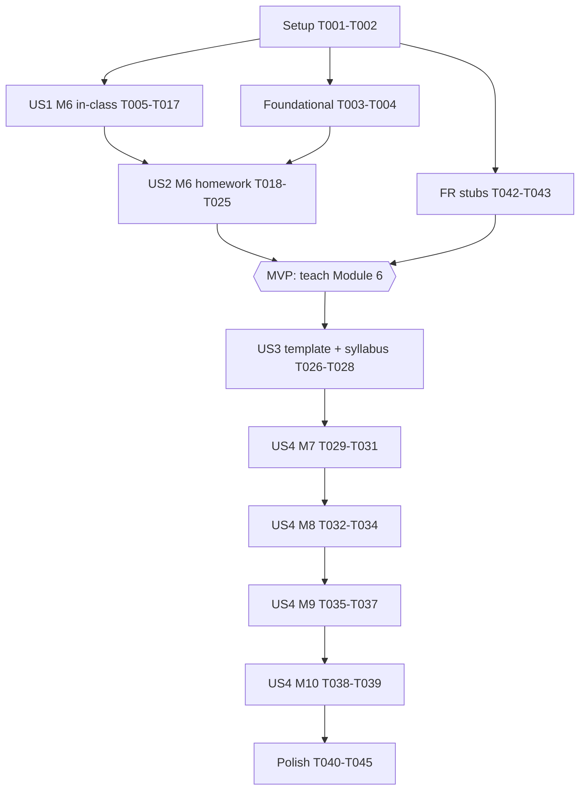

---

description: "Task list for the concrete-to-abstract revision of the Data Description course"
---

# Tasks: Concrete-to-Abstract Pedagogy — Data Description

**Input**: Design documents from `/specs/012-data-description-pedagogy/`

**Prerequisites**: plan.md, spec.md, research.md, data-model.md,
contracts/module-page-contract-v2.md, quickstart.md

**Tests**: No automated test suite was requested. Validation is the v2
structure checker, NumPy number checks, `quarto render`, and the manual
walkthrough in [quickstart.md](./quickstart.md).

**Organization**: Tasks are grouped by user story. US1 and US2 (both P1)
together form the Module 6 MVP, due **before the next class**.

## Format: `[ID] [P?] [Story] Description`

- **[P]**: Can run in parallel (different files, no dependencies)
- **[Story]**: US1–US4 from spec.md
- Paths are relative to the repository root `/home/guillaume/www`
- `M6` = `teaching/data-description/modules/module-06.qmd`
- Render single files with
  `PROFILE_README_RUNNING=1 quarto render <file> --quiet` (research R12)
- Prose wrapped at 80 characters; math with `$…$` / `$$…$$`; no `style=`,
  no `<style>`, no new callout classes (contract v2)

---

## Phase 1: Setup

**Purpose**: Baseline so fidelity and "unchanged numbers" can be proven.

- [X] T001 Record the v1 baseline: run `.venv/bin/python specs/010-data-description-10-modules/check_modules.py` on `teaching/data-description/modules/module-0{6,7,8,9}.qmd` and `module-10.qmd`, and paste the summary at the top of a new `specs/012-data-description-pedagogy/fidelity-record.md` under `## Baseline (before revision)`
- [X] T002 [P] Add to `specs/012-data-description-pedagogy/fidelity-record.md` a `## Module 6` section containing the old → new table from data-model.md §4 with an empty `Verified` column (one row per old block: intro, objectives, time plan, 4 theory subsections, "Why n−1", worked example, Interpreting CV, Using Excel, derivation, visual intuition, demo, Exercises 1–6, common mistakes, further reading)

---

## Phase 2: Foundational (Blocking Prerequisites)

**Purpose**: Checkers that every module revision relies on.

**⚠️ CRITICAL**: Complete before the US1/US2 validation tasks.

- [X] T003 Create `specs/012-data-description-pedagogy/check_modules_v2.py` (Python 3, stdlib only, same CLI as the v1 checker: file arguments, exit 1 on any FAIL, `OK`/`FAIL`/`WARN` lines) implementing contract v2: (a) H2 headings in this order: `## Learning objectives`, `## Time plan`, `## Theory`, `## Worked example`, `## Proof / derivation`, `## Visual intuition`, `## Interactive demo`, `## Exercises`, `## Common mistakes`, `## Exit check`, `## Homework — Excel lab`, `## Further reading`; (b) time-plan table: sum of all block rows except `**Total**` = 180, no block label starting with `Excel lab`, at most one `Excel preview` row with ≤ 5 minutes, `Homework debrief` ≤ 10 when present, plus a `--needs-debrief` flag that makes the `Homework debrief` row mandatory; (c) the first `.callout-tip` inside `## Theory` appears after the first `#### Try it` heading; (d) every `.callout-tip` inside `## Theory` is followed, before the next `###` heading, by a `.callout-note` whose title starts `#### Notation decoder`; (e) no heading containing `(Excel)` before `## Homework — Excel lab`; (f) `## Exercises` has ≥ 3 `#### Exercise k (by hand)` callouts with `collapse="true"`; (g) `## Exit check` has 3–5 numbered questions and ≥ 1 `.callout-caution collapse="true"`; (h) the homework section contains `Estimated time:`, `Follow-up:`, `### Using Excel`, `### Step 0 — check your class results`, ≥ 1 `#### Homework k (Excel)`; (i) the v1 rules for collapsible proof, OpenStax + Khan Academy, demo or `TODO:`, no inline styles, 80-char warnings (skip lines inside ``` fences including `{ojs}` and `{shinylive-python}`); (j) a `--synthesis` flag (contract v2 "Synthesis module exception", Module 10) that waives rules (c), (d) and the formula ↔ words part of (f), while still requiring ≥ 1 `#### Exercise k (by hand)` and every other rule
- [X] T004 [P] Make the v1 time-plan check tolerant of extra rows in `specs/010-data-description-10-modules/check_modules.py`: in the table branch, sum the minutes of every row whose second cell is an integer, except the `**Total**` row, instead of only the first three `Theory|Excel lab|Exercises` rows (needed so unrevised Modules 7–10 still pass after a `Homework debrief` row is added, research R8); re-run it on Modules 7–10 and confirm the result matches T001

**Checkpoint**: `check_modules_v2.py teaching/data-description/modules/module-06.qmd` runs and reports FAILs (the page is not revised yet). That's expected.

---

## Phase 3: User Story 1 — Concrete-first dispersion in Module 6 (Priority: P1) 🎯 MVP

**Goal**: Every Module 6 concept is built from Trucks A/B by hand and
shown as a picture before its formula, and every formula has a notation
decoder. Ends with the exit check.

**Independent Test**: Read M6 top to bottom: no formula callout before
the first *Try it*, every `.callout-tip` followed by a *Notation
decoder*, the worked-example values 478.97 / 18,793.33 / 137.09 /
21.82% unchanged, exit check present (spec US1 acceptance 1–5).

Reference numbers (research R2, verified):
Truck A "Steady" 590, 610, 630, 630, 640 → mean 620, range 50,
deviations −30, −10, 10, 10, 20, squares 900, 100, 100, 100, 400,
Σ = 1,600, $s^2$ = 400, $s$ = 20, $CV$ = 3.23%, $\sum x_i^2$ = 1,923,600,
$n\bar{x}^2$ = 1,922,000. Truck B "Erratic" 370, 470, 670, 720, 870 →
mean 620, range 500, deviations −250, −150, 50, 100, 250, squares
62,500, 22,500, 2,500, 10,000, 62,500, Σ = 160,000, $s^2$ = 40,000,
$s$ = 200, $CV$ = 32.26%, $\sum x_i^2$ = 2,082,000.

### Implementation for User Story 1

All M6 tasks edit one file, so run them in order. T016 (glossary) can
run in parallel.

- [X] T005 [US1] In M6, set `date-modified: 2026-10-13`; keep the intro business question (Harbour mean €628.34) and add a last sentence leading into the hook ("Let's start with two trucks small enough to compute by hand."); rewrite `## Learning objectives` to ≥ 3 measurable concept/notation bullets: explain in words what range, IQR, $s$ and $CV$ measure; compute range, $s^2$ and $s$ by hand with a deviation table; read and write $\sum$ notation and the variance formula in words; compute and interpret $CV$; use the shortcut formula. Keep the calculator objective, and move the Excel objective to the homework intro (T018)
- [X] T006 [US1] Replace the M6 `## Time plan` table with the research R5 table exactly: Hook 10, Concrete build 45, Notation 25, Relative spread 20, Worked example 20, Practice 45, Exit check 10, Excel preview 5, **Total** 180, keeping the third "What you do" column from R5
- [X] T007 [US1] Add the first `## Theory` subsection to M6, `### Same mean, different days`: a table of Truck A and Truck B daily revenue (5 days each, values above), the fact that both means are €620, and the question "Which truck would you rather manage, and why?". No formula and no callout
- [X] T008 [US1] Restructure M6 `### Range and interquartile range` into the micro-cycle: **Try it** (table: Truck, max, min, max − min with `?` blanks) → `.callout-caution collapse="true"` `#### Try it — check your answer` (50 and 500; "B's best and worst days are 10× further apart") → **See it** (refer to step 1 of the OJS figure added in T010) → `In plain words:` line → the existing definition `.callout-note` kept verbatim → IQR as a **recall**: one sentence plus a link to `module-05.qmd`, no new computation. Keep the existing "In plain words" paragraph (merge, don't duplicate)
- [X] T009 [US1] Restructure M6 `### Sample variance and standard deviation`: **Try it** deviation table for Truck A with columns $x_i$, $x_i-\bar{x}$, $(x_i-\bar{x})^2$ and a Total row (blanks `?`), then "Your turn: Truck B" → collapsible `#### Try it — check your answer` with both completed tables → a prompt "What is the total of the deviation column? Why is it always 0?" with a short explanation (positives and negatives cancel, which is why we square) → the "only 4 of the 5 deviations are free" intuition (given −30, −10, 10, 10 the last must be +20, so we divide by $n-1=4$) → divide 1,600/4 = 400 and √400 = 20 (B: 40,000 and 200) → **See it** (steps 2–3 of the T010 figure) → `In plain words:` line → the existing formula `.callout-tip` kept verbatim → a `.callout-note` `#### Notation decoder — sample variance and standard deviation` with a table `Symbol | Read aloud | In our example` covering $n$ (5), $x_i$ ("x sub i", e.g. $x_1=590$), $\bar{x}$ ("x-bar", 620), $x_i-\bar{x}$ (deviation column), $(x_i-\bar{x})^2$ (squares column), $\sum_{i=1}^{n}$ ("add up for i from 1 to n", Total row = 1,600), $\frac{1}{n-1}$ (÷4), $s^2$ (400 €²), $s$ (20 €), followed by `Whole formula as a sentence:`. Then the existing "In plain words" paragraph and the "Why $n-1$" `.callout-warning`, kept verbatim
- [X] T010 [US1] Insert in M6 (inside the variance subsection, at the **See it** step) an `{ojs}` block with `//| echo: false` that hard-codes Trucks A/B and offers `viewof step = Inputs.radio(["1 · Dots", "2 · Deviations", "3 · Squares"], {value: "1 · Dots", label: "Show"})`. Step 1: Plot dot chart, x = revenue (€, shared domain about 350–900), y = truck (two rows), dashed `darkorange` rule at x = 620, `steelblue` dots. Step 2: adds a segment from each dot to 620, text labels with the signed deviation, colour by sign, and a caption computed in JS: "Sum of deviations: A = 0, B = 0". Step 3: one facet per truck drawing each deviation as a square of side |x_i − x̄| (rect marks, equal x/y scales), with a caption computed in JS: "Sum of squares: A = 1,600 · B = 160,000". All values must be computed from the arrays (no hard-coded totals) and must match the reference numbers. Use Plot options for colours and no `style=` in any `html` template. Follow the OJS conventions of `teaching/mathematical-fundamentals/module-4.qmd`
- [X] T011 [US1] Restructure M6 `### Coefficient of variation`: **Try it** "Truck B's $s$ is €200. Is that a lot? Compute $s/\bar{x}$ for both trucks." → collapsible answer (3.23% vs 32.26%; then €200 against a €620 mean vs €20 against €620; relate to the existing CV bands: A low, B moderate, near high) → `In plain words:` → the existing CV `.callout-tip` kept verbatim → `.callout-note` `#### Notation decoder — coefficient of variation` covering $CV$, $s$ (20 / 200), $\bar{x}$ (620), $\times 100\%$, plus a sentence. Keep the existing "In plain words" paragraph
- [X] T012 [US1] Restructure M6 `### Shortcut (computational) formula for variance`: **Try it** on Truck A: compute $\sum x_i^2$ (1,923,600), $n\bar{x}^2 = 5\times620^2$ (1,922,000), the difference (1,600), ÷4 (400), "same as the deviation table" → collapsible answer, adding the observation that two large, nearly equal numbers are subtracted, so rounding $\bar{x}$ is dangerous (this links to the existing worked-example warning) → `In plain words:` → the existing shortcut `.callout-tip` kept verbatim (including its `SUMSQ` sentence) → `.callout-note` `#### Notation decoder — variance shortcut` covering $\sum_{i=1}^{n} x_i^2$ (square each value, then add) vs $(\sum x_i)^2$ (not the same!), $n\bar{x}^2$, $\frac{1}{n-1}$, plus a sentence
- [X] T013 [US1] In M6 `## Visual intuition`, keep the existing paragraph and add 2–3 sentences linking it to step 3 of the OJS figure ("each square's area is a squared deviation; variance is their total divided by $n-1$, the average square, and $s$ is the side of that average square"). Leave `## Worked example`, `### Interpreting $CV$`, `## Proof / derivation` and `## Interactive demo` byte-for-byte unchanged
- [X] T014 [US1] In M6 `## Exercises`, keep Exercises 1–3 (by hand) verbatim and add two `.callout-caution collapse="true"` exercises: `#### Exercise 4 (by hand) — Formula to words (click for solution)`: (a) read $\frac{1}{n-1}\sum_{i=1}^{n}(x_i-\bar{x})^2$ aloud as one sentence; (b) for $x_1=4, x_2=6, x_3=8$ compute $\sum_{i=1}^{3} x_i$ (18) and $\sum_{i=1}^{3} x_i^2$ (116), and say why $(\sum x_i)^2 = 324 \neq 116$. `#### Exercise 5 (by hand) — Words to formula (click for solution)`: write in symbols (a) "add up the squares of all $n$ observations" → $\sum_{i=1}^{n} x_i^2$; (b) "the standard deviation as a percentage of the mean" → $CV = s/\bar{x}\times100\%$; (c) "the distance between the 3rd observation and the mean" → $x_3-\bar{x}$. Move the three `(Excel)` exercises out of this section (handled in T021, so don't delete them before T021)
- [X] T015 [US1] Add `## Exit check` to M6 after `## Common mistakes`: one intro line ("5 minutes, no calculator needed except Q4") and 5 numbered questions: (1) In one sentence, what does $s$ measure? (2) Why does $\sum(x_i-\bar{x})$ always equal 0? (3) Read $s^2=\frac{1}{n-1}\sum(x_i-\bar{x})^2$ as a sentence. (4) Compute $s^2$ for 2, 4, 4, 6, 9 (mean 5, squares 9, 1, 1, 1, 16, total 28, $s^2 = 7$). (5) Revenue in € and items sold: which indicator compares their spread fairly, and why? ($CV$, unit-free). Then one `.callout-caution collapse="true"` `#### Exit check — answers` with all answers. No Excel question
- [X] T016 [P] [US1] Add three rows to the "Univariate center, dispersion, and shape" table of `teaching/data-description/modules/glossary.qmd`, placed before the $s^2$ row: $x_i$ | $i$-th observation | the value of observation number $i$ (e.g. day $i$'s revenue) | — | **Module 4** ; $\sum_{i=1}^{n}$ | Summation | add up the expression for $i=1, 2, \dots, n$ | "capital sigma" | **Module 4** ; $x_i-\bar{x}$ | Deviation from the mean | how far, and in which direction, observation $i$ is from the mean; deviations always sum to 0 | — | **Module 6** (the Module 4 rows already use $x_i$ and $\sum$ in the mean formula, research R10). Wrap prose per glossary style (table rows are exempt)
- [X] T017 [US1] Render M6 with `PROFILE_README_RUNNING=1 quarto render teaching/data-description/modules/module-06.qmd --quiet` and fix any OJS or math errors. Confirm the OJS figure's three steps show the reference totals (0 / 0, then 1,600 / 160,000)

**Checkpoint**: The in-class part of Module 6 can be taught (the Excel exercises are still somewhere on the page until US2).

---

## Phase 4: User Story 2 — Excel lab as homework in Module 6 (Priority: P1)

**Goal**: The Excel lab is a self-contained homework section on M6, and
the follow-up debrief is scheduled in Module 7.

**Independent Test**: The M6 time plan has no Excel lab and totals 180;
former Exercises 4–6 (Excel) and their solutions are present as
Homework 1–3; a student who missed class can do the homework from the
page alone; the Module 7 time plan has a ≤ 10-min debrief (spec US2
acceptance 1–4).

### Implementation for User Story 2

- [X] T018 [US2] Add `## Homework — Excel lab` to M6 between `## Exit check` and `## Further reading`, with an intro paragraph containing: the homework objective ("reproduce, in Excel, every indicator you computed by hand in class with `VAR.S`, `STDEV.S`, `SUMSQ` and a $CV$ formula"), `Estimated time: about 50–60 minutes.`, where to do it ("any spreadsheet application, at home or in a campus computer room"), and `Follow-up: 10-minute debrief at the start of [Module 7](module-07.qmd).`
- [X] T019 [US2] Move the whole former M6 `## Using Excel` section (intro sentence with the `excel-functions.qmd` link, the concept → function table, the "Sample vs population" note, the `tblFork`/`FILTER` tip) under the homework section as `### Using Excel`, content unchanged, and delete the old `## Using Excel` H2
- [X] T020 [US2] Add `### Step 0 — check your class results` to the M6 homework: type Truck A and Truck B into two columns, compute `=AVERAGE`, `=MAX(…)-MIN(…)`, `=VAR.S`, `=STDEV.S`, `=STDEV.S(…)/AVERAGE(…)`, and `=(SUMSQ(…)-COUNT(…)*AVERAGE(…)^2)/(COUNT(…)-1)`, and confirm they equal the hand results (620; 50 / 500; 400 / 40,000; 20 / 200; 3.23% / 32.26%; 400). Add a collapsible `.callout-caution collapse="true"` `#### Step 0 — expected results` listing these values and the warning "if your shortcut cell is off, check that you referenced the AVERAGE cell rather than typing a rounded mean"
- [X] T021 [US2] Move former M6 Exercises 4, 5 and 6 (Excel) into the homework, after Step 0, retitled `#### Homework 1 (Excel) — Dispersion for Campus revenue (click for solution)`, `#### Homework 2 (Excel) — Shortcut formula with `SUMSQ` (click for solution)` and `#### Homework 3 (Excel) — Payroll skew: dispersion (click for solution)`. Keep statements and solutions verbatim, and add before each **Solution** at most one `**How to.**` line with the exact steps (e.g., Homework 1: "Filter `franchise` = Campus, or use `FILTER(tblFork[daily_revenue_eur], tblFork[franchise]="Campus")` inside each function"). Confirm no `(Excel)` heading remains above `## Homework — Excel lab`
- [X] T022 [US2] Add the homework debrief to `teaching/data-description/modules/module-07.qmd` (research R8 fallback, done now regardless of the US4 pace): insert the row `| Homework debrief | 10 | Module 6 Excel homework: Step 0 results, questions on Homework 1–3 |` as the first block of its `## Time plan` and reduce `Excel lab` from 50 to 40 so the total stays 180. Set its `date-modified: 2026-10-13`. Run the v1 checker (patched in T004) on it
- [X] T023 [P] [US2] Add one sentence to the module-pattern paragraph of `teaching/data-description/index.qmd` (after "…an Excel lab, …"): "Module 6 pilots a new format in which the Excel lab is done as homework at the end of the module page, so class time goes to concepts, notation and practice by hand; later modules switch to it as they are revised." (research R11; it must stay true while Modules 7–10 still have in-class labs). Don't rewrite the rest yet (US3). Each US4 module task updates this sentence only if the full US3 wording has not yet replaced it
- [X] T024 [US2] Complete the `## Module 6` table in `specs/012-data-description-pedagogy/fidelity-record.md`: fill the actual new location of every old block, mark `Verified ✓` after checking the block on the page, and add rows for the new blocks (hook, Try-it callouts, decoders, OJS figure, Exercises 4–5, exit check, Step 0, glossary rows)
- [X] T025 [US2] Validate M6 per quickstart §1–§5: `check_modules_v2.py teaching/data-description/modules/module-06.qmd` (all OK, exit 0), the NumPy numbers check, the `git diff main` grep for 478.97 / 18{,}793.33 / 137.09 / 21.82 (no deleted lines), a render of M6 + `glossary.qmd` + `index.qmd` + `module-07.qmd` (exit 0), the CDN privacy grep on `docs/teaching/data-description/modules/module-06.html` (flag any third-party OJS/Plot URL to the owner), and the 7-point browser walkthrough with `quarto preview`

**Checkpoint**: 🎯 **Module 6 MVP ready to teach.** Commit the sources with `docs/`.

---

## Phase 5: User Story 3 — Reusable module template and syllabus (Priority: P2)

**Goal**: A documented template so Modules 7–10 can be revised
consistently, and a syllabus that describes the new structure.

**Independent Test**: Someone unfamiliar with the course can tell, from
`module-template.md` alone, which blocks are in class, which are
homework, and in what order the concrete and abstract elements appear.
The syllabus says Excel labs are homework within the 20-hour budget.

### Implementation for User Story 3

- [ ] T026 [P] [US3] Create `specs/012-data-description-pedagogy/module-template.md` containing: (1) the contract v2 section order as a skeleton `.qmd` outline with every heading; (2) the micro-cycle Try it → See it → Say it → Write it → Decoder, with a copy-ready markup snippet for each element, taken from the final Module 6 (Try-it table plus answer callout, decoder table, exit-check block, homework intro with `Estimated time:` / `Follow-up:`, Step 0, `#### Homework k (Excel)`); (3) the recall-cycle rule for concepts from earlier modules; (4) mini-dataset rules (≤ 6 values, whole-number deviations, hand arithmetic ≤ 5 min, verify with NumPy and record in research.md); (5) the "See it" rule (OJS + Plot when a picture adds meaning, otherwise a table or number line; never skipped); (6) the time-plan model (Hook ~10, Concrete build ~45, Notation ~25, …, Exit check 10, optional Excel preview ≤ 5, Homework debrief ≤ 10, total 180); (7) the homework rules (≤ 60 min, all former Excel exercises kept verbatim, renumbered); (8) the per-module revision checklist from contract v2; (9) the Module 10 exception, copied from contract v2 "Synthesis module exception" (waived rules, still-required rules, `--synthesis` checker flag)
- [ ] T027 [US3] Rewrite the relevant parts of `teaching/data-description/index.qmd` (research R11): replace the module-pattern paragraph (lines ~25–29) with the new order (business question, concrete activities by hand, notation decoders, worked example on the shared dataset, derivation, exercises by hand, exit check, Excel lab as homework), replacing the T023 sentence; in learning objectives 2, 3 and 5 keep the Excel function names but phrase them as "by hand in class and in Excel at home"; extend `## Personal work` with "Each module ends with an Excel homework (about 50–60 min), debriefed at the start of the next module; this is about 10 of the 20 hours". Keep `## Recommended Literature` and everything else unchanged. Note in the text that Modules 1–5 still include their original Excel lab
- [ ] T028 [US3] Render `teaching/data-description/index.qmd` with `PROFILE_README_RUNNING=1 quarto render … --quiet` (exit 0) and check the syllabus wording against the actual state of Modules 6–10

**Checkpoint**: Template and syllabus ready. Module revisions in US4 follow `module-template.md`.

---

## Phase 6: User Story 4 — Modules 7–10 rollout (Priority: P3)

**Goal**: Modules 7–10 follow the same approach, released in teaching
order, each before its class.

**Independent Test** (per module): `check_modules_v2.py --needs-debrief <module>` passes; all former Excel exercises are present as Homework items; no worked-example number changed; render exits 0.

**Per-module procedure** (each module's tasks run in order; the
research.md addenda are one file, so they run sequentially across
modules):

### Module 7 — Shape and univariate review

- [ ] T029 [US4] Design and verify hand-friendly mini-datasets for Module 7 (≤ 6 values each: one symmetric, one right-skewed, one left-skewed, with mean, median and mode easy to compute and clearly ordered; compute mean, median, mode, $s$, Fisher-Pearson `SKEW`-equivalent (adjusted), Pearson $(\bar{x}-Mo)/s$, $3(\bar{x}-Me)/s$ and Yule-Kendall with `QUARTILE.EXC` positions), check with `.venv/bin/python` (NumPy/SciPy `skew(bias=False)`), and record them as `## R13. Module 7 mini-datasets` in `specs/012-data-description-pedagogy/research.md`
- [ ] T030 [US4] Restructure `teaching/data-description/modules/module-07.qmd` per `module-template.md`: hook (two Wandering Fork distributions with the same mean and $s$ but different shapes), concept cycles for symmetry vs skew (mean/median/mode order), Fisher-Pearson skewness, Pearson coefficients, Yule-Kendall (recall quartiles from Module 5), reading skew from charts. Every existing formula callout is kept verbatim and gets a decoder. Add an OJS "See it" figure (dot or histogram of the three mini-datasets with mean/median/mode markers) if it adds meaning. Add ≥ 1 formula → words and ≥ 1 words → formula exercise and an exit check. Move all `(Excel)` exercises (including the full univariate workflow) and `## Using Excel` into `## Homework — Excel lab` with Step 0, `Estimated time:` (≤ 60 min) and `Follow-up:` Module 8. Keep the `Homework debrief` row from T022 and replace the Excel lab minutes with in-class blocks (total 180)
- [ ] T031 [US4] Add the Module 7 homework debrief row (`| Homework debrief | 10 | Module 7 Excel homework … |`, taken from Excel lab) to `teaching/data-description/modules/module-08.qmd`; add new symbols (if any) to `teaching/data-description/modules/glossary.qmd`; add a `## Module 7` old → new table to `specs/012-data-description-pedagogy/fidelity-record.md`; validate with `check_modules_v2.py --needs-debrief teaching/data-description/modules/module-07.qmd`, the v1 checker on module-08, and a render of both

### Module 8 — Contingency tables and scatter plots

- [ ] T032 [US4] Design and verify Module 8 mini-data (a 2×2 or 2×3 contingency table with small round counts, e.g. franchise × weather, giving clean marginal and conditional percentages; 5 hand-plottable (x, y) pairs) and record as `## R14. Module 8 mini-datasets` in `specs/012-data-description-pedagogy/research.md`
- [ ] T033 [US4] Restructure `teaching/data-description/modules/module-08.qmd` per `module-template.md`: hook, concept cycles for contingency table, marginal distributions, conditional distributions (decoders for $n_{ij}$, $n_{i\cdot}$, $n_{\cdot j}$ and conditional-frequency notation as already used on the page), scatter plot (OJS "See it" if useful); formula ↔ words exercises; exit check; homework with all `(Excel)` exercises, `### Using Excel`, Step 0, `Estimated time:`, `Follow-up:` Module 9; keep its Module 7 debrief row; total 180
- [ ] T034 [US4] Add the Module 8 debrief row to `teaching/data-description/modules/module-09.qmd`; update `glossary.qmd` and `fidelity-record.md` (`## Module 8`); validate with `check_modules_v2.py --needs-debrief` on module-08, the v1 checker on module-09, and renders

### Module 9 — Covariance, correlation, regression

- [ ] T035 [US4] Design and verify Module 9 mini-data (5 (x, y) pairs with integer means and integer products of deviations, giving a clean $\text{Cov}$, $r$, slope and intercept; e.g. temperature vs items sold) with NumPy (`np.cov`, `np.corrcoef`, `np.polyfit`), recorded as `## R15. Module 9 mini-datasets` in `specs/012-data-description-pedagogy/research.md`
- [ ] T036 [US4] Restructure `teaching/data-description/modules/module-09.qmd` per `module-template.md`: hook, concept cycles with a deviation-product table ($x_i-\bar{x}$, $y_i-\bar{y}$, product, Total) leading to covariance, then correlation (as standardised covariance), $r^2$, regression line through $(\bar{x},\bar{y})$; decoders for every formula; OJS "See it" (scatter with quadrant shading by deviation sign, reusing the Module 6 deviation idea); keep the existing interactive demo (already converted from Shinylive to OJS on 2026-10-13, see fidelity-record.md); formula ↔ words exercises; exit check; homework with all `(Excel)` exercises (including Analysis ToolPak), Step 0, `Estimated time:`, `Follow-up:` Module 10; keep its debrief row; total 180
- [ ] T037 [US4] Add the Module 9 debrief row to `teaching/data-description/modules/module-10.qmd`; update `glossary.qmd` and `fidelity-record.md` (`## Module 9`); validate with `check_modules_v2.py --needs-debrief` on module-09, the v1 checker on module-10, and renders

### Module 10 — Synthesis and mock exam

- [ ] T038 [US4] Revise `teaching/data-description/modules/module-10.qmd` per contract v2 "Synthesis module exception" (as copied in `module-template.md`): keep the Lakeside Bakery walkthrough, the 90-min mock exam and its debrief in class; turn "Replicate the walkthrough in Excel" (former 30-min Excel lab) and any `(Excel)` exercises into `## Homework — Excel lab` with `### Using Excel`, Step 0 (re-check the walkthrough's headline numbers), `Estimated time:` (≤ 60 min) and `Follow-up:` (self-check with solutions, as there's no next module); reallocate the 30 min to in-class blocks (e.g., notation recap across Modules 4–9 using the decoders) with the debrief row from T037; add an exit check (5 notation/concept questions spanning the course); total 180
- [ ] T039 [US4] Update `fidelity-record.md` (`## Module 10`); validate with `check_modules_v2.py --needs-debrief --synthesis teaching/data-description/modules/module-10.qmd` (flag built in T003 rule (j)), then render

**Checkpoint**: Modules 6–10 all pass the v2 checker.

---

## Phase 7: Polish & Cross-Cutting Concerns

- [ ] T040 [P] Check that `teaching/data-description/modules/excel-functions.qmd` still lists every function used in the homework sections of Modules 6–10 (`VAR.S`, `STDEV.S`, `SUMSQ`, `SKEW`, …), and add any missing English/French pair
- [ ] T041 [P] Re-read `teaching/data-description/index.qmd` against the final state of Modules 6–10 and remove the "Modules 1–5 still include their original Excel lab" note only if those modules were revised later
- [X] T042 [P] Create one French stub per English page in `teaching/data-description/modules/` (13 files: `module-01.qmd` … `module-10.qmd`, `dataset.qmd`, `glossary.qmd`, `excel-functions.qmd`) at `fr/teaching/data-description/modules/<same name>.qmd` (FR-021, data-model §5). Front matter: French `title` (e.g. "Module 6 — Dispersion", "Jeu de données", "Glossaire", "Fonctions Excel") and `date-modified: 2026-10-13`, with no `lang:` (inherited from `fr/teaching/_metadata.yml`). Body, modelled on `fr/teaching/data-description/index.qmd`: `::: {.callout-note}` / `## Contenu en préparation` / "Cette page n'est pas encore traduite en français." / `[Consulter la version anglaise](../../../../teaching/data-description/modules/<same name>.qmd)` / `:::`. Also add the same link sentence to `fr/teaching/data-description/index.qmd` (`../../../teaching/data-description/index.qmd`)
- [X] T043 Register the stubs in `_quarto.yml`: add a `#--- FR --- Data Description` sidebar block `id: fr-data-description`, `title: "Description des données"`, listing `fr/teaching/data-description/index.qmd` first, then the ten module stubs, then a `section: "**Ressources**"` with the dataset, glossary and Excel-functions stubs, modelled on the `fr-mathematics-finance` block. Render `fr/teaching/data-description/` with `PROFILE_README_RUNNING=1 quarto render fr/teaching/data-description --quiet` (exit 0) and check in `quarto preview` that the navbar language switcher on `teaching/data-description/modules/module-06.html` reaches the French stub and back
- [ ] T044 Run the full site render `quarto render` (constitution render gate; note it runs the post-render hook that pushes `about.qmd` to the profile repo) and confirm exit 0; then commit the sources with `docs/` (and `_freeze/` if anything changed) in the same commit, referencing `specs/012-data-description-pedagogy/fidelity-record.md` in the message (T-I)
- [ ] T045 After teaching Module 6, record the exit-check results against SC-004 (≥ 80% explain $s$ in a sentence; ≥ 70% compute $s^2$ of 5 values) under `## Classroom notes` in `specs/012-data-description-pedagogy/fidelity-record.md`, and adjust `module-template.md` (timings, Try-it difficulty) before the next module revision

---

## Dependencies & Execution Order

### Phase dependencies

- **Setup (T001–T002)**: start immediately
- **Foundational (T003–T004)**: after Setup. T003 is needed for T025 and all US4 validation; T004 is needed before T022
- **US1 (T005–T017)**: writing can start right after Setup (the checker is only needed for validation)
- **US2 (T018–T025)**: after US1 on the same file (T018–T021 edit M6); T022–T023 touch other files and can start once T004 is done
- **US3 (T026–T028)**: after the MVP (T025), because the template copies the final Module 6 markup
- **US4 (T029–T039)**: after US3. Modules in teaching order 7 → 8 → 9 → 10, since each adds the debrief row to the next module
- **Polish (T040–T045)**: after the desired stories, except T042–T043 (French stubs, Constitution VI). They don't depend on any story and **should ship with the Module 6 MVP commit**. T044 before each release; T045 after the Module 6 class

### User story dependencies



### Within each module

Mini-dataset verified → hook → concept cycles (Try it → See it → Say
it → Write it → Decoder) → exercises → exit check → homework → next
module's debrief row → fidelity record → checker + render.

---

## Parallel Opportunities

- T002 ∥ T001 (different sections; T001 creates the file first, so
  start T002 right after the file exists)
- T004 ∥ T003 (different checker files)
- T016 (glossary) ∥ T005–T015 (M6)
- T023 (index sentence) ∥ T018–T021 (M6 homework)
- T026 (template) ∥ T027 (syllabus)
- T040 ∥ T041
- T042 (French stubs) ∥ all of US1/US2 (different files); T043 after T042
- During US4, the next module's mini-dataset design can overlap with the
  current module's restructure, but research.md edits stay sequential

## Parallel Example: User Story 1

```bash
# Developer/agent A (module page, sequential):
Task: "T005–T015 restructure teaching/data-description/modules/module-06.qmd"
# Developer/agent B (in parallel):
Task: "T016 add x_i, Σ, x_i − x̄ rows to teaching/data-description/modules/glossary.qmd"
Task: "T003 write specs/012-data-description-pedagogy/check_modules_v2.py"
```

---

## Implementation Strategy

### MVP first (before the next class)

1. T001–T002 baseline
2. T003–T004 checkers (in parallel with US1 writing)
3. T005–T017 Module 6 in-class (US1)
4. T018–T025 Module 6 homework + Module 7 debrief row (US2)
5. T042–T043 French stubs + sidebar (Constitution VI, in parallel)
6. **STOP and VALIDATE** with quickstart §1–§5, commit, teach Module 6

If time runs short before class, the **minimum teachable slice** is
T006–T012 + T015 + T018–T021 (time plan, concept cycles with OJS figure,
exit check, homework). T013, T014's new exercises, T016 and T024 can
follow right after class.

### Incremental delivery

- After class 6: T045 (classroom notes) → US3 template
- Before each later class: that module's US4 tasks, released alone

---

## Notes

- Never delete an existing theory callout, worked-example line,
  derivation, demo, exercise or solution. Move and renumber only, and
  log it in `fidelity-record.md` (constitution T-I)
- Same-file tasks are sequential by design. [P] only marks different files
- Commit after each module (sources + `docs/`), not per task
